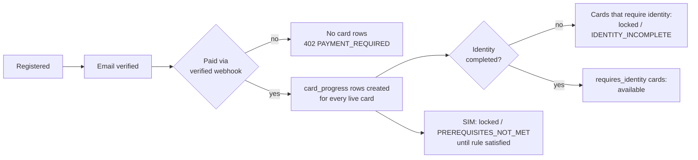
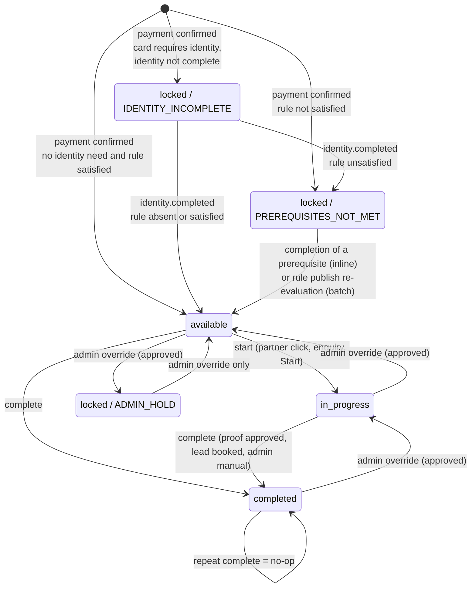

# Card State Machine

| Field | Value |
|-------|-------|
| Status | Review |
| Owner | NIVO Platform team (M06) |
| Last updated | 2026-11-24 |
| Source documents | `docs/design/m06-cards/hld.md`, `docs/design/m06-cards/lld.md` (tables, trigger, jobs), `00-integration-matrix.md` (critical sequences), `00-fmea.md` (`RISK-CARD-RELOCK`, `RISK-CARD-RACE`, `RISK-CARD-PAYWALL-BYPASS`) |
| Code mirror | `packages/shared/src/cards.ts` (pure evaluator and transition table, test-first) and `apps/api/src/modules/cards` (CardEngine) |
| Requirements | REQ-CARD-01…10, REQ-PAY-02, REQ-PART-05 |

This document is the single picture of how a student's card statuses change. If the LLD and this file disagree, the LLD wins and this file is corrected.

## 1. Vocabulary

| Term | Meaning |
|------|---------|
| Card | Admin-defined, versioned item on the dashboard (seed: Blocked Account, SIM, Accommodation, Card 4 "Coming soon") |
| Status (stored per student, per card) | `locked`, `available`, `in_progress`, `completed` (rank 0–3) |
| Display status | Stored status plus the derived `coming_soon` for cards whose live version is of type `coming_soon` (never stored: `CHECK status <> 'coming_soon'`) |
| Lock reason | Present only while `locked`: `IDENTITY_INCOMPLETE`, `PREREQUISITES_NOT_MET`, `ADMIN_HOLD` |
| Milestones | `student_milestones.paid_at`, `identity_completed_at` (set once, never cleared — the identity "latch") |
| Rule | Versioned JSON `{mode: all | any | at_least, requiredCardIds[], min?}` on a target card; first consumer is SIM |
| Grandfathering | A card that has ever left `locked` is never automatically moved back to `locked` (`unlocked_at` marker) |
| Single writer | `CardEngine` is the only code path that writes `card_progress` |

## 2. Preconditions chain (what must happen before a card can open)

Browser return from Stripe never unlocks anything (REQ-PAY-02). Refund closes the paywall at request time but leaves rows untouched (`GAP-CARD-REFUND-ACCESS`).

## 3. Per-card state machine

Rank order for regression checks: `locked 0 < available 1 < in_progress 2 < completed 3`.

### 3.1 Transition table

| # | From | To | Cause (`card_event_cause`) | Guard | Side effects in the same transaction |
|---|------|----|----------------------------|-------|--------------------------------------|
| 1 | (none) | `locked/IDENTITY_INCOMPLETE` | `payment_confirmed`, `fanout_new_card` | Card live, `requires_identity`, no `identity_completed_at` | Event row |
| 2 | (none) | `locked/PREREQUISITES_NOT_MET` | same | Live rule unsatisfied | Event row |
| 3 | (none) | `available` | same | No identity need (or latched) and rule absent/satisfied | `unlocked_at = now()` |
| 4 | `locked/IDENTITY_INCOMPLETE` | `available` | `identity_completed` | Rule absent/satisfied | `unlocked_at`, event, unlock email only when configured |
| 5 | `locked/IDENTITY_INCOMPLETE` | `locked/PREREQUISITES_NOT_MET` | `identity_completed` | Rule unsatisfied | Event (reason change only) |
| 6 | `locked/PREREQUISITES_NOT_MET` | `available` | `prereq_satisfied` / `rule_reeval` | Rule satisfied by the student's Completed set | `unlocked_at`, `unlocked_rule_version_id`, event, **outbox email** `dedupeKey = card_unlocked:{userId}:{cardId}` (SIM uses template `sim_unlocked`) |
| 7 | `available` | `in_progress` | `start` | none | `started_at` |
| 8 | `available`/`in_progress` | `completed` | `complete` | Caller supplies `completion_source` | `completed_at`, event, publish `card.completed` (M05 uses it for the retention anchor), evaluate unlock rules for this student's Locked rows |
| 9 | `completed` | `completed` | `complete` repeat | — | No-op `alreadyCompleted: true` |
| 10 | any | lower rank | `admin_override` | Approved `cards.override` request; `SET LOCAL app.override_approval_id` | Event with approval ref; audit before/after |
| 11 | `locked/ADMIN_HOLD` | `available` | `admin_override` | Only via override | Automatic evaluation ignores `ADMIN_HOLD` |

Completion sources: `proof_approved` (M07), `lead_booked` (M08), `admin_manual`, `admin_override`; `partner_webhook` and `partner_csv` are reserved for Phase 2.

## 4. Seed cards and their rules (provisional until `GAP-CARD-SIM-DEFAULT`)

| Card (slug) | Type | Requires identity | Completion mode | Unlock rule | Retention anchor |
|-------------|------|-------------------|-----------------|-------------|------------------|
| Blocked Account (`blocked-account`) | partner (Expatrio) | Yes | `proof_review` | none | **Yes** (identity deleted 30 days after Completed) |
| SIM (`sim`) | partner (Vodafone) | No | `proof_review` | `all` of {Blocked Account, Accommodation} Completed | No |
| Accommodation (`accommodation`) | accommodation (Roshan) | Yes | `lead_booked` | none | No |
| Card 4 (`card-4`) | coming_soon | — | — | — | No |

Admin may add cards (for example Insurance) as flexible cards, and add them to the SIM rule through the draft → review → publish workflow with an impact preview.

## 5. Grandfathering (REQ-CARD-06) — worked example

Rule v1: SIM requires {Blocked Account, Accommodation}. Student states:

| Student | Blocked Account | Accommodation | SIM |
|---------|-----------------|---------------|-----|
| Asha | completed | completed | available (unlocked under v1) |
| Ben | completed | in_progress | locked/PREREQUISITES_NOT_MET |
| Chen | in_progress | available | locked/PREREQUISITES_NOT_MET |

Admin publishes rule v2: SIM also requires Insurance (new card, Phase 2).

| Student | After publish and re-evaluation | Why |
|---------|---------------------------------|-----|
| Asha | SIM **stays available** | Evaluation queries select only `status = 'locked' AND lock_reason = 'PREREQUISITES_NOT_MET'`; Asha's row is never selected |
| Ben | stays locked (now needs Insurance as well) | Still locked, rule stricter |
| Chen | stays locked | same |
| A new student paying after publish | SIM locked until three cards complete | Rule v2 applies from the first evaluation |

Rule v3 loosens SIM to "any one of {Blocked Account, Accommodation}": the batch job unlocks Ben (Blocked Account completed) and sends one `sim_unlocked` email (dedupe key). Chen stays locked.

**Enforcement is triple:**

1. Automatic evaluation SQL only touches `locked / PREREQUISITES_NOT_MET` rows.
2. Trigger `card_progress_guard` raises `CARD_REGRESSION_FORBIDDEN` for any rank decrease unless `app.override_approval_id` is set, and protects `unlocked_at` and `completed_at` from being cleared or changed.
3. Property tests: for random rule sequences and progress sets, no automatic path lowers a status (T-CARD-02x series) and nightly invariant query finds no regression without an override ID.

## 6. Concurrency and idempotency

| Scenario | Handling |
|----------|----------|
| Parallel completion of the two SIM prerequisites | `completeCard` locks the student's `card_progress` rows in fixed order (`card_id`), evaluates inside the transaction; second transaction sees the unlocked state; unique `dedupeKey` ensures exactly one email |
| Deadlock (`40P01`) | Retry the transaction (bounded) |
| Repeat `complete` | No-op, returns `alreadyCompleted` |
| Webhook replay of `payment.confirmed` | Row creation is `INSERT … ON CONFLICT DO NOTHING`; milestones set only once |
| Rule publish while students complete cards | Batch job `cards.rule.reeval` works per student with the same locking; idempotent re-run |
| Optimistic lock | `card_progress.version` incremented by the trigger; admin override compares expected version |

## 7. Read-path and paywall

| Check | Result |
|-------|--------|
| No session | `401 UNAUTHORIZED` |
| Email not verified | `403 AUTH_EMAIL_NOT_VERIFIED` |
| Terms re-acceptance pending | `403 TERMS_REACCEPT_REQUIRED` |
| Unpaid | `402 PAYMENT_REQUIRED` (or `202 PAYMENT_PROCESSING` while confirming) |
| Card requires identity and identity incomplete | `403 IDENTITY_INCOMPLETE` |
| Card locked (prerequisites or hold) | `403 CARD_LOCKED`; body returns only title, summary, lock reason and prerequisite titles |
| Unknown or unpublished slug | `404 NOT_FOUND` |
| Available / In progress / Completed | Full content, CTA, launch capability (M07) |

Guard order: auth → verified → terms current (M03) → paywall (M04 `isPaid` per request, no cached flag) → card access rules. Every student route is registered with an explicit `paywall: 'required' | 'exempt'` flag; lint and a route-matrix test fail otherwise.

## 8. Events in and out

| Direction | Event | Counterpart | Contract |
|-----------|-------|-------------|----------|
| In | `payment.confirmed {userId, paidAt}` | M04 | Same transaction as the paid upsert; creates rows and milestone |
| In | `payment.revoked {userId}` | M04 | Logged; statuses untouched |
| In | `identity.completed {userId, completedAt}` | M05 | Sets latch; unlocks identity-gated cards |
| In | `identity.deleted {userId, reason}` | M05 | Received and ignored for status purposes |
| In | `startCard`, `completeCard` | M07, M08 | Called inside their transactions |
| In | `overrideCard` | M09 | Approved request required |
| Out | `card.completed {userId, cardId, isRetentionAnchor, completedAt}` | M05, M10 | Retention anchor and funnel |
| Out | Outbox rows `sim_unlocked`, `card_unlocked`, `card_available` | M11 | Dedupe-keyed, same transaction |
| Out | `card_status_events` rows | M09 timeline, M10 funnel via projection | Append-only |

## 9. Coming-soon cards and waitlist

`card_type = 'coming_soon'` produces no `card_progress` rows. Students press *Notify me* (`notify_requests`). On go-live (publish of a non-coming-soon version) a fan-out job creates `card_progress` rows for paid students (`fanout_new_card`) and queues one `card_available` email per waiting student (rate limited).

## 10. Admin override (the only backward path)

1. Admin with `cards:override`-class permission raises a request with reason (approval policy `cards.override`).
2. A different approver approves with step-up.
3. Handler verifies the approval row is unconsumed, executes `SET LOCAL app.override_approval_id`, performs the change, writes `card_status_events` (`admin_override`) and audit before/after.
4. Nothing else — not migrations, not scripts — may regress a row; the trigger blocks it.

## 11. Test mapping

| Concern | Test IDs (M06 LLD) |
|---------|--------------------|
| Four cards with tags, Card 4 coming soon | T-CARD-001 |
| SIM unlock by rule (all/any/at least N) | T-CARD-010… |
| Admin-added cards, publish workflow | T-CARD-020… |
| Paywall by URL/API, route-matrix | T-CARD-030… |
| Grandfathering and rule-change simulations | T-CARD-040… |
| Concurrency, outbox exactly-once | T-CARD-050… |
| Override, waitlist, fan-out | T-CARD-060… |
| E2E | T-E2E-03, 05, 06, 07 |
