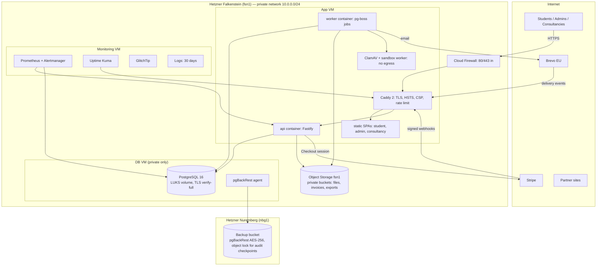

# Deployment Architecture

| Field | Value |
|-------|-------|
| Status | Review |
| Owner | NIVO Engineering (M01 Infrastructure) |
| Last updated | 2026-11-24 |
| Decisions | ADR-001 (stack), ADR-004 (encryption), ADR-005 (Hetzner Germany), `docs/design/m01-infra/lld.md` |
| Requirement | REQ-SEC-01: hosting in Germany, HTTPS, encryption |

## 1. Principles

1. All personal data processed and stored in **Germany** (Hetzner fsn1 for compute/DB, nbg1 for backups). Helsinki is excluded (T-INFRA-024).
2. Only ports 80/443 reach the internet; the database is reachable only from the app VM private IP.
3. Everything encrypted: TLS in transit, LUKS on volumes, application-level AES-256-GCM for identity data, pgBackRest encrypted repo.
4. Infrastructure as code (OpenTofu), reproducible images, signed artefacts, secrets in SOPS (never in the repo or DB).
5. Staging mirrors production topology at lower scale and contains **synthetic data only**.
6. Expand → deploy → contract migrations; every deploy has a pre-backup and a health gate with automatic rollback.

## 2. Production topology

### 2.1 Hosts and DNS

| Host | Purpose | Cookie scope |
|------|---------|--------------|
| `app.<domain>` | Student SPA + API | `__Host-nivo_sid`, `__Host-nivo_csrf` |
| `admin.<domain>` | Admin SPA + API (staff, accommodation agent) | staff session cookie (separate jar) |
| `consultancy.<domain>` | Consultancy portal (own host: lower-trust users isolated from admin origin, M10) | own jar |
| `www.<domain>` / apex | Redirect to `app.` (or marketing site later) | none |
| `status.<domain>` (optional) | Public status page (GlitchTip/Uptime Kuma) | none |

DNS with CAA records limiting issuance to the chosen CA; SPF, DKIM and DMARC (`p=quarantine` then `reject`) for the sending domain; MTA-STS and TLS-RPT recommended.

### 2.2 Sizing (launch)

| Component | Spec | Notes |
|-----------|------|-------|
| App VM | Hetzner CPX31 (4 vCPU, 8 GB) | Caddy, api, worker, ClamAV (needs ~1.5 GB) |
| DB VM | CPX31 or CCX13 with 100 GB encrypted volume | `shared_buffers` 2 GB; connection pool via app (pg pool ≤ 40) |
| Monitoring VM | CPX11 | Prometheus 13 months retention, logs 30 days |
| Object Storage | Hetzner Object Storage, private buckets with versioning off | Files, invoices, export temp |
| Backups | Hetzner Object Storage nbg1 | pgBackRest repo + audit checkpoints (object lock if supported, `GAP-ADM-ANCHOR-STORE`) |

Expected load (Phase 1): hundreds of students, tens of admins; single app VM is sufficient. Vertical scale first; a second app VM behind the Hetzner Load Balancer is a documented step (stateless api, sessions in Postgres, in-process caches invalidated by `NOTIFY`).

## 3. Environments

| Env | Host | Data | Stripe | Email | Notes |
|-----|------|------|--------|-------|-------|
| local | docker compose | Seed fixtures | Stripe CLI test | Mailpit | Postgres, ClamAV, MinIO |
| ci | GitHub runner + service containers | Generated | Mocked/fixtures | Stub | Testcontainers |
| staging | Hetzner fsn1 (1 VM, all-in-one) | **Synthetic only** | Test mode | Mailpit + allow-listed inbox | Same images, same Caddyfile, restricted by IP allow-list for pen test |
| production | Hetzner fsn1 (app, DB, monitoring) + nbg1 backups | Real | Live | Brevo | Two-reviewer deploy approval |

Staging never receives production backups. Production database access by humans is break-glass only (`infra.ops.break_glass_db_access` audited).

## 4. Network and security zones

| Zone | Members | Inbound | Outbound |
|------|---------|---------|----------|
| Public | Cloud firewall | 80, 443 from anywhere | — |
| App | App VM | 443 via Caddy; SSH only from operator VPN IPs (key-only, no password, fail2ban) | Stripe API, Brevo API, object storage, DB (private), OCSP/ACME |
| Sandbox | ClamAV and conversion worker | From app only | **None** (T-ID-063) |
| Data | DB VM | 5432 from app VM private IP only | Backup bucket (nbg1) |
| Monitoring | Monitoring VM | Scrape from private network; UI behind SSO/IP allow-list | Alert SMTP |

Hardening: unattended security upgrades, minimal packages, no Docker socket exposure, read-only root filesystems for containers where possible, non-root users, seccomp default, secrets via Docker secrets (tmpfs `/run/secrets`), `ufw` as defence in depth on each VM.

## 5. Build and release

```mermaid
flowchart LR
  PR[Pull request] --> CI[lint + typecheck + unit + integration + security]
  CI --> MAIN[merge to main]
  MAIN --> TAG[tag vX.Y.Z]
  TAG --> BUILD[build images, SBOM, cosign sign, push GHCR]
  BUILD --> STG[deploy staging + migrate]
  STG --> VER[verify-infra + smoke + e2e]
  VER --> APP{{manual approval: 2 reviewers}}
  APP --> PRE[pgBackRest diff backup]
  PRE --> MIG[expand migration as nivo_owner]
  MIG --> ROLL[roll new api/worker, health gate]
  ROLL --> LIVE[Live: /readyz ok x3, canary]
  ROLL -. fail .-> RB[Rollback to previous image]
```

| Stage | Detail |
|-------|--------|
| Artefacts | One image for `api`/`worker` (different commands), one static bundle per SPA; images signed with cosign, verified on host before start |
| Migrations | `drizzle` SQL + hand-written RLS/trigger SQL run by role `nivo_owner` only in the deploy job; destructive changes only in the *contract* release after the previous release stopped using the column (RISK-PLAT-MIGRATE) |
| Rolling | New containers start next to old; `/readyz` must pass three times; Caddy switches; old drains |
| Rollback | Previous image tag redeployed; expand-only migrations stay compatible; data restore only for corruption |
| Feature flags | M09 settings (draft/publish) for runtime toggles such as `payments.checkout_enabled`, `identity.reveal_enabled` |
| Branch protection | PR + 1 review (2 for `infra/`, migrations, auth, payment), signed commits, linear history |

## 6. Configuration and secrets

| Item | Mechanism |
|------|-----------|
| Environment variables | Validated at boot by `env.ts` (Zod); process exits on invalid config |
| Secrets | `infra/secrets/<env>.enc.yaml` encrypted with SOPS + age; decrypted at deploy into Docker secrets; app reads files, not env vars |
| Key custody | Age private keys held by 2 of 3 operators; production KEKs additionally escrowed offline (sealed, 2-of-3 Shamir) |
| Rotation | DB passwords and S3 keys 180 days; KEKs 12 months with quarterly drill; Stripe, email, HMAC keys 12 months or on staff change |
| Webhook endpoints | Stripe: `https://app.<domain>/api/v1/webhooks/stripe`; email provider events: `/api/v1/webhooks/email` (signature secrets in SOPS) |

## 7. Data layer

| Aspect | Configuration |
|--------|---------------|
| PostgreSQL 16 | Roles `nivo_owner` (migrations), `nivo_app` (runtime; NOSUPERUSER NOBYPASSRLS; statement/idle timeouts), `nivo_readonly`, `nivo_backup`; RLS enabled and forced on every table; TLS `verify-full` |
| Queue | pg-boss in the same database (`pgboss` schema); DLQ per queue; heartbeat metric |
| Object storage | Private buckets, server-side ciphertext only (application encrypts first), no public ACLs, lifecycle rules for quarantine (24 h) and exports (7 days) |
| Backups | pgBackRest full weekly, differential daily, WAL continuous; AES-256-CBC repo cipher; retention 5 full / 14 diff; RPO ≤ 5 min, RTO ≤ 4 h; identity data ages out of backups ≤ 35 days; **`identity.ledger.replay` mandatory after restore** |
| Audit anchor | Daily checkpoint (hash only) to object-locked bucket; hourly verification |

## 8. Observability

| Signal | Tooling | Alerts |
|--------|---------|--------|
| Metrics | Prometheus (`http_requests_total`, latency, DB pool, queue depth, DLQ depth, backup age, cert expiry, webhook events, identity retention heartbeat) | 5xx > 2 % for 5 min; p95 > 1.5 s for 10 min; DLQ > 0; backup stale; disk ≥ 80 %; cert < 14 d; worker heartbeat missing 5 min; clock offset > 1 s |
| Logs | pino JSON, redacted; Caddy access logs IP-masked; 14–30 day retention | Log-based alerts for auth failures spike |
| Errors | GlitchTip (self-hosted) with PII scrubber | New error groups |
| Uptime | Uptime Kuma on `/healthz` and `/readyz` for each host, SMTP fallback | Down > 2 min |
| Business | Dashboards: funnel, payment reconciliation mismatches, proof queue age, lead notification latency | SLA breaches |
| Security | Audit verification, reveal/export velocity, failed logins, signature failures | Page on-call |

## 9. Disaster recovery

| Scenario | Plan | Target |
|----------|------|--------|
| App VM loss | Recreate from OpenTofu + signed images; secrets from SOPS | ≤ 1 h |
| DB VM loss | New VM, pgBackRest restore (PITR), ledger replay, audit verification | RTO ≤ 4 h, RPO ≤ 5 min |
| Region/DC problem (fsn1) | Rebuild in nbg1 from backups (tabletop documented, T-INFRA-043) | ≤ 1 day |
| Key loss | Escrow restore; canary check | ≤ 4 h |
| Ransomware | Isolate, rebuild, restore (incident playbook P7) | ≤ 1 day |
| Stripe outage | Checkout shows "temporarily unavailable"; events replay later | n/a |
| Email provider outage | Outbox retries with backoff; admin/ops alerts via direct SMTP fallback | n/a |

Monthly restore drill on an ephemeral VM (`ops_restore_drills` row, audit event).

## 10. Compliance mapping

| Requirement | Deployment evidence |
|-------------|---------------------|
| Hosting in Germany | Server and bucket locations in OpenTofu state; T-INFRA-024 |
| HTTPS | TLS 1.2+/1.3, HSTS preload; T-INFRA-020/021 |
| Encryption at rest | LUKS, field/file encryption, backup cipher; T-INFRA-025, T-ID-001 |
| Separate cookie scope | Separate hosts; `__Host-` cookies; T-INFRA-035 |
| Backups and restore | T-INFRA-026, 040 |
| No third-party scripts | CSP; T-INFRA-031 |

## 11. Open items

| ID | Item | Owner |
|----|------|-------|
| GAP-ADM-ANCHOR-STORE | Object-lock support or alternative anchor | M01 |
| GAP-DEPLOY-VPN | Operator access method (WireGuard vs bastion) | Engineering |
| GAP-DEPLOY-WAF | Need for a managed WAF in front of Caddy | Security |
| GAP-DNS-PROVIDER | DNS/registrar choice | Founders |
