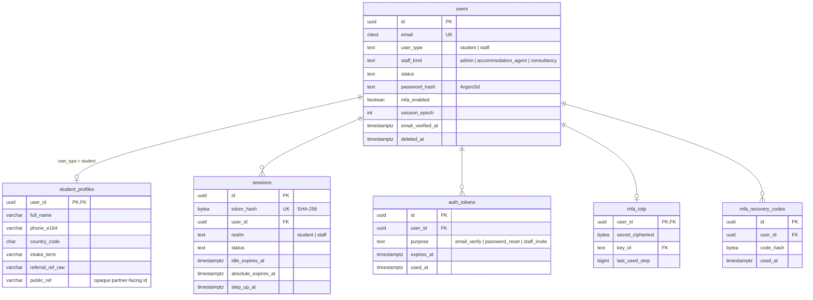
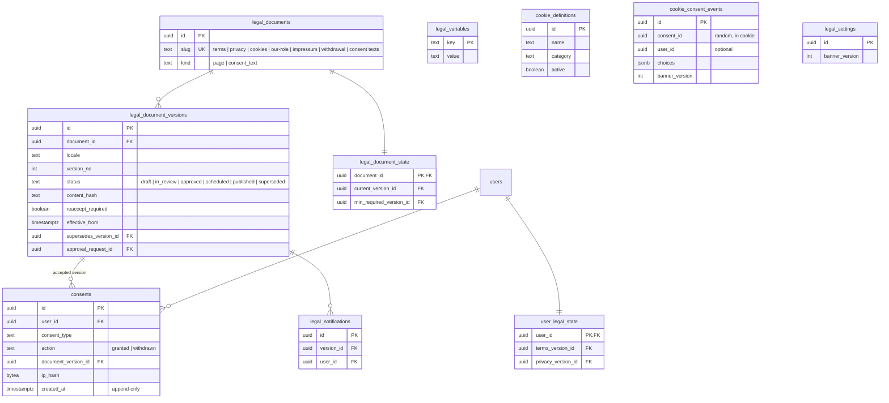
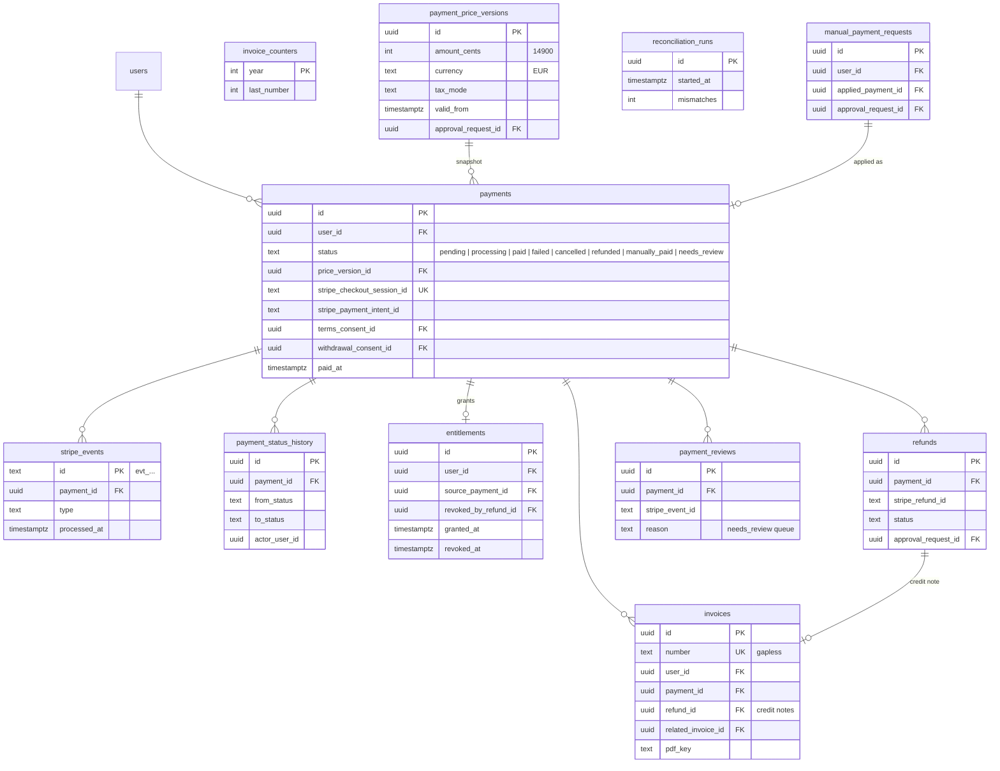
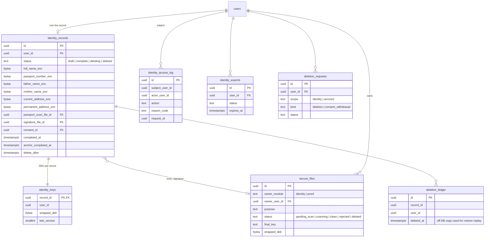
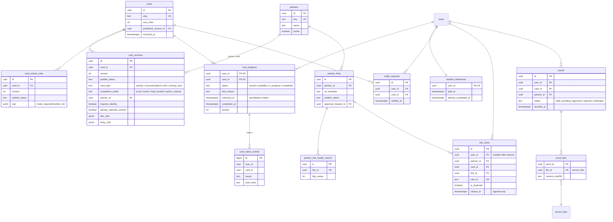
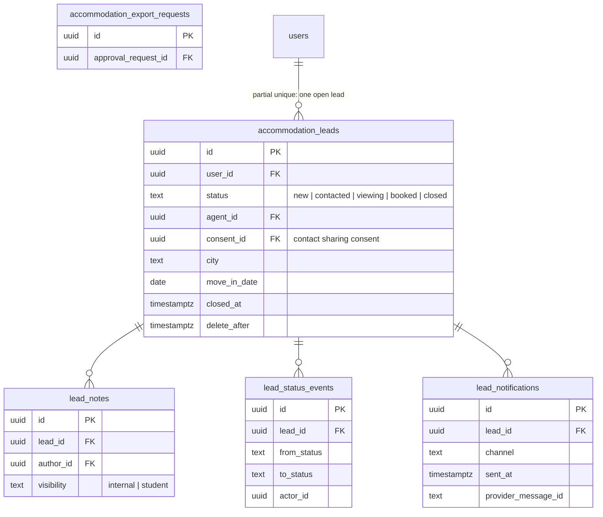
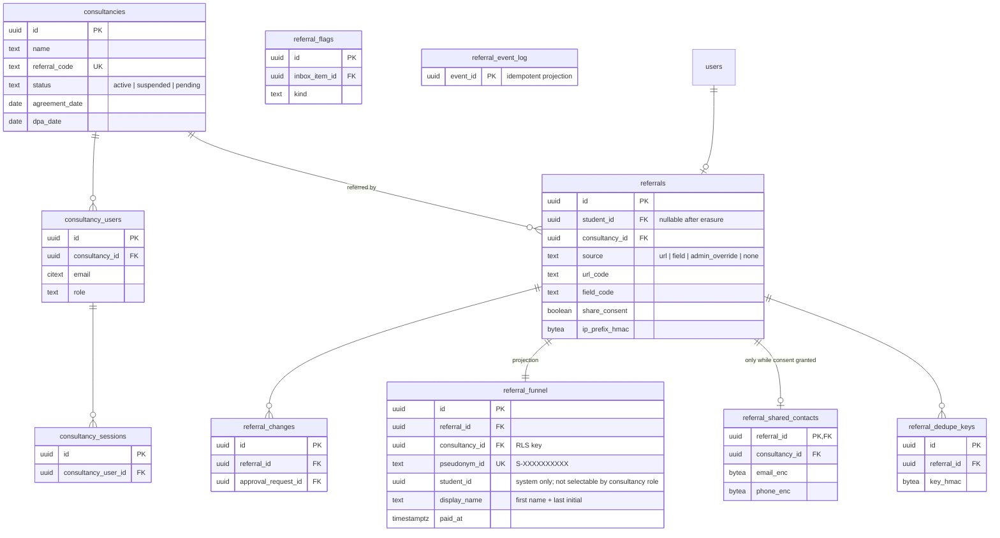
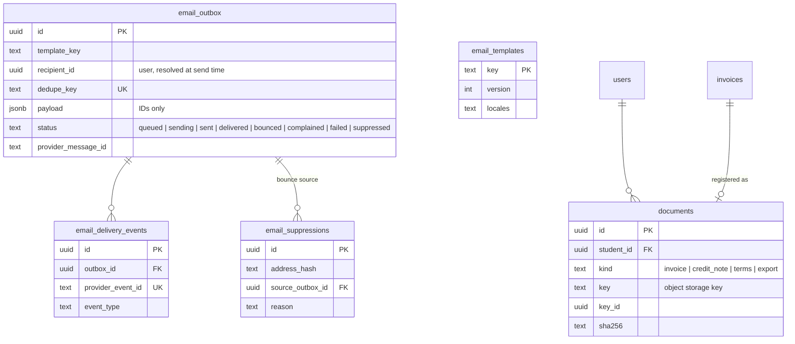

# Entity Relationship Diagram

| Field | Value |
|-------|-------|
| Status | Review |
| Owner | NIVO Platform team |
| Last updated | 2026-11-24 |
| Source | Module LLD §1 tables (`docs/design/mNN-*/lld.md`) consolidated; high-level model in `docs/design/00-data-model.md` |
| Conventions | PostgreSQL 16; UUID primary keys (UUIDv7 generated in app); `timestamptz` UTC; snake_case; money in integer cents + ISO currency; RLS enabled **and forced** on every table; append-only tables have no UPDATE/DELETE grant for `nivo_app` and a `forbid_mutation()` trigger |
| How to read | Diagrams show primary keys, foreign keys and the columns that matter for relationships. Full column lists live in the LLDs. `||--o{` = one-to-many, `||--o|` = one-to-zero-or-one |

If this file and an LLD disagree, the LLD wins; fix this file.

## 1. Domain overview

```mermaid
erDiagram
  users ||--o| student_profiles : "student only"
  users ||--o{ sessions : has
  users ||--o{ auth_tokens : has
  users ||--o| mfa_totp : has
  users ||--o{ consents : gives
  users ||--o{ payments : makes
  users ||--o| identity_records : "one live record"
  users ||--o{ card_progress : has
  users ||--o{ proofs : uploads
  users ||--o{ link_clicks : produces
  users ||--o{ accommodation_leads : raises
  users ||--o| referrals : "attributed by"
  users ||--o{ documents : owns
  users ||--o{ deletion_requests : files
  cards ||--o{ card_versions : versioned
  cards ||--o{ card_progress : tracks
  payments ||--o{ invoices : bills
  payments ||--o{ refunds : refunded_by
  referrals }o--|| consultancies : "referred by"
  partners ||--o{ partner_links : has
  permissions }o--o{ roles : role_permissions
  roles }o--o{ admin_accounts : admin_roles
  approval_requests ||--o{ approval_decisions : decided
  audit_log }o--o| admin_accounts : "actor"
```

Cross-module references to `users(id)` are real foreign keys except where erasure requires the row to survive the user (`audit_log.actor_id` and `consents` after anonymisation keep opaque IDs only; see §9).

## 2. Authentication and profile (M02)

Notes: `password_hash`, tokens and TOTP secrets are never returned by any API. Phase 1 authoritative identity store is unified `users` with `role` / staff kind (`GAP-ADM-ACCOUNT-MODEL` closed for Phase 1). Separate `admin_accounts`/`admin_sessions` remain an optional hardening target before pen-test, not the first migration.

## 3. Legal and consent (M03)

## 4. Payment (M04)

Partial unique index: at most one `paid`/`manually_paid` payment per user; a second paid session becomes `needs_review` with a refund proposal.

## 5. Identity vault (M05)

Tombstone rule: `status = 'deleted'` rows hold no personal data (CHECK constraint).

## 6. Cards (M06), partners and proofs (M07)

## 7. Accommodation (M08)

## 8. Admin control plane (M09)

```mermaid
erDiagram
  admin_accounts {
    uuid id PK
    citext email UK
    text status
    text password_hash
    uuid totp_key_id
  }
  admin_sessions {
    uuid id PK
    uuid admin_id FK
    timestamptz step_up_at
  }
  admin_recovery_codes {
    uuid id PK
    uuid admin_id FK
    timestamptz used_at
  }
  roles {
    uuid id PK
    text key UK
    boolean is_system
    boolean exclusive
  }
  permissions {
    text key PK "domain:action"
    text sensitivity "L | M | H | C"
    boolean step_up
    text approval_action
  }
  role_permissions {
    uuid role_id FK
    text permission_key FK
  }
  admin_roles {
    uuid admin_id FK
    uuid role_id FK
    jsonb scope "countries | lead_type | consultancy_ids"
    uuid approval_request_id FK
  }
  approval_policies {
    text action_key PK
    boolean required
    int approver_count
    text[] approver_roles
    interval expiry
  }
  approval_requests {
    uuid id PK
    text action_key
    uuid requester_id FK
    text status "pending | approved | rejected | expired | cancelled | executing | executed | failed"
    jsonb payload "IDs and parameters, no PII"
    bytea payload_hash
    jsonb policy_snapshot
  }
  approval_decisions {
    uuid id PK
    uuid request_id FK
    uuid approver_id FK "trigger: not requester"
    text decision
    bytea payload_hash
  }
  inbox_items {
    uuid id PK
    text item_type "proof | approval | dsr | fraud | ..."
    uuid assignee_id FK
    uuid requester_admin_id FK
  }
  content_entities {
    uuid id PK
    text content_type "card | partner_link | text | sim_rule | contact | legal"
    uuid live_version_id FK
  }
  content_versions {
    uuid id PK
    uuid entity_id FK
    int version_no
    text status
    jsonb payload
    uuid base_version_id FK
    uuid change_set_id FK
    uuid approval_request_id FK
  }
  change_sets {
    uuid id PK
    uuid approval_request_id FK
  }
  audit_log {
    bigint id PK
    uuid chain_id
    uuid actor_id
    text action
    text target_type
    uuid target_id
    jsonb before_masked
    jsonb after_masked
    bytea prev_hash
    bytea hash "HMAC-SHA256 chain"
  }
  audit_checkpoints {
    uuid id PK
    bigint seq_to
    bytea last_hash
    text object_key "object-locked bucket"
  }
  export_jobs {
    uuid id PK
    text export_type
    uuid approval_request_id FK
    timestamptz expires_at
  }
  admin_alerts {
    uuid id PK
    text severity
    uuid subject_admin_id FK
  }
  student_notes {
    uuid id PK
    uuid student_id FK
    uuid author_id FK
  }
  preview_sessions {
    uuid id PK
    uuid student_id FK
    uuid admin_id FK
  }
  link_domain_allowlist {
    uuid id PK
    text domain
  }
  reject_reason_templates {
    text code PK
  }
  system_settings {
    text key PK
    jsonb value
  }
  admin_accounts ||--o{ admin_sessions : ""
  admin_accounts ||--o{ admin_recovery_codes : ""
  roles ||--o{ role_permissions : ""
  permissions ||--o{ role_permissions : ""
  admin_accounts ||--o{ admin_roles : ""
  roles ||--o{ admin_roles : ""
  approval_policies ||--o{ approval_requests : "snapshot at create"
  approval_requests ||--o{ approval_decisions : ""
  admin_accounts ||--o{ approval_requests : "requester"
  content_entities ||--o{ content_versions : ""
  change_sets ||--o{ content_versions : "atomic publish"
  approval_requests ||--o{ content_versions : ""
  audit_checkpoints ||--o{ audit_log : "covers range"
  users ||--o{ student_notes : "about student"
```

`audit_log` holds opaque IDs only (no names, emails, identity values) so it never needs erasure. It has no foreign key to `users`.

## 9. Consultancy (M10)

Consultancy DB role can read only column-limited views of `referral_funnel` and `referral_shared_contacts` filtered by `consultancy_id`; it has no grants on student, identity, payment or card tables (T-CON-010).

## 10. Email and documents (M11)

## 11. Platform (M01)

| Table | Purpose | Keys |
|-------|---------|------|
| `rate_limit_buckets` | Sliding-window counters, key is an HMAC (never raw email/IP) | PK `key` |
| `idempotency_keys` | Client `Idempotency-Key` replay protection | UNIQUE (`scope`, `key`) |
| `encryption_key_registry` | KEK metadata (no key material), one `active` per purpose | PK `key_id` |
| `ops_backup_runs`, `ops_restore_drills` | Backup and restore evidence | PK `id` |
| `pgboss.*` | Job queues and DLQs (payloads carry IDs only) | managed by pg-boss |

## 12. Table catalogue

| Module | Tables | Append-only / immutable | Personal data class | Erasure behaviour |
|--------|--------|-------------------------|---------------------|-------------------|
| M01 | rate_limit_buckets, idempotency_keys, encryption_key_registry, ops_backup_runs, ops_restore_drills | — | Internal (hashed keys) | Purged by TTL |
| M02 | users, student_profiles, sessions, auth_tokens, mfa_totp, mfa_recovery_codes | — | Personal | Account deletion saga nulls/deletes; `deleted_at` tombstone for the email uniqueness window |
| M03 | legal_documents, legal_document_versions, legal_document_state, legal_variables, legal_settings, cookie_definitions | Published versions immutable | Public | Kept |
| M03 | consents, user_legal_state, legal_notifications, cookie_consent_events | `consents`, `cookie_consent_events` append-only | Personal / pseudonymous | Consents anonymised after account life + 3 years (evidence); cookie events 36 months |
| M04 | payments, payment_status_history, stripe_events, entitlements, invoices, invoice_counters, refunds, manual_payment_requests, payment_reviews, reconciliation_runs, payment_price_versions | `invoices`, `payment_status_history`, `stripe_events` | Personal (financial) | Retained 8 years, restricted; recipient name anonymised on erasure |
| M05 | identity_records, identity_keys, secure_files, identity_access_log, identity_exports, deletion_requests, deletion_ledger | `identity_access_log`, `deletion_ledger` | Sensitive | Crypto-shred DEK, delete ciphertext and files, tombstone |
| M06 | cards, card_versions, card_unlock_rules, card_progress, card_status_events, student_milestones, notify_requests | `card_status_events`; `card_progress` regression trigger | Personal (low) | Deleted with account; aggregates retained without IDs |
| M07 | partners, partner_links, partner_link_health_checks, link_clicks, proofs, proof_files | `link_clicks` | Personal / sensitive-adjacent (proof files) | Clicks: `user_id` set NULL; proofs deleted |
| M08 | accommodation_leads, lead_notes, lead_status_events, lead_notifications, accommodation_export_requests | `lead_status_events` | Personal | Contact snapshot deleted; closed leads anonymised |
| M09 | admin_accounts, admin_sessions, admin_recovery_codes, roles, permissions, role_permissions, admin_roles, approval_policies, approval_requests, approval_decisions, inbox_items, content_entities, content_versions, change_sets, audit_log, audit_checkpoints, export_jobs, admin_alerts, student_notes, preview_sessions, link_domain_allowlist, reject_reason_templates, system_settings | `audit_log`, `approval_decisions` | Internal (staff personal data); audit holds IDs only | Staff anonymised 12 months after disable; student notes deleted in erasure saga |
| M10 | consultancies, consultancy_users, consultancy_sessions, referrals, referral_changes, referral_funnel, referral_shared_contacts, referral_flags, referral_dedupe_keys, referral_event_log | `referral_event_log` | Personal (pseudonymous) | Funnel row PII nulled, shared contacts deleted, student link removed |
| M11 | email_outbox, email_delivery_events, email_suppressions, email_templates, documents | `email_delivery_events` | Personal | Outbox payloads purged at 90 days; documents per source rule |

## 13. Naming reconciliation with `00-data-model.md`

| `00-data-model.md` | Implemented as | Reason |
|--------------------|----------------|--------|
| `identity_files` | `secure_files` (`owner_module = identity | proof`) | Shared encrypted upload pipeline for M05 and M07 |
| `sim_unlock_rules` | `card_unlock_rules` | Any card can have a rule; SIM is the first consumer |
| `settings`, `setting_drafts`, `setting_versions` | `content_entities` + `content_versions` + `system_settings` | One generic versioned content store for cards, links, texts, rules, contact, legal drafts |
| `students` / `users` | `users` (+ `student_profiles`); staff in `users` (M02) and/or `admin_accounts` (M09) | See §2 note |
| `lead_status` enum values | `new | contacted | viewing | booked | closed` | As in data model; prototype code uses a different list and must migrate |
| `payment_status` enum | M04 adds `cancelled` and `needs_review` | Failure and review states |
| `link_clicks`, `proofs` | Same names; `proof_status` gains `draft`, `withdrawn` | M07 workflow |
| `users` per-student `consultancy_id` | `referrals.consultancy_id` | Attribution is a locked, auditable record |

## 14. Integrity rules that the schema enforces

1. One live identity record per user (partial unique index); tombstones carry no personal data (CHECK).
2. One paid payment per user (partial unique index); one live card version and rule per card.
3. `card_progress` cannot regress without an approved override (trigger); `unlocked_at`/`completed_at` cannot be cleared.
4. `approval_decisions.approver_id <> approval_requests.requester_id` (trigger) and decisions bound to the payload hash.
5. `audit_log`, `consents`, `link_clicks`, `identity_access_log` are append-only for the runtime role; the last active Super Admin cannot be removed (trigger).
6. Staff accounts cannot be `active` without `mfa_enabled` (CHECK).
7. Consultancy role reads only `consultancy_id`-filtered views (RLS + column-limited views).
8. Every table has RLS enabled and forced (T-INFRA-013).
