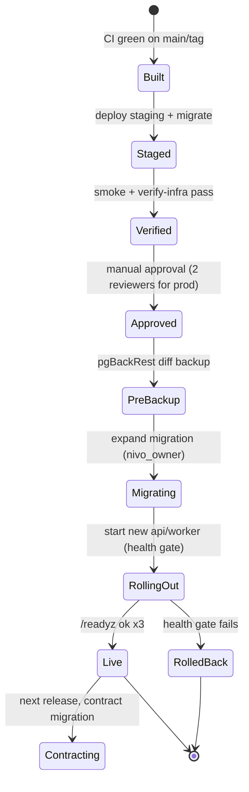
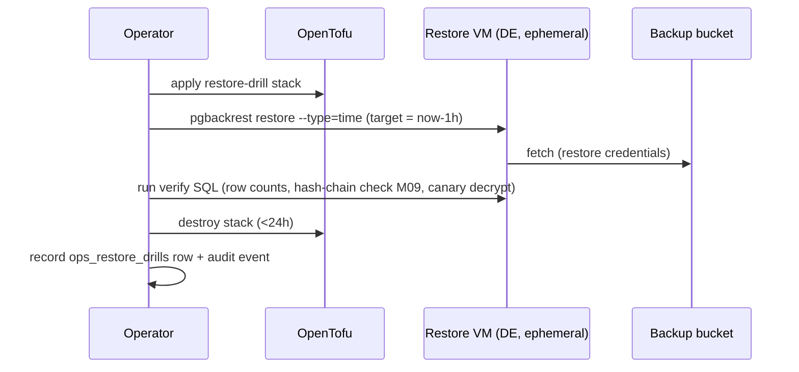

# LLD: M01 — Infrastructure

| Field | Value |
|-------|-------|
| Module | M01 |
| Status | Review |
| Depends on HLD | `hld.md` |
| Last updated | 2026-11-24 |

Conventions that apply to **all modules** (referenced by M02–M11 LLDs):

- Primary keys: `uuid` generated in app as UUIDv7 (`uuidv7()`); no DB defaults except `gen_random_uuid()` for system seeds.
- Timestamps: `timestamptz`, UTC; `created_at timestamptz not null default now()`, `updated_at` maintained by trigger `set_updated_at()`.
- Names: snake_case tables (plural) and columns. Drizzle schema in `apps/api/src/db/schema/<module>.ts`; SQL for RLS/triggers in hand-written migrations `apps/api/drizzle/<n>_<module>_rls.sql`.
- Money: integer minor units (`*_cents`) + ISO currency.
- Every table: `ALTER TABLE … ENABLE ROW LEVEL SECURITY; ALTER TABLE … FORCE ROW LEVEL SECURITY;` (so the owner is bound too).
- API base path `/api/v1`. Error shape per `00-error-catalog.md`.

## 1. Database

### 1.0 Roles

| Role | Used by | Privileges | Notes |
|------|---------|------------|-------|
| `nivo_owner` | Migrations only (CI/deploy job) | Owns schema, DDL | Not available to api/worker at runtime; password in deploy secrets only |
| `nivo_app` | api + worker | `SELECT/INSERT/UPDATE/DELETE` on granted tables, `USAGE` on schema, `EXECUTE` on helper functions | `NOSUPERUSER NOBYPASSRLS NOCREATEDB NOCREATEROLE`; `statement_timeout=15s`, `idle_in_transaction_session_timeout=30s`, `lock_timeout=5s` |
| `nivo_readonly` | Operators (break-glass analytics) | `SELECT` on non-sensitive views only | Access logged; not used by app |
| `nivo_backup` | pgBackRest on DB VM | `REPLICATION`, local socket only | No network login |
| `pgboss` schema | Owned by `nivo_owner`, DML granted to `nivo_app` | | Queue tables |

Per-table privileges are granted explicitly in each module's migration (deny by default; `REVOKE ALL ON ALL TABLES IN SCHEMA public FROM PUBLIC`). Append-only tables get only `SELECT, INSERT` for `nivo_app`.

### 1.1 Helper functions (SQL)

```sql
CREATE FUNCTION app_actor_type() RETURNS text LANGUAGE sql STABLE AS
$$ SELECT coalesce(nullif(current_setting('app.actor_type', true), ''), 'anon') $$;

CREATE FUNCTION app_user_id() RETURNS uuid LANGUAGE sql STABLE AS
$$ SELECT nullif(current_setting('app.user_id', true), '')::uuid $$;

CREATE FUNCTION app_is_system() RETURNS boolean LANGUAGE sql STABLE AS
$$ SELECT app_actor_type() = 'system' $$;

CREATE FUNCTION set_updated_at() RETURNS trigger LANGUAGE plpgsql AS
$$ BEGIN NEW.updated_at := now(); RETURN NEW; END $$;

-- Prevent UPDATE/DELETE on append-only tables
CREATE FUNCTION forbid_mutation() RETURNS trigger LANGUAGE plpgsql AS
$$ BEGIN RAISE EXCEPTION 'table % is append-only', TG_TABLE_NAME USING ERRCODE = 'integrity_constraint_violation'; END $$;
```

### Tables

| Table | Column | Type | Constraints | Notes |
|-------|--------|------|-------------|-------|
| `rate_limit_buckets` | `key` | text | PK | e.g. `login:ip:<hmac>`; never raw email/IP |
| | `window_start` | timestamptz | not null | Start of fixed window (sliding-window-log approximated by 2 windows) |
| | `count` | int | not null default 0, check `count >= 0` | |
| | `prev_count` | int | not null default 0 | Previous window count for sliding approximation |
| | `blocked_until` | timestamptz | null | Set when a lock rule triggers |
| | `expires_at` | timestamptz | not null | Row purge time |
| `idempotency_keys` | `id` | uuid | PK | |
| | `scope` | text | not null | e.g. `payments.checkout:<userId>` |
| | `key` | text | not null, check `length(key) between 16 and 128` | Client `Idempotency-Key` |
| | `request_hash` | bytea | not null | SHA-256 of canonical request body |
| | `status` | text | not null check in (`in_progress`,`completed`) | |
| | `response_status` | int | null | |
| | `response_body` | jsonb | null | Must not contain secrets; for checkout stores `{paymentId}` only |
| | `created_at` | timestamptz | not null default now() | |
| | `expires_at` | timestamptz | not null default now() + interval '48 hours' | |
| | | | UNIQUE (`scope`,`key`) | |
| `encryption_key_registry` | `key_id` | text | PK | e.g. `kek-2026-01` |
| | `purpose` | text | not null check in (`field`,`file`,`token`) | |
| | `status` | text | not null check in (`active`,`decrypt_only`,`retired`) | One `active` per purpose (partial unique index) |
| | `created_at` | timestamptz | not null | |
| | `retired_at` | timestamptz | null | |
| | `canary_ciphertext` | bytea | not null | Startup self-test (decrypts to `NIVO-CANARY`) |
| `ops_backup_runs` | `id` | uuid | PK | |
| | `kind` | text | not null check in (`full`,`diff`,`wal_check`) | |
| | `started_at` / `finished_at` | timestamptz | | |
| | `status` | text | not null check in (`success`,`failed`) | |
| | `size_bytes` | bigint | null | |
| | `repo_label` | text | not null | `nbg1-backup` |
| | `error_summary` | text | null | No secrets |
| `ops_restore_drills` | `id` | uuid | PK | |
| | `performed_by` | text | not null | Operator handle |
| | `backup_label` | text | not null | |
| | `started_at` / `finished_at` | timestamptz | | |
| | `rto_seconds` | int | null | Measured |
| | `rpo_seconds` | int | null | Measured |
| | `result` | text | not null check in (`pass`,`fail`) | |
| | `notes` | text | null | |
| `pgboss.*` | — | — | Managed by pg-boss | Created by library migration run by `nivo_owner` |

### Indexes

- `rate_limit_buckets (expires_at)` for purge.
- `idempotency_keys (expires_at)`.
- `encryption_key_registry (purpose) WHERE status = 'active'` UNIQUE.
- `ops_backup_runs (kind, finished_at DESC)`.

### RLS policies

All M01 tables are **system-only** (not reachable by end-user contexts).

```sql
-- applied to rate_limit_buckets, idempotency_keys, encryption_key_registry, ops_backup_runs, ops_restore_drills
ALTER TABLE rate_limit_buckets ENABLE ROW LEVEL SECURITY;
ALTER TABLE rate_limit_buckets FORCE ROW LEVEL SECURITY;

CREATE POLICY rlb_system_all ON rate_limit_buckets
  FOR ALL TO nivo_app
  USING (app_is_system())
  WITH CHECK (app_is_system());
```

`ops_backup_runs` and `ops_restore_drills` additionally allow `SELECT` when `app_actor_type() = 'staff'` (read via M09 permission `infra.ops.read`, enforced in app).

Note: rate-limit and idempotency helpers always run inside `withSystemContext('platform.ratelimit')`, i.e. a separate short transaction so that a rolled-back business transaction does not erase failed-attempt counts.

### Policy test matrix (feeds T-INFRA-010…013)

| Actor | `rate_limit_buckets` | `ops_backup_runs` |
|-------|----------------------|-------------------|
| anon / student / consultancy | none | none |
| staff | none | SELECT |
| system | ALL | ALL |

## 2. API endpoints

| Method | Path | Permission | Request | Response | Errors | Rate limit | Idempotency |
|--------|------|------------|---------|----------|--------|------------|-------------|
| GET | `/healthz` | Public (edge allows from anywhere, returns no detail) | — | `200 {"status":"ok"}` | — | 60/min/IP at edge | n/a |
| GET | `/readyz` | Public summary; detail only from private network or staff session with `infra.ops.read` | — | `200 {"status":"ready","checks":{...}}` / `503` | `INTERNAL` | 30/min/IP | n/a |
| GET | `/api/v1/meta` | Public | — | `{"version":"git-sha","env":"production","time":"ISO"}` (no stack/infra detail) | — | 60/min/IP | n/a |
| GET | `/api/v1/admin/ops/status` | `infra.ops.read` (staff, 2FA) | — | Backup freshness, last restore drill, queue depths, DLQ counts, cert expiry | `UNAUTHORIZED`, `FORBIDDEN` | 30/min/user | n/a |

`/readyz` checks: DB `SELECT 1` (≤ 500 ms), `pgboss` schema reachable, object storage `HEAD` on health object, ClamAV `PING`, key service canary decrypt. ClamAV failure marks `degraded` (uploads disabled, rest of app ready), DB/key failure marks not ready.

Edge-only routes (Caddy, not Fastify): `/.well-known/security.txt` (contact + policy), `/robots.txt` (disallow `/api`, `/admin`).

Error catalog additions owned by M01 (to merge into `00-error-catalog.md`, see GAP-TRACE-M01): `IDEMPOTENCY_CONFLICT` (409, "This request was already used with different data."). Additions owned by other modules: `CSRF_INVALID`, `AUTH_TOKEN_INVALID`, `AUTH_2FA_INVALID` (M02), `WEBHOOK_SIGNATURE_INVALID` (M04).

### Platform middleware order (Fastify hooks)

1. `onRequest`: assign `requestId` (UUID; ignore inbound), start timer, apply `trustProxy` (Caddy IP only).
2. Body size / content-type enforcement (`application/json` only except uploads and webhook).
3. Origin/Fetch-Metadata check for unsafe methods (implemented in M02, registered here).
4. Rate limit (per route config).
5. Session load (M02) → RLS context set → handler within transaction.
6. `onSend`: security headers for API responses (`Cache-Control: no-store` for authenticated, `X-Content-Type-Options`, `Content-Type`), `X-Request-Id` echo.
7. Error handler maps to catalog shape; unknown errors → `INTERNAL`, stack to logs only.

### Edge configuration (Caddyfile excerpt)

```caddy
{
  servers { protocols h1 h2 h3 }
  order rate_limit before basicauth
}

(security_headers) {
  header {
    Strict-Transport-Security "max-age=63072000; includeSubDomains; preload"
    X-Content-Type-Options "nosniff"
    X-Frame-Options "DENY"
    Referrer-Policy "no-referrer"
    Permissions-Policy "accelerometer=(), camera=(), geolocation=(), gyroscope=(), microphone=(), payment=(), usb=()"
    Cross-Origin-Opener-Policy "same-origin"
    Cross-Origin-Resource-Policy "same-origin"
    Content-Security-Policy "default-src 'self'; script-src 'self'; style-src 'self'; img-src 'self' data:; font-src 'self'; connect-src 'self'; frame-src 'none'; frame-ancestors 'none'; base-uri 'self'; form-action 'self'; object-src 'none'; upgrade-insecure-requests"
    -Server
  }
}

app.{$DOMAIN} {
  import security_headers
  encode zstd gzip
  request_body { max_size 1MB }

  @webhook path /api/v1/webhooks/stripe
  handle @webhook {
    request_body { max_size 256KB }
    rate_limit { zone webhook { key {remote_host} events 300 window 1m } }
    reverse_proxy api:3000
  }

  @upload path_regexp upload ^/api/v1/(identity|partners)/.*/uploads$
  handle @upload {
    request_body { max_size 9MB }
    rate_limit { zone upload { key {remote_host} events 20 window 10m } }
    reverse_proxy api:3000
  }

  handle /api/* {
    rate_limit { zone api { key {remote_host} events 300 window 1m } }
    reverse_proxy api:3000 {
      header_up X-Forwarded-For {remote_host}
      header_up -X-Request-Id
    }
  }

  handle {
    root * /srv/web-student
    try_files {path} /index.html
    file_server
    header /assets/* Cache-Control "public, max-age=31536000, immutable"
    header /index.html Cache-Control "no-cache"
  }

  log {
    output file /var/log/caddy/access.log { roll_keep_for 336h }   # 14 days
    format filter {
      wrap json
      request>remote_ip ip_mask { ipv4 24 ipv6 48 }
      request>client_ip ip_mask { ipv4 24 ipv6 48 }
      request>headers delete
    }
  }
}

admin.{$DOMAIN} {
  import security_headers
  # same as above with root /srv/web-admin, stricter limits (api 120/min), optional IP allowlist for /api/v1/admin/ops
}
```

Notes: CSP has **no** third-party sources because Stripe Checkout is a full-page redirect (no Stripe.js on our pages) and fonts are self-hosted. If a later module needs a third party (e.g. analytics after consent), CSP changes go through an ADR and are applied only to the specific route.

### Zod schemas

```ts
// packages/shared/src/platform.ts
import { z } from 'zod';

export const HealthResponse = z.object({ status: z.literal('ok') });

export const ReadyResponse = z.object({
  status: z.enum(['ready', 'degraded', 'not_ready']),
  checks: z.record(z.enum(['ok', 'degraded', 'fail'])),
});

export const MetaResponse = z.object({
  version: z.string().regex(/^[0-9a-f]{7,40}$/),
  env: z.enum(['staging', 'production']),
  time: z.string().datetime(),
});

export const ApiError = z.object({
  error: z.object({
    code: z.string(),
    message: z.string(),
    requestId: z.string().uuid(),
    details: z.array(z.object({ path: z.string(), code: z.string(), message: z.string() })).default([]),
  }),
});

export const IdempotencyKeyHeader = z.string().min(16).max(128).regex(/^[A-Za-z0-9_\-:.]+$/);

// Rate-limit rule shape used by route config
export const RateLimitRule = z.object({
  name: z.string(),
  limit: z.number().int().positive(),
  windowSec: z.number().int().positive(),
  failMode: z.enum(['open', 'closed']),
  blockSec: z.number().int().nonnegative().optional(),
});
```

### Rate-limit algorithm (`rateLimit.consume`)

```
INSERT … ON CONFLICT (key) DO UPDATE
  SET window_start = CASE WHEN now() >= window_start + window THEN date_trunc-aligned now ELSE window_start END,
      prev_count   = CASE WHEN rolled THEN count ELSE prev_count END,
      count        = CASE WHEN rolled THEN 1 ELSE count + 1 END,
      blocked_until = …, expires_at = now() + 2*window
RETURNING …
allowed = blocked_until IS NULL OR blocked_until <= now()
          AND (prev_count * (1 - elapsed/window) + count) <= limit
```

Keys are `<rule>:<dimension>:<HMAC-SHA256(IP_HASH_KEY, value)>` (value = IP, email lowercase, user id).

## 3. State machines

### 3.1 Deployment



Side effects: each transition writes an `infra.deploy.*` audit event (see §8). Migrations follow **expand → deploy → contract**: no destructive migration may ship in the same release that stops using the old column.

### 3.2 Backup health

`healthy` (last success < 26 h and WAL archive lag < 5 min) → `warning` (> 26 h or lag ≥ 5 min) → `critical` (> 50 h or lag ≥ 30 min). Transitions page on-call.

### 3.3 Key lifecycle

`active` → (rotation) `decrypt_only` → (all data re-wrapped, verified) `retired`. A key is never deleted while any ciphertext references it. New `active` key is created first; both exist simultaneously during rotation.

### 3.4 Queue job (pg-boss)

`created` → `active` → `completed` | `retry` (backoff) → `failed` → moved to `<queue>_dlq` after retry limit. DLQ items are replayed manually via `pnpm ops:dlq replay <queue> <id>` (audit-logged).

## 4. Sequence diagrams

### Happy path — authenticated API request with RLS

```mermaid
sequenceDiagram
  participant B as Browser
  participant C as Caddy
  participant A as API
  participant D as PostgreSQL
  B->>C: HTTPS POST /api/v1/... (cookie)
  C->>A: proxy (XFF set, size/rate checked)
  A->>A: requestId, rate limit, CSRF/Origin, session lookup
  A->>D: BEGIN; set_config(actor_type,user_id,request_id)
  A->>D: business queries (RLS enforced)
  A->>D: enqueue jobs (same tx) ; COMMIT
  A-->>C: 200 JSON + security headers
  C-->>B: response
```

### Failure paths

1. **DB down**: `/readyz` fails → Uptime Kuma alert; API returns `503` with `INTERNAL` (requestId); Stripe webhook receives `5xx` and retries; static SPA still served with an offline banner.
2. **Rate-limit store error** on login: fail closed → `429 RATE_LIMITED` with `Retry-After: 60`; on public GET: fail open + log `ratelimit.store_error`.
3. **Queue stalled**: worker heartbeat metric missing for 5 min → alert; business writes continue (jobs persisted in DB).
4. **Backup failure**: `pgbackrest check` cron exits non-zero → inserts `ops_backup_runs(status=failed)` → alert email via direct SMTP fallback.
5. **Key canary mismatch at startup**: process exits non-zero; deploy health gate fails; rollback.

### Restore drill (monthly)



## 5. Validation rules

| Field | Client | API | DB |
|-------|--------|-----|----|
| `Idempotency-Key` | n/a (generated UUID) | Zod `IdempotencyKeyHeader` | check length 16–128; UNIQUE(scope,key) |
| Request body size | n/a | Fastify `bodyLimit` 1 MB default; route overrides | Edge cap first |
| `Content-Type` | n/a | Must be `application/json` for JSON routes, else 415 `VALIDATION_FAILED` | n/a |
| `Host` header | n/a | Must match `APP_ORIGIN`/`ADMIN_ORIGIN` host; others 421 | n/a |
| `X-Request-Id` | n/a | Ignored (server-generated) | n/a |
| Env config | n/a | Zod-validated at boot (`env.ts`); process exits on invalid | n/a |
| Rate-limit key | n/a | Constructed only by `rateLimit.key()` helper (hash enforced) | n/a |

## 6. Background jobs

All jobs use payloads with IDs only (**No PII**). Defaults: `retryLimit: 5`, `retryBackoff: true` (exponential from 30 s), `expireInSeconds: 900`, DLQ `<name>_dlq`, `retentionDays: 14`, `singletonKey` where duplicates are harmful.

| Job | Trigger | Retry | Dead letter | Payload rules |
|-----|---------|-------|-------------|---------------|
| `ops.purge_rate_limits` | cron `*/10 * * * *` | 3 | `ops.purge_rate_limits_dlq` | `{}` — `DELETE … WHERE expires_at < now()` in batches of 5 000 |
| `ops.purge_idempotency` | cron `15 * * * *` | 3 | dlq | `{}` |
| `ops.backup_freshness_check` | cron `*/15 * * * *` | 1 | dlq + direct alert | `{}` — reads `ops_backup_runs`; emits metric/alert |
| `ops.dlq_monitor` | cron `*/5 * * * *` | 1 | n/a | `{}` — counts DLQ rows; alert when > 0 |
| `ops.cert_expiry_check` | cron `0 6 * * *` | 3 | dlq | `{}` — TLS handshake to both hosts, alert < 14 days |
| `ops.key_canary_check` | cron `0 * * * *` | 3 | dlq | `{}` — decrypts canaries for all non-retired keys |
| `ops.worker_heartbeat` | cron `* * * * *` | 0 | n/a | `{}` — writes metric timestamp |
| `ops.queue_archive` | cron `0 3 * * *` | 3 | dlq | `{}` — pg-boss maintenance (archive/delete) |

pgBackRest schedules run from cron on the DB VM (not pg-boss) so that backups do not depend on the app: `0 2 * * 0` full, `0 2 * * 1-6` diff, WAL continuous.

## 7. Emails

Operational alerts only (to `ops@` distribution list; sent via M11 pipeline with direct-SMTP fallback). No user-facing email in M01.

| Template key | Trigger | Content summary |
|--------------|---------|-----------------|
| `ops_alert_backup` | Backup failed/stale | Kind, last success time, repo label; no secrets |
| `ops_alert_dlq` | DLQ count > 0 | Queue names and counts |
| `ops_alert_cert` | Cert < 14 days | Host, expiry date |
| `ops_alert_key` | Canary failure / key near rotation due | Key ID (not material) |
| `ops_alert_disk` | Disk ≥ 80 % | Host, mount, percent |

## 8. Audit events

Written through M09 `audit.append()` with `actor = system:<operator-or-pipeline>`.

| Action | Before/After | Reason required |
|--------|--------------|-----------------|
| `infra.deploy.started` / `.completed` / `.rolled_back` | `{ gitSha, env }` / n/a | Rollback: yes |
| `infra.migration.applied` | `{ migrationId }` | No |
| `infra.key.created` / `.rotated` / `.retired` | `{ keyId, purpose, status }` (no material) | Yes |
| `infra.secret.rotated` | `{ secretName }` (no value) | Yes |
| `infra.restore_drill.completed` | `{ backupLabel, rtoSeconds, rpoSeconds, result }` | No |
| `infra.dlq.replayed` | `{ queue, jobId }` | Yes |
| `infra.ops.break_glass_db_access` | `{ operator, role, durationMin }` | Yes |

## 9. Config / admin settings

### Environment variables and secrets (validated by `env.ts`)

| Name | Kind | Used by | Rotation |
|------|------|---------|----------|
| `NODE_ENV`, `APP_ENV` (`staging`/`production`) | config | all | n/a |
| `APP_ORIGIN`, `ADMIN_ORIGIN` | config | CSRF/Origin, cookies, links | n/a |
| `DATABASE_URL` (role `nivo_app`) | secret | api, worker | 180 days |
| `DATABASE_MIGRATOR_URL` (role `nivo_owner`) | secret | deploy only | 180 days |
| `S3_ENDPOINT`, `S3_REGION`, `S3_BUCKET_FILES`, `S3_BUCKET_INVOICES`, `S3_ACCESS_KEY_ID`, `S3_SECRET_ACCESS_KEY` | secret | api, worker | 180 days |
| `FIELD_KEK_<ID>` (e.g. `FIELD_KEK_2026_01`), `FILE_KEK_<ID>`, `ACTIVE_FIELD_KEK_ID`, `ACTIVE_FILE_KEK_ID` | secret | key service | 12 months (rotation drill quarterly) |
| `AUTH_PEPPER` | secret | M02 | 12 months (versioned, see M02) |
| `CSRF_HMAC_KEY`, `IP_HASH_KEY`, `TOKEN_HMAC_KEY` | secret | M02/M01 | 12 months |
| `STRIPE_SECRET_KEY` (restricted), `STRIPE_WEBHOOK_SECRET` | secret | M04 | 12 months / on staff change |
| `EMAIL_PROVIDER`, `EMAIL_API_KEY`, `EMAIL_FROM` | secret/config | M11 | 12 months |
| `CLAMAV_HOST`, `CLAMAV_PORT` | config | M05 | n/a |
| `SENTRY_DSN` (GlitchTip) | config | api, web | n/a |
| `OPS_ALERT_SMTP_URL` | secret | direct alert fallback | 12 months |

Secrets: SOPS+age files `infra/secrets/<env>.enc.yaml`; at deploy decrypted into Docker secrets mounted at `/run/secrets/*` (tmpfs); the app reads from files. Production age keys held by 2 of 3 operators; offline escrow of KEKs (printed, sealed) with 2-of-3 Shamir split.

### Runtime settings (hot-changeable via M09 settings, draft/publish)

| Key | Default | Notes |
|-----|---------|-------|
| `ratelimit.api_default_per_min` | 300 per IP (edge) | Edge value is deploy config, not runtime |
| `ops.log_level` | `info` | Max `debug` in staging only |

### Environments

| Env | Host | Data | Stripe | Email |
|-----|------|------|--------|-------|
| local | docker compose | seed fixtures | Stripe CLI test | Mailpit |
| ci | GitHub runner + PG service | generated | mocked | stub |
| staging | Hetzner fsn1 (1 VM, all-in-one) | synthetic only | test mode | Mailpit + allowlisted real inbox |
| production | Hetzner fsn1 (app VM, DB VM, monitoring VM); backups nbg1 | real | live | provider |

### CI/CD pipeline (GitHub Actions)

1. `lint` (ESLint incl. restricted `withSystemContext` import rule, Prettier), `typecheck` (tsc), `unit` (Vitest).
2. `integration`: Postgres 16 service, run migrations, run RLS and API tests.
3. `security`: Semgrep (`p/owasp-top-ten`, `p/typescript`, custom rules), `gitleaks`, `pnpm audit --prod --audit-level=high`, Trivy image scan (fail on HIGH/CRITICAL with fix), SBOM (CycloneDX) artifact.
4. `e2e`: Playwright on built images (smoke subset on PR, full on main).
5. `release` (tag): build, sign image (cosign), push to GHCR, deploy staging, run `verify-infra`, manual approval, deploy production.
6. Branch protection: PR required, 1 review (2 for `infra/`, migrations, auth, payment), signed commits, linear history.

### Backup parameters (pgBackRest)

```
repo1-type=s3  repo1-s3-endpoint=<nbg1 endpoint>  repo1-path=/nivo-prod
repo1-cipher-type=aes-256-cbc  repo1-cipher-pass=<secret>
repo1-retention-full=5  repo1-retention-diff=14  archive-timeout=60
start-fast=y  compress-type=zst  process-max=2
```

Targets: **RPO ≤ 5 min, RTO ≤ 4 h**. Staging does not receive prod backups.

## 10. Logging and redaction

pino JSON logs: `{time, level, requestId, route, method, status, durationMs, userIdHash, actorType}`.

Never logged (enforced by pino `redact` paths + a CI test that greps fixtures):

- Request/response bodies, cookies, `Authorization`, `Set-Cookie`, `X-CSRF-Token`, `Stripe-Signature`.
- Passwords, tokens (verify/reset/session), TOTP secrets and codes, recovery codes.
- Full IP addresses (use `ipHash`), email addresses, phone numbers, names, passport/identity data, addresses.
- Stripe card data (never reaches the server), full webhook payloads, Stripe secret/webhook keys.
- Storage object keys containing user IDs in plaintext — log hashed key.
- SQL parameter values (pg query logging off; only query name/duration).

`userIdHash = HMAC-SHA256(IP_HASH_KEY, userId)[:16]`. Error reports to GlitchTip use `beforeSend` scrubber (drops request body, headers, user email). Redaction paths list: `req.headers.authorization`, `req.headers.cookie`, `res.headers["set-cookie"]`, `*.password`, `*.token`, `*.secret`, `*.email`, `*.phone`, `*.passportNumber`.

Metrics (Prometheus): `http_requests_total{route,status}`, `http_request_duration_seconds`, `db_pool_in_use`, `pgboss_queue_depth{queue}`, `pgboss_dlq_depth{queue}`, `backup_last_success_timestamp`, `tls_cert_expiry_days`, `webhook_events_total{type,result}` (M04).

Alert thresholds: 5xx rate > 2 % for 5 min; p95 latency > 1.5 s for 10 min; DLQ > 0; backup stale; disk ≥ 80 %; cert < 14 d; worker heartbeat missing 5 min; clock offset > 1 s.

## 11. Test cases

| ID | Layer | Description | Expected |
|----|-------|-------------|----------|
| T-INFRA-001 | unit | Key service wraps and unwraps DEK with active KEK; ciphertext carries key ID | Round-trip equals plaintext; key ID present |
| T-INFRA-002 | unit | Unwrap with `decrypt_only` KEK succeeds; with `retired` unknown key fails closed | Success / error, no plaintext |
| T-INFRA-003 | unit | `rateLimit.consume` allows `limit` calls then blocks; window rollover resets | 429 semantics, `retryAfterSec` > 0 |
| T-INFRA-004 | unit | Idempotency: same key + same hash returns stored response; different hash | Replay / `IDEMPOTENCY_CONFLICT` |
| T-INFRA-005 | unit | pino redaction removes cookie, authorization, email, token fields | Fields replaced by `[Redacted]` |
| T-INFRA-006 | unit | `ipHash` is stable per key, differs per key, never returns raw IP | Pass |
| T-INFRA-010 | integration | `nivo_app` has `rolbypassrls = false`, not superuser | Query on `pg_roles` confirms |
| T-INFRA-011 | integration | With `actor_type=anon`, `SELECT` on `rate_limit_buckets` returns 0 rows | 0 rows |
| T-INFRA-012 | integration | With `actor_type=system`, insert/select works | Pass |
| T-INFRA-013 | integration | Every table in `public` has RLS enabled **and** forced (catalog query) | No violating table |
| T-INFRA-014 | integration | Transaction-local settings do not leak between pooled requests | Second request sees `anon` |
| T-INFRA-015 | integration | Queue job failing 6× lands in DLQ; `ops.dlq_monitor` reports count | DLQ = 1, alert metric set |
| T-INFRA-016 | integration | `/readyz` returns 503 when DB down, `degraded` when ClamAV down | Status codes as specified |
| T-INFRA-020 | infra | HTTP request redirects to HTTPS (301/308) on both hosts | Redirect |
| T-INFRA-021 | infra | TLS 1.0/1.1 rejected; TLS 1.3 supported | Handshake result |
| T-INFRA-022 | infra | Port scan from internet shows only 80/443 | Others closed |
| T-INFRA-023 | infra | DB port reachable only from app VM private IP | Connection refused elsewhere |
| T-INFRA-024 | infra | Server location labels and Object Storage region ∈ {fsn1, nbg1} (Germany; Helsinki excluded); no non-DE endpoints in env | Pass |
| T-INFRA-025 | infra | LUKS active on data volume (`lsblk`/`cryptsetup status`) | Active |
| T-INFRA-026 | infra | Last backup < 26 h and WAL archive lag < 5 min | Pass |
| T-SEC-001 | infra | REQ-SEC-01 conformance bundle: T-INFRA-020…025 + HSTS preload header + DB TLS `verify-full` | All pass on staging and prod |
| T-INFRA-030 | security | Response headers on `/`, `/api/v1/meta`: HSTS, CSP, nosniff, Referrer-Policy, frame-ancestors | All present, CSP has no `unsafe-inline`/`unsafe-eval` |
| T-INFRA-031 | security | Playwright loads home page: zero requests to non-first-party hosts, no cookies except necessary | 0 third-party requests |
| T-INFRA-032 | security | gitleaks over full history and workspace | No findings |
| T-INFRA-033 | security | `pnpm audit --prod` and Trivy | No HIGH/CRITICAL unfixed |
| T-INFRA-034 | security | Caddy rejects body > 1 MB on JSON route and > 256 KB on webhook | 413 |
| T-INFRA-035 | security | Cookies set by API are `__Host-` prefixed, Secure, HttpOnly (session), SameSite=Lax; student cookie absent on admin host | Pass (with M02) |
| T-INFRA-040 | drill | Monthly restore to ephemeral VM, verify row counts + canary decrypt | `ops_restore_drills.result = pass`, RTO ≤ 4 h |
| T-INFRA-041 | drill | KEK rotation: create new KEK, re-wrap sample DEKs, retire old | No data unreadable |
| T-INFRA-042 | drill | DLQ replay after fixing handler | Jobs complete, audit event written |
| T-INFRA-043 | drill | Region rebuild tabletop (nbg1) documented with timings | Report stored |
