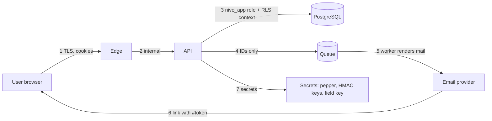

# HLD: M02 — Authentication and Sessions

| Field | Value |
|-------|-------|
| Module | M02 |
| Status | Review |
| Owner | NIVO Platform team |
| Last updated | 2026-11-24 |
| Requirements | REQ-AUTH-01..09, REQ-SEC-01 (cookies, secrets), REQ-LEG-03 (consent at registration) |
| Companion docs | `lld.md` (tables, endpoints, state machines, tests); M01 `lld.md` (RLS context, rate limiter, keys); M03 (consent records); M09 (admin permissions, step-up policy) |

## 1. Purpose and scope

M02 answers one question for every request: **who is this, and how sure are we?** It owns registration, email verification, login, password reset, server-side sessions, CSRF protection, optional student two-factor authentication, mandatory staff two-factor authentication, step-up re-authentication, login throttling, and the route-guard pipeline that every other module plugs into.

**In scope**

- Student registration with passport name, email, phone, country, intake term, password, optional referral reference (`?ref=` prefilled, editable) and the Terms / Privacy acknowledgement recorded through M03 in the same transaction.
- Email verification (single-use link, token in the URL fragment) before the dashboard becomes available.
- Login for the **student** realm on `app.<domain>` and the **staff** realm (staff kinds in `users`: `accommodation_agent`, `consultancy`, and `admin` until GAP-ADM-ACCOUNT-MODEL is closed). Administrators on `admin.<domain>` use the same primitives; under the provisional M09 model their credential and session tables are owned by M09. Consultancy users use their own host `consultancy.<domain>`.
- Server-side sessions with opaque 256-bit cookie tokens (`__Host-` prefix), rotation on privilege change, idle and absolute expiry, remote revocation, `session_epoch` kill switch.
- CSRF protection (synchroniser token header + `Origin` / `Sec-Fetch-Site` checks) on every cookie-authenticated mutation.
- TOTP two-factor: optional for students, **mandatory** for all staff, with recovery codes.
- Step-up re-authentication (password or TOTP, valid 5 minutes) used by M05, M09, M10 and others for sensitive actions.
- Password reset, password change, staff invitation acceptance, enumeration-safe responses on register / login / forgot / resend.
- Password hashing (Argon2id with a server-side pepper), breached-password check, login and OTP throttling, account lockout.
- The `RoutePolicy` guard (realm → session → RLS context → verified → terms → paid → permission → step-up).
- Hooks consumed by other modules: `session.userId`, `session.stepUpAt`, `auth.registered` domain event, staff-invite token service.

**Out of scope**

- What a staff member may do (roles, permissions, scopes, approvals): M09. M02 only transports the `permissions` list into `SessionView` for navigation and calls the M09 permission evaluator in the guard.
- Legal text, consent storage and re-acceptance: M03 (M02 calls `consents.record` and the `requireTermsCurrent` guard).
- Payment state: M04 (M02 calls the `paid` guard and reads `paymentState` for `SessionView`).
- Email rendering and delivery: M11 (M02 enqueues `email.send` with IDs only).
- Social login, passkeys / WebAuthn, SMS OTP: not in Phase 1 (see §8 and §12).
- Consultancy attribution logic: M10 (M02 stores the raw `referral_ref_raw` and enqueues `domain.auth.registered`).

## 2. Requirements covered

| ID | Statement | Priority | Tests |
|----|-----------|----------|-------|
| REQ-AUTH-01 | Register with passport name, email, phone, country, intake and password | Must | T-AUTH-001..007 |
| REQ-AUTH-02 | Email verification before the dashboard is reachable | Must | T-AUTH-010..016 |
| REQ-AUTH-03 | Password reset is single-use and short-lived (30 min) | Must | T-AUTH-020..025 |
| REQ-AUTH-04 | Session cookie `HttpOnly; Secure; SameSite`, server-side session store, no tokens in web storage | Must | T-AUTH-030, 034..039 |
| REQ-AUTH-05 | Admin and consultancy 2FA mandatory; student 2FA optional | Must | T-AUTH-040..047 |
| REQ-AUTH-06 | CSRF protection on all cookie-authenticated mutations | Must | T-AUTH-031..033 |
| REQ-AUTH-07 | Login throttling and lockout, per IP, per email and per email+IP | Must | T-AUTH-050..056 |
| REQ-AUTH-08 | Enumeration-safe responses for register, login, forgot, resend | Must | T-AUTH-002, 014, 022, 052, 080 |
| REQ-AUTH-09 | A staff account cannot be `active` without enrolled 2FA (application and database) | Must | T-AUTH-040, T-AUTH-082 |
| REQ-LEG-03 | Terms and Privacy acknowledgement saved with version and time at registration | Must | T-AUTH-001, 004 |
| REQ-SEC-01 | Cookie prefixes, secrets outside DB, PII-free logs | Must | T-AUTH-083 |

## 3. Component diagram

```mermaid
flowchart TB
    subgraph Browser
      SPA[React SPA<br/>CSRF token in memory only]
    end
    subgraph Edge
      CADDY[Caddy: TLS, HSTS, host routing<br/>app. admin. consultancy.]
    end
    subgraph API["apps/api (Fastify)"]
      ROUTES[Auth routes /auth/*, /me/*]
      GUARD[Guard pipeline<br/>RoutePolicy]
      AS[AuthService<br/>register, login, reset, verify]
      SS[SessionService<br/>create, rotate, revoke, epoch]
      TS[TokenService<br/>verify, reset, invite tokens]
      MFA[MfaService<br/>TOTP, recovery codes, step-up]
      PW[PasswordService<br/>Argon2id + pepper, policy, breach check]
      THR[Throttle<br/>M01 rateLimit]
      CSRF[CSRF plugin]
    end
    subgraph Data
      PG[(PostgreSQL<br/>users, student_profiles, sessions,<br/>auth_tokens, mfa_totp, mfa_recovery_codes)]
      Q[(pg-boss queue)]
    end
    SPA --> CADDY --> ROUTES
    ROUTES --> CSRF --> GUARD
    GUARD --> SS
    GUARD -. terms .-> M03[M03]
    GUARD -. paid .-> M04[M04]
    GUARD -. permission + step-up .-> M09[M09]
    ROUTES --> AS
    AS --> PW
    AS --> TS
    AS --> MFA
    AS --> THR
    AS --> PG
    SS --> PG
    TS --> PG
    MFA --> PG
    AS --> Q
    AS -. consents.record .-> M03
    AS -. registered event .-> M10[M10]
    Q --> M11[M11 email worker]
```

| Component | Responsibility |
|-----------|----------------|
| Auth routes | Public and session routes under `/api/v1/auth/*` and `/api/v1/me/*`; admin helper routes `/admin/auth/*`; validate with Zod `.strict()` |
| Guard pipeline | One declarative `RoutePolicy` per route; evaluates realm, session, RLS actor context, verification, Terms currency, payment state, permission, step-up in a fixed order; routes without a policy fail the build |
| AuthService | Orchestrates registration (atomic with consent rows and token), login decision table, password reset, staff-invite acceptance, enumeration-safe branching |
| SessionService | Creates hashed session rows, slides idle expiry, enforces absolute expiry, rotates the session ID on login / MFA / password change / enrolment, revokes, bumps `session_epoch` |
| TokenService | Issues and verifies single-use tokens (`email_verify`, `password_reset`, `staff_invite`); the token is an HMAC-bound reference to a DB row, so the worker can build the email link from the token ID alone |
| MfaService | TOTP enrolment / verification with replay protection, recovery codes, step-up windows; secrets encrypted with the M01 field key |
| PasswordService | Argon2id (m=64 MiB, t=3, p=1) with versioned pepper, rehash-on-login, length / breach / similarity policy, global hash semaphore |
| Throttle | Per-IP, per-email, per-email+IP, per-user MFA counters in the shared rate limiter; fail closed if the store is unavailable |
| CSRF plugin | Issues the anonymous and session-bound CSRF token, verifies `X-CSRF-Token`, `Origin`, `Sec-Fetch-Site` |

## 4. Data flows and trust boundaries



| # | Flow | Initiator | Boundary crossed | Data | Protection |
|---|------|-----------|------------------|------|------------|
| 1 | Register / login / reset / MFA | User | Internet → Edge | Credentials, one-time codes | TLS 1.2+, HSTS, no credentials in URL or logs, CSRF token on mutations |
| 2 | Cookie → session lookup | Edge → API | Edge → App | 256-bit token | Cookie is hashed (SHA-256) before the DB lookup; DB holds no usable token |
| 3 | User and session reads/writes | API | App → DB | Profile, hashes, ciphertext | RLS forced on all M02 tables; writes only in system context inside `AuthService` with `WHERE id = :ctxUser`; staff/student/consultancy actor type set from the session |
| 4 | Email jobs | API | App → Queue | `{templateKey, userId, tokenId}` | No email address, no token, no name in payloads |
| 5–6 | Link delivery | Worker → provider → user | App → Provider → Internet | Link with token in the **fragment** (`#t=`) | Fragment is not sent to servers or `Referer`; SPA reads it and `history.replaceState`s |
| 7 | Secrets load | API | App → Secrets | `AUTH_PEPPER[id]`, `TOKEN_HMAC_KEY`, `CSRF_HMAC_KEY`, `IP_HASH_KEY`, field key | Loaded at boot from SOPS-decrypted env; never logged; rotation by key ID |

**Realm boundaries.** Three browser origins, three cookie scopes, one API:

| Realm | Host | Session cookie | Notes |
|-------|------|----------------|-------|
| Student | `app.<domain>` | `__Host-nivo_sid` (`HttpOnly; Secure; SameSite=Lax; Path=/`, no `Domain`) | Persistent login optional; idle 7 d, absolute 30 d |
| Admin | `admin.<domain>` | `__Host-nivo_admin_sid` (`SameSite=Strict`, session cookie only) per the provisional M09 model | Idle 15 min (M09 bounds 5–30), absolute 8 h; valid only on this host. M02 LLD §2.1 still names the shared `__Host-nivo_staff_sid` with idle 30 min; see GAP-ADM-ACCOUNT-MODEL |
| Accommodation agent | agent portal host (M08) | Staff-realm cookie from M02 (`__Host-nivo_staff_sid`) | `users.staff_kind='accommodation_agent'`; mandatory TOTP; reaches `/api/agent/*` only |
| Consultancy | `consultancy.<domain>` | `__Host-nivo_cons_sid` (M10) | Same primitives, idle 30 min, absolute 12 h, RLS role `app_consultancy` |

A cookie presented to the wrong realm yields `401 UNAUTHORIZED` and is cleared. `__Host-` cookies cannot be set by sibling subdomains, so a compromised or phished lookalike under another host cannot fix a session.

## 5. Inputs / outputs to other modules

| From / To | Contract | Failure behaviour |
|-----------|----------|-------------------|
| M01 → M02 | `rateLimit(key, rule)`, `withSystemContext`, field-encryption key (`encryption_key_registry`), secrets, job queue, RLS helpers `app_actor_type()`, `app_user_id()`, `app_is_system()` | Rate-limit store down → login/register **fail closed** (`429`/`503`); missing key → boot fails |
| M02 → M03 | `consents.record(tx, userId, [{type:'terms'|'privacy_ack', versionId}], ctx)` inside the registration transaction; `requireTermsCurrent` guard evaluated after session | Stale version ID → `VALIDATION_FAILED` (`LEGAL_VERSION_STALE`), nothing persisted; M03 state missing → guard fails closed with alert |
| M02 → M04 | `paid` guard (`PAYMENT_REQUIRED`); `paymentState` in `SessionView` | Payment service unreachable → state `null`; gated routes deny |
| M02 → M05 | `user.status` transitions (`deletion_requested`, `deleted`), `session_epoch` bump on erasure; M05 erasure job nulls PII | Saga retries; login for those states always yields the generic invalid-credentials response |
| M02 → M09 | Guard asks `permissions.check(adminId, key, scope)` and `stepUpMaxAgeSec`; for staff kinds stored in `users` (agents, consultancy users) M09 / M10 invitations call `TokenService.issue('staff_invite', userId)` and the approved `admins.reset_2fa` action calls `MfaService.resetForStaff(userId)`; administrators themselves are handled by M09's own invite and TOTP tables under the provisional model (primitives shared) | Permission service error → deny (no fail-open path) |
| M02 → M10 | In-transaction `ReferralService.attributeAtRegistration` call or `domain.auth.registered` job (see M10 HLD §5); `student_profiles.referral_ref_raw` | Invalid code → `REFERRAL_CODE_INVALID` field error; student can clear it and continue |
| M02 → M11 | `email.send {templateKey, userId, tokenId?, eventId?}`; template keys `auth_verify_email`, `auth_account_exists`, `auth_email_verified`, `auth_password_reset`, `auth_password_changed`, `auth_account_locked`, `auth_2fa_enabled`, `auth_2fa_disabled`, `auth_recovery_code_used`, `auth_2fa_reset_by_admin`, `auth_staff_invite` | Enqueue is transactional with the state change; queue down → registration/reset returns `500`, no orphan account |
| M02 → all | `SessionView`, `RoutePolicy`, `req.actor` (`type`, `userId`, `staffKind`, `stepUpAt`), audit via M09 `audit.append` | Audit write failure rolls back the security-relevant change (fail closed) |

## 6. External dependencies

| Dependency | Purpose | Fallback |
|------------|---------|----------|
| PostgreSQL 16 (RLS) | Users, sessions, tokens, TOTP | None; auth is unavailable if the DB is down (`503`, never fail open) |
| `argon2` (native) | Password hashing | None; hashing is mandatory. Semaphore of 4 concurrent hashes; queue wait > 2 s sheds load with `503` rather than exhausting memory |
| TOTP library (`otpauth`, SHA-1, 6 digits, 30 s) | 2FA | Recovery codes; admin-approved reset for staff |
| Breached-password list (k-anonymity range check or bundled top-N list) | Password policy | If the online check fails, the bundled list is used; registration is not blocked |
| `libphonenumber-js` | E.164 validation | None needed (bundled data) |
| Disposable-email list (M09-editable setting `auth.disposable_email_domains`) | Registration quality | Skipped if empty |
| Email provider via M11 | Verification, reset, security mails | Resend endpoints, manual support path (RISK-AUTH-EMAIL) |
| Secrets store (SOPS + age) | Pepper, HMAC keys | Boot refuses to start without them |

## 7. Data classification

| Data | Class | Lawful basis | Retention |
|------|-------|--------------|-----------|
| Email, full name (as in passport), phone, country, intake, locale | Personal | Art. 6(1)(b) contract | Life of account; on erasure PII nulled and email replaced by `deleted+<id>@invalid` (M05) |
| `referral_ref_raw` | Personal (pseudonymous link) | Art. 6(1)(f) / see M10 GAP-CON-LAWFUL-BASIS | Life of account; removed on erasure |
| Password hash (Argon2id), pepper ID | Secret | Art. 6(1)(b), Art. 32 | Life of account |
| TOTP secret (AES-256-GCM ciphertext), recovery-code HMACs | Secret | Art. 6(1)(b)/(f) | Until disabled / reset / erasure |
| Session rows (token hash, UA family, IP HMAC, timestamps) | Personal (pseudonymous) | Art. 6(1)(f) security of the service | Revoked rows deleted after 30 days; expired sessions swept hourly |
| Auth tokens (ID, purpose, expiry, used flag) | Internal | Art. 6(1)(b) | Deleted 7 days after expiry or use |
| Login / security audit events (email hash, IP hash, outcome) | Personal (pseudonymous) | Art. 6(1)(f) | Per M09 audit retention (GAP-ADM-AUDIT-RETENTION) |
| Unverified registrations | Personal | Art. 6(1)(b) pre-contract steps | Purged after 7 days |
| Consents (Terms, Privacy) | Personal | Art. 6(1)(c)/(f) proof of consent | Owned by M03; ledger tombstone after erasure |

No raw IP address is stored in M02 tables; only a keyed HMAC (`IP_HASH_KEY`).

## 8. Key decisions

| Decision | Chosen | Alternatives rejected | Why |
|----------|--------|----------------------|-----|
| Session mechanism | Opaque random token in cookie, hashed in DB, server-side revocation | JWT access tokens; JWT + refresh | Instant revocation, no token content to leak or forge, `session_epoch` kills all sessions at once; plan decision "sessions + CSRF" |
| CSRF | Synchroniser token header bound to session + `Origin` / `Sec-Fetch-Site` check; `SameSite=Lax` as a second layer | Double-submit cookie only; SameSite only | Defence in depth; works for anonymous forms too (anon token) |
| Cookie prefix | `__Host-` for session, CSRF and consent | Domain cookies shared across subdomains | Prevents sibling-subdomain fixation and cookie tossing; no `Domain` attribute |
| Token location in emails | URL fragment `#t=`, posted by the SPA | Query string | Not logged by proxies, not sent in `Referer`, not consumed by mail scanners (GET never consumes the token, T-AUTH-016) |
| Token design | `tokenId(16 B) ‖ HMAC(24 B)` referencing a DB row; DB stores no usable secret | Random token stored hashed; stateless signed token | Worker builds the link from the ID without raw tokens in queue/DB; single-use enforced by row; **GAP-AUTH-TOKEN-MODEL** records that the earlier design preferred pure HMAC tokens |
| Password hashing | Argon2id with pepper, rehash on login | bcrypt; scrypt | Memory-hard, current OWASP guidance; pepper protects against DB-only leaks |
| Password policy | Min 12 characters, breached-list and similarity check, no composition rules, zxcvbn ≥ 3 on the client | Complexity rules, forced rotation | NIST SP 800-63B; fewer predictable patterns |
| Student 2FA | Optional TOTP, offered after payment and in settings | Mandatory for everyone | Friction for international students; staff keep mandatory TOTP |
| Staff 2FA | Mandatory; DB CHECK blocks `active` staff without `mfa_enabled`; session cannot reach any route except enrolment until confirmed | Policy only | Cannot be bypassed by a bug or a direct SQL change |
| Lost authenticator (staff) | Admin-approved reset (maker-checker, M09) with verification note | Self-service email reset | Email takeover would otherwise defeat 2FA |
| Enumeration safety | Same status, body, headers and (within noise) timing for existing / unknown emails; password hashed even on duplicate registration; owner informed by email | Distinct errors | REQ-AUTH-08; tested statistically (T-AUTH-080) |
| Lockout | Pair-level (email+IP) short lock, account-level progressive lock, IP-level throttle; counters exist for unknown emails too | Hard account lock after N failures | Limits denial-of-service by attackers locking out victims while stopping stuffing |
| Step-up | Re-enter password or TOTP; valid 5 minutes (`step_up_at`) | Re-login; separate admin password | Simple, tested boundary (299 s / 301 s); window configurable within bounds |
| Admin account store | **Provisional (aligned with M09 HLD):** administrators live in M09 `admin_accounts` / `admin_sessions`; M02 supplies the primitives (Argon2id, TOTP, token service, CSRF plugin, throttle). Students, accommodation agents and consultancy users stay in M02 `users` (`user_type`, `staff_kind`) | Staff-as-`users` for everyone (as M02 LLD §1 is drafted); separate stores for every kind | A bug on the student side cannot reach admin credentials; separate cookie and host; simpler RLS. Cost: two credential stores and the M02 LLD rows for `staff_kind='admin'` become unused. **GAP-ADM-ACCOUNT-MODEL (High) must be closed before the first migration** |
| Session cookie names | One name per realm: `__Host-nivo_sid` (student), `__Host-nivo_admin_sid` (admin), `__Host-nivo_cons_sid` (consultancy), staff-realm name for agents | Shared `__Host-nivo_staff_sid` for all staff | Clear realm boundary per host; one test list (T-INFRA-035); tracked as GAP-COOKIE-NAME-SYNC |
| Social login / passkeys | Not in Phase 1 | Include now | Scope and legal review (additional processors); designed so a WebAuthn factor can be added next to TOTP without schema redesign |
| Rate-limit store | Shared M01 limiter (Postgres-backed counters; Redis not required) | Per-instance memory | Correct across instances; fail closed |

## 9. Failure modes (summary)

| Failure | Impact | Detection | Recovery |
|---------|--------|-----------|----------|
| Verification email never arrives (RISK-AUTH-EMAIL) | Student stuck before payment | M11 delivery metrics; support sees delivery state in M09 timeline | Resend (60 s cool-down, 3/h), login re-sends automatically, support can resend; email change before first verification handled by re-registration after purge |
| Authenticator lost (RISK-AUTH-2FA-LOST) | Student or staff locked out | Support ticket | Student: recovery code, otherwise identity-verified support reset; staff: approved admin reset |
| Credential stuffing (RISK-AUTH-STUFFING) | Account takeover | `auth_login_total{outcome}`, `auth_lockouts_total`, edge rate metrics | Argon2id cost, throttles, breach check, forced reset campaign, alert at threshold |
| Mail scanner pre-fetches the link | Token consumed before the user | T-AUTH-016 | Token only consumed by POST from SPA |
| Session fixation / theft | Account takeover | Rotation tests, `__Host-` cookie | Revoke, bump epoch, force reset |
| Hash CPU / memory exhaustion | Login outage | `auth_hash_queue_depth` | Semaphore + shed with `503`; scale out |
| Rate-limit store outage | Cannot verify limits | Health check | Fail closed; login unavailable but safe |
| Pepper or HMAC key loss | All passwords / tokens invalid | Boot check, backup drills (M01) | Restore key from backup; keys are versioned |
| Staff `active` without 2FA (bug or SQL) | Weak admin account | DB CHECK; daily job `auth.staff_mfa_audit` | CHECK blocks; job alerts; fix |
| Realm confusion (student cookie on admin host) | Privilege confusion | T-AUTH-038 | `401`, cookie cleared |
| Enumeration oracle regression | Privacy leak | T-AUTH-080 battery in CI | Patch; battery is a release gate |

## 10. Security and privacy controls (summary)

| Control ID | Control | Layer | Mitigates |
|------------|---------|-------|-----------|
| CTRL-AUTH-ARGON2 | Argon2id + pepper, rehash on login, breached/similar-password rejection, dummy hash for unknown users, hash semaphore | API | RISK-AUTH-STUFFING |
| CTRL-AUTH-SESSION | Opaque hashed server-side sessions, `__Host-` cookies, rotation on privilege change, idle + absolute expiry, `session_epoch`, CSRF token + Origin check, realm binding, no web storage | API, Edge | Session theft, fixation, CSRF |
| CTRL-AUTH-VERIFY | Email verification with single-use fragment token, scanner-safe, purge of unverified accounts | API, Jobs | RISK-AUTH-EMAIL, spam accounts |
| CTRL-AUTH-RESET | Reset token 30 min, single use, supersedes older tokens, revokes all sessions, notifies owner | API | Account recovery abuse |
| CTRL-AUTH-2FA | TOTP with replay guard, encrypted secret, recovery codes, mandatory staff enrolment enforced by DB CHECK, admin-approved reset | API, DB | RISK-AUTH-2FA-LOST, admin takeover |
| CTRL-AUTH-RATE | Per-IP / email / email+IP / user throttles; progressive lock; equal behaviour for unknown emails; fail closed | API | RISK-AUTH-STUFFING |
| CTRL-AUTH-STEPUP | `step_up_at` window (default 300 s) required by `RoutePolicy.stepUpMaxAgeSec`; failures counted and revoke the session at the limit | API | Stolen idle session performing sensitive actions |
| CTRL-AUTH-LOG | Never log passwords, tokens, cookies, codes, emails, phone, names, full IPs; hashed identifiers only; log-capture tests | API | Secret leakage via logs |

Asset → control → risk:

| Asset | Controls | Risks |
|-------|----------|-------|
| Passwords | CTRL-AUTH-ARGON2, CTRL-AUTH-RATE | RISK-AUTH-STUFFING |
| Sessions | CTRL-AUTH-SESSION, CTRL-AUTH-STEPUP | Session theft, CSRF |
| One-time tokens | CTRL-AUTH-VERIFY, CTRL-AUTH-RESET | RISK-AUTH-EMAIL, link interception |
| Second factor | CTRL-AUTH-2FA | RISK-AUTH-2FA-LOST |
| Logs | CTRL-AUTH-LOG | PII / secret leakage |

## 11. Test strategy

- **Unit:** name / phone / email / password schemas (property tests for normalisation), token derivation and constant-time MAC check, TOTP window and replay, Argon2 parameters and rehash decision, login decision table, throttle rules, `RoutePolicy` evaluation order.
- **Integration (Testcontainers + fake clock):** full register → verify → login → 2FA → logout flows; rotation on privilege change; idle and absolute expiry; lockout ladders; password reset invalidating sessions; RLS isolation (student A cannot read student B; consultancy actor reads nothing); registration atomicity with M03 consents and queue.
- **Security:** enumeration battery (≥ 200 samples comparing status, body, headers, timing) over register / login / forgot / resend; CSRF matrix (missing, wrong, other-session token, cross-origin, missing Origin); cookie attribute assertions; cross-realm cookie replay; `next` open-redirect attempts; mail-scanner GET simulation; log-redaction capture.
- **Static / CI:** route-registry test (every route has a policy; no system context outside the allow-list), secret scan, `no-web-storage-auth` ESLint rule.
- **E2E (Playwright):** register with referral prefill → verify link with fragment → login → enrol student 2FA → recovery code login; staff invite → forced enrolment → locked until confirmed; assert `localStorage` / `sessionStorage` / non-HttpOnly cookies hold no secrets.
- **Mutation:** login decision table, throttle rules, token verification.
- Test IDs T-AUTH-001..086 in `lld.md` §11 (ranges: 001–007 registration, 010–016 verification, 020–025 reset, 030–039 sessions/CSRF, 040–047 2FA, 050–056 throttling, 060–064 passwords/step-up, 070–071 admin actions, 080–086 security and static checks).

## 12. Open questions

| ID | Question | Owner | Status |
|----|----------|-------|--------|
| GAP-AUTH-TOKEN-MODEL | Design preferred pure HMAC tokens; implementation uses HMAC-bound DB references. Keep unless a stateless model is required | Eng | Accepted for Phase 1 |
| GAP-AUTH-COUNTRY-LIST | Blocked or restricted countries (sanctions, payment-provider limits) and whether the country list is restricted at registration | Product owner / Lawyer | Open (Medium) |
| GAP-ADM-ACCOUNT-MODEL | M02 LLD drafts all staff (including admins) as `users` rows with `staff_kind`, a shared `sessions` table, cookie `__Host-nivo_staff_sid`, 72 h invite (`auth_staff_invite`), staff idle 30 min. M09 specifies `admin_accounts` / `admin_sessions`, `__Host-nivo_admin_sid`, 24 h invite (`admin_invite`), idle 15 min. Default (M09 HLD): M09's separate model; then M02 LLD §1–§3 drop `staff_kind='admin'` and admin session paths, and the M02 guard delegates admin routes to M09's guard chain. Alternative: M02 owns the rows and M09 keeps a 1:1 profile table (IP allow-list, `perm_version`, lock fields) | Engineering lead (M02 + M09) | Provisional (**High**) |
| GAP-COOKIE-NAME-SYNC | Cookie names for admin, consultancy and agent sessions must be one list in the registry (M03), the cookie inventory and test T-INFRA-035 | Eng | Open (Low) |
| GAP-AUTH-STUDENT-2FA-NUDGE | When and how aggressively to offer student 2FA (after payment? after identity data?) and whether to make it mandatory for identity reveal-sensitive accounts | Product owner | Open (Low) |
| GAP-AUTH-PASSKEYS | WebAuthn as a second factor for staff in Phase 2 | Eng | Open (Low, Phase 2) |
| GAP-AUTH-EMAIL-CHANGE | Email-change flow for students (re-verification, notification to old address) is not in Phase 1; support-assisted only | Product owner | Open (Low) |
| GAP-AUTH-BREACH-LIST | Online k-anonymity breach check versus an offline list (privacy review of the outbound call) | Security owner | Open (Low) |
