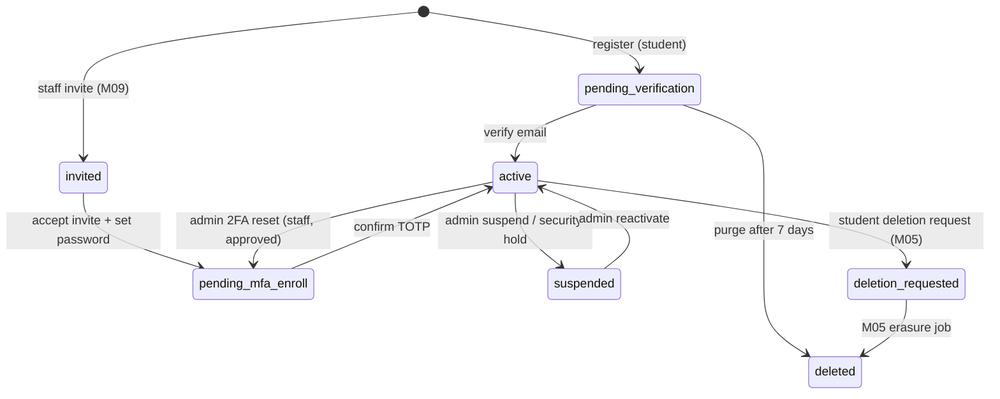
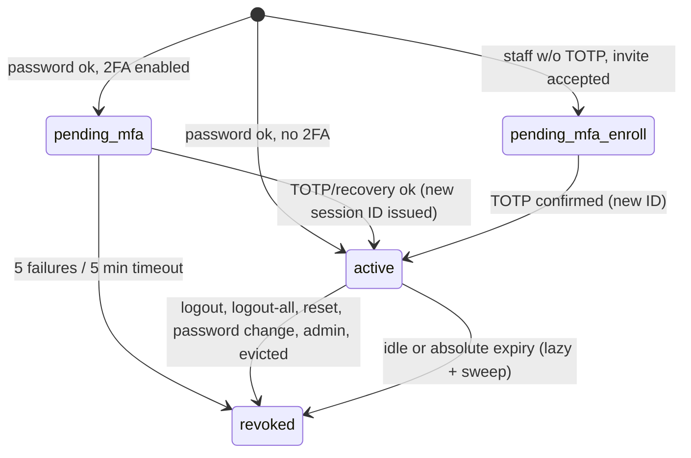
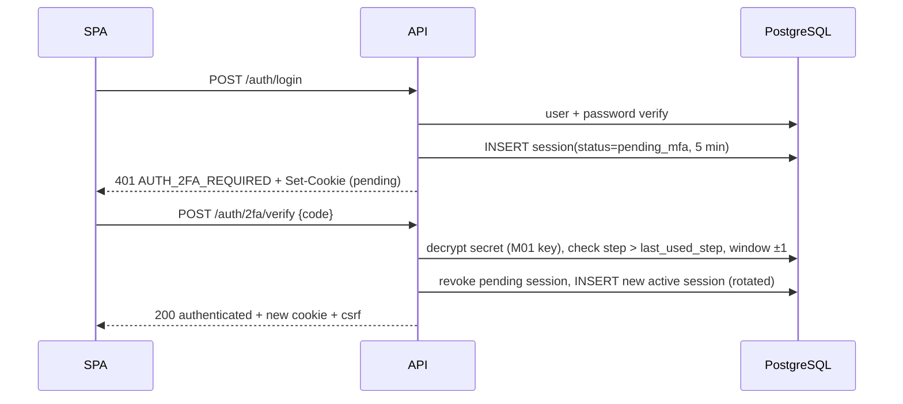

# LLD: M02 — Authentication and Sessions

| Field | Value |
|-------|-------|
| Module | M02 |
| Status | Review |
| Depends on HLD | `hld.md` (also M01 `lld.md` for RLS context, rate limits, keys) |
| Last updated | 2026-11-24 |

## 1. Database

Extensions required (M01 migration 0001): `citext`, `pgcrypto`.

### Tables

| Table | Column | Type | Constraints | Notes |
|-------|--------|------|-------------|-------|
| `users` | `id` | uuid | PK | UUIDv7 |
| | `email` | citext | NOT NULL, UNIQUE | Stored trimmed, NFKC-normalised; plus-tags preserved |
| | `user_type` | text | NOT NULL, CHECK in (`student`,`staff`) | |
| | `staff_kind` | text | NULL; CHECK in (`admin`,`accommodation_agent`,`consultancy`); CHECK (`user_type='staff'` ⇔ `staff_kind IS NOT NULL`) | Fine-grained roles/permissions in M09 |
| | `status` | text | NOT NULL, CHECK in (`pending_verification`,`invited`,`pending_mfa_enroll`,`active`,`suspended`,`deletion_requested`,`deleted`) | See §3.1 |
| | `password_hash` | text | NULL until set | Argon2id encoded string |
| | `password_pepper_id` | smallint | NOT NULL default 1 | Pepper version used |
| | `password_changed_at` | timestamptz | NULL | |
| | `email_verified_at` | timestamptz | NULL | |
| | `mfa_enabled` | boolean | NOT NULL default false | True only after TOTP confirmed |
| | `mfa_required` | boolean | GENERATED ALWAYS AS (`user_type = 'staff'`) STORED | REQ-AUTH-05 |
| | `session_epoch` | integer | NOT NULL default 0 | Increment to invalidate all sessions |
| | `locale` | text | NOT NULL default `en`, CHECK in (`en`,`de`) | |
| | `last_login_at` | timestamptz | NULL | |
| | `last_login_ip_hash` | bytea | NULL | HMAC, 16 bytes |
| | `created_at`, `updated_at` | timestamptz | NOT NULL | |
| | `deleted_at` | timestamptz | NULL | Set on erasure; PII columns nulled by M05 job |
| | *CHECKs* | | `status <> 'active' OR email_verified_at IS NOT NULL`; `NOT (user_type='staff' AND status='active' AND mfa_enabled = false)`; `status NOT IN ('active','pending_mfa_enroll') OR password_hash IS NOT NULL` | Enforces staff 2FA at DB level |
| `student_profiles` | `user_id` | uuid | PK, FK `users(id)` ON DELETE CASCADE | Only for `user_type='student'` |
| | `full_name` | varchar(120) | NOT NULL | As in passport |
| | `phone_e164` | varchar(16) | NOT NULL, CHECK `~ '^\+[1-9][0-9]{6,14}$'` | |
| | `country_code` | char(2) | NOT NULL, CHECK `~ '^[A-Z]{2}$'` | ISO 3166-1 alpha-2 (country of residence/citizenship — label "Country" in UI) |
| | `intake_term` | varchar(16) | NOT NULL | Value from `intake_options` setting |
| | `referral_ref_raw` | varchar(64) | NULL, CHECK `~ '^[A-Za-z0-9_-]{3,64}$'` | Passed to M10 |
| | `created_at`, `updated_at` | timestamptz | NOT NULL | |
| `sessions` | `id` | uuid | PK | Public handle (listing/revoking); not secret |
| | `token_hash` | bytea | NOT NULL, UNIQUE | SHA-256 of cookie value (32 bytes) |
| | `user_id` | uuid | NOT NULL, FK `users(id)` ON DELETE CASCADE | |
| | `realm` | text | NOT NULL, CHECK in (`student`,`staff`) | Must equal host realm |
| | `status` | text | NOT NULL, CHECK in (`pending_mfa`,`pending_mfa_enroll`,`active`,`revoked`) | |
| | `epoch` | integer | NOT NULL | Copy of `users.session_epoch` |
| | `created_at` | timestamptz | NOT NULL | |
| | `last_seen_at` | timestamptz | NOT NULL | Updated at most every 5 min |
| | `idle_expires_at` | timestamptz | NOT NULL | Sliding |
| | `absolute_expires_at` | timestamptz | NOT NULL | Fixed |
| | `mfa_verified_at` | timestamptz | NULL | |
| | `step_up_at` | timestamptz | NULL | Last password/TOTP re-auth |
| | `mfa_attempts` | smallint | NOT NULL default 0 | Revoke session at 5 |
| | `user_agent` | varchar(256) | NULL | Truncated |
| | `ip_hash` | bytea | NULL | |
| | `revoked_at` | timestamptz | NULL | |
| | `revoke_reason` | text | NULL | `logout`,`logout_all`,`password_changed`,`reset`,`admin`,`expired`,`evicted`,`mfa_failed` |
| `auth_tokens` | `id` | uuid | PK | Token ID; embedded in the link |
| | `user_id` | uuid | NOT NULL, FK | |
| | `purpose` | text | NOT NULL, CHECK in (`email_verify`,`password_reset`,`staff_invite`) | |
| | `mac_key_id` | smallint | NOT NULL default 1 | `TOKEN_HMAC_KEY` version |
| | `expires_at` | timestamptz | NOT NULL | |
| | `used_at` | timestamptz | NULL | Single use |
| | `superseded_at` | timestamptz | NULL | Set when a newer token of same purpose is issued |
| | `requested_ip_hash` | bytea | NULL | |
| | `created_at` | timestamptz | NOT NULL | |
| `mfa_totp` | `user_id` | uuid | PK, FK | |
| | `secret_ciphertext` | bytea | NOT NULL | AES-256-GCM via M01 field key |
| | `key_id` | text | NOT NULL, FK `encryption_key_registry` | |
| | `confirmed_at` | timestamptz | NULL | NULL = enrolment pending |
| | `last_used_step` | bigint | NOT NULL default 0 | Replay protection (30 s steps) |
| | `created_at` | timestamptz | NOT NULL | |
| `mfa_recovery_codes` | `id` | uuid | PK | |
| | `user_id` | uuid | NOT NULL, FK | |
| | `code_hash` | bytea | NOT NULL | HMAC-SHA256(`TOKEN_HMAC_KEY`, code) |
| | `used_at` | timestamptz | NULL | |
| | `created_at` | timestamptz | NOT NULL | |
| | | | UNIQUE (`user_id`,`code_hash`) | 10 rows per generation; regenerate deletes old |

Token secret format (so the worker can build the email link from `tokenId` alone, without raw tokens in DB or queue payloads):

```
token = base64url( uuid_bytes(tokenId) || HMAC-SHA256(TOKEN_HMAC_KEY[mac_key_id], "nivo.tok.v1|" || purpose || "|" || tokenId)[0..24] )
```

Verification parses `tokenId`, loads the row, recomputes the MAC, compares in constant time, then checks `used_at IS NULL AND superseded_at IS NULL AND expires_at > now()`. A DB leak alone does not reveal valid tokens; a key leak alone is useless without token IDs.

### Indexes

- `users (email)` unique (citext); `users (status, created_at)` for purge job.
- `sessions (user_id, status)`, `sessions (idle_expires_at)`, `sessions (absolute_expires_at)`.
- `auth_tokens (user_id, purpose) WHERE used_at IS NULL AND superseded_at IS NULL`; `auth_tokens (expires_at)`.
- `mfa_recovery_codes (user_id) WHERE used_at IS NULL`.
- `student_profiles (country_code)`, `(intake_term)` for admin filters.

### RLS policies

All tables: `ENABLE` + `FORCE ROW LEVEL SECURITY`; `nivo_app` only.

```sql
-- users
CREATE POLICY users_self_select ON users FOR SELECT TO nivo_app
  USING (id = app_user_id());
CREATE POLICY users_staff_select ON users FOR SELECT TO nivo_app
  USING (app_actor_type() = 'staff');            -- coarse; field/permission checks in app (M09)
CREATE POLICY users_system_all ON users FOR ALL TO nivo_app
  USING (app_is_system()) WITH CHECK (app_is_system());
-- No user-context INSERT/UPDATE/DELETE: all writes happen in system context inside AuthService
-- with WHERE id = :ctxUserId (reviewed + tested, T-AUTH-081).

-- student_profiles
CREATE POLICY sp_self_select ON student_profiles FOR SELECT TO nivo_app USING (user_id = app_user_id());
CREATE POLICY sp_self_update ON student_profiles FOR UPDATE TO nivo_app
  USING (user_id = app_user_id()) WITH CHECK (user_id = app_user_id());
CREATE POLICY sp_staff_select ON student_profiles FOR SELECT TO nivo_app USING (app_actor_type() = 'staff');
CREATE POLICY sp_system_all ON student_profiles FOR ALL TO nivo_app
  USING (app_is_system()) WITH CHECK (app_is_system());
-- consultancy actor: no policy => no rows (M10 uses pseudonymised views, not this table)

-- sessions
CREATE POLICY sess_self_select ON sessions FOR SELECT TO nivo_app USING (user_id = app_user_id());
CREATE POLICY sess_self_revoke ON sessions FOR UPDATE TO nivo_app
  USING (user_id = app_user_id()) WITH CHECK (user_id = app_user_id() AND status = 'revoked');
CREATE POLICY sess_system_all ON sessions FOR ALL TO nivo_app
  USING (app_is_system()) WITH CHECK (app_is_system());

-- auth_tokens, mfa_totp, mfa_recovery_codes: system only
CREATE POLICY at_system_all ON auth_tokens FOR ALL TO nivo_app
  USING (app_is_system()) WITH CHECK (app_is_system());
-- (same pattern for mfa_totp, mfa_recovery_codes)
```

Triggers: `set_updated_at` on `users`, `student_profiles`; trigger forbidding changes to `users.user_type`/`staff_kind` after insert (`protect_user_type()`); trigger on `sessions` forbids reviving (`revoked` → other status).

### Seed / config

`intake_options` (admin-managed list in M09 settings; default e.g. `WS2027`, `SS2027`, `WS2028`), `countries` (static ISO list in `packages/shared`).

## 2. API endpoints

Base `/api/v1`. "Perm" column: `public`; `session` (any active session); `session+verified` (student, verified); `staff:<permission>` (M09 permission string, deny by default). All unsafe methods require CSRF (`X-CSRF-Token`) unless marked `csrf:no`. Authenticated responses carry `Cache-Control: no-store`.

| Method | Path | Permission | Request | Response | Errors | Rate limit | Idempotency |
|--------|------|------------|---------|----------|--------|------------|-------------|
| GET | `/auth/csrf` | public | — | `200 {csrfToken}`; sets `__Host-nivo_csrf` cookie | — | 60/min/IP | n/a |
| POST | `/auth/register` | public (host `app.` only) | `RegisterBody` | `202 {status:'verification_sent'}` (always, incl. existing email) | `VALIDATION_FAILED`, `RATE_LIMITED` | 5/h/IP; 3/day/email-hash | n/a (natural dedupe by email) |
| POST | `/auth/verify-email` | public | `{token}` | `200 {status:'verified'}` | `AUTH_TOKEN_INVALID` (400, covers expired/used/unknown), `RATE_LIMITED` | 20/h/IP | Re-using token → `AUTH_TOKEN_INVALID` |
| POST | `/auth/resend-verification` | public | `{email}` | `202 {status:'sent_if_applicable'}` | `RATE_LIMITED` | 3/h/email-hash, 60 s cooldown, 10/day/IP | n/a |
| POST | `/auth/login` | public | `LoginBody` | `200 {status:'authenticated', session}` or `200 {status:'mfa_enrollment_required'}`; or `401 AUTH_2FA_REQUIRED` (pending-MFA cookie set) | `AUTH_INVALID_CREDENTIALS`, `AUTH_EMAIL_NOT_VERIFIED`, `AUTH_LOCKED`, `AUTH_2FA_REQUIRED`, `RATE_LIMITED`, `FORBIDDEN` (suspended/deleted → generic invalid credentials) | See §2.2 | n/a |
| POST | `/auth/2fa/verify` | session (`pending_mfa`) | `{code}` or `{recoveryCode}` | `200 {status:'authenticated', session}` (session rotated) | `AUTH_2FA_INVALID` (401), `AUTH_LOCKED`, `UNAUTHORIZED` | 5 attempts/session; 10/15 min/user | n/a |
| POST | `/auth/logout` | session (any status) | — | `204`; cookies cleared | — | 30/min/user | Idempotent |
| POST | `/auth/logout-all` | session | — | `204`; epoch bumped | — | 5/h/user | Idempotent |
| GET | `/auth/session` | session (any non-revoked status) | — | `200 SessionView` | `UNAUTHORIZED` | 120/min/user | n/a |
| POST | `/auth/password/forgot` | public | `{email}` | `202 {status:'sent_if_applicable'}` | `RATE_LIMITED` | 3/h/email-hash; 10/h/IP | n/a |
| POST | `/auth/password/reset` | public | `{token, newPassword}` | `200 {status:'password_reset'}`; all sessions revoked | `AUTH_TOKEN_INVALID`, `VALIDATION_FAILED` | 10/h/IP | Single-use token |
| POST | `/auth/password/change` | session+verified (active) | `{currentPassword, newPassword}` | `200`; other sessions revoked; current rotated | `AUTH_INVALID_CREDENTIALS`, `VALIDATION_FAILED`, `RATE_LIMITED` | 5/h/user | n/a |
| POST | `/auth/step-up` | session (active) | `{password}` or `{code}` | `200 {stepUpValidUntil}` | `AUTH_INVALID_CREDENTIALS`, `AUTH_2FA_INVALID`, `RATE_LIMITED` | 5/10 min/user | n/a |
| POST | `/auth/2fa/enroll/start` | session (`active` or `pending_mfa_enroll`) | — | `200 {otpauthUri, secretBase32, issuer:'NIVO'}` (secret shown once) | `CONFLICT` (already enabled) | 5/h/user | Repeat call replaces unconfirmed secret |
| POST | `/auth/2fa/enroll/confirm` | session (`active`/`pending_mfa_enroll`) | `{code}` | `200 {recoveryCodes:[10]}` (shown once); staff session promoted to `active`, rotated | `AUTH_2FA_INVALID`, `CONFLICT` | 10/h/user | n/a |
| POST | `/auth/2fa/disable` | session+verified, **student only**, step-up ≤5 min | `{code}` | `200`; other sessions revoked | `STEP_UP_REQUIRED`, `AUTH_2FA_INVALID`, `FORBIDDEN` (staff) | 5/h/user | n/a |
| POST | `/auth/2fa/recovery-codes/regenerate` | session, step-up ≤5 min | `{code}` | `200 {recoveryCodes:[10]}` | `STEP_UP_REQUIRED`, `AUTH_2FA_INVALID` | 3/h/user | n/a |
| GET | `/auth/sessions` | session (active) | — | `200 [{id, createdAt, lastSeenAt, uaFamily, current}]` (no IPs) | — | 30/min/user | n/a |
| DELETE | `/auth/sessions/:id` | session (active), own only | — | `204` | `NOT_FOUND` (also for other users' IDs) | 30/min/user | Idempotent |
| POST | `/auth/staff-invite/accept` | public | `{token, newPassword}` | `200 {status:'mfa_enrollment_required'}`; creates `pending_mfa_enroll` session | `AUTH_TOKEN_INVALID`, `VALIDATION_FAILED` | 10/h/IP | Single-use |
| GET | `/me/profile` | session+verified | — | `200 StudentProfileView` | — | 60/min/user | n/a |
| PATCH | `/me/profile` | session+verified (student) | `ProfilePatchBody` | `200 StudentProfileView` | `VALIDATION_FAILED`, `CONFLICT` (name locked after payment) | 20/h/user | n/a |
| POST | `/admin/auth/users/:id/sessions/revoke` | `staff:auth.session.revoke` + step-up | `{reason}` | `204` | `FORBIDDEN`, `STEP_UP_REQUIRED`, `NOT_FOUND` | 30/h/user | Idempotent |
| POST | `/admin/auth/users/:id/unlock` | `staff:auth.user.unlock` + step-up | `{reason}` | `204` (clears lock buckets for email-hash) | same | 30/h/user | Idempotent |
| POST | `/admin/auth/users/:id/suspend` and `/reactivate` | `staff:auth.user.suspend` + step-up | `{reason}` | `204` | same | 30/h/user | Idempotent |
| POST | `/admin/auth/users/:id/2fa-reset` | `staff:auth.2fa.reset` + step-up | `{reason}` | `202 {approvalId}` (maker-checker via M09; executed on approval) | `APPROVAL_REQUIRED`, `STEP_UP_REQUIRED` | 10/h/user | By approvalId |
| GET | `/admin/auth/users/:id/security` | `staff:auth.user.read` | — | `200 {status, mfaEnabled, lastLoginAt, activeSessions, locked}` | `FORBIDDEN`, `NOT_FOUND` | 120/min/user | n/a |

Staff routes are only served on the `admin.` host; student routes on `app.`. A `realm` mismatch returns `UNAUTHORIZED`.

Error catalog additions (to merge into `00-error-catalog.md`; see GAP-TRACE-M02): `AUTH_TOKEN_INVALID` (400, "This link is invalid or has expired."), `AUTH_2FA_INVALID` (401, "The code is incorrect."), `CSRF_INVALID` (403, "Your session could not be verified. Reload and try again.").

### 2.1 Cookies

| Cookie | Realm | Attributes | Value |
|--------|-------|-----------|-------|
| `__Host-nivo_sid` | student (`app.`) | `HttpOnly; Secure; SameSite=Lax; Path=/` (no `Domain`); `Max-Age` = absolute remaining for persistent login, else session cookie | 32 random bytes base64url |
| `__Host-nivo_staff_sid` | staff (`admin.`) | same, session cookie only | same |
| `__Host-nivo_csrf` | both | `HttpOnly; Secure; SameSite=Lax; Path=/` | `rand16` base64url |

No auth data in `localStorage`/`sessionStorage`. SPA keeps CSRF token in memory only.

### 2.2 Login throttling (REQ-AUTH-07)

Counters via M01 `rateLimit`; keys hashed. A **failed** attempt increments; success clears the (email, IP) key.

| Rule | Student | Staff | Effect |
|------|---------|-------|--------|
| `login:ip` (all attempts) | 30 / 15 min | 15 / 15 min | `429 RATE_LIMITED` |
| `login:email+ip` (failures) | 5 / 15 min | 3 / 15 min | `423 AUTH_LOCKED` for 15 min (that pair only) |
| `login:email` (failures, any IP) | 20 / 1 h | 8 / 1 h | `423 AUTH_LOCKED` 30 min (progressive: ×4 on repeat within 24 h, cap 4 h); owner emailed once per lock (`auth_account_locked`) if account exists |
| `mfa:user` | 10 / 15 min | 6 / 15 min | `423 AUTH_LOCKED` |
| `mfa:session` | 5 attempts | 3 attempts | Session revoked (`mfa_failed`) |

Keys exist whether or not the account does, so lock behaviour is identical for unknown emails.

### Zod schemas

```ts
// packages/shared/src/auth.ts
import { z } from 'zod';

const nfc = (s: string) => s.normalize('NFC').trim().replace(/\s+/g, ' ');

export const Email = z.string().trim().toLowerCase().max(254).email();
export const Password = z.string().min(12).max(128);          // composition rules intentionally absent
export const FullName = z.string().transform(nfc)
  .pipe(z.string().min(2).max(120).regex(/^[\p{L}\p{M}][\p{L}\p{M} .'’\-]*[\p{L}\p{M}.]$/u));
export const PhoneE164 = z.string().trim().regex(/^\+[1-9][0-9]{6,14}$/);
export const CountryCode = z.string().length(2).regex(/^[A-Z]{2}$/).refine(isIsoCountry);
export const IntakeTerm = z.string().max(16).refine(isActiveIntakeOption);   // server-side list
export const ReferralRef = z.string().trim().regex(/^[A-Za-z0-9_-]{3,64}$/).optional();
export const OpaqueToken = z.string().regex(/^[A-Za-z0-9_-]{54}$/);          // 16 + 24 bytes base64url = 54 chars

export const RegisterBody = z.object({
  fullName: FullName,
  email: Email,
  phone: PhoneE164,
  country: CountryCode,
  intake: IntakeTerm,
  password: Password,
  referralRef: ReferralRef,
  acceptedTermsVersionId: z.string().uuid(),       // must equal current published Terms version (M03)
  acknowledgedPrivacyVersionId: z.string().uuid(), // must equal current published Privacy version
}).strict();

export const LoginBody = z.object({ email: Email, password: z.string().min(1).max(128) }).strict();
export const VerifyEmailBody = z.object({ token: OpaqueToken }).strict();
export const ForgotBody = z.object({ email: Email }).strict();
export const ResetBody = z.object({ token: OpaqueToken, newPassword: Password }).strict();
export const ChangePasswordBody = z.object({ currentPassword: z.string().max(128), newPassword: Password }).strict();
export const TotpCode = z.string().regex(/^[0-9]{6}$/);
export const RecoveryCode = z.string().regex(/^[A-Z2-7]{5}-[A-Z2-7]{5}$/);
export const MfaVerifyBody = z.union([
  z.object({ code: TotpCode }).strict(),
  z.object({ recoveryCode: RecoveryCode }).strict(),
]);
export const StepUpBody = z.union([
  z.object({ password: z.string().max(128) }).strict(),
  z.object({ code: TotpCode }).strict(),
]);
export const ProfilePatchBody = z.object({
  fullName: FullName.optional(), phone: PhoneE164.optional(),
  intake: IntakeTerm.optional(), locale: z.enum(['en', 'de']).optional(),
}).strict().refine(v => Object.keys(v).length > 0);

export const SessionView = z.object({
  user: z.object({
    id: z.string().uuid(), type: z.enum(['student', 'staff']),
    staffKind: z.enum(['admin', 'accommodation_agent', 'consultancy']).nullable(),
    email: z.string(), fullName: z.string().nullable(),
    emailVerified: z.boolean(), mfaEnabled: z.boolean(), mfaRequired: z.boolean(),
  }),
  session: z.object({
    status: z.enum(['pending_mfa', 'pending_mfa_enroll', 'active']),
    expiresAt: z.string().datetime(), stepUpValidUntil: z.string().datetime().nullable(),
  }),
  csrfToken: z.string(),
  termsReacceptRequired: z.boolean(),                   // from M03
  paymentState: z.enum(['unpaid', 'processing', 'paid', 'refunded']).nullable(), // from M04 (students)
  onboardingStep: z.number().int().min(1).max(5).nullable(), // REQ-UX-01
  permissions: z.array(z.string()).optional(),          // staff only, from M09
});
```

### Guard pipeline (route policy declarations)

```ts
type RoutePolicy =
  | { auth: 'public' }
  | { auth: 'session', allow?: SessionStatus[], realm: 'student'|'staff',
      verified?: true, terms?: true, paid?: true,
      permission?: string, stepUpMaxAgeSec?: number };
```

Order: realm check → session lookup (system ctx, hash lookup, epoch/expiry/status) → set RLS context (`actor_type` = `student|staff|consultancy` from user) → `verified` → `terms` (M03) → `paid` (M04) → `permission` (M09) → `stepUp`. Failures map to `UNAUTHORIZED`, `AUTH_EMAIL_NOT_VERIFIED`, `TERMS_REACCEPT_REQUIRED`, `PAYMENT_REQUIRED`, `FORBIDDEN`, `STEP_UP_REQUIRED`. A route lacking a policy fails the `route-registry` test (T-AUTH-082).

Sessions in `pending_mfa` / `pending_mfa_enroll` may call only: `/auth/2fa/verify`, `/auth/2fa/enroll/*`, `/auth/logout`, `/auth/session`, `/auth/csrf`.

## 3. State machines

### 3.1 User status



Side effects: leaving `active` (suspend, deletion, reset) bumps `session_epoch` (all sessions invalid). `deleted` rows retain only `id`, `status`, `deleted_at`, `user_type` (email nulled → `email` replaced by `deleted+<id>@invalid`).

### 3.2 Session



Lifetimes: `pending_mfa` 5 min; student `active` idle 7 d / absolute 30 d; staff idle 30 min / absolute 8 h; `pending_mfa_enroll` 30 min. Step-up window 5 min (`step_up_at`).

### 3.3 Auth token

`issued` → (`superseded` when a newer same-purpose token is issued | `expired` at `expires_at`) → `used` (single use, set inside the same transaction as the state change). TTLs: verify 24 h, reset 30 min, invite 72 h.

### 3.4 2FA enrolment

`none` → `pending` (`mfa_totp.confirmed_at IS NULL`, start called) → `enabled` (confirm with valid code, recovery codes generated) → `none` (student disable with step-up; staff only via approved admin reset).

### 3.5 Login decision

1. Check throttles (`login:ip`, `login:email+ip`, `login:email`) → deny if blocked (`AUTH_LOCKED`/`RATE_LIMITED`).
2. Lookup user by email (system ctx). If none → verify against dummy hash (equalise time) → fail.
3. Verify password (Argon2id + pepper). If wrong → count failure → `AUTH_INVALID_CREDENTIALS`.
4. If status ∈ {`suspended`, `deleted`, `deletion_requested`} → count failure shape, return `AUTH_INVALID_CREDENTIALS` (no status leak).
5. If `pending_verification` → `AUTH_EMAIL_NOT_VERIFIED` (only reachable with correct password).
6. If `mfa_enabled` → create `pending_mfa` session → `401 AUTH_2FA_REQUIRED`.
7. Else if staff (`mfa_required`) → `pending_mfa_enroll` session → `200 mfa_enrollment_required`.
8. Else `active` session; rehash password if params/pepper outdated; update `last_login_*`; audit.

## 4. Sequence diagrams

### Happy path — register, verify, login

```mermaid
sequenceDiagram
  actor S as Student
  participant W as SPA
  participant A as API
  participant D as PostgreSQL
  participant Q as Queue/M11
  participant M as Mailbox
  S->>W: open /register?ref=ABC (prefill referral)
  W->>A: GET /auth/csrf
  A-->>W: csrf cookie + token
  S->>W: submit form (terms + privacy checkboxes)
  W->>A: POST /auth/register
  A->>A: rate limit, Zod, check version IDs current (M03)
  A->>D: BEGIN (system ctx)
  A->>D: INSERT users, student_profiles, auth_tokens(email_verify), consents (M03)
  A->>Q: enqueue email.send {auth_verify_email, userId, tokenId}
  A->>D: COMMIT
  A-->>W: 202 verification_sent
  Q->>M: email with link /verify-email#t=<token>
  S->>W: open link (token in URL fragment)
  W->>W: read fragment, history.replaceState(clean URL)
  W->>A: POST /auth/verify-email {token}
  A->>D: validate MAC, row, expiry; set used_at; users.status=active
  A-->>W: 200 verified
  W->>A: POST /auth/login
  A->>D: create session (hash)
  A-->>W: 200 + Set-Cookie __Host-nivo_sid + csrfToken
```

(Link fragment `#t=` is never sent to servers or logs; the SPA moves it into the POST body.)

### Login with 2FA



### Password reset

```mermaid
sequenceDiagram
  actor U as User
  participant A as API
  participant D as PostgreSQL
  U->>A: POST /auth/password/forgot {email}
  A->>A: throttle (email-hash, IP); constant-time branch
  A->>D: if user exists: supersede old tokens, INSERT reset token (30 min)
  A-->>U: 202 sent_if_applicable (always)
  U->>A: POST /auth/password/reset {token, newPassword}
  A->>D: BEGIN; validate token; policy check; hash; UPDATE users; used_at; session_epoch+1; COMMIT
  A->>U: (email) auth_password_changed
  A-->>U: 200 (all sessions revoked; user must log in)
```

### Staff invite and mandatory 2FA

M09 `POST /admin/staff` → `TokenService.issue('staff_invite', userId)` (status `invited`) → email → `POST /auth/staff-invite/accept` → session `pending_mfa_enroll` → `POST /auth/2fa/enroll/start` → `/confirm` → status `active`, session rotated to `active`.

### Failure paths

| Case | Behaviour |
|------|-----------|
| Registration, email already registered | Same `202`; owner gets `auth_account_exists` email (with reset link); no new rows; same CPU work (password hashed anyway) |
| Verification token expired/used/forged | `400 AUTH_TOKEN_INVALID` (identical body); SPA offers "Send a new link" |
| Login unknown email | Dummy Argon2 verify, `AUTH_INVALID_CREDENTIALS`; counters incremented |
| Login correct password, unverified | `403 AUTH_EMAIL_NOT_VERIFIED`; verification re-sent automatically (rate limited) |
| TOTP replay (same step) | `AUTH_2FA_INVALID`; counted as failure |
| CSRF missing/invalid, Origin mismatch | `403 CSRF_INVALID`; no state change; metric incremented |
| Session cookie for wrong realm | `401 UNAUTHORIZED`; cookie cleared |
| Expired session | `401 UNAUTHORIZED`; SPA redirects to login preserving safe `next` path (relative paths only) |
| Email queue down at registration | Transaction fails (enqueue is transactional) → `500 INTERNAL`; user can retry; no orphan account |
| DB down | `503`; no fail-open path in auth |

## 5. Validation rules

| Field | Client | API | DB |
|-------|--------|-----|----|
| `fullName` | Required, 2–120, Unicode letters/space/`.`/`'`/`-`; hint "exactly as in your passport" | Zod `FullName` (NFC, collapse spaces) | `varchar(120) NOT NULL` |
| `email` | HTML5 + regex; lowercase on blur | `Email` (trim, lowercase, RFC email, ≤ 254); reject disposable-domain list (config, low-risk list, admin-editable) | citext UNIQUE |
| `phone` | Country-code picker; formats to E.164 (libphonenumber) | `PhoneE164` + libphonenumber `isValid` | CHECK regex |
| `country` | Select from ISO list | In ISO list; blocked-country policy (GAP-AUTH-COUNTRY-LIST) | `char(2)` CHECK |
| `intake` | Select | Must be in active `intake_options` | `varchar(16)` |
| `password` | Strength meter (zxcvbn), min 12, show/hide | 12–128, not in breached list, zxcvbn ≥ 3, must not contain email local-part or name tokens (≥ 4 chars) | Hash only |
| `referralRef` | Prefilled from `?ref=`; editable, optional | Regex; stored raw, resolved by M10 | CHECK regex |
| `acceptedTermsVersionId`, `acknowledgedPrivacyVersionId` | Unticked checkboxes with links to `/terms`, `/privacy`; submit disabled until ticked | Must equal current published version IDs (M03); mismatch → `VALIDATION_FAILED` code `LEGAL_VERSION_STALE` | FK in `consents` |
| `token` | n/a | 54-char base64url, MAC verified | `auth_tokens` row state |
| `code` (TOTP) | 6 digits, autocomplete `one-time-code` | `^[0-9]{6}$`; step > `last_used_step`; window ±1 | `last_used_step` |
| `recoveryCode` | Uppercased input | `^[A-Z2-7]{5}-[A-Z2-7]{5}$` | UNIQUE hash |
| `next` redirect | n/a | Relative path only (`^/(?!/)`), allowlist of SPA routes | n/a |
| Unknown JSON keys | n/a | Rejected (`.strict()`) | n/a |

Argon2id parameters (config): `memoryCost=65536 KiB, timeCost=3, parallelism=1, hashLength=32, saltLength=16`, `secret=AUTH_PEPPER[pepper_id]`. Re-hash on login when `needsRehash` or `password_pepper_id` is stale. Global semaphore of 4 concurrent hashes; queue wait > 2 s → `503 INTERNAL` (shed load rather than OOM).

TOTP parameters: SHA-1, 6 digits, 30 s step, 160-bit secret, window ±1 step, issuer `NIVO`, label = email.

Recovery codes: 10 codes, 10 base32 chars shown as `XXXXX-XXXXX`, generated with CSPRNG, stored as HMAC; shown once; using one emails the owner.

## 6. Background jobs

All payloads contain IDs only (no email, no tokens).

| Job | Trigger | Retry | Dead letter | Payload rules |
|-----|---------|-------|-------------|---------------|
| `auth.purge_unverified` | cron `20 3 * * *` | 3 | `auth.purge_unverified_dlq` | `{}`; deletes `users` in `pending_verification` older than 7 days (cascades profile/tokens/sessions) and calls M03 `consents.eraseForUser`; No PII |
| `auth.purge_tokens` | cron `30 3 * * *` | 3 | dlq | `{}`; deletes `auth_tokens` expired/used > 7 days |
| `auth.purge_sessions` | cron `40 * * * *` | 3 | dlq | `{}`; marks idle/absolute-expired as `revoked(expired)`; deletes revoked > 30 days |
| `auth.staff_mfa_audit` | cron `0 4 * * *` | 1 | alert | `{}`; asserts no staff `active` without `mfa_enabled`; raises `ops_alert` if any |
| `auth.send_security_email` | enqueued on events (lock, password changed, 2FA changes, recovery code used) | 5, exp backoff | `email.send_dlq` (M11) | `{templateKey, userId, eventId}` — rendered by worker |
| `auth.hash_semaphore_metrics` | cron `* * * * *` | 0 | n/a | `{}`; exports hash queue depth |
| `domain.auth.registered` (to M10) | enqueued in registration tx | 5 | dlq | `{userId}` — M10 reads `referral_ref_raw` itself |

## 7. Emails

All templates in M11 with brand styling (Poppins fallback to Arial, Orange `#FB770B` accent, Beige `#F5EFE6` background, Charcoal `#2D2A26` text). Links use `APP_ORIGIN`/`ADMIN_ORIGIN`; verification and reset links carry the token in the **URL fragment** (`#t=`), never in the query. Worker derives the token from `tokenId` (see §1). Sent from `no-reply@`, reply-to `support@`.

| Template key | Trigger | Content summary |
|--------------|---------|-----------------|
| `auth_verify_email` | Register; resend; login while unverified | "Confirm your email", button + link valid 24 h, ignore-if-not-you note |
| `auth_account_exists` | Register with existing email | "You already have a NIVO account", link to login and to reset password; no verification link |
| `auth_email_verified` | Verification success | Short confirmation + link to login (stepper step 3: payment) |
| `auth_password_reset` | Forgot (only if account exists) | Reset button valid 30 min; "If you did not request this, ignore" |
| `auth_password_changed` | Reset complete or change | Time, approximate device (UA family, no IP), "Not you? Reset now + contact support" |
| `auth_account_locked` | Account-level lock triggered | Lock duration, advice, link to reset |
| `auth_2fa_enabled` / `auth_2fa_disabled` | Enrol confirm / disable | Time + security advice |
| `auth_recovery_code_used` | Recovery code login | Remaining codes count, advice to regenerate |
| `auth_2fa_reset_by_admin` | Approved admin 2FA reset | Staff must re-enrol on next login |
| `auth_staff_invite` | M09 invites staff | Invitation link valid 72 h; explains mandatory 2FA |
| `auth_new_session_notice` | *(optional, off by default)* login from new device | Disabled in Phase 1 to limit noise |

## 8. Audit events

Written via M09 `audit.append` (hash-chained). Never include passwords, tokens, TOTP secrets/codes, or full IPs (IP hash only). Security-relevant events are written in the same transaction as the state change (fail closed).

| Action | Before/After | Reason required |
|--------|--------------|-----------------|
| `auth.register.created` | — / `{userId, referralPresent}` | No |
| `auth.register.duplicate_email` | `{emailHash}` | No |
| `auth.email.verified` | `status: pending_verification → active` | No |
| `auth.login.succeeded` | `{userId, realm, mfa: bool, ipHash}` | No |
| `auth.login.failed` | `{emailHash, ipHash, reason: bad_password|unknown|locked|unverified}` | No (rate sampled: first 5 per key per window) |
| `auth.lockout.triggered` | `{emailHash, rule, until}` | No |
| `auth.logout` / `auth.logout_all` | `{sessionId}` / `{epoch: n → n+1}` | No |
| `auth.password.reset_requested` | `{userId}` (only if exists) | No |
| `auth.password.reset_completed` / `auth.password.changed` | `{userId, sessionsRevoked: n}` | No |
| `auth.mfa.enrolled` / `auth.mfa.disabled` | `mfa_enabled false↔true` | Disabled: no (step-up required) |
| `auth.mfa.failed` | `{userId, sessionId, kind: totp|recovery}` | No |
| `auth.mfa.recovery_used` | `{remaining}` | No |
| `auth.stepup.succeeded` / `.failed` | `{method: password|totp}` | No |
| `auth.session.revoked` | `{sessionId, reason}` | Admin: yes |
| `auth.admin.unlock` | `{userId}` | Yes |
| `auth.admin.suspend` / `.reactivate` | `status: active ↔ suspended` | Yes |
| `auth.admin.mfa_reset` | `mfa_enabled true → false` + approval ID | Yes |
| `auth.staff.invite_accepted` | `status: invited → pending_mfa_enroll` | No |
| `auth.profile.updated` | field names only (not values for phone) | No |

## 9. Config / admin settings

| Key | Default | Changeable via | Notes |
|-----|---------|----------------|-------|
| `auth.student.idle_days` / `absolute_days` | 7 / 30 | Deploy config | |
| `auth.staff.idle_minutes` / `absolute_hours` | 30 / 8 | Deploy config | |
| `auth.stepup.window_sec` | 300 | Deploy config | |
| `auth.verify.ttl_hours` / `reset.ttl_minutes` / `invite.ttl_hours` | 24 / 30 / 72 | Deploy config | |
| `auth.password.min_length` | 12 | Deploy config | |
| `auth.argon2.*` | per §5 | Deploy config | Increases trigger rehash on next login |
| `auth.unverified_purge_days` | 7 | Deploy config | |
| `auth.intake_options` | list | M09 settings (draft/publish) | |
| `auth.disposable_email_domains` | list | M09 settings | |
| `auth.max_sessions.student` / `.staff` | 10 / 3 | Deploy config | Oldest evicted |
| Secrets | `AUTH_PEPPER` (versioned), `CSRF_HMAC_KEY`, `TOKEN_HMAC_KEY`, `IP_HASH_KEY` | M01 secrets | Pepper rotation: add new ID, rehash on login, retire after 90 days of reset campaign |

## 10. Logging and redaction

Never logged: passwords (plain or hash), pepper, session cookie value, CSRF tokens, verification/reset/invite tokens (including full URLs — the fragment is not sent to the server, and `Referer` is `no-referrer`), TOTP secrets, TOTP codes, recovery codes, emails (use `emailHash`), phone numbers, full names, full IPs, `Set-Cookie`/`Cookie` headers, request bodies for `/auth/*`.

Allowed fields on auth logs: `requestId`, `route`, `outcome` (`ok|invalid|locked|throttled`), `userIdHash`, `emailHash`, `ipHash`, `ruleName`, `sessionIdHash` (first 8 hex of SHA-256 of the session UUID). Tests assert that a failed-login fixture produces log lines containing none of the above (T-AUTH-083).

Metrics: `auth_login_total{outcome}`, `auth_lockouts_total{rule}`, `auth_csrf_failures_total`, `auth_hash_queue_depth`, `auth_active_sessions`, `auth_mfa_failures_total`.

## 11. Test cases

| ID | Layer | Description | Expected |
|----|-------|-------------|----------|
| T-AUTH-001 | integration | Register with valid fields, current Terms/Privacy version IDs, referral ref | `202`; user `pending_verification`; profile row; `consents` rows (Terms + Privacy) with version + time; verification email enqueued; audit event; no session cookie |
| T-AUTH-002 | integration | Register with already-registered email | Same `202` body; no new user; `auth_account_exists` enqueued; response time within 20 % of new-user path |
| T-AUTH-003 | unit | `RegisterBody` rejects missing fields, bad phone, bad country, unknown intake, extra keys | `VALIDATION_FAILED` with field paths |
| T-AUTH-004 | integration | Register with stale Terms version ID or unticked acknowledgement | `400 VALIDATION_FAILED` (`LEGAL_VERSION_STALE`); nothing persisted |
| T-AUTH-005 | integration | `referralRef` stored raw; invalid chars rejected; `domain.auth.registered` job enqueued | Pass |
| T-AUTH-006 | unit | Name normalisation (NFC, whitespace), allows `O'Brien`, `Müller-Schmidt`, rejects digits/emoji | Pass |
| T-AUTH-007 | integration | Registration is atomic: queue failure rolls back user + consent rows | No orphan rows |
| T-AUTH-010 | integration | Verify with valid token | `200`; `email_verified_at` set; status `active`; token `used_at` set; `auth_email_verified` enqueued; audit |
| T-AUTH-011 | integration | Verify with expired token / tampered MAC / unknown ID | Identical `400 AUTH_TOKEN_INVALID` |
| T-AUTH-012 | integration | Reuse a used token; use superseded token after resend | `AUTH_TOKEN_INVALID` |
| T-AUTH-013 | integration | Login with correct password before verify | `403 AUTH_EMAIL_NOT_VERIFIED`; no session; wrong password still `AUTH_INVALID_CREDENTIALS` |
| T-AUTH-014 | integration | Resend: 60 s cooldown, 3/h limit, unknown email returns identical `202` | `RATE_LIMITED` after limit; no enumeration |
| T-AUTH-015 | integration | `auth.purge_unverified` deletes 8-day-old unverified users and their consents, keeps 6-day-old | Pass |
| T-AUTH-016 | e2e | Mail scanner simulation: GET on link URL does not consume token | Token still valid |
| T-AUTH-020 | integration | Forgot → reset happy path | `202` then `200`; password changed; token used; all sessions revoked; `auth_password_changed` enqueued |
| T-AUTH-021 | integration | Reset token used at minute 31 | `AUTH_TOKEN_INVALID` |
| T-AUTH-022 | integration | Forgot for unknown vs known email | Identical status/body; timing within tolerance; email only for known |
| T-AUTH-023 | integration | Session cookie of an old session after reset | `401 UNAUTHORIZED` |
| T-AUTH-024 | integration | Second forgot supersedes first token | First token invalid, second valid |
| T-AUTH-025 | integration | Reset on unverified account sets `email_verified_at` | Account becomes `active` |
| T-AUTH-030 | integration | Login response `Set-Cookie` attributes | `__Host-nivo_sid`; `HttpOnly; Secure; SameSite=Lax; Path=/`; no `Domain`; value 43 chars base64url; DB stores only SHA-256 |
| T-AUTH-031 | integration | POST without `X-CSRF-Token` / with wrong token / with token from another session | `403 CSRF_INVALID` each; GET unaffected |
| T-AUTH-032 | integration | Valid token bound to session A rejected on session B | `CSRF_INVALID` |
| T-AUTH-033 | integration | `Origin: https://evil.example` with valid cookie+token | `CSRF_INVALID`; missing Origin + `Sec-Fetch-Site: cross-site` rejected |
| T-AUTH-034 | integration | Session ID rotates on login, 2FA verify, password change, enrolment confirm (old ID unusable) | Pass (fixation resistance) |
| T-AUTH-035 | integration | Idle and absolute expiry for student and staff (fake clock) | `401` after limits |
| T-AUTH-036 | integration | Logout revokes server-side; replaying cookie fails; `logout-all` bumps epoch | `401` |
| T-AUTH-037 | e2e | After login, `localStorage`/`sessionStorage`/JS-accessible cookies contain no session or token | Assertion passes |
| T-AUTH-038 | integration | Student cookie sent to `admin.` host and vice versa | `401`; no cross-realm session |
| T-AUTH-039 | integration | Session list shows only own sessions; `DELETE /auth/sessions/:otherUserSession` | `404` |
| T-AUTH-040 | e2e + integration | Invited staff accepts invite, cannot reach any route except enrolment until TOTP confirmed; then `active`; DB CHECK blocks `active` staff without `mfa_enabled` | Pass; direct SQL attempt fails |
| T-AUTH-041 | integration | Student enables 2FA (start, confirm); next login returns `401 AUTH_2FA_REQUIRED` then verify succeeds | Pass |
| T-AUTH-042 | unit/integration | TOTP replay of same code in same step; code from step ±2 | `AUTH_2FA_INVALID`; ±1 accepted |
| T-AUTH-043 | integration | Recovery code works once; second use fails; owner emailed | Pass |
| T-AUTH-044 | integration | 5 wrong codes revoke pending session (3 for staff) | Session `revoked(mfa_failed)`; `AUTH_LOCKED` after user-level cap |
| T-AUTH-045 | integration | Student disable 2FA requires step-up ≤ 5 min and valid code; staff attempt | `STEP_UP_REQUIRED` / success / `FORBIDDEN` |
| T-AUTH-046 | integration | TOTP secret in DB is ciphertext; decrypts only with M01 key; wrong `key_id` fails closed | Pass |
| T-AUTH-047 | integration | Admin 2FA reset requires step-up + approval by different admin; executes on approval; target staff must re-enrol; sessions revoked | `202`, then `APPROVAL_REQUIRED` until approved |
| T-AUTH-050 | integration | 6th failed login for (email, IP) | `423 AUTH_LOCKED` 15 min; correct password during lock also refused |
| T-AUTH-051 | integration | 20 failures across IPs for one email | Account-level lock; owner `auth_account_locked` email once |
| T-AUTH-052 | integration | Same attack on non-existent email | Same codes/timing/lock behaviour; no email sent |
| T-AUTH-053 | integration | Register 6 times from one IP in an hour | `429 RATE_LIMITED` on 6th |
| T-AUTH-054 | integration | Forgot > 3/h per email | `429` (response shape unchanged for unknown email) |
| T-AUTH-055 | integration | Staff thresholds (3 failures) stricter than student | Pass |
| T-AUTH-056 | integration | Rate-limit store failure on login | Fail closed (`429`/`503`), never allow |
| T-AUTH-060 | unit | Argon2id hash uses configured params and pepper; `needsRehash` triggers on login with old params | Hash updated |
| T-AUTH-061 | unit | Password policy: length 11 rejected, breached list entry rejected, contains email local-part rejected, 12+ strong accepted | Pass |
| T-AUTH-062 | integration | Change password revokes all other sessions, rotates current, emails owner | Pass |
| T-AUTH-063 | integration | Sensitive route without step-up; after step-up within 5 min; after 6 min | `STEP_UP_REQUIRED` / OK / `STEP_UP_REQUIRED` |
| T-AUTH-064 | integration | `PATCH /me/profile` fullName after payment | `409 CONFLICT` |
| T-AUTH-070 | integration | Admin unlock/revoke/suspend need permission + step-up + reason; student/consultancy actors forbidden | `FORBIDDEN` / `STEP_UP_REQUIRED` |
| T-AUTH-071 | integration | Suspended user cannot log in (generic error) and existing sessions die | Pass |
| T-AUTH-080 | security | Enumeration battery over register/login/forgot/resend: compare status, body, headers, timing distribution (≥ 200 samples) | No distinguishing signal beyond noise |
| T-AUTH-081 | integration | RLS: student A cannot read B's `users`, `student_profiles`, `sessions`; consultancy actor reads nothing; student cannot write `users` | 0 rows / error |
| T-AUTH-082 | static | Route-registry test: every Fastify route declares a policy; no route uses `withSystemContext` outside allowlist | CI green |
| T-AUTH-083 | integration | Log capture during failed/successful logins, resets, 2FA contains none of: password, token, cookie, TOTP, email, IP | Pass |
| T-AUTH-084 | unit | Token derivation: MAC verified in constant time; token for purpose A rejected for purpose B; 54 chars | Pass |
| T-AUTH-085 | integration | `deleted`/`deletion_requested` account cannot log in; `next` open-redirect attempts (`//evil`, `https://evil`) rejected | Pass |
| T-AUTH-086 | integration | Concurrent-hash semaphore sheds load beyond limit without crashing | `503` after 2 s queue, process healthy |
