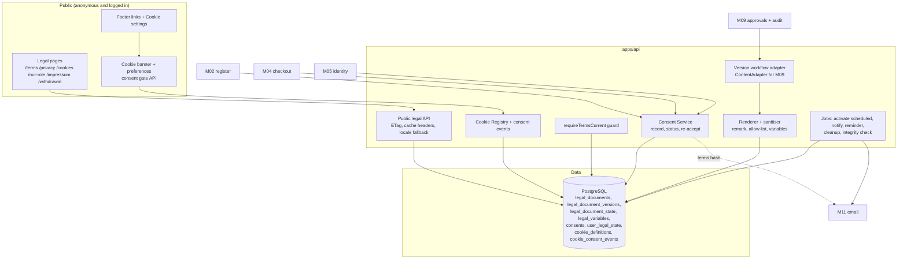
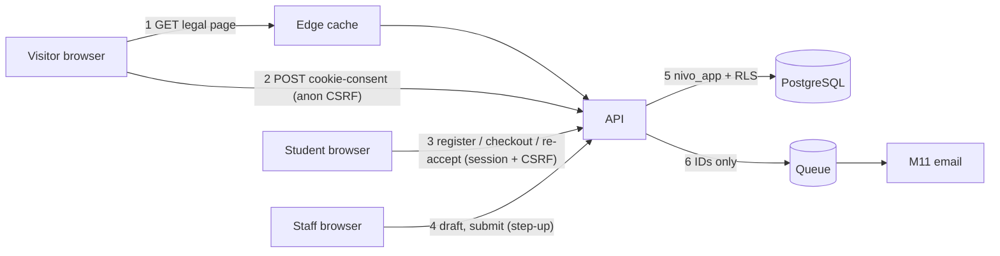

# HLD: M03 — Legal Pages, Cookies and Consent

| Field | Value |
|-------|-------|
| Module | M03 |
| Status | Review |
| Owner | NIVO Platform team (content owner: managing director; text author: counsel) |
| Last updated | 2026-11-24 |
| Requirements | REQ-LEG-01..06, REQ-AUTH-01 (acknowledgement at registration, with M02); checkout consent is REQ-LEG-05 (shared with M04) |
| Companion docs | `lld.md`; M02 (registration call); M04 (checkout call); M09 (approval and publish workflow); M11 (Terms PDF, update emails); `docs/privacy/cookie-inventory.md`, `docs/privacy/legal-review-checklist.md` |

## 1. Purpose and scope

M03 makes NIVO's legal position **provable**. It serves the six legal pages from versioned, immutable documents, records what each person agreed to (which text, which version, when), makes users accept a new Terms version before they continue, and runs the cookie banner and registry so that no optional cookie or script loads without consent.

**In scope**

- Six legal documents: `/terms`, `/cookies`, `/our-role`, `/privacy`, `/impressum`, `/withdrawal`, each versioned, with an `en` master and a `de`-ready structure (`/de/...`, `Content-Language`, fallback to `en`).
- Authoring workflow: draft → review (maker-checker via M09) → scheduled / published → superseded; published versions are immutable and kept forever.
- Company variables (`{{company.legal_name}}`, `{{company.vat_id}}`, …) resolved and snapshotted at publish.
- Consent ledger (append-only): Terms and Privacy at registration, withdrawal acknowledgement at checkout, Terms re-acceptance, identity-processing consent (written by M05), optional marketing email consent, consultancy share consent (type documented in M10).
- Terms re-acceptance: `reaccept_required` versions with a notice period, notification emails, a guard that blocks the app until accepted, reminder after 7 days.
- Cookie banner with exactly three equally weighted actions, preferences dialog, consent cookie, consent event log, cookie registry (what each cookie/storage key is, category, duration), consent gate for third-party scripts.
- Footer legal links on every page, including "Cookie settings".
- Hand-off of the accepted Terms version to M11, which renders the Terms PDF stored with the invoice.
- Placeholder protection: seed texts are never served in production; launch is gated by counsel's texts (GAP-LAWYER-TEXTS).

**Out of scope**

- The legal wording itself (lawyer deliverable).
- Rendering PDFs and email (M11); payment logic (M04); identity consent text (M05 owns the wording, M03 stores the record).
- Analytics or marketing tooling: none is configured in Phase 1; the banner and gate exist so that adding it later cannot bypass consent.
- Cookie scanning of third-party pages, automated legal-change monitoring, and full German translations (structure only).

## 2. Requirements covered

New IDs (★) are proposed additions to `00-traceability.md`.

| ID | Statement | Priority | Tests |
|----|-----------|----------|-------|
| REQ-LEG-01 | Six legal pages are versioned and editable by authorised staff | Must | T-LEG-001..009 |
| REQ-LEG-02 | Cookie banner has three equal buttons; no non-essential cookie or script before consent | Must | T-LEG-010..014 |
| REQ-LEG-03 | Terms acceptance saved with version, hash and time | Must | T-LEG-020, T-LEG-024 |
| REQ-LEG-04 | A new Terms version forces re-acceptance before the app is usable again | Must | T-LEG-021..023, 025 |
| REQ-LEG-05 | Checkout records Terms and withdrawal acknowledgement per version | Must | T-LEG-030..032 |
| REQ-AUTH-01 (part) | Terms and Privacy acknowledgement recorded at registration | Must | T-LEG-020 |
| REQ-LEG-06 | Legal publish uses draft / review / publish; prior versions retained | Must | T-LEG-004, 006, 008 |
| REQ-LEG-07 ★ | Published versions are immutable and carry a content hash; the exact text a user accepted can be reproduced | Must | T-LEG-004, 024 |
| REQ-LEG-08 ★ | Cookie registry lists every cookie and storage key; consent choices are logged without identifying the person by default | Must | T-LEG-011..014 |
| REQ-LEG-09 ★ | Placeholder legal text is never served in production; launch gated by counsel texts | Must | T-LEG-005 |
| REQ-LEG-10 ★ | Consent and cookie records are exportable for DSR and erasable according to retention (ledger tombstone) | Must | T-LEG-033, T-LEG-024 |

## 3. Component diagram

| Component | Responsibility |
|-----------|----------------|
| Public legal API | Serves published / superseded versions by slug, locale and version number; strong ETag = content hash; `Cache-Control: public, max-age=300`; purges on publish |
| Renderer and sanitiser | Markdown (no raw HTML) → allow-listed HTML; resolves `{{company.*}}` variables from an allow-list; blocks submit if a variable is empty or the sanitiser had to strip content |
| Version workflow adapter | Implements M09's `ContentAdapter` for type `legal`: create draft, validate, diff, freeze, publish (supersede previous, upsert `legal_document_state`, enqueue notifications) |
| Consent Service | `consents.record` (transactional, called by M02/M04/M05), `GET /legal/me/status`, `POST /legal/consents`, ledger export for DSR, staff read with reason (logged) |
| `requireTermsCurrent` guard | Per-request decision from `legal_document_state` and `user_legal_state`; students only; exempt routes for auth, legal pages, deletion and export |
| Cookie registry and events | Registry of cookies / storage keys by category; `registry_revision` and `banner_version` for re-prompting; append-only `cookie_consent_events` |
| Jobs | `legal.activate_scheduled` (every minute), `legal.notify_update`, `legal.reaccept_reminder`, `legal.cleanup_cookie_events`, `legal.cleanup_consents`, `legal.review_reminder`, `legal.state_integrity_check` |
| Frontend consent gate | `consent.allowed(category)`, `loadAfterConsent(category, loader)`; ESLint rule forbids direct third-party script tags; CSP `script-src 'self'` backs it up |

## 4. Data flows and trust boundaries

| # | Flow | Initiator | Boundary crossed | Data | Notes |
|---|------|-----------|------------------|------|-------|
| 1 | Read legal page | Anyone | Internet → Edge → App | Public text | Cacheable; placeholder versions blocked by RLS in production |
| 2 | Cookie consent decision | Visitor | Internet → App | `consentId` (random), choices, banner and registry revision, UA family | No user identifier unless logged in; no IP stored |
| 3 | Consent writes | Student | Internet → App → DB | Version IDs; IP HMAC, UA family | Version ID must equal current published (`LEGAL_VERSION_STALE`); written in the same transaction as registration / payment start |
| 4 | Authoring | Staff | Admin host → App → DB | Markdown, variables, change summary | Edits only in `draft` / `in_review`; publish only via approval executor (system context) |
| 5 | Persistence | App | App → DB | All M03 tables | RLS forced; ledger append-only by trigger and grants |
| 6 | Notifications | Jobs | App → Queue → Email | `{versionId, cursor}` then `{userId, versionId}` | No PII in job payloads; dedupe table `legal_notifications` |

**Trust boundary specific to M03:** the **publish transition**. Only the Approval Engine (system context) can move a version to `scheduled` or `published`, and a database trigger (`lv_publish_requires_approval`) rejects the transition unless an approval exists whose approver differs from author and submitter. A compromised editor account, or a bug in an endpoint, cannot publish legal text.

## 5. Inputs / outputs to other modules

| From / To | Contract | Failure behaviour |
|-----------|----------|-------------------|
| M02 → M03 | `consents.record(tx, userId, [terms, privacy_ack], ctx)` inside the registration transaction; `requireTermsCurrent` guard after session | Stale version → `400 VALIDATION_FAILED (LEGAL_VERSION_STALE)`; nothing persisted. Missing `legal_document_state` → fail closed with alert |
| M04 → M03 | `consents.record(tx, userId, [terms, withdrawal_ack], {context:'checkout'})` before the Stripe session is created; text hashes copied to `payments.terms_consent_id`, `payments.withdrawal_consent_id` | Missing consent → checkout refused (`TERMS_REACCEPT_REQUIRED` or validation error) |
| M05 → M03 | `consents.record` with `consent_type='identity_processing'`, `text_ref` (e.g. `m05.identity.v1`); withdrawal writes a `withdrawn` row | Identity save refused without consent |
| M10 ↔ M03 | Consent type `consultancy_share` (versioned text, unticked); event `consent.changed` consumed by the funnel projection | Missing record → `share_consent=false` (fail private) |
| M03 → M09 | Registers permissions (`legal:*`), approval policies `content.publish.legal` and `legal.cookies.publish`; `audit.append` for every action; implements `ContentAdapter`; inbox item for approvers | Approval failure leaves version `in_review`; audit failure rolls back |
| M03 → M11 | Templates `legal_terms_updated`, `legal_reaccept_reminder`, `legal_privacy_updated`, `legal_publish_approval_request`, `legal_review_reminder`; Terms PDF rendered from a published version and stored with the invoice | Email failure does not affect enforcement (guard is independent) |
| M05 → M03 | Erasure saga calls `consents_erase_for_user(userId, reason)` after retention; ledger keeps tombstone rows until 36 months after close | Saga retries; failure alerts |
| M01 → M03 | RLS roles and helpers, `app.env` setting, queue, cache purge hook, Caddy cache headers | Cache purge failure bounded by `max-age=300` |
| M03 → all | `LegalStatusView` (via `GET /legal/me/status` and in `SessionView.termsReacceptRequired`), cookie consent gate in the SPA | If status unavailable, SPA treats as "re-accept required" for gated routes only |

## 6. External dependencies

| Dependency | Purpose | Fallback |
|------------|---------|----------|
| `remark` / `rehype` with a strict allow-list | Markdown → safe HTML | Publish blocked if sanitiser must strip content |
| Counsel (external lawyer) | Final texts for Privacy, Impressum, Withdrawal, Terms, Our role, Cookies | Placeholder drafts in non-production only; production boots with `/readyz` detail `legal: pending_counsel` |
| M11 PDF renderer | Terms PDF with invoice | Invoice delayed, alert (`document.render_failed`) |
| Edge cache (Caddy) | Public page caching | Bypass; origin handles load |
| None for analytics | No third-party scripts in Phase 1 | n/a |

## 7. Data classification

| Data | Class | Lawful basis | Retention |
|------|-------|--------------|-----------|
| Legal document versions and company variables | Public | n/a (public information; Impressum is a legal duty) | Forever (published versions are evidence) |
| Draft and in-review versions | Internal | n/a | Until published or discarded (discarded drafts kept as record) |
| Consent ledger (`consents`: user, type, version, content hash, IP HMAC, UA family, time) | Personal | Art. 6(1)(c) and (f): accountability for consents and contract terms (Art. 7(1)) | Life of account; after erasure only a tombstone row without identifiers; rows of `deleted` users removed 36 months later (`legal.consent_retention_after_close_months`) |
| `user_legal_state` (accepted versions) | Personal | Art. 6(1)(b)/(f) | Life of account |
| Cookie consent events (random consent ID, choices, revision, UA family; user ID only if logged in) | Personal (pseudonymous) | Art. 6(1)(c)/(f): proof of the cookie choice (TDDDG § 25 documentation) | 36 months (`legal.cookie_event_retention_months`) |
| Consent cookie `__Host-nivo_consent` | Necessary (strictly required to remember the choice) | TDDDG § 25(2) no. 2 | 180 days |
| Notification log (`legal_notifications`) | Internal | Art. 6(1)(f) | With the version |

IP addresses are never stored raw by M03; the ledger keeps a keyed HMAC for evidentiary use only.

## 8. Key decisions

| Decision | Chosen | Alternatives rejected | Why |
|----------|--------|----------------------|-----|
| Document storage | Immutable versions in Postgres with content hash; edits only on drafts; trigger forbids changes to published rows | Files in the repo; mutable rows with history | Must prove what a person accepted; approval workflow and audit need rows; hash links consent to exact text |
| Publish control | Approval executor (system context) + DB trigger requiring approver ≠ author ≠ submitter | Application check only | Legal text is high-impact; a bug must not bypass maker-checker |
| What requires re-acceptance | Only Terms, and only when the author sets `reaccept_required` with a notice period (default 14 days, shortened only with `urgent_reason`) | Re-accept everything; never re-accept | Privacy Policy is informational (Art. 13/14 notice), typo fixes should not interrupt users |
| Enforcement of re-acceptance | Guard on every student route except exempt ones; already-paid access to **purchased content** is preserved by showing the acceptance gate, not by deleting access | Soft banner only | Terms changes must bind; the gate is reversible by accepting |
| Consent ledger shape | Append-only rows (`granted` / `withdrawn`), never updated; erasure through one SECURITY DEFINER function | Boolean columns on user | Full history, evidential value, withdrawal without loss of the original grant |
| Cookie banner | Exactly three equal actions (Accept all / Reject all / Manage preferences); no pre-ticked optional categories; Esc closes without deciding | Two buttons with "Settings" link; dark patterns | Regulator expectation (equal prominence); plan decision |
| Cookie consent proof | Random `consentId` stored in the cookie, posted once; no IP; choices + registry revision | Store per-IP; no log | Documentation of the choice without tracking the person |
| Enforcement of consent | Gate API + ESLint ban on direct third-party script tags + CSP `script-src 'self'` | Policy only | Makes bypass fail in CI and in the browser |
| Language | `en` master; `de` structure ready; consent refers to the master locale version | Translate everything before launch | English-first launch (plan); legal binding language is explicit |
| Variables | Allow-listed `company.*` keys, snapshot at publish | Free text placeholders | Impressum / privacy contact data stay consistent; snapshot keeps old versions accurate |
| Placeholder safety | `is_placeholder` flag + RLS helper blocks serving in production; `/readyz` reports `pending_counsel` | Rely on discipline | Prevents shipping lorem ipsum as a legal text |
| Terms PDF | Rendered by M11 from the published version at checkout, hash stored | Link to live page | Invoice archive must contain the exact Terms in force |

## 9. Failure modes (summary)

| Failure | Impact | Detection | Recovery |
|---------|--------|-----------|----------|
| Registration or checkout posts a stale version ID | User consents to wrong text | `LEGAL_VERSION_STALE` check; T-LEG-020 | Request rejected; UI reloads text and asks again |
| Scheduled version not activated | Old terms stay in force; users not prompted | `legal.state_integrity_check` (alert if > 5 min late) | Job rerun; activation idempotent |
| Notification email not delivered | Users surprised by the gate | M11 metrics; guard independent of email | Reminder after 7 days; in-app message at the gate |
| Placeholder text published to production | Misleading legal text live | RLS block + `/readyz`; CI forbids `legal.allow_placeholder=true` in prod | Block automatically; publish counsel text |
| Editor publishes without a checker | Unreviewed legal text | DB trigger; approval required | Not possible; attempt audited |
| Sanitiser strips content silently | Published text differs from authored | Publish blocked with diff of stripped nodes | Fix source |
| Empty or wrong company variable | Impressum incomplete | Submit blocked while any referenced variable is empty; quarterly review reminder | Fix variable; republish |
| Cookie registry out of date (new cookie without entry) | Unlawful storage | CI test lists cookies set by the API and SPA against the registry (T-INFRA-035, T-LEG-013); E2E scans storage after "Reject all" | Add entry, publish registry |
| Banner bypass (script loaded before consent) | TDDDG violation | ESLint rule, CSP, Playwright test with "Reject all" asserting no third-party requests | Fix loader |
| Consent event POST fails (offline) | Proof missing for one choice | Pending flag in cookie (`p:1`), retried on next load | Retried; choice already applied locally |
| Guard misreads state (cache) | Wrong users blocked or not blocked | 30 s cache with invalidation on accept; test T-LEG-021 | Cache bypass flag; fix |
| Erasure leaves identifiable consent rows | Art. 17 breach | T-LEG-024, saga test | Re-run erasure step |

## 10. Security and privacy controls (summary)

| Control ID | Control | Layer | Mitigates |
|------------|---------|-------|-----------|
| CTRL-LEG-VERSION | Immutable versions, content hash, trigger-protected, approval-gated publish, supersede-not-overwrite | DB, API | RISK-LEG-TAMPER ★, unreviewed publish |
| CTRL-LEG-COOKIE | Three-equal-button banner, no optional storage before consent, registry, consent gate, CSP, ESLint rule, revoke clears category storage | UI, Edge, CI | RISK-LEG-COOKIE ★ |
| CTRL-LEG-CONSENT | Append-only ledger with version, hash, context, IP HMAC; written in the same transaction as the action; erase only via definer function | DB, API | RISK-LEG-PROOF ★ |
| CTRL-LEG-REACCEPT | Guard, notice period rule, notifications, reminder, fail closed if state missing | API, Jobs | RISK-LEG-STALE-TERMS ★ |
| CTRL-LEG-A11Y | Banner and footer meet WCAG 2.1 AA (contrast, focus, keyboard, non-modal banner, focus-trapped preferences dialog) | UI | BFSG accessibility |
| CTRL-LEG-SANITISE | Markdown allow-list, no raw HTML, forced `rel`, variable allow-list | API | Stored XSS in legal pages |
| CTRL-LEG-PLACEHOLDER | `is_placeholder` flag, production block, `/readyz` gate | DB, Ops | RISK-LEG-PLACEHOLDER ★ |

Asset → control → risk:

| Asset | Controls | Risks |
|-------|----------|-------|
| Legal text in force | CTRL-LEG-VERSION, CTRL-LEG-SANITISE, CTRL-LEG-PLACEHOLDER | RISK-LEG-TAMPER, RISK-LEG-PLACEHOLDER |
| Proof of agreement | CTRL-LEG-CONSENT | RISK-LEG-PROOF |
| Cookie choices | CTRL-LEG-COOKIE, CTRL-LEG-A11Y | RISK-LEG-COOKIE |
| Terms currency | CTRL-LEG-REACCEPT | RISK-LEG-STALE-TERMS; related RISK-LEGAL-ERASURE (invoice vs erasure, owned by M04/M05) |

## 11. Test strategy

- **Unit:** sanitiser allow-list (script, `onerror`, `javascript:` href, raw HTML, iframe, style), variable substitution, content-hash canonicalisation, notice-period rule, `requireTermsCurrent` decision table, cookie consent body refinement, consent cookie encode/decode, banner re-prompt rules.
- **Integration (Testcontainers):** immutability trigger, publish-approval trigger, RLS (anonymous, student, staff, consultancy), scheduled activation, supersede and state pointer, notification fan-out with 1 000 fixture users (no duplicates after crash), ledger append-only and erasure function, public API cache/ETag/locale fallback, placeholder block in production mode, registration and checkout consent atomicity.
- **Security:** IDOR on consents, staff read requiring reason and audit, XSS payloads through Markdown, privilege checks for each admin route, forged approval insert.
- **E2E (Playwright):** first visit shows banner with three equal buttons (computed-style equality assertions), "Reject all" loads no third-party requests and leaves only necessary storage, preferences dialog keyboard and screen-reader flow, footer reopens settings, new Terms → gate → accept → continue, registration with unticked boxes is blocked.
- **Accessibility:** axe checks and manual keyboard test for banner, dialog and legal pages; contrast assertions for brand colours (white on Orange fails; never used).
- **Mutation:** guard decision table, notice-period rule, sanitiser.
- Test IDs T-LEG-001..033 in `lld.md` §11 (ranges: 001–009 documents and workflow, 010–014 cookies, 020–026 consent and re-accept, 030–033 checkout and export).

## 12. Open questions

| ID | Question | Owner | Status |
|----|----------|-------|--------|
| GAP-LAWYER-TEXTS | Final Privacy Policy, Impressum, Withdrawal policy, German terms (AGB), Our-role and Cookie texts from counsel; production boots with `pending_counsel` until published | Lawyer | Open — blocks go-live (High) |
| GAP-LEG-COUNSEL | Counsel review of the whole consent design (ledger, re-accept rule, banner, cookie registry) against `docs/privacy/legal-review-checklist.md` | Lawyer / product owner | Open (High) |
| GAP-LEG-WITHDRAWAL-WAIVER | Wording and mechanics of the immediate-performance / loss-of-withdrawal acknowledgement at checkout | Lawyer | Open — blocks D5 / go-live (High) |
| GAP-COOKIE-NAME-SYNC | Cookie names in the seeded registry must equal what M02, M09 and M10 actually set (`__Host-nivo_sid`, `__Host-nivo_admin_sid` or `__Host-nivo_staff_sid` depending on GAP-ADM-ACCOUNT-MODEL, `__Host-nivo_cons_sid`); the seed in M03 LLD §9 currently lists `__Host-nivo_staff_sid` | Eng | Open (Low) |
| GAP-LEG-DE | German translations of all six documents and the banner; which version is binding for German-speaking users | Lawyer / content | Open (Medium) |
| GAP-LEG-PRIVACY-RELEASE | Whether a Privacy version change needs any acknowledgement beyond the information email | Lawyer | Open (Low) |
| GAP-LEG-CONSENT-RETENTION | 36-month retention after account closure for the consent ledger and cookie events is a proposal (limitation periods) | Lawyer | Open (Medium) |
| GAP-LEG-LANG-MISMATCH | If `de` is published without `en` update, which master applies to the guard (LLD uses master locale only) | Product owner | Open (Low) |
