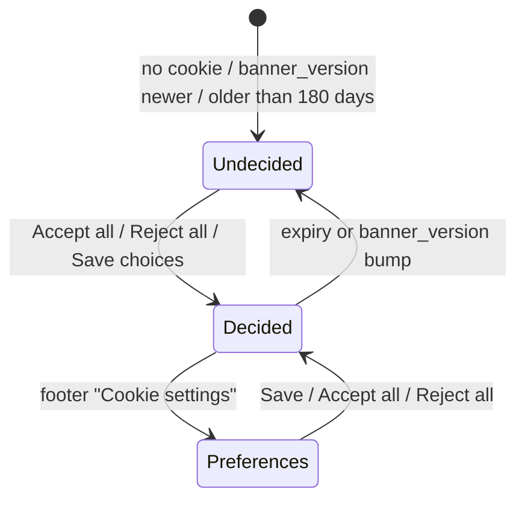

# LLD: M03 — Legal Pages, Cookies and Consent

| Field | Value |
|-------|-------|
| Module | M03 |
| Status | Review |
| Depends on HLD | `hld.md` (conventions and RLS contract: M01 `lld.md`; users/sessions: M02 `lld.md`) |
| Last updated | 2026-11-24 |

## 1. Database

### Tables

| Table | Column | Type | Constraints | Notes |
|-------|--------|------|-------------|-------|
| `legal_documents` | `id` | uuid | PK | |
| | `slug` | text | NOT NULL, UNIQUE, CHECK in (`terms`,`cookies`,`our-role`,`privacy`,`impressum`,`withdrawal`) | Fixed set of six; adding one needs a migration |
| | `master_locale` | text | NOT NULL default `en`, CHECK in (`en`,`de`) | Legally binding language; consent refers to this locale's version |
| | `requires_acceptance` | boolean | NOT NULL | true only for `terms`; others are informational (privacy gets acknowledgement at registration, no re-accept) |
| | `default_reaccept_required` | boolean | NOT NULL | true for `terms` |
| | `created_at`, `updated_at` | timestamptz | NOT NULL | |
| `legal_document_versions` | `id` | uuid | PK | |
| | `document_id` | uuid | NOT NULL, FK `legal_documents(id)` | |
| | `locale` | text | NOT NULL, CHECK in (`en`,`de`) | |
| | `version_number` | integer | NOT NULL, CHECK `> 0` | Allocated per (document, locale) = max+1 at creation |
| | `label` | text | NOT NULL | Human label e.g. `2026-12` |
| | `status` | text | NOT NULL, CHECK in (`draft`,`in_review`,`scheduled`,`published`,`superseded`,`discarded`) | See §3.1 |
| | `title` | varchar(200) | NOT NULL | |
| | `body_md` | text | NOT NULL, CHECK `length <= 200000` | Source |
| | `body_html` | text | NULL until publish/scheduled | Sanitised render |
| | `variables_snapshot` | jsonb | NULL until publish | Resolved `company.*` values |
| | `content_hash` | bytea | NULL until publish | SHA-256 of canonical JSON `{title, body_html, variables_snapshot, locale, version_number}` |
| | `change_summary` | text | NOT NULL for `in_review`+ | Shown to users (≤ 1000 chars) |
| | `reaccept_required` | boolean | NOT NULL default false | Only meaningful when `requires_acceptance` |
| | `urgent_reason` | text | NULL | Required when notice period shortened |
| | `notify_users` | boolean | NOT NULL default false | Send update email at publish |
| | `effective_from` | timestamptz | NULL | Required before submit; ≥ now |
| | `published_at` | timestamptz | NULL | |
| | `superseded_at` | timestamptz | NULL | |
| | `is_placeholder` | boolean | NOT NULL default false | Seed drafts; production refuses to serve if true (T-LEG-005) |
| | `authored_by` | uuid | NOT NULL, FK `users(id)` | |
| | `submitted_by` | uuid | NULL, FK | |
| | `approval_request_id` | uuid | NULL | M09 approval request |
| | `approved_by` | uuid | NULL, FK | CHECK `approved_by <> submitted_by` |
| | `supersedes_version_id` | uuid | NULL, FK self | |
| | `created_at`, `updated_at` | timestamptz | NOT NULL | |
| | | | UNIQUE (`document_id`,`locale`,`version_number`) | |
| `legal_document_state` | `document_id` | uuid | PK part, FK | |
| | `locale` | text | PK part | |
| | `current_version_id` | uuid | NOT NULL, FK | Latest published |
| | `min_required_version_number` | integer | NOT NULL | Terms re-acceptance threshold (master locale only is used by guard) |
| | `min_required_effective_from` | timestamptz | NOT NULL | |
| | `updated_at` | timestamptz | NOT NULL | |
| `legal_variables` | `key` | text | PK, CHECK in allowlist (§5) | e.g. `company.legal_name` |
| | `value` | text | NOT NULL, CHECK `length <= 500` | |
| | `updated_by` | uuid | FK | |
| | `updated_at` | timestamptz | NOT NULL | |
| `cookie_definitions` | `id` | uuid | PK | |
| | `name` | text | NOT NULL, UNIQUE | Cookie / storage key, e.g. `__Host-nivo_sid` |
| | `category` | text | NOT NULL, CHECK in (`necessary`,`preferences`,`analytics`,`marketing`) | |
| | `provider` | text | NOT NULL | `NIVO`, or third-party name |
| | `storage_type` | text | NOT NULL, CHECK in (`cookie`,`local_storage`,`session_storage`) | |
| | `purpose_en` | text | NOT NULL | |
| | `purpose_de` | text | NULL | |
| | `duration` | text | NOT NULL | e.g. `Session`, `180 days` |
| | `is_third_party` | boolean | NOT NULL | CHECK `NOT (category='necessary' AND is_third_party)` unless approved exception (Stripe is not a cookie on our domain) |
| | `active` | boolean | NOT NULL default true | |
| | `created_at`, `updated_at` | timestamptz | NOT NULL | |
| `legal_settings` | `id` | smallint | PK CHECK `id = 1` | Single row |
| | `cookie_registry_revision` | integer | NOT NULL default 1 | Bumped when registry published |
| | `banner_version` | integer | NOT NULL default 1 | Bump forces re-prompt |
| | `consent_ttl_days` | integer | NOT NULL default 180 | |
| | `updated_at` | timestamptz | NOT NULL | |
| `cookie_consent_events` | `id` | uuid | PK | |
| | `consent_id` | uuid | NOT NULL | Random per browser decision chain; stored in cookie |
| | `action` | text | NOT NULL, CHECK in (`accept_all`,`reject_all`,`custom`) | |
| | `choices` | jsonb | NOT NULL | `{"preferences":bool,"analytics":bool,"marketing":bool}`; `necessary` implicit |
| | `registry_revision` | integer | NOT NULL | |
| | `banner_version` | integer | NOT NULL | |
| | `cookie_policy_version_id` | uuid | NULL, FK | `/cookies` version shown at the time |
| | `ua_family` | varchar(40) | NULL | e.g. `Chrome 130 / Windows` truncated |
| | `user_id` | uuid | NULL, FK | Set only if user was logged in |
| | `created_at` | timestamptz | NOT NULL | |
| `consents` | `id` | uuid | PK | Append-only |
| | `user_id` | uuid | NOT NULL, FK `users(id)` | Tombstone row kept after erasure |
| | `consent_type` | text | NOT NULL, CHECK in (`terms`,`privacy_ack`,`withdrawal_ack`,`identity_processing`,`marketing_email`) | `identity_processing` written by M05 |
| | `action` | text | NOT NULL, CHECK in (`granted`,`withdrawn`) | |
| | `document_version_id` | uuid | NULL, FK | NULL only for non-document types |
| | `text_ref` | text | NULL | For types without document (e.g. `m05.identity.v1`) |
| | `content_hash` | bytea | NOT NULL | Copied from version or text hash |
| | `context` | text | NOT NULL, CHECK in (`registration`,`checkout`,`reaccept`,`identity`,`settings`) | |
| | `accepted_at` | timestamptz | NOT NULL default now() | |
| | `ip_hash` | bytea | NULL | HMAC |
| | `ua_family` | varchar(40) | NULL | |
| | | | CHECK (`document_version_id IS NOT NULL OR text_ref IS NOT NULL`) | |
| `user_legal_state` | `user_id` | uuid | PK, FK | |
| | `terms_version_id` | uuid | NULL, FK | Last accepted Terms |
| | `terms_version_number` | integer | NOT NULL default 0 | |
| | `terms_accepted_at` | timestamptz | NULL | |
| | `privacy_version_id` | uuid | NULL, FK | |
| | `privacy_ack_at` | timestamptz | NULL | |
| | `updated_at` | timestamptz | NOT NULL | |
| `legal_notifications` | `version_id` | uuid | PK part, FK | |
| | `user_id` | uuid | PK part, FK | |
| | `kind` | text | PK part, CHECK in (`update`,`reminder`) | Idempotency for fan-out |
| | `enqueued_at` | timestamptz | NOT NULL | |

Triggers:

- `lv_immutable`: BEFORE UPDATE on `legal_document_versions` — if `OLD.status IN ('published','superseded')` allow only `status: published→superseded` with `superseded_at` set; reject all other column changes. BEFORE DELETE: reject unless `status IN ('draft','discarded')`.
- `lv_publish_requires_approval`: reject transition to `scheduled`/`published` unless `approval_request_id IS NOT NULL AND approved_by IS NOT NULL AND approved_by <> authored_by AND approved_by <> submitted_by`.
- `consents_append_only` (via `forbid_mutation()`), `cookie_events_append_only`; `GRANT SELECT, INSERT` only.
- Erasure function `consents_erase_for_user(uuid, reason text)` — `SECURITY DEFINER`, owned by `nivo_owner`, executes `DELETE` after setting `app.erasure='on'`, which `consents_append_only` honours; called only by M05/M02 jobs; writes an audit row.

### Indexes

- `legal_document_versions (document_id, locale, status)`; partial UNIQUE `(document_id, locale) WHERE status IN ('draft','in_review','scheduled')` (one open version per document/locale); `(effective_from) WHERE status='scheduled'`.
- `consents (user_id, consent_type, accepted_at DESC)`; `consents (document_version_id)`.
- `cookie_consent_events (consent_id, created_at DESC)`; `(created_at)` for retention.
- `legal_notifications (version_id, kind)`.

### RLS policies

All tables `ENABLE` + `FORCE`.

```sql
-- Public read of published history, for every actor (anon, student, staff, consultancy)
CREATE POLICY lv_public_select ON legal_document_versions FOR SELECT TO nivo_app
  USING (status IN ('published','superseded') AND NOT is_placeholder_blocked(is_placeholder));
-- Helper (set per connection by the API at boot: SET app.env = 'production'|'staging'):
CREATE FUNCTION is_placeholder_blocked(p boolean) RETURNS boolean LANGUAGE sql STABLE AS
$$ SELECT p AND coalesce(current_setting('app.env', true), '') = 'production' $$;
-- Defence in depth with T-LEG-005: placeholder text is never served in production.

CREATE POLICY lv_staff_select ON legal_document_versions FOR SELECT TO nivo_app
  USING (app_actor_type() = 'staff');
-- Staff may only create/edit non-final states; final states only via system (approval executor)
CREATE POLICY lv_staff_insert ON legal_document_versions FOR INSERT TO nivo_app
  WITH CHECK (app_actor_type() = 'staff' AND status = 'draft');
CREATE POLICY lv_staff_update ON legal_document_versions FOR UPDATE TO nivo_app
  USING (app_actor_type() = 'staff' AND status IN ('draft','in_review'))
  WITH CHECK (app_actor_type() = 'staff' AND status IN ('draft','in_review','discarded'));
CREATE POLICY lv_system_all ON legal_document_versions FOR ALL TO nivo_app
  USING (app_is_system()) WITH CHECK (app_is_system());

-- legal_documents, legal_document_state, cookie_definitions (active=true), legal_settings: SELECT for all actors; writes staff (definitions only) / system
-- legal_variables: SELECT/INSERT/UPDATE staff + system; no anon access (public pages use snapshot)

-- consents: self read; staff read (permission legal.consents.read enforced in app); insert system only
CREATE POLICY consents_self_select ON consents FOR SELECT TO nivo_app USING (user_id = app_user_id());
CREATE POLICY consents_staff_select ON consents FOR SELECT TO nivo_app USING (app_actor_type() = 'staff');
CREATE POLICY consents_system_insert ON consents FOR INSERT TO nivo_app WITH CHECK (app_is_system());
-- No UPDATE/DELETE policy and no grant.

-- user_legal_state: self select; system write
CREATE POLICY uls_self_select ON user_legal_state FOR SELECT TO nivo_app USING (user_id = app_user_id());
CREATE POLICY uls_system_all ON user_legal_state FOR ALL TO nivo_app USING (app_is_system()) WITH CHECK (app_is_system());

-- cookie_consent_events: system insert; staff select
CREATE POLICY cce_system_insert ON cookie_consent_events FOR INSERT TO nivo_app WITH CHECK (app_is_system());
CREATE POLICY cce_staff_select ON cookie_consent_events FOR SELECT TO nivo_app USING (app_actor_type() = 'staff');
```

Consultancy actor: only public policies; cannot read `consents`, `user_legal_state`, events.

### Seed data (migration `0030_legal_seed.sql`)

Six `legal_documents` rows; v1 `en` placeholder drafts with `is_placeholder=true`, `status='published'` **only in non-production**; in production the seed leaves them `draft` and the app boots with a startup warning and `/readyz` detail `legal: pending_counsel` until real versions are published (so launch is gated by GAP-LEG-COUNSEL). Default `legal_variables` keys inserted with empty values (publish blocked while any referenced variable is empty).

## 2. API endpoints

Base `/api/v1`. CSRF required on all unsafe methods. Cache headers on public GETs: `Cache-Control: public, max-age=300, stale-while-revalidate=60`, strong `ETag` = content hash.

| Method | Path | Permission | Request | Response | Errors | Rate limit | Idempotency |
|--------|------|------------|---------|----------|--------|------------|-------------|
| GET | `/legal/documents` | public | `?locale=` | `200 [{slug,title,locale,versionId,versionNumber,label,effectiveFrom,publishedAt,path}]` | — | 120/min/IP | n/a |
| GET | `/legal/documents/:slug` | public | `?locale=en|de` | `200 LegalDocumentView` (`isFallbackLocale`, `Content-Language`) | `NOT_FOUND` | 120/min/IP | n/a |
| GET | `/legal/documents/:slug/versions/:n` | public | `?locale=` | `200 LegalDocumentView` (published or superseded) | `NOT_FOUND` | 60/min/IP | n/a |
| GET | `/legal/cookies/registry` | public | — | `200 {registryRevision,bannerVersion,consentTtlDays,cookies:[…]}` | — | 120/min/IP | n/a |
| POST | `/legal/cookie-consent` | public (CSRF anon token) | `CookieConsentBody` | `201 {consentId}` | `VALIDATION_FAILED`, `RATE_LIMITED`, `CSRF_INVALID` | 30/h/IP; 10/h/consentId | Client may resend same `consentId`+`choices` safely (dedupe within 10 s) |
| GET | `/legal/me/status` | session (student; exempt from terms guard) | — | `200 LegalStatusView` | `UNAUTHORIZED` | 60/min/user | n/a |
| POST | `/legal/consents` | session+verified (student; exempt from terms guard) | `ReacceptBody` | `201 LegalStatusView` | `VALIDATION_FAILED` (`LEGAL_VERSION_STALE`), `CONFLICT` (already accepted) | 10/h/user | Same version twice → `200` (no duplicate row) |
| GET | `/legal/me/consents` | session (student) | — | `200 [{type,action,documentSlug,versionNumber,acceptedAt,context}]` | — | 30/min/user | n/a |
| GET | `/admin/legal/documents` | `staff:legal.read` | — | `200` docs + current/open version summary | `FORBIDDEN` | 120/min/user | n/a |
| GET | `/admin/legal/documents/:slug/versions` | `staff:legal.read` | `?locale=` | `200` versions list | `FORBIDDEN`, `NOT_FOUND` | 120/min/user | n/a |
| POST | `/admin/legal/documents/:slug/versions` | `staff:legal.edit` | `{locale, baseVersionId?}` | `201 {versionId}` (draft copy of base or empty) | `CONFLICT` (open version exists) | 20/h/user | n/a |
| GET | `/admin/legal/versions/:id` | `staff:legal.read` | — | `200 AdminVersionView` + `ETag` | `NOT_FOUND` | 120/min/user | n/a |
| PATCH | `/admin/legal/versions/:id` | `staff:legal.edit` | `VersionPatchBody` + `If-Match` | `200 AdminVersionView` | `CONFLICT` (not draft / stale ETag), `VALIDATION_FAILED` | 120/min/user | n/a |
| POST | `/admin/legal/versions/:id/preview` | `staff:legal.read` | — | `200 {html, unresolvedVariables, sanitiserWarnings}` | `VALIDATION_FAILED` | 60/min/user | n/a |
| GET | `/admin/legal/versions/:id/diff` | `staff:legal.read` | `?against=<versionId>` | `200 {hunks:[…]}` | `NOT_FOUND` | 60/min/user | n/a |
| POST | `/admin/legal/versions/:id/submit` | `staff:legal.edit` + step-up | `{notifyUsers, urgentReason?}` | `202 {approvalId}`; status `in_review` | `VALIDATION_FAILED`, `CONFLICT`, `STEP_UP_REQUIRED` | 20/h/user | Same version while `in_review` → returns existing approval |
| POST | `/admin/legal/versions/:id/recall` | `staff:legal.edit` (author) | — | `200`; back to `draft`; approval cancelled | `CONFLICT` | 20/h/user | Idempotent |
| POST | `/admin/legal/versions/:id/discard` | `staff:legal.edit` | `{reason}` | `204` | `CONFLICT` (published) | 20/h/user | Idempotent |
| *(M09)* POST | `/admin/approvals/:id/approve` / `/reject` | `staff:legal.publish` + step-up, approver ≠ submitter | `{comment}` | Executes handler `legal.publish` (§3.1) | `APPROVAL_REQUIRED`, `FORBIDDEN` | per M09 | By approval ID |
| GET | `/admin/legal/variables` | `staff:legal.variables.manage` | — | `200 [{key,value,updatedAt}]` | `FORBIDDEN` | 60/min/user | n/a |
| PUT | `/admin/legal/variables/:key` | `staff:legal.variables.manage` + step-up | `{value, reason}` | `200` | `VALIDATION_FAILED` | 20/h/user | n/a |
| GET/POST/PATCH | `/admin/legal/cookies[/:id]` | `staff:legal.cookies.manage` | `CookieDefinitionBody` | `200/201` (draft changes to registry) | `VALIDATION_FAILED` | 60/h/user | n/a |
| POST | `/admin/legal/cookies/publish` | `staff:legal.cookies.manage` + step-up; approval policy `legal.cookies.publish` | `{bumpBanner: bool, reason}` | `202 {approvalId}`; on approval bumps `cookie_registry_revision` (and `banner_version` if requested → all visitors re-prompted) | `APPROVAL_REQUIRED` | 10/h/user | By approval |
| GET | `/admin/legal/stats` | `staff:legal.read` | — | `{termsPendingReaccept, byVersion[], reminderSent}` | — | 30/min/user | n/a |
| GET | `/admin/legal/users/:userId/consents` | `staff:legal.consents.read` + `reason` query (logged) | — | `200` ledger rows for user | `FORBIDDEN`, `NOT_FOUND` | 30/h/user | n/a |

Errors use catalog codes. New reason code under `VALIDATION_FAILED.details[].code`: `LEGAL_VERSION_STALE`. `TERMS_REACCEPT_REQUIRED` (403) carries `details: [{ "code": "TERMS_REACCEPT_REQUIRED", "versionId": "…", "effectiveFrom": "…" }]`.

### Guard `requireTermsCurrent` (decision table)

| Condition | Result |
|-----------|--------|
| `user_type != 'student'` | pass |
| Route flagged `terms: 'exempt'` (`/auth/*`, `/legal/*`, `POST /me/deletion-request`, `GET /me/export`, health) | pass |
| No `legal_document_state` row for `terms` master locale | fail closed (`INTERNAL`, alert) |
| `now() < min_required_effective_from` | pass (notice period) |
| `user_legal_state.terms_version_number >= min_required_version_number` | pass |
| otherwise | `403 TERMS_REACCEPT_REQUIRED` |

State is read with one indexed query and cached in-process for 30 s per user (invalidated on re-accept).

### Zod schemas

```ts
// packages/shared/src/legal.ts
import { z } from 'zod';

export const LegalSlug = z.enum(['terms', 'cookies', 'our-role', 'privacy', 'impressum', 'withdrawal']);
export const Locale = z.enum(['en', 'de']);

export const LegalDocumentView = z.object({
  slug: LegalSlug, locale: Locale, isFallbackLocale: z.boolean(),
  versionId: z.string().uuid(), versionNumber: z.number().int().positive(), label: z.string(),
  title: z.string(), bodyHtml: z.string(),            // already sanitised server-side
  contentHash: z.string().regex(/^[0-9a-f]{64}$/),
  effectiveFrom: z.string().datetime(), publishedAt: z.string().datetime(),
  changeSummary: z.string().nullable(),
  previousVersions: z.array(z.object({ versionNumber: z.number().int(), effectiveFrom: z.string().datetime() })),
});

export const CookieChoices = z.object({
  preferences: z.boolean(), analytics: z.boolean(), marketing: z.boolean(),
}).strict();

export const CookieConsentBody = z.object({
  consentId: z.string().uuid().optional(),               // client generates (crypto.randomUUID) on first decision
  action: z.enum(['accept_all', 'reject_all', 'custom']),
  choices: CookieChoices,
  registryRevision: z.number().int().positive(),
  bannerVersion: z.number().int().positive(),
}).strict().superRefine((v, ctx) => {
  const all = Object.values(v.choices);
  if (v.action === 'accept_all' && !all.every(Boolean)) ctx.addIssue({ code: 'custom', message: 'accept_all requires all true' });
  if (v.action === 'reject_all' && all.some(Boolean)) ctx.addIssue({ code: 'custom', message: 'reject_all requires all false' });
});

export const ReacceptBody = z.object({
  items: z.array(z.object({ type: z.enum(['terms', 'privacy_ack']), versionId: z.string().uuid() })).min(1).max(2),
}).strict();

export const LegalStatusView = z.object({
  terms: z.object({
    currentVersionId: z.string().uuid(), currentVersionNumber: z.number().int(),
    acceptedVersionNumber: z.number().int(), reacceptRequired: z.boolean(),
    effectiveFrom: z.string().datetime(), changeSummary: z.string().nullable(),
  }),
  privacy: z.object({ currentVersionId: z.string().uuid(), acknowledgedVersionId: z.string().uuid().nullable() }),
});

export const VersionPatchBody = z.object({
  title: z.string().min(3).max(200).optional(),
  bodyMd: z.string().min(1).max(200_000).optional(),
  changeSummary: z.string().min(10).max(1000).optional(),
  reacceptRequired: z.boolean().optional(),
  effectiveFrom: z.string().datetime().optional(),
  label: z.string().min(1).max(40).optional(),
}).strict();

export const CookieDefinitionBody = z.object({
  name: z.string().min(1).max(100), category: z.enum(['necessary', 'preferences', 'analytics', 'marketing']),
  provider: z.string().min(1).max(100), storageType: z.enum(['cookie', 'local_storage', 'session_storage']),
  purposeEn: z.string().min(5).max(500), purposeDe: z.string().max(500).optional(),
  duration: z.string().min(1).max(50), isThirdParty: z.boolean(), active: z.boolean().default(true),
}).strict();
```

## 3. State machines

### 3.1 Legal document version

```mermaid
stateDiagram-v2
  [*] --> draft: create (staff, legal.edit)
  draft --> in_review: submit (step-up; approval request created)
  in_review --> draft: recall by author / approval rejected
  in_review --> scheduled: approved and effective_from > now
  in_review --> published: approved and effective_from <= now
  scheduled --> published: job at effective_from
  scheduled --> draft: recall before effective (approval cancelled)
  draft --> discarded: discard
  published --> superseded: newer version published
```



Rules and side effects:

| Transition | Preconditions | Side effects (single transaction) |
|------------|---------------|-----------------------------------|
| create → `draft` | No open version for (doc, locale) | Copy base content; allocate `version_number` |
| `draft` → `in_review` | `change_summary` present; all `{{variables}}` resolved & non-empty; sanitiser report clean; `effective_from` set (≥ now; for `reaccept_required` and an existing published version: ≥ now + `legal.reaccept_min_notice_days` unless `urgent_reason`); caller has step-up | Create M09 approval request (`legal.publish`, payload = version ID + `content hash preview`); freeze edits |
| approve | Approver has `legal.publish`, ≠ author, ≠ submitter; version still `in_review` and ETag unchanged | Render HTML, snapshot variables, compute `content_hash`; set `approved_by`; to `scheduled` or `published` |
| → `published` | | Previous published → `superseded`; upsert `legal_document_state` (`current_version_id`; if `reaccept_required` then `min_required_version_number = version_number`, `min_required_effective_from = effective_from`); purge public cache; enqueue `legal.notify_update` if `notify_users`; audit; if cookies doc: set `legal_settings.banner_version++` only when author ticked `bumpBanner` |
| reject | Approver ≠ submitter, comment required | Back to `draft`; author notified in-app |

Terms re-accept applies per master locale; translations follow the same `version_number` only if published together (UI warns).

### 3.2 Cookie consent (browser)



Entering `Decided`: write `__Host-nivo_consent`, fire `POST /legal/cookie-consent`, call `consent.apply()` → load scripts for allowed categories only. Any category set from on → off: `consent.revoke(category)` deletes registry-listed cookies/storage for that category and stops loaders (reload if required).

### 3.3 User Terms status

`accepted(v=n)` --publish v=n+1 with reaccept--> `notice_period` (until effective_from; email sent) --> `reaccept_required` (guard blocks) --accept--> `accepted(v=n+1)`.

### 3.4 Notification fan-out

`created` → `batching` (200 users/batch via cursor) → `completed`; each `(version, user, kind)` inserted into `legal_notifications` before enqueue (unique PK prevents duplicates on retry).

## 4. Sequence diagrams

### Happy path — publish new Terms with re-acceptance

```mermaid
sequenceDiagram
  actor A as Admin A (author)
  actor B as Admin B (approver)
  participant API as API (M03)
  participant AP as M09 Approvals
  participant DB as PostgreSQL
  participant Q as Queue
  actor S as Student
  A->>API: POST /admin/legal/documents/terms/versions
  A->>API: PATCH version (markdown, summary, effective_from +14d, reaccept=true)
  A->>API: POST /submit (step-up)
  API->>AP: create approval legal.publish
  API->>DB: status in_review
  B->>AP: approve (step-up)
  AP->>API: execute handler
  API->>DB: render+sanitise, snapshot vars, hash, status scheduled
  API->>Q: enqueue notify_update (notifyUsers)
  Q->>S: email legal_terms_updated (summary, effective date, link)
  Note over API,DB: at effective_from job legal.activate_scheduled
  API->>DB: published, supersede old, state.min_required=n+1
  S->>API: any student route
  API-->>S: 403 TERMS_REACCEPT_REQUIRED
  S->>API: GET /legal/documents/terms ; POST /legal/consents {terms, versionId}
  API->>DB: consents row + user_legal_state (one tx)
  API-->>S: 201 (routes unblocked)
```

### Registration consent (called from M02)

M02 transaction: `consents.record(userId, [{type:'terms', versionId}, {type:'privacy_ack', versionId}], {context:'registration', ipHash, uaFamily})` → validates each `versionId` equals `legal_document_state.current_version_id` (master locale) else `LEGAL_VERSION_STALE`; inserts rows with `content_hash`; upserts `user_legal_state`.

### Checkout consent (called from M04)

M04 `POST /payments/checkout-session` carries `termsVersionId` and `withdrawalVersionId` + two checkboxes (unticked by default): M04 calls `consents.record(userId, [terms, withdrawal_ack], {context:'checkout'})` before creating the Stripe session; consent IDs stored in `payments.terms_consent_id`, `payments.withdrawal_consent_id`. Checkout page shows the current `/withdrawal` text inline (from `GET /legal/documents/withdrawal`) next to the checkbox.

### Failure paths

| Case | Behaviour |
|------|-----------|
| Approver tries to approve own submission | `403 FORBIDDEN` + DB trigger backstop |
| Version edited by someone else after submit | `409 CONFLICT` (`in_review` is read-only; ETag mismatch) |
| Unresolved/empty variable in text | Submit blocked with `VALIDATION_FAILED` listing keys |
| Sanitiser strips content during render | Publish blocked; diff of stripped nodes shown |
| Stale `versionId` at registration/checkout/re-accept (new version published meanwhile) | `VALIDATION_FAILED` `LEGAL_VERSION_STALE`; UI reloads text and asks again |
| `legal.activate_scheduled` job down | Versions stay `scheduled`; alert after 5 min late; guard uses `min_required_effective_from` only after state updated, so no false blocking |
| Notification email fails | Retry; guard enforcement independent of email |
| Cookie-consent POST fails (offline) | Choice still applied locally (cookie), retried once on next page load via `localStorage`-free flag in the cookie payload `p:1` (pending proof) |
| Student has pending re-accept and starts checkout | `403 TERMS_REACCEPT_REQUIRED` (checkout not started); already-paid access unaffected |
| Public API cache stale after publish | Purge on publish; `max-age=300` bounds staleness; ETag revalidation |

## 5. Validation rules

| Field | Client | API | DB |
|-------|--------|-----|----|
| `slug` | Fixed routes | `LegalSlug` enum | CHECK |
| `locale` | `/de/…` prefix | `Locale`; fallback to `en` if no published `de` | CHECK |
| `title` | 3–200 | Zod | `varchar(200)` |
| `bodyMd` | Editor with preview | ≤ 200 000 chars; parsed with `remark-parse`; **raw HTML disallowed** | `text` |
| Markdown allowlist | Preview shows warnings | Elements: `h1–h4, p, ul, ol, li, strong, em, a, blockquote, table, thead, tbody, tr, th, td, hr, br, code`; attributes: `href` (`https:`, `mailto:`, `tel:`, or `/relative`), `id` on headings; `rel="noopener noreferrer"` forced on external links; no `style`, `class`, `target`, `on*`, `iframe`, `img` (none needed), `script` | n/a |
| Variables | `{{company.legal_name}}` autocompletion | Only keys in allowlist: `company.legal_name`, `company.legal_form`, `company.street`, `company.postal_code`, `company.city`, `company.country`, `company.register_court`, `company.register_number`, `company.managing_directors`, `company.vat_id`, `company.email`, `company.phone`, `company.supervisory_authority`, `company.dpo_contact`, `company.platform_url`; all referenced keys must be non-empty at submit | CHECK on `legal_variables.key` |
| `effective_from` | Date-time picker (Europe/Berlin shown, stored UTC) | ≥ now; notice rule (§3.1) | `timestamptz` |
| `changeSummary` | 10–1000, plain text | Zod | text |
| `reacceptRequired` | Toggle (default from document) | Only allowed if `requires_acceptance` | CHECK via trigger |
| `CookieConsentBody` | 3 buttons / toggles | `superRefine` consistency; revision/version must be ≤ current (reject future) | jsonb |
| `consentId` | `crypto.randomUUID()` | UUID v4 | uuid |
| Cookie definition `name` | Free text | Unique; `necessary` category limited to NIVO first-party (`is_third_party=false`) unless two-admin approval note | UNIQUE + CHECK |
| Re-accept `versionId` | From status payload | Must equal current master-locale version (`LEGAL_VERSION_STALE`) | FK |

### Banner and footer specification (REQ-LEG-02, CTRL-LEG-COOKIE, CTRL-LEG-A11Y)

- Component `CookieBanner` renders **exactly three** actions through one shared `<ConsentButton>`: **Accept all**, **Reject all**, **Manage preferences** — same size (`min-height: 48px; flex: 1 1 0; min-width: 9rem`), same font (Poppins 600, 16 px), same border (2 px `#2D2A26`), same background (`#F5EFE6`), same text colour (`#2D2A26`), same hover (`#E8A55C` background), same focus style (3 px `#2D2A26` outline, 2 px offset), same row on ≥ 640 px and stacked with equal width on mobile; order Accept, Reject, Manage. No button uses Orange `#FB770B` as the sole emphasis, no pre-ticked optional categories, no countdown, no "X" that silently accepts (closing via Esc = no decision, banner stays; non-modal so content remains reachable).
- Container: `role="region" aria-label="Cookie consent"`, Beige `#F5EFE6` background, Charcoal text, Saffron `#E8A55C` 4 px top border, fixed to bottom, keyboard first in tab order after skip link. Copy: "We use essential cookies to run NIVO. Optional cookies are off unless you allow them." Link to `/cookies` and `/privacy`.
- Preferences dialog (`role="dialog" aria-modal="true"`, focus trap, Esc closes without decision): one row per category with switch (necessary: locked on with explanation), cookie table from registry, and three equal buttons: Reject all / Save choices / Accept all.
- Contrast (WCAG 2.1 AA, computed): Charcoal on Beige ≈ 12.5:1; Charcoal on Saffron ≈ 6.8:1; Charcoal on Orange ≈ 5.3:1; **White on Orange ≈ 2.7:1 (fails) — never use white text on Orange**; Orange text on Beige/white fails for body text, allowed only for decorative/large (≥ 24 px) elements. Focus indicators use Charcoal for ≥ 3:1 non-text contrast.
- Footer on every public and app page: links to Terms, Privacy, Cookies, Our role, Impressum (label "Legal notice (Impressum)"), Withdrawal, and a **Cookie settings** button reopening preferences. Checkout page also shows Terms + Withdrawal links next to the consent checkboxes.
- Consent cookie `__Host-nivo_consent` (JS-set, `Secure; SameSite=Lax; Path=/; Max-Age=15552000`): base64url JSON `{"v":1,"id":"<consentId>","c":{"p":0,"a":0,"m":0},"r":<registryRevision>,"b":<bannerVersion>,"t":<epoch>,"p":0|1}`. Re-prompt if missing, `b` < current `banner_version`, or `t` older than `consent_ttl_days`.
- Gate API (`apps/web/src/consent`): `consent.allowed(category)`, `consent.onChange(cb)`, `loadAfterConsent(category, loader)`. ESLint rule `no-direct-third-party-script` and CSP `script-src 'self'` make bypass fail in CI and in the browser.

## 6. Background jobs

| Job | Trigger | Retry | Dead letter | Payload rules |
|-----|---------|-------|-------------|---------------|
| `legal.activate_scheduled` | cron `* * * * *` | 3 | `legal.activate_scheduled_dlq` (alert) | `{}` — publishes versions with `status='scheduled' AND effective_from <= now()` (singleton) |
| `legal.notify_update` | Enqueued at approval (if `notify_users`) | 5, backoff | `legal.notify_update_dlq` | `{versionId, cursor}`; batch of 200 active students; inserts `legal_notifications` then enqueues `email.send {legal_terms_updated|legal_privacy_updated, userId, versionId}` — **No PII** |
| `legal.reaccept_reminder` | cron `0 8 * * *` Europe/Berlin | 3 | dlq | `{}`; users still below min version `legal.reminder_after_days` (7) after `effective_from`, once per version |
| `legal.cleanup_cookie_events` | cron `0 3 1 * *` | 3 | dlq | `{}`; delete `cookie_consent_events` older than 36 months |
| `legal.cleanup_consents` | cron `15 3 1 * *` | 3 | dlq | `{}`; delete ledger rows of `deleted` users older than 36 months after `deleted_at` via `consents_erase_for_user` |
| `legal.review_reminder` | cron `0 9 1 */3 *` | 1 | n/a | `{}`; emails legal owners to review `/impressum` data and registry |
| `legal.state_integrity_check` | cron `*/30 * * * *` | 1 | alert | `{}`; asserts each document has `legal_document_state` (non-prod placeholders aside) and no `scheduled` version overdue > 5 min |

## 7. Emails

| Template key | Trigger | Content summary |
|--------------|---------|-----------------|
| `legal_terms_updated` | Approval of Terms version with `notify_users` (sent at approval, before effective date) | What changed (summary), effective date, link to new Terms and previous version, "you will be asked to accept when you next sign in", support contact |
| `legal_reaccept_reminder` | 7 days after effective date, still not accepted | Gentle reminder, direct link to accept; states access to the dashboard is paused until accepted (paid access preserved) |
| `legal_privacy_updated` | Privacy version with `notify_users` | Informational (Art. 13/14 GDPR), summary + link; no acceptance needed |
| `legal_publish_approval_request` | Approval created | Internal: to approvers (`legal.publish` holders except author): document, summary, link to diff |
| `legal_review_reminder` | Quarterly job | Internal: review Impressum data and cookie registry |

Footers of all emails link to Terms, Privacy and Impressum (M11).

## 8. Audit events

All via M09 `audit.append` (same transaction as the change).

| Action | Before/After | Reason required |
|--------|--------------|-----------------|
| `legal.version.created` | — / `{slug, locale, versionNumber, baseVersionId}` | No |
| `legal.version.updated` | field names + `bodyMd` hash before/after (not full text) | No |
| `legal.version.submitted` | `draft → in_review`, `{approvalId, effectiveFrom, reacceptRequired, urgentReason}` | Urgent: yes |
| `legal.version.approved` / `.rejected` | `in_review → scheduled|published|draft`, `{approvedBy, contentHash}` | Reject: yes |
| `legal.version.published` | `{contentHash, supersedes, minRequiredVersion}` | No |
| `legal.version.superseded` | `published → superseded` | No |
| `legal.version.recalled` / `.discarded` | status change | Discard: yes |
| `legal.variable.changed` | `{key, valueHash}` before/after (values are public but history kept) | Yes |
| `legal.cookie.definition_changed` | before/after row | Yes |
| `legal.cookie.registry_published` | `{registryRevision, bannerVersion}` | Yes |
| `legal.consent.recorded` | `{userId, type, versionId, context}` (also in ledger) | No |
| `legal.consent.erased` | `{userId, rows, reason}` | Yes |
| `legal.consents.viewed_by_staff` | `{targetUserId, reason}` | Yes |
| `legal.reaccept.completed` | `{userId, versionNumber}` | No |

## 9. Config / admin settings

| Key | Default | Changeable via |
|-----|---------|----------------|
| `legal.reaccept_min_notice_days` | 14 | M09 settings (approval) |
| `legal.reminder_after_days` | 7 | M09 settings |
| `legal.consent_ttl_days` (`legal_settings.consent_ttl_days`) | 180 | Admin with approval |
| `legal.cookie_event_retention_months` | 36 | Deploy config |
| `legal.consent_retention_after_close_months` | 36 | Deploy config |
| `legal.allow_placeholder` | `false` in production | Deploy config (CI forbids `true` in prod) |
| Company variables (`legal_variables`) | empty | Admin `legal.variables.manage` + step-up |
| Cookie registry | Seeded with NIVO necessary items: `__Host-nivo_sid`, `__Host-nivo_staff_sid`, `__Host-nivo_csrf`, `__Host-nivo_consent`, `nivo_lang` (preferences, optional) | Admin `legal.cookies.manage` + approval to publish |

Permissions registered with M09 (deny by default): `legal.read`, `legal.edit`, `legal.publish`, `legal.cookies.manage`, `legal.variables.manage`, `legal.consents.read`. Default role mapping: Content admin → `read, edit, cookies.manage`; Legal approver → `read, publish`; Super admin → all (publish still bound by approver ≠ submitter).

## 10. Logging and redaction

Never logged: legal document bodies (log IDs/hashes only), `ip_hash` inputs (raw IPs), user agents beyond family, consent cookie contents together with user identifiers, admin draft text, step-up credentials. Consent IDs are random and may be logged. Public GET logs contain only route/status/latency.

## 11. Test cases

| ID | Layer | Description | Expected |
|----|-------|-------------|----------|
| T-LEG-001 | e2e + integration | Each of `/terms`, `/cookies`, `/our-role`, `/privacy`, `/impressum`, `/withdrawal` renders published content from API with version label and effective date; admin can create, edit, submit and (after another admin approves) publish a new version; old version still reachable at `/versions/:n` | All six pages serve; publish creates `superseded` predecessor; hash differs |
| T-LEG-002 | unit | Sanitiser: `<script>`, `onerror`, `javascript:` href, raw HTML, `iframe`, `style` removed or rejected; allowed elements preserved | XSS corpus yields clean HTML or validation error |
| T-LEG-003 | unit | Variable substitution: unknown key rejected; empty value blocks submit; snapshot stored; later variable change does not alter published HTML | Pass |
| T-LEG-004 | integration | Trigger `lv_immutable`: direct SQL `UPDATE body_html` on published row fails; only `published→superseded` allowed; delete forbidden | Exception raised |
| T-LEG-005 | integration | Production config with `is_placeholder` version published or none published for a document: `/readyz` reports `legal: pending_counsel`, public API returns `503` for that doc, deploy gate fails | Pass (launch gate) |
| T-LEG-006 | integration | Maker-checker: author cannot approve; submitter ≠ approver; DB trigger rejects forged approval | `FORBIDDEN` / constraint error |
| T-LEG-007 | integration | Public API: ETag/304 behaviour, cache headers, locale fallback with `Content-Language`, placeholder blocked in production | Pass |
| T-LEG-008 | integration | Scheduled version publishes via job at `effective_from`; state pointer updated atomically; cache purged | Pass |
| T-LEG-009 | integration | RLS: anon/student cannot read drafts or `legal_variables`; consultancy reads public docs only; staff cannot set status `published` directly (only system) | Pass |
| T-LEG-010 | e2e | First visit shows banner with exactly three actions; Accept all/Reject all/Customise each persist and hide banner; banner reappears after `banner_version` bump or 181 days (fake clock) | Pass |
| T-LEG-011 | e2e | Before any choice and after Reject all: zero requests to non-first-party hosts, no cookies other than `necessary` registry entries, no analytics/marketing storage keys; after Accept all with a test analytics loader registered, loader runs; after later withdraw, its cookies are removed | Pass |
| T-LEG-012 | e2e + unit | Parity: computed width/height/font/border/background/colour of the three buttons identical (tolerance 0 for style, ≤ 1 px size); same DOM depth; axe-core AA passes; keyboard operable; Esc doesn't set consent | Pass |
| T-LEG-013 | integration + e2e | Cookie consent POST stores event (consentId, choices, versions, no IP); invalid combos (`accept_all` with false) rejected; footer "Cookie settings" reopens and change is recorded as new event with same `consentId`; rate limit 30/h | Pass |
| T-LEG-014 | integration | Cookie registry publish needs approval; bumping banner version re-prompts; registry endpoint reflects only active, published entries | Pass |
| T-LEG-020 | integration | Registration creates `consents` rows for `terms` and `privacy_ack` with current version IDs, `content_hash`, `accepted_at`, `ip_hash`; `user_legal_state` updated in same transaction; stale ID rejected with `LEGAL_VERSION_STALE`; rolled back with failed registration | Pass |
| T-LEG-021 | integration + e2e | Publish Terms v2 with `reaccept_required`: before `effective_from` student passes; after, any student API route returns `403 TERMS_REACCEPT_REQUIRED`; SPA shows blocking screen; `POST /legal/consents` unblocks; exempt routes (`/auth/logout`, `/legal/*`, deletion request) still work; paid access/entitlement unchanged; staff unaffected | Pass |
| T-LEG-022 | integration | Version published with `reaccept_required=false` (typo fix) does not block users | Pass |
| T-LEG-023 | integration | Notification fan-out: 1 000 fixture students → one email each, no duplicates after job retry/crash; reminder once | Counts match |
| T-LEG-024 | integration | Ledger append-only: UPDATE/DELETE as `nivo_app` fails; `consents_erase_for_user` works only via definer function and writes audit | Pass |
| T-LEG-025 | integration | Notice-period rule: `reaccept_required` with effective date < 14 days rejected unless `urgentReason` | `VALIDATION_FAILED` |
| T-LEG-026 | integration | Student cannot read another user's consents (IDOR) or `/admin/legal/*`; staff read of a user's ledger requires `reason`, produces audit | Pass |
| T-LEG-030 | integration + e2e | Checkout requires both unticked-by-default checkboxes (Terms + withdrawal acknowledgement) tied to current versions; consent rows created before Stripe session; IDs stored on payment; missing/stale → no session created | Pass (with M04 T-PAY-001) |
| T-LEG-031 | e2e | Footer shows all six links + Cookie settings on home, login, dashboard, checkout; Impressum reachable in ≤ 2 clicks from any page | Pass |
| T-LEG-032 | a11y | Six pages and banner pass axe AA; headings hierarchy; `lang` attribute follows locale; 200 % zoom without loss; contrast tokens table verified in unit test | Pass |
| T-LEG-033 | integration | Export: `GET /legal/me/consents` returns complete ledger for DSR (M05 T-ID-030 consumes) | Pass |
