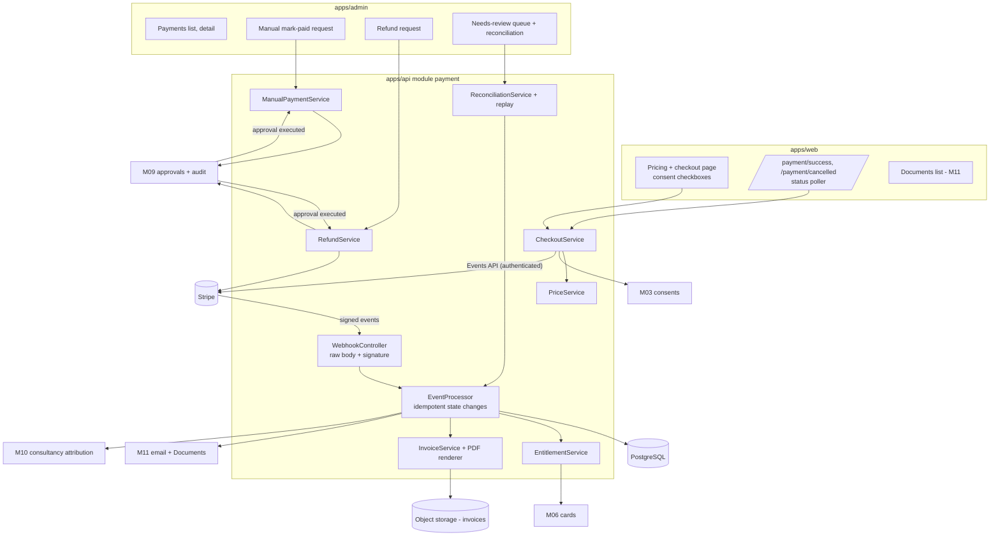

# HLD: M04 — Payment (Stripe €149)

| Field | Value |
|-------|-------|
| Module | M04 |
| Status | Review |
| Owner | NIVO Engineering (backend) with Finance/tax advisor for invoice rules |
| Last updated | 2026-11-24 |
| Requirements | REQ-PAY-01…05, REQ-PAY-06…08 (derived), REQ-LEG-05 (checkout consent, with M03), REQ-DOC-01 (payment emails, with M11), REQ-CARD-04 / REQ-PAY-02 (unlock contract with M06) |

## 1. Purpose and scope

M04 charges each student a **one-time €149** via Stripe Checkout, grants platform access **only** after a verified Stripe event, produces invoices (PDF, emailed and stored in Documents), and provides controlled administrative paths for manual payment recording and refunds.

**In scope**

- Price configuration (versioned) and server-side amount control.
- Stripe Checkout Session creation (hosted page, card + dynamic payment methods enabled in the Stripe dashboard), return/cancel pages and status polling.
- Webhook endpoint with signature verification, idempotent event processing, amount/currency/session cross-checks, and verified-event replay for missed events.
- Entitlement (access grant/revoke) consumed by M06 and other student-facing modules.
- Invoice and credit-note generation (sequential numbering, PDF), email delivery, Documents listing (M11 surfaces them).
- Failure UX contract: failed/cancelled/expired → retry button, dashboard stays locked (REQ-PAY-04).
- Admin: payment list/search, manual mark-paid (maker-checker), refund (maker-checker), needs-review queue, reconciliation reports.
- Disputes (chargebacks) intake and flagging.

**Out of scope**

- Partner payments (NIVO never holds partner money; contracts are student ↔ partner).
- Subscriptions, coupons, multi-currency, instalments, saved cards (Phase 1: single price, EUR).
- Tax advice and filing (design provides data and configuration; see GAP-PAY-VAT).
- Dashboard card logic (M06 consumes the entitlement).
- Generic approval engine, audit store, permission registry (M09).

## 2. Requirements covered

| ID | Statement | Priority |
|----|-----------|----------|
| REQ-PAY-01 | €149 one-time payment via Stripe Checkout | Must |
| REQ-PAY-02 | Dashboard unlock **only** after a verified Stripe webhook event (never on redirect/return URL or client claim) | Must |
| REQ-PAY-03 | Invoice PDF emailed and available in Documents | Must |
| REQ-PAY-04 | Payment failure shows retry; account stays locked | Must |
| REQ-PAY-05 | Admin can mark paid manually and refund, with audit and approval | Must |
| REQ-PAY-06 *(derived)* | Amount, currency and product are determined server-side; client cannot influence price | Must |
| REQ-PAY-07 *(derived)* | Missed or duplicate webhooks cannot cause lost unlocks, double unlocks or double invoices (idempotency + replay + reconciliation) | Must |
| REQ-PAY-08 *(derived)* | Duplicate/over-payment, amount mismatches and disputes are detected and routed to a human review queue | Must |
| REQ-LEG-05 | Checkout records Terms agreement and withdrawal-right acknowledgement per version (M03) | Must |
| REQ-DOC-01 | Receipt, failure, refund emails | Must |
| REQ-CARD-04 | Unpaid student cannot open cards by URL (M06 enforces; M04 provides `requirePaid`) | Must |

> Derived IDs REQ-PAY-06…08 to be added to `00-traceability.md` (GAP-TRACE-M04).

## 3. Component diagram

| Component | Responsibility |
|-----------|----------------|
| **PriceService** | Single source of truth for amount (`payment_price_versions`); snapshots version, tax rate and amount on each payment row. |
| **CheckoutService** | Pre-conditions (verified, terms current, consents), creates payment row + Stripe Checkout Session; idempotent; expires superseded sessions; exposes `GET /payments/me`. |
| **WebhookController** | Public route `/api/v1/webhooks/stripe`: raw body, signature verification (5 min tolerance), stores event, hands to processor, returns 2xx only after durable processing. |
| **EventProcessor** | **The only code path that can move a payment to `paid`** (and refunds to `succeeded`). Accepts events from signed webhooks **or** from authenticated Stripe Events API replay; verifies object against Stripe API retrieve; cross-checks amount, currency, payment ID, user. |
| **EntitlementService** | Maintains `entitlements`; `getEntitlement(userId)`; grant only called by EventProcessor / approved manual payment executor; revoke only by approved refund executor or dispute resolution. |
| **InvoiceService** | Allocates gapless invoice numbers, snapshots seller/buyer/tax data, renders PDF (pdfmake, Poppins, brand colours), stores encrypted in object storage, hashes PDF, triggers email + Documents entry. Creates credit notes for refunds. |
| **RefundService** | Request → approval → Stripe refund → webhook confirmation → credit note + email + optional access revoke. |
| **ManualPaymentService** | Request → approval → creates `source='manual'` payment (+ entitlement + invoice) for off-Stripe payments (bank transfer, support-resolved cases). |
| **ReconciliationService** | Jobs: reconcile pending sessions, replay missed events, compare daily ledger vs Stripe, populate needs-review queue. |

## 4. Data flows and trust boundaries

**Checkout (student → Stripe)**

1. Student (authenticated, verified, terms current) opens checkout page; page shows price from `GET /payments/price` and two **unticked** checkboxes (Terms, withdrawal acknowledgement) linked to current M03 versions.
2. `POST /payments/checkout-session` (CSRF, idempotency key). Server: validates, records consents (M03), loads active price, inserts `payments(status=created)`, calls Stripe `checkout.sessions.create` (amount from DB, never from request) with `client_reference_id = payments.id`, metadata `{paymentId}` only, `customer_email` prefill, 30-min expiry. Updates row to `pending`. Returns Stripe URL.
3. Browser leaves NIVO for `checkout.stripe.com` (TB4). Card data never touches NIVO (PCI SAQ A).

**Confirmation (Stripe → NIVO)**

4. Stripe sends `checkout.session.completed` (and `async_payment_succeeded` for delayed methods) to `/api/v1/webhooks/stripe` (TB4 inbound; public internet).
5. WebhookController verifies `Stripe-Signature` over the **raw** body. Invalid → `400`, nothing stored except a counter metric.
6. EventProcessor in **one DB transaction**: insert event ID (dedupe) → load payment by `client_reference_id` → retrieve Checkout Session from Stripe API (authoritative status, amount, currency) → cross-check against payment row (amount_total, currency, payment_status `paid`) → set `paid` → grant entitlement → allocate invoice number + create invoice row → enqueue jobs (PDF, email, M10 conversion event). Commit → `200`.
7. Browser returns to `/payment/success?cs=…` (**display only**): SPA polls `GET /payments/me` until `paid` (`202 PAYMENT_PROCESSING` meanwhile). Return URL never grants anything.

**Missed event path**: `payment.reconcile_pending` finds payments `pending` > 10 min, lists Stripe events (`GET /v1/events`, authenticated with restricted key, types filtered, last 72 h) and feeds each through the **same** EventProcessor (including cross-check). Stripe API calls are an authenticated channel from Stripe, equivalent in trust to a signed webhook; no code path trusts the browser.

**Admin paths** (admin host only, step-up, maker-checker): manual mark-paid and refunds create approval requests in M09; execution happens in M04 executors when a different admin approves.

**Trust boundaries**: Internet → Edge (webhook route exempt from CSRF/session; size 256 KB); App → Stripe API (TLS, restricted key); Admin host separate cookie scope; DB RLS for student isolation; object storage for invoice PDFs (private, encrypted, accessed only through the authorised API).

## 5. Inputs / outputs to other modules

| From / To | Contract | Failure behaviour |
|-----------|----------|-------------------|
| M02 → M04 | Session context (user ID, verified, step-up age) | No session → `UNAUTHORIZED` |
| M03 → M04 | `consents.record` for `terms` + `withdrawal_ack` (versions must be current); `legal.getCurrent('withdrawal')` text for checkout page | Missing/stale → no checkout session |
| M04 → M06 | `getEntitlement(userId) → {active, grantedAt, source}`; `requirePaid` guard (`PAYMENT_REQUIRED` 402); `paymentState` in session view (`unpaid|processing|paid|refunded`) | M04 DB unavailable → deny (fail closed) |
| M04 → M05 | Entitlement required before identity capture (M05 calls `requirePaid`) | Deny |
| M04 → M11 | Queue `email.send` templates `pay_receipt`, `pay_failed`, `pay_refund_issued`, `pay_manual_confirmation`; invoice/credit-note PDFs registered as Documents (`documents.register({userId, kind:'invoice', ref})`) | Retry with backoff; invoice remains downloadable via API |
| M04 → M10 | Domain event `payment.paid {userId, paidAt}` (no amounts to consultancy); M10 exposes only "converted" flag to consultancy views | Event retried; non-blocking |
| M04 ↔ M09 | Approval policies `payment.mark_paid`, `payment.refund`; permission strings (`payment.*`); `audit.append` for every state change | Audit write failure aborts the state change (fail closed) |
| M01 → M04 | Webhook route config (raw body, 256 KB, no CSRF), queue, idempotency keys, rate-limit, secrets (`STRIPE_SECRET_KEY`, `STRIPE_WEBHOOK_SECRET`) | Missing secret → process refuses to start |
| Stripe → M04 | Signed events (types in LLD §2.3) | See §9 |
| M04 → Stripe | Checkout Sessions create/retrieve/expire, Refunds create, Events list, Charges retrieve | Retry with backoff; user-facing `INTERNAL` with retry for session creation |

## 6. External dependencies

| Dependency | Purpose | Fallback |
|------------|---------|----------|
| Stripe (Stripe Payments Europe, Ltd.; DPA + SCCs; EU data centre processing where available) | Checkout, refunds, events | If Stripe is down: checkout page shows "temporarily unavailable, try again" (no alternative card flow); manual mark-paid exists for support cases; webhooks retry for up to 3 days |
| Object storage (M01) | Invoice PDFs | Regenerate PDF deterministically from `invoices` snapshot data if object lost |
| `pdfmake` + embedded Poppins | PDF rendering | Pinned; render tests in CI |
| Email provider via M11 | Receipts | Retry; invoice stays downloadable |
| Tax advisor (human) | VAT treatment and invoice wording | Configurable tax mode; launch gate GAP-PAY-VAT |

## 7. Data classification

| Data | Class | Lawful basis | Retention |
|------|-------|--------------|-----------|
| Payment record (amount, status, Stripe IDs, timestamps, consent IDs) | Personal (financial) | Art. 6(1)(b) contract; 6(1)(c) tax/commercial law | 8 years after end of the fiscal year (accounting records, § 147 AO as amended; confirm with tax advisor — GAP-PAY-RETENTION) |
| Invoice and credit-note records + PDFs | Personal (name, email-derived data) | Art. 6(1)(c) | 8 years (as above) |
| Stripe event summaries (type, IDs, amounts; no raw payload) | Internal / Personal (IDs) | Art. 6(1)(b), (f) | 180 days |
| Card data | **Never stored or logged** (Stripe only) | n/a | n/a |
| Manual payment evidence (reference text, approver notes) | Personal / Internal | Art. 6(1)(b), (c) | 8 years |
| Refund requests and decisions | Personal | Art. 6(1)(b), (c) | 8 years |
| Entitlement record | Personal | Art. 6(1)(b) | Account life (+ audit retention) |
| Stripe keys, webhook secret | Secret | n/a | Rotated per M01 |
| Payment audit events | Internal | Art. 6(1)(f), (c) | 8 years via M09 |

Account erasure (M05) removes profile data but retains payment and invoice records restricted for the legal period (processing restricted; identity fields minimised to invoice snapshot).

## 8. Key decisions

| Decision | Chosen | Alternatives rejected | Why |
|----------|--------|----------------------|-----|
| PSP | Stripe Checkout (hosted, redirect) — ADR-002 | Mollie; Stripe Elements; custom form | SAQ A scope, SCA handled, no third-party scripts on our pages (CSP stays `script-src 'self'`) |
| Price authority | Server-side `payment_price_versions` + inline `price_data` | Stripe Price IDs configured in dashboard; client-sent amount | Single audited source, snapshot per payment; no client influence |
| What unlocks | Verified Stripe event processed by `EventProcessor` only | Unlock on return URL; client poll "paid"; admin toggle without approval | Return URLs are forgeable; REQ-PAY-02 |
| Verification depth | Signature check **and** authenticated retrieve of the Checkout Session + field cross-checks | Signature only | Defence in depth against secret leakage/replay and mis-routed events |
| Missed events | Replay via Stripe Events API into the same processor + reconcile job | Trust return page; manual only | Meets REQ-PAY-07 without weakening REQ-PAY-02 |
| Idempotency | `stripe_events.id` PK + unique active entitlement per user + unique open payment per user + invoice unique per payment + Stripe idempotency keys for outbound calls | App-level locks only | Database guarantees survive crashes and concurrency |
| Duplicate payments | Expire previous open session when creating a new one; if two paid, second flagged `needs_review` and proposed for refund | Allow silently | Avoid double charge |
| Async payment methods | Support `async_payment_succeeded/failed`; state `processing` | Cards only | Students may use delayed methods (e.g. SEPA); costs little extra |
| Invoice | Own PDF generation, gapless numbering, small-amount invoice (< €250 gross, § 33 UStDV) fields plus buyer name | Stripe invoices; no invoice | Control over numbering/branding/Documents; seller data from M03 variables |
| Refund effect | Full refund revokes entitlement by default (`revokeAccess=true`); partial refunds do not | Always keep access | Matches "access for €149"; explicit flag with approval keeps flexibility |
| Manual mark-paid | Maker-checker + evidence + step-up; results in same entitlement/invoice path | Single-admin toggle | Fraud/insider risk (REQ-PAY-05) |
| VAT | Price is **gross €149 incl. statutory VAT**; rate/mode stored per price version; tax mode configurable (`de_standard`, `none`, `custom_bps`) pending advisor | Stripe Tax; assume 19 % forever | Cross-border consumer VAT is unresolved (GAP-PAY-VAT) — design isolates it |
| Receipt of funds | Stripe payouts to NIVO UG bank account; no custody of partner money | n/a | System HLD principle |
| Stripe key scope | Restricted API key (Checkout write, PaymentIntents/Charges read, Refunds write, Events read) | Full secret key | Least privilege |

## 9. Failure modes (summary)

| Failure | Impact | Detection | Recovery |
|---------|--------|-----------|----------|
| RISK-PAY-WEBHOOK-LOST: webhook not delivered or endpoint down | Paid student stays locked | `pending` payments > 10 min; Stripe dashboard delivery failures; metric `webhook_events_total` | Stripe retries ≤ 3 days; `payment.reconcile_pending` replay; support can trigger replay for one payment |
| RISK-PAY-WEBHOOK-FORGED: attacker posts fake success | Free access | Signature failures counter | Signature + Stripe API retrieve + amount/currency/ID cross-check; unknown payment IDs ignored + alerted |
| RISK-PAY-REPLAY: valid old event re-sent | Duplicate state change | Duplicate event metric | `stripe_events` PK dedupe; handlers are state-based (no-ops when already applied); 5-min timestamp tolerance |
| RISK-PAY-OUT-OF-ORDER: events arrive out of order (e.g. `expired` after `completed`) | Wrong status | Transition guard failures | State machine only allows valid transitions; terminal `paid` never downgraded by `expired`/`failed` |
| RISK-PAY-AMOUNT-MISMATCH: paid amount ≠ expected | Revenue loss / wrong invoice | Cross-check fails | Payment set `needs_review`, no entitlement, alert finance, manual resolution |
| RISK-PAY-DOUBLE-PAY: student pays twice (two tabs) | Over-charge | EventProcessor finds an active entitlement when a second payment confirms | Second charge is recorded and invoiced, flagged for review, no second entitlement; refund proposal created (approval required) |
| RISK-PAY-CLIENT-TAMPER: user alters price/redirects | Under-payment, fake unlock | Tests T-PAY-006/010 | Server-side price, return page display-only |
| RISK-PAY-INSIDER-FRAUD: admin marks paid or refunds improperly | Financial loss | Audit review, approval stats | Maker-checker, step-up, reason + evidence, alerts on volume, monthly reconciliation |
| RISK-PAY-INVOICE-FAIL: PDF/number generation fails | Missing legal invoice | Job DLQ; invoices without `pdf_key` > 15 min | Number allocated in the paid-transaction (no gaps); PDF job retried, deterministic regeneration |
| RISK-PAY-EMAIL-FAIL: receipt email lost | Support load | Email DLQ/bounce | Invoice downloadable in Documents; resend action |
| RISK-PAY-REFUND-FAIL: Stripe refund errors (insufficient balance, charge too old) | Student not refunded | Refund `failed` status + alert | Manual Stripe handling; refund request reopened with reason |
| RISK-PAY-DISPUTE: chargeback opened | Funds held, fee | `charge.dispute.created` event | Flag payment, suspend entitlement per policy decision, evidence pack from audit/consents |
| RISK-PAY-STRIPE-OUTAGE: Stripe API unavailable | No new payments | Error rate on create | Clear error to user + retry; no state corruption; events replay after recovery |
| RISK-PAY-KEY-LEAK: Stripe key or webhook secret exposed | Fraud, forged events | Secret scanning, Stripe alerts | Rotate keys (runbook), review events in window |
| RISK-PAY-TAX-WRONG: incorrect VAT on invoice | Tax penalty | Advisor sign-off; invoice test fixtures | Price-version tax config; corrected invoices via credit note + new invoice |

## 10. Security and privacy controls (summary)

| Control ID | Control | Layer |
|------------|---------|-------|
| CTRL-PAY-STRIPE | Hosted Stripe Checkout only (SAQ A), restricted API key, no card data in logs/DB, CSP without third-party scripts | App / Edge |
| CTRL-PAY-WEBHOOK | Signature verification, retrieve-and-cross-check, event dedupe, state-machine guard, only path to `paid` | App |
| CTRL-PAY-AMOUNT | Server-side price versions; amount/currency validated at checkout and at confirmation | App |
| CTRL-PAY-INVOICE | Gapless numbering in payment transaction, immutable invoice rows, PDF hash, encrypted storage, owner-only download | App / Data |
| CTRL-PAY-RETRY | Retryable failure state; stays locked; stale sessions expired | App |
| CTRL-ADM-APPROVAL | Maker-checker + step-up for mark-paid and refunds; requester ≠ approver; reasons; TTL on requests | App (M09) |
| CTRL-PAY-RECON | Reconcile pending, replay events, daily ledger comparison, needs-review queue | Jobs |
| CTRL-PAY-RLS | Students see only own payments/invoices; staff via permissions; consultancy none (pseudonymised event only) | Data |
| CTRL-PAY-AUDIT | Every state change audited (hash-chained, M09) incl. webhook outcomes | Observability |
| CTRL-PAY-KEYS | Stripe key/webhook secret in secrets store, rotation, per-environment | Platform (M01) |
| CTRL-PAY-ENT | Entitlement only granted/revoked by designated executors; DB trigger prevents direct writes from other contexts | Data |

## 11. Test strategy

| Level | Coverage |
|-------|----------|
| Unit | Price/tax calculation, invoice numbering, state machine, event cross-check functions, signature verification wrapper, refund amount rules, PDF content builder |
| Integration (real PG + Stripe mock server, plus Stripe test mode in staging) | Checkout creation, webhook happy/duplicate/out-of-order/forged/old-timestamp, replay job, entitlement transitions, invoice generation, refund and manual flows with maker-checker, RLS |
| E2E (Playwright + Stripe test cards in staging) | Success `4242…`, decline `4000 0000 0000 0002`, 3DS `4000 0027 6000 3184`, cancel, expired session; student locked until webhook (webhook delayed via test hook); invoice email and Documents |
| Security | Return-URL spoof, price tampering, IDOR on payments/invoices, webhook signature fuzz, CSRF on checkout, admin without step-up/approval, self-approval attempt |
| Financial reconciliation tests | Daily ledger comparison with Stripe fixtures; double-pay scenario; dispute scenario |
| Non-functional | Webhook p95 < 500 ms; load test 50 concurrent completions |

Test IDs in `lld.md` §11. REQ mapping: REQ-PAY-01 → T-PAY-001; -02 → T-PAY-010; -03 → T-PAY-020; -04 → T-PAY-030; -05 → T-PAY-040; -06 → T-PAY-006; -07 → T-PAY-014; -08 → T-PAY-050.

## 12. Open questions

| ID | Question | Owner | Status |
|----|----------|-------|--------|
| GAP-TRACE-M04 | Add REQ-PAY-06…08 to traceability matrix | Engineering | Open (Low) |
| GAP-PAY-VAT | VAT treatment of the €149 service for German/EU/non-EU consumers (place of supply, OSS, rate, wording); decides `tax_mode` and invoice text | Tax advisor | Open (High — blocks D5) |
| GAP-LEG-WITHDRAWAL-WAIVER | Refund policy vs statutory withdrawal and early-performance waiver (shared with M03) | Legal | Open (High — blocks D5) |
| GAP-PAY-REFUND-POLICY | Business rules: full vs partial refunds, windows, effect on identity data and partner steps already started, chargeback handling | Founders | Open (Medium) |
| GAP-PAY-RETENTION | Confirm 8-year retention for invoices/payment records | Tax advisor | Open (Medium) |
| GAP-PAY-METHODS | Which payment methods to enable in Stripe (cards, Apple/Google Pay, SEPA, others for target countries) and settlement currency impact | Founders | Open (Medium) |
| GAP-PAY-INVOICE-ADDRESS | Whether buyer address is needed (not for invoices < €250 gross) or desired for non-DE customers | Tax advisor | Open (Low) |
| GAP-PAY-EINVOICE | E-invoice (XRechnung/ZUGFeRD) not required for B2C; revisit if B2B/consultancy billing appears | Finance | Open (Low) |
