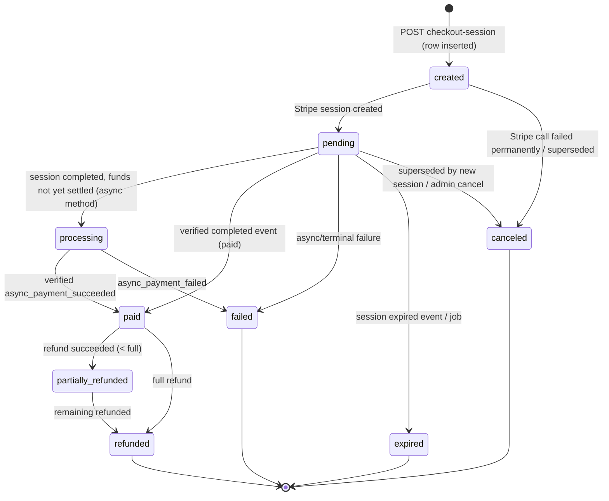
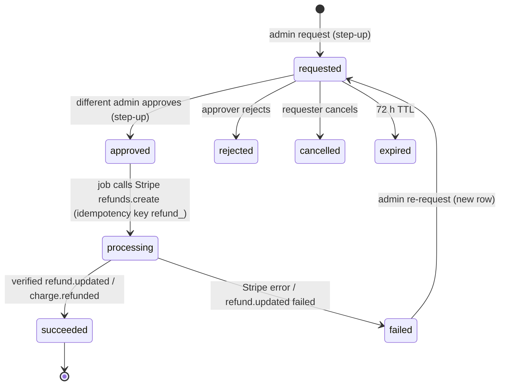
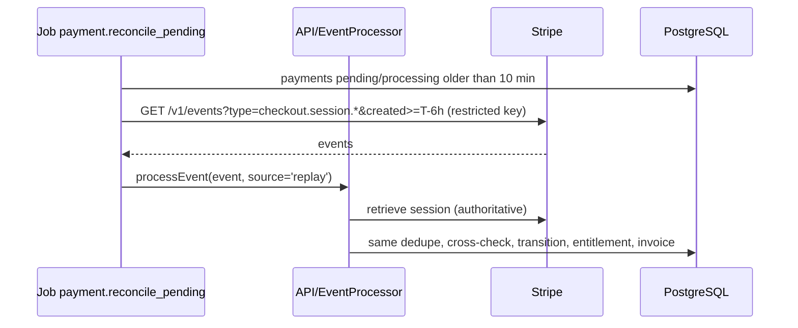

# LLD: M04 — Payment (Stripe €149)

| Field | Value |
|-------|-------|
| Module | M04 |
| Status | Review |
| Depends on HLD | `hld.md` (conventions and RLS contract: M01 `lld.md`; sessions/guards: M02; consents: M03) |
| Last updated | 2026-11-24 |

Money is stored as integer cents. Price is **gross, VAT included**. For rate `r` (basis points) and gross `G`: `tax = round(G * r / (10000 + r))`, `net = G − tax`. Example `G=14900, r=1900` → `tax=2379`, `net=12521`.

## 1. Database

### Tables

| Table | Column | Type | Constraints | Notes |
|-------|--------|------|-------------|-------|
| `payment_price_versions` | `id` | uuid | PK | |
| | `amount_cents` | integer | NOT NULL, CHECK `> 0` | Gross; seed `14900` |
| | `currency` | char(3) | NOT NULL, CHECK `= 'EUR'` | Phase 1 only |
| | `tax_mode` | text | NOT NULL, CHECK in (`de_standard`,`none`,`custom_bps`) | Decided by GAP-PAY-VAT |
| | `tax_rate_bps` | integer | NOT NULL, CHECK `between 0 and 3000` | `1900` for `de_standard`; `0` for `none` |
| | `description` | text | NOT NULL | Invoice line, e.g. "NIVO student platform access (one-time)" |
| | `effective_from` | timestamptz | NOT NULL | |
| | `status` | text | NOT NULL, CHECK in (`scheduled`,`active`,`retired`) | |
| | `approval_request_id` | uuid | NULL | M09 |
| | `created_by` | uuid | FK `users` | |
| | `created_at` | timestamptz | NOT NULL | |
| `payments` | `id` | uuid | PK | UUIDv7; used as `client_reference_id` |
| | `user_id` | uuid | NOT NULL, FK `users(id)` | |
| | `status` | text | NOT NULL, CHECK in (`created`,`pending`,`processing`,`paid`,`partially_refunded`,`refunded`,`failed`,`expired`,`canceled`) | See §3.1 |
| | `source` | text | NOT NULL, CHECK in (`stripe`,`manual`) | |
| | `price_version_id` | uuid | NOT NULL, FK | Snapshot reference |
| | `amount_cents` | integer | NOT NULL, CHECK `> 0` | Copied from price version |
| | `currency` | char(3) | NOT NULL, CHECK `= 'EUR'` | |
| | `tax_rate_bps` | integer | NOT NULL | Copied |
| | `tax_amount_cents` | integer | NOT NULL | |
| | `net_amount_cents` | integer | NOT NULL, CHECK `net + tax = amount` | |
| | `stripe_checkout_session_id` | text | NULL, UNIQUE | `cs_…` |
| | `stripe_payment_intent_id` | text | NULL, UNIQUE | `pi_…` |
| | `stripe_charge_id` | text | NULL | `ch_…` |
| | `stripe_dispute_id` | text | NULL | |
| | `payment_method_type` | text | NULL | `card`, `sepa_debit`, `manual_bank`, … (no card numbers) |
| | `expires_at` | timestamptz | NULL | Checkout session expiry |
| | `paid_at` | timestamptz | NULL | |
| | `failed_at` | timestamptz | NULL | |
| | `failure_code` | text | NULL | Stripe decline code/category only |
| | `refunded_cents` | integer | NOT NULL default 0, CHECK `between 0 and amount_cents` | |
| | `dispute_status` | text | NULL, CHECK in (`open`,`won`,`lost`) | |
| | `needs_review` | boolean | NOT NULL default false | |
| | `terms_consent_id` | uuid | NULL, FK `consents(id)` | Required for `source='stripe'` |
| | `withdrawal_consent_id` | uuid | NULL, FK `consents(id)` | Required for `source='stripe'` |
| | `manual_request_id` | uuid | NULL, FK | Required for `source='manual'` |
| | `created_at`, `updated_at` | timestamptz | NOT NULL | |
| | *CHECKs* | | `status NOT IN ('paid','partially_refunded','refunded') OR paid_at IS NOT NULL`; `source <> 'stripe' OR status IN ('created','pending','expired','canceled','failed') OR stripe_payment_intent_id IS NOT NULL`; `source <> 'stripe' OR (terms_consent_id IS NOT NULL AND withdrawal_consent_id IS NOT NULL)`; `source <> 'manual' OR manual_request_id IS NOT NULL` | |
| `payment_status_history` | `id` | uuid | PK | Append-only |
| | `payment_id` | uuid | NOT NULL, FK | |
| | `from_status`, `to_status` | text | NOT NULL | |
| | `cause` | text | NOT NULL | `checkout_created`, `webhook:<type>`, `replay:<type>`, `job:expire`, `manual_approved`, `refund:<id>`, `admin_cancel` |
| | `stripe_event_id` | text | NULL | |
| | `actor_user_id` | uuid | NULL | Staff for admin causes |
| | `at` | timestamptz | NOT NULL default now() | |
| `entitlements` | `id` | uuid | PK | |
| | `user_id` | uuid | NOT NULL, FK | |
| | `kind` | text | NOT NULL, CHECK `= 'platform_access'` | Extensible |
| | `status` | text | NOT NULL, CHECK in (`active`,`revoked`) | |
| | `source_payment_id` | uuid | NOT NULL, FK | |
| | `granted_at` | timestamptz | NOT NULL | |
| | `revoked_at` | timestamptz | NULL | |
| | `revoked_reason` | text | NULL | `refund`,`dispute_lost`,`admin_review` |
| | `revoked_by_refund_id` | uuid | NULL | |
| | | | UNIQUE (`user_id`,`kind`) WHERE `status='active'` | |
| `stripe_events` | `id` | text | PK | `evt_…` |
| | `type` | text | NOT NULL | |
| | `livemode` | boolean | NOT NULL | Must equal `APP_ENV=production` |
| | `api_version` | text | NULL | |
| | `stripe_created_at` | timestamptz | NOT NULL | |
| | `received_at` | timestamptz | NOT NULL default now() | |
| | `processed_at` | timestamptz | NULL | |
| | `status` | text | NOT NULL, CHECK in (`received`,`processed`,`ignored`,`failed`) | |
| | `source` | text | NOT NULL, CHECK in (`webhook`,`replay`) | |
| | `object_id` | text | NULL | session / PI / charge / refund ID |
| | `payment_id` | uuid | NULL | |
| | `summary` | jsonb | NOT NULL default `{}` | IDs, amount, currency, status only — **no payload, no email** |
| | `attempts` | smallint | NOT NULL default 0 | |
| | `error_code` | text | NULL | |
| `invoice_counters` | `series` | text | PK part, CHECK in (`INV`,`CN`) | |
| | `year` | smallint | PK part | Europe/Berlin year of issue |
| | `last_number` | integer | NOT NULL default 0 | Updated with `SELECT … FOR UPDATE` |
| `invoices` | `id` | uuid | PK | |
| | `payment_id` | uuid | NOT NULL, FK | |
| | `user_id` | uuid | NOT NULL, FK | |
| | `kind` | text | NOT NULL, CHECK in (`invoice`,`credit_note`) | |
| | `number` | text | NOT NULL, UNIQUE | `NIVO-2026-000001`; credit notes `NIVO-CN-2026-000001` |
| | `related_invoice_id` | uuid | NULL, FK self | Credit note → invoice |
| | `refund_id` | uuid | NULL, UNIQUE, FK | |
| | `issued_at` | timestamptz | NOT NULL | |
| | `service_date` | date | NOT NULL | Europe/Berlin date of payment |
| | `currency` | char(3) | NOT NULL | |
| | `gross_cents`, `net_cents`, `tax_cents` | integer | NOT NULL, CHECK `net + tax = gross` | Positive; sign by `kind` |
| | `tax_rate_bps` | integer | NOT NULL | |
| | `tax_mode` | text | NOT NULL | |
| | `line_description` | text | NOT NULL | |
| | `buyer_name` | text | NOT NULL | Snapshot of passport name |
| | `buyer_country` | char(2) | NULL | |
| | `seller_snapshot` | jsonb | NOT NULL | From M03 variables at issue time |
| | `pdf_object_key` | text | NULL | `invoices/<userId>/<invoiceId>.pdf` |
| | `pdf_sha256` | bytea | NULL | |
| | `pdf_generated_at` | timestamptz | NULL | |
| | `emailed_at` | timestamptz | NULL | |
| | | | UNIQUE (`payment_id`) WHERE `kind='invoice'` | One invoice per payment |
| `refunds` | `id` | uuid | PK | |
| | `payment_id` | uuid | NOT NULL, FK | |
| | `amount_cents` | integer | NOT NULL, CHECK `> 0` | |
| | `reason_code` | text | NOT NULL, CHECK in (`requested_by_customer`,`duplicate`,`fraudulent`,`service_not_delivered`,`goodwill`,`other`) | |
| | `reason_text` | text | NOT NULL | 10–1000 chars |
| | `revoke_access` | boolean | NOT NULL | |
| | `origin` | text | NOT NULL, CHECK in (`admin`,`auto_duplicate`,`stripe_dashboard`) | |
| | `status` | text | NOT NULL, CHECK in (`requested`,`approved`,`processing`,`succeeded`,`failed`,`rejected`,`cancelled`,`expired`) | |
| | `requested_by` | uuid | NOT NULL, FK | |
| | `approval_request_id` | uuid | NULL | |
| | `approved_by` | uuid | NULL, FK, CHECK `approved_by <> requested_by` | |
| | `stripe_refund_id` | text | NULL, UNIQUE | `re_…` |
| | `external_reference` | text | NULL | Bank ref for manual-source refunds |
| | `failure_reason` | text | NULL | |
| | `requested_at` | timestamptz | NOT NULL | |
| | `expires_at` | timestamptz | NOT NULL | Approval TTL (72 h) |
| | `decided_at`, `completed_at` | timestamptz | NULL | |
| `manual_payment_requests` | `id` | uuid | PK | |
| | `user_id` | uuid | NOT NULL, FK | Student to unlock |
| | `amount_cents` | integer | NOT NULL | Must equal active price (`CHECK` enforced in service) |
| | `method` | text | NOT NULL, CHECK in (`bank_transfer`,`cash`,`stripe_dashboard`,`other`) | |
| | `external_reference` | text | NOT NULL | Bank transaction / Stripe ID |
| | `paid_on` | date | NOT NULL | |
| | `evidence_note` | text | NOT NULL | 10–1000 chars |
| | `status` | text | NOT NULL, CHECK in (`requested`,`approved`,`rejected`,`cancelled`,`expired`,`applied`) | |
| | `requested_by` | uuid | NOT NULL, FK | |
| | `approval_request_id` | uuid | NULL | |
| | `approved_by` | uuid | NULL, FK, CHECK `approved_by <> requested_by` | |
| | `applied_payment_id` | uuid | NULL, FK | |
| | `requested_at`, `expires_at` | timestamptz | NOT NULL | 72 h |
| | | | UNIQUE (`method`,`external_reference`) | Prevents reusing one transfer for two students |
| `payment_reviews` | `id` | uuid | PK | |
| | `payment_id` | uuid | NULL, FK | May be NULL if event could not be matched |
| | `stripe_event_id` | text | NULL | |
| | `reason` | text | NOT NULL, CHECK in (`amount_mismatch`,`currency_mismatch`,`unknown_payment`,`duplicate_payment`,`dispute_opened`,`dashboard_refund`,`livemode_mismatch`,`session_not_paid`,`other`) | |
| | `status` | text | NOT NULL, CHECK in (`open`,`resolved`,`dismissed`) | |
| | `resolution` | text | NULL, CHECK in (`refund_requested`,`manual_paid_requested`,`dismissed`,`no_action`) | |
| | `notes` | text | NULL | |
| | `opened_at` | timestamptz | NOT NULL default now() | |
| | `resolved_by` | uuid | NULL, FK | |
| | `resolved_at` | timestamptz | NULL | |
| `reconciliation_runs` | `id` | uuid | PK | |
| | `run_date` | date | NOT NULL, UNIQUE | |
| | `stripe_gross_cents`, `db_gross_cents`, `diff_cents` | bigint | NOT NULL | Charges minus refunds for the day |
| | `status` | text | NOT NULL, CHECK in (`ok`,`discrepancy`,`error`) | |
| | `details` | jsonb | NOT NULL default `{}` | IDs only |
| | `created_at` | timestamptz | NOT NULL | |

Triggers:

- `payments_transition_guard`: BEFORE UPDATE — enforces the transition table in §3.1 (raises on illegal transitions, e.g. `paid → failed`); after any status change inserts into `payment_status_history` (same tx).
- `entitlements_writer_guard`: BEFORE INSERT/UPDATE — requires `current_setting('app.payment_executor', true) = 'on'`, set with `set_config(..., true)` only by `EventProcessor`, `ManualPaymentExecutor`, `RefundExecutor`, `DisputeExecutor`.
- `invoices_immutable`: BEFORE UPDATE — only `pdf_object_key`, `pdf_sha256`, `pdf_generated_at`, `emailed_at` may change (and only once from NULL for the first three).
- `status_history_append_only`, `stripe_events` no DELETE except by retention job (`app.retention='on'`).
- `set_updated_at` on `payments`, `refunds`.

### Indexes

- `payments`: UNIQUE partial `(user_id) WHERE status IN ('created','pending','processing')` ("one open payment per user"); non-unique `(user_id, status)`. There is deliberately **no** unique constraint on paid payments: if Stripe really captured a second charge, NIVO must record and invoice it (money received) and then refund it; "one active access grant per user" is enforced on `entitlements` instead; `(status, created_at)`; `(needs_review) WHERE needs_review`; `(stripe_checkout_session_id)`, `(stripe_payment_intent_id)` unique.
- `stripe_events (status, received_at)`, `(object_id)`, `(received_at)` for retention.
- `invoices (user_id, issued_at DESC)`, `(number)` unique.
- `refunds (payment_id)`, `(status, expires_at)`.
- `manual_payment_requests (user_id)`, `(status, expires_at)`.
- `payment_reviews (status, opened_at)`.

### RLS policies

All tables `ENABLE` + `FORCE`.

```sql
-- payments: students see own; staff see all (permission checked in app); writes only in system context
CREATE POLICY pay_self_select  ON payments FOR SELECT TO nivo_app USING (user_id = app_user_id());
CREATE POLICY pay_staff_select ON payments FOR SELECT TO nivo_app USING (app_actor_type() = 'staff');
CREATE POLICY pay_system_all   ON payments FOR ALL    TO nivo_app USING (app_is_system()) WITH CHECK (app_is_system());

-- entitlements, invoices: same pattern (self select, staff select, system write)
-- payment_status_history, stripe_events, payment_reviews, reconciliation_runs, invoice_counters: staff select, system write only
-- refunds: staff select/insert(request) ; system update
CREATE POLICY ref_staff_select ON refunds FOR SELECT TO nivo_app USING (app_actor_type() = 'staff');
CREATE POLICY ref_staff_insert ON refunds FOR INSERT TO nivo_app
  WITH CHECK (app_actor_type() = 'staff' AND requested_by = app_user_id() AND status = 'requested');
CREATE POLICY ref_system_all   ON refunds FOR ALL TO nivo_app USING (app_is_system()) WITH CHECK (app_is_system());
-- manual_payment_requests: identical to refunds (staff insert own request with status 'requested')
-- payment_price_versions: SELECT for all actors (public price); writes system only
CREATE POLICY ppv_public_select ON payment_price_versions FOR SELECT TO nivo_app USING (status = 'active');
CREATE POLICY ppv_staff_select  ON payment_price_versions FOR SELECT TO nivo_app USING (app_actor_type() = 'staff');
CREATE POLICY ppv_system_all    ON payment_price_versions FOR ALL TO nivo_app USING (app_is_system()) WITH CHECK (app_is_system());
```

Consultancy and accommodation-agent actors have **no** policies on payment tables. M10 receives only the `payment.paid` domain event ID/time and keeps its own pseudonymised conversion flag.

Webhook and job code runs in `withSystemContext('payment.webhook' | 'payment.job')`; student-initiated reads/writes (`GET /payments/me`, checkout) run in user context but perform inserts via a narrow `CheckoutRepository` in system context with `user_id` bound from the session (no user-supplied IDs).

### Seed

`payment_price_versions`: one `active` row `amount_cents=14900`, `tax_mode` and rate per GAP-PAY-VAT outcome (default in staging: `de_standard`, `1900`). Production deploy gate: fails if no active price or `tax_mode` unconfirmed flag set in config (`PAYMENT_TAX_CONFIRMED=true` required).

## 2. API endpoints

Base `/api/v1`. CSRF required on unsafe methods except webhook. "student" = authenticated student session (email verified). Terms guard applies except where noted.

### 2.1 Student and public

| Method | Path | Permission | Request | Response | Errors | Rate limit | Idempotency |
|--------|------|------------|---------|----------|--------|------------|-------------|
| GET | `/payments/price` | public | — | `200 PriceView` (`Cache-Control: public, max-age=60`) | `INTERNAL` | 60/min/IP | n/a |
| GET | `/payments/me` | student (terms guard **exempt**) | `?awaiting=<paymentId>` optional | `200 PaymentStateView`; if `awaiting` given and payment still `pending`/`processing` → `202` with error body `PAYMENT_PROCESSING`; if `failed`/`expired` → `402 PAYMENT_FAILED` with `PaymentStateView` in `details` | `UNAUTHORIZED`, `NOT_FOUND` (foreign ID) | 60/min/user | n/a |
| POST | `/payments/checkout-session` | student + terms current | `CheckoutBody` + header `Idempotency-Key` | `201 {paymentId, checkoutUrl, expiresAt}` | `VALIDATION_FAILED` (`LEGAL_VERSION_STALE`, `CONSENT_MISSING`), `CONFLICT` (already paid), `TERMS_REACCEPT_REQUIRED`, `RATE_LIMITED`, `INTERNAL` (Stripe error; safe to retry) | 5/10 min/user | `Idempotency-Key` scope `payments.checkout:<userId>`; same key → same response; open session reused |
| POST | `/payments/me/recheck` | student | — | `202` (enqueues `payment.reconcile_one`; **does not** change state itself) | `RATE_LIMITED`, `CONFLICT` (nothing pending) | 3/10 min/user | Idempotent (dedupe 60 s) |
| GET | `/payments/invoices` | student (terms exempt) | — | `200 [{id, number, kind, issuedAt, grossCents, currency}]` | — | 30/min/user | n/a |
| GET | `/payments/invoices/:id/pdf` | student, owner only (terms exempt) | — | `200 application/pdf` (`Content-Disposition: attachment`, `Cache-Control: no-store`) | `NOT_FOUND` (non-owner or no PDF yet → `409 CONFLICT` "preparing") | 30/min/user | n/a |

### 2.2 Admin (host `admin.`; staff session with 2FA; permissions deny-by-default)

| Method | Path | Permission | Request | Response | Errors | Rate limit | Idempotency |
|--------|------|------------|---------|----------|--------|------------|-------------|
| GET | `/admin/payments` | `staff:payment.read` | `?status&userId&email&from&to&needsReview&cursor&limit≤100` | `200 {items, nextCursor}` | `FORBIDDEN` | 120/min/user | n/a |
| GET | `/admin/payments/:id` | `staff:payment.read` | — | `200 AdminPaymentView` (history, refunds, invoice, events summary, consents) | `NOT_FOUND` | 120/min/user | n/a |
| POST | `/admin/payments/manual-requests` | `staff:payment.manual.request` + step-up | `ManualRequestBody` | `202 {requestId, approvalId}` | `VALIDATION_FAILED`, `CONFLICT` (user already entitled / open payment / duplicate reference), `STEP_UP_REQUIRED` | 10/h/user | UNIQUE (`method`,`external_reference`) |
| GET | `/admin/payments/manual-requests` | `staff:payment.read` | `?status` | `200` list | — | 60/min/user | n/a |
| POST | `/admin/payments/manual-requests/:id/cancel` | `staff:payment.manual.request` (requester) | — | `204` | `CONFLICT` | 20/h/user | Idempotent |
| POST | `/admin/payments/:id/refunds` | `staff:payment.refund.request` + step-up | `RefundRequestBody` | `202 {refundId, approvalId}` | `VALIDATION_FAILED` (amount > refundable), `CONFLICT` (payment not refundable / open refund exists), `STEP_UP_REQUIRED` | 10/h/user | One open refund per payment (partial unique index) |
| GET | `/admin/payments/refunds` | `staff:payment.read` | `?status` | `200` list | — | 60/min/user | n/a |
| POST | `/admin/payments/refunds/:id/cancel` | `staff:payment.refund.request` (requester) | — | `204` | `CONFLICT` | 20/h/user | Idempotent |
| POST | `/admin/payments/refunds/:id/confirm-manual` | `staff:payment.refund.confirm_manual` + step-up | `{externalReference}` | `200` (only for `source='manual'` payments, status `approved`) | `CONFLICT` | 10/h/user | Idempotent |
| *(M09)* POST | `/admin/approvals/:id/approve` \| `/reject` | `staff:payment.mark_paid.approve` or `staff:payment.refund.approve` + step-up; approver ≠ requester | `{comment}` | Executes M04 executor (§3.3/§3.4) | `APPROVAL_REQUIRED`, `FORBIDDEN`, `STEP_UP_REQUIRED` | per M09 | By approval ID |
| POST | `/admin/payments/:id/invoice/resend` | `staff:payment.invoice.resend` | — | `202` | `CONFLICT` (no PDF) | 20/h/user | n/a |
| POST | `/admin/payments/:id/replay` | `staff:payment.reconcile` | — | `202` (runs `payment.reconcile_one`) | `NOT_FOUND` | 20/h/user | n/a |
| GET | `/admin/payments/reviews` | `staff:payment.read` | `?status=open` | `200` list | — | 60/min/user | n/a |
| POST | `/admin/payments/reviews/:id/resolve` | `staff:payment.review.resolve` + step-up | `ReviewResolveBody` | `200` — resolution **never grants/revokes access directly**: creates refund request, manual-paid request, or dismisses | `VALIDATION_FAILED` | 30/h/user | Idempotent |
| GET | `/admin/payments/reconciliation` | `staff:payment.reconcile.read` | `?from&to` | `200 [reconciliation_runs]` | — | 30/min/user | n/a |
| GET/POST | `/admin/payments/prices` | `staff:payment.price.manage` + step-up; POST creates approval (`payment.price_change`) | `PriceBody` | `200` / `202 {approvalId}` | `APPROVAL_REQUIRED` | 10/h/user | By approval |

### 2.3 Webhook

| Method | Path | Auth | Request | Response | Errors | Rate limit |
|--------|------|------|---------|----------|--------|-----------|
| POST | `/webhooks/stripe` (full path `/api/v1/webhooks/stripe`) | Stripe signature only; no session; CSRF-exempt; body ≤ 256 KB; raw body preserved (`rawBody` parser for this route only) | Stripe event JSON | `200 {"received":true}` after durable processing or duplicate; `400` bad signature/livemode mismatch/unparseable; `500` processing error (Stripe retries) | `WEBHOOK_SIGNATURE_INVALID` (400) | Edge 300/min/IP |

Error catalog additions: `WEBHOOK_SIGNATURE_INVALID` (400, internal only, empty body message "Bad request"), `IDEMPOTENCY_CONFLICT` (409, from M01). Optional `details[].code` values used with catalog codes: `CONSENT_MISSING`, `LEGAL_VERSION_STALE`, `PAYMENT_PROCESSING`.

Events configured in Stripe for the endpoint (and no others): `checkout.session.completed`, `checkout.session.async_payment_succeeded`, `checkout.session.async_payment_failed`, `checkout.session.expired`, `payment_intent.payment_failed`, `charge.refunded`, `refund.updated`, `charge.dispute.created`, `charge.dispute.closed`. Unknown types → recorded as `ignored`, `200`.

### Zod schemas

```ts
// packages/shared/src/payment.ts
import { z } from 'zod';

export const PriceView = z.object({
  priceVersionId: z.string().uuid(), amountCents: z.number().int().positive(), currency: z.literal('EUR'),
  taxIncluded: z.literal(true), taxMode: z.enum(['de_standard', 'none', 'custom_bps']),
  taxRateBps: z.number().int().min(0).max(3000), display: z.string(),   // "€149.00"
});

export const CheckoutBody = z.object({
  termsVersionId: z.string().uuid(),
  withdrawalVersionId: z.string().uuid(),
  acceptTerms: z.literal(true),
  acknowledgeWithdrawal: z.literal(true),
}).strict();   // amount, currency, priceId, successUrl... are NOT accepted (strict => VALIDATION_FAILED)

export const PaymentStateView = z.object({
  state: z.enum(['unpaid', 'pending', 'processing', 'paid', 'failed', 'expired', 'refunded']),
  paymentId: z.string().uuid().nullable(),
  amountCents: z.number().int().nullable(), currency: z.literal('EUR').nullable(),
  paidAt: z.string().datetime().nullable(),
  canRetry: z.boolean(),
  failure: z.object({ code: z.string(), message: z.string() }).nullable(),
  invoice: z.object({ id: z.string().uuid(), number: z.string(), pdfReady: z.boolean() }).nullable(),
});

const ref = z.string().trim().min(3).max(100).regex(/^[A-Za-z0-9._\/\- ]+$/);

export const ManualRequestBody = z.object({
  userId: z.string().uuid(),
  method: z.enum(['bank_transfer', 'cash', 'stripe_dashboard', 'other']),
  externalReference: ref,
  paidOn: z.string().regex(/^\d{4}-\d{2}-\d{2}$/),   // not in the future, not older than 90 days
  evidenceNote: z.string().trim().min(10).max(1000),
}).strict();

export const RefundRequestBody = z.object({
  amountCents: z.number().int().positive(),
  reasonCode: z.enum(['requested_by_customer', 'duplicate', 'fraudulent', 'service_not_delivered', 'goodwill', 'other']),
  reasonText: z.string().trim().min(10).max(1000),
  revokeAccess: z.boolean(),
}).strict();

export const ReviewResolveBody = z.object({
  resolution: z.enum(['refund_requested', 'manual_paid_requested', 'dismissed', 'no_action']),
  notes: z.string().trim().min(10).max(1000),
}).strict();

export const PriceBody = z.object({
  amountCents: z.number().int().min(100).max(100_000),
  taxMode: z.enum(['de_standard', 'none', 'custom_bps']), taxRateBps: z.number().int().min(0).max(3000),
  description: z.string().min(5).max(200), effectiveFrom: z.string().datetime(), reason: z.string().min(10).max(500),
}).strict();
```

### Webhook handling matrix (EventProcessor)

All steps run in one transaction under `withSystemContext('payment.webhook')`; `set_config('app.payment_executor','on',true)`.

| Step | Rule |
|------|------|
| 1. Verify | `stripe.webhooks.constructEvent(rawBody, sig, STRIPE_WEBHOOK_SECRET, tolerance=300)`; fail → `400`, metric `webhook_signature_failures_total` |
| 2. Livemode | `event.livemode === (APP_ENV==='production')` else `400` + alert + `payment_reviews(livemode_mismatch)` |
| 3. Dedupe | `INSERT INTO stripe_events(id,…) ON CONFLICT DO NOTHING`; if conflict and `status IN ('processed','ignored')` → `200` (no work); if `failed/received` → reprocess |
| 4. Locate | Resolve payment by `client_reference_id`/`metadata.paymentId`, else by `stripe_checkout_session_id`/`payment_intent`; none → `unknown_payment` review, mark event `ignored`, `200` (avoid retry storms) |
| 5. Authoritative fetch | For session events: `stripe.checkout.sessions.retrieve(id, {expand:['payment_intent']})` (idempotent GET); use **fetched** `payment_status`, `amount_total`, `currency`, `payment_intent.status`; if fetch fails → throw → `500` (Stripe retries) |
| 6. Cross-check | `amount_total == payments.amount_cents`, `currency == 'eur'`, session ID equals stored, payment `status` allows transition, `payment_intent.status == 'succeeded'` for paid; mismatch → `needs_review=true`, `payment_reviews`, **no entitlement**, event `processed`, `200`, alert |
| 7. Transition | Apply per type (below) via transition guard; record `payment_status_history` |
| 8. Side effects (same tx) | On `paid`: grant entitlement; allocate invoice number and insert `invoices`; enqueue `payment.invoice.render`, `payment.domain_event.m10`, `email.send(pay_receipt)` (after PDF), audit |
| 9. Commit & ack | `stripe_events.status='processed'`, `processed_at`; return `200` |

| Event type | Action |
|------------|--------|
| `checkout.session.completed` | `payment_status=paid` → `paid`; `unpaid` (async method) → `processing` |
| `checkout.session.async_payment_succeeded` | → `paid` (same path) |
| `checkout.session.async_payment_failed` | → `failed` (`failure_code`), email `pay_failed` |
| `checkout.session.expired` | `created/pending/processing → expired` (ignored if already `paid`) |
| `payment_intent.payment_failed` | Store `failure_code` for display; status unchanged while session open |
| `charge.refunded` | Match to our refund by `refund` ID; update `refunded_cents`, status `partially_refunded/refunded`; unknown refund (dashboard) → create `refunds(origin='stripe_dashboard', status='succeeded')` + review item |
| `refund.updated` | Our refund `processing → succeeded|failed` |
| `charge.dispute.created` / `.closed` | Set `dispute_status`, open review, alert; **no automatic revoke** |

## 3. State machines

### 3.1 Payment



Allowed transitions (enforced by trigger and `EventProcessor`): `created→{pending,canceled,expired}`; `pending→{processing,paid,failed,expired,canceled}`; `processing→{paid,failed}`; `paid→{partially_refunded,refunded}`; `partially_refunded→{refunded}`. `paid`/`refunded` can never move to `failed/expired/canceled`. Student-facing state mapping: `created|pending → pending`, `processing → processing`, `paid|partially_refunded → paid`, `failed → failed`, `expired|canceled → expired`, `refunded → refunded`, no row → `unpaid`.

Retry semantics (REQ-PAY-04): in `failed`, `expired`, `canceled` the student sees the failure message and a **Pay again** button; pressing it creates a **new** `payments` row and Stripe session; the old row stays terminal. Dashboard remains locked (no active entitlement) throughout.

### 3.2 Entitlement

`none → active` only by executors in a payment transition to `paid` (webhook/replay or approved manual payment). `active → revoked` only by approved refund with `revoke_access=true` (on `succeeded`) or an explicit review resolution through an approved refund. Re-purchase after revoke: new payment → new `active` row.

### 3.3 Manual payment request

`requested → approved → applied` or `requested → rejected | cancelled | expired (72 h)`.

On approval (approver ≠ requester, step-up, permission `payment.mark_paid.approve`): in one tx — re-validate (user not entitled, no open Stripe payment [if open Stripe session exists it is expired first], amount equals active price, reference unique), insert `payments(source='manual', status='paid', paid_at=paid_on, payment_method_type='manual_<method>')` with consent IDs NULL (manual payments are tied to the Terms accepted at registration; M03 `terms` consent referenced via `user_legal_state`; CHECK allows NULL for manual), grant entitlement, issue invoice, enqueue emails, audit, `applied`.

### 3.4 Refund



On `succeeded`: update `payments.refunded_cents` and status; credit note issued; if `revoke_access` (default true when the refund covers the remaining paid amount) → revoke entitlement; emails; audit. Manual-source payments: `approved → processing` (awaiting bank transfer) `→ succeeded` via `confirm-manual` with bank reference.

Rules: refundable = `amount_cents − refunded_cents − Σ open refunds`; one open refund per payment; refund of a payment with open dispute is blocked (`CONFLICT`).

### 3.5 Price version

`scheduled → active` at `effective_from` (job), previous `active → retired`. Existing payments keep their snapshot. Changing price requires approval (`payment.price_change`).

## 4. Sequence diagrams

### Happy path — checkout, webhook, unlock, invoice

```mermaid
sequenceDiagram
  actor S as Student
  participant W as SPA
  participant A as API
  participant D as PostgreSQL
  participant ST as Stripe
  participant Q as Queue
  S->>W: open /checkout (price from GET /payments/price)
  S->>W: tick Terms + withdrawal acknowledgement, click Pay
  W->>A: POST /payments/checkout-session (CSRF, Idempotency-Key)
  A->>A: verify session, terms current, consent versions current
  A->>D: BEGIN: consents (M03), INSERT payments(created)
  A->>ST: checkout.sessions.create (amount from DB, idem key checkout_<paymentId>)
  ST-->>A: session id + url
  A->>D: payments -> pending; COMMIT
  A-->>W: 201 {checkoutUrl}
  W->>ST: redirect to Stripe Checkout
  S->>ST: pays (3DS if needed)
  ST-->>A: POST /webhooks/stripe checkout.session.completed (signed)
  A->>A: verify signature + livemode
  A->>D: BEGIN; INSERT stripe_events (dedupe)
  A->>ST: retrieve session (authoritative)
  A->>D: cross-check; payments -> paid; entitlement active; invoice number allocated; enqueue jobs; COMMIT
  A-->>ST: 200
  ST-->>W: redirect /payment/success?payment=<id>
  W->>A: GET /payments/me?awaiting=<id>
  A-->>W: 202 PAYMENT_PROCESSING (if webhook not yet processed) ... then 200 state=paid
  Q->>Q: payment.invoice.render -> PDF in storage -> email pay_receipt (PDF attached) -> Documents entry
```

### Failure path — webhook lost (replay)



### Failure paths

| Case | Behaviour |
|------|-----------|
| Invalid / missing signature, timestamp > 5 min old | `400`; no DB writes; counter + alert if > 5/min |
| Valid signature, unknown payment ID | Event stored `ignored`, review `unknown_payment`, `200` |
| Amount/currency mismatch | `needs_review`, no unlock, finance alert; student sees "We are confirming your payment" and receives support follow-up |
| Duplicate event delivery | `200` immediately; zero side effects |
| `expired` arrives after `completed` | Transition rejected by guard; event `processed` (no-op) |
| Stripe retrieve fails during webhook | `500` → Stripe retries with backoff (up to 3 days); replay job as second line |
| DB failure during processing | Transaction rolls back (no entitlement, no event row) → `500` → retry; idempotent |
| Invoice PDF render fails | Payment/entitlement already committed; job retries (8×, backoff); watchdog alerts at 15 min; invoice number already allocated |
| Email send fails | Retry; invoice available at Documents |
| Student double-clicks Pay / two tabs | Same idempotency key → same URL; new key → previous session expired, one open payment per user enforced by unique index |
| Second payment completes anyway (race) | EventProcessor sees an `active` entitlement already exists: second payment still transitions to `paid` and is invoiced (money was received), but is flagged `needs_review(duplicate_payment)`, **no second entitlement** is created (unique active entitlement per user), and a refund request `origin='auto_duplicate'`, `revoke_access=false` is created in `requested` state awaiting maker-checker approval |
| Student returns to success URL without paying (manual URL edit) | `GET /payments/me` shows `pending/unpaid`; no unlock |
| Declined card | Stripe page lets user retry inside session; after terminal failure → `failed`, `PAYMENT_FAILED`, email `pay_failed`, **Pay again** |
| Refund API error | Refund `failed`, alert, request can be re-raised |
| Dispute opened | `dispute_status=open`, review item, alert; refunds blocked until closed |

## 5. Validation rules

| Field | Client | API | DB |
|-------|--------|-----|----|
| Amount / currency / price ID | Not sent | Rejected by `.strict()`; taken from active price version | CHECK `amount>0`, `currency='EUR'`, `net+tax=amount` |
| `acceptTerms`, `acknowledgeWithdrawal` | Two unticked checkboxes, Pay disabled until both ticked; text from M03 shown/linked | `z.literal(true)`; `termsVersionId`/`withdrawalVersionId` must equal current M03 versions (`LEGAL_VERSION_STALE`) | consent FKs NOT NULL for Stripe source |
| `Idempotency-Key` | UUID per click attempt | 16–128 chars (M01) | UNIQUE (`scope`,`key`) |
| User state | n/a | Verified, `active`, terms current, no active entitlement (`CONFLICT` "already paid"), no other open payment (reuse) | partial unique indexes |
| `externalReference` | Required | Regex `^[A-Za-z0-9._\/\- ]{3,100}$`; unique per method | UNIQUE |
| `paidOn` | Date picker ≤ today | Not in future, ≤ 90 days old | `date` |
| `evidenceNote`, `reasonText`, review `notes` | Min 10 chars | Trimmed, 10–1000 | text |
| Refund `amountCents` | Max = refundable shown | ≤ refundable; payment `paid/partially_refunded`; no open dispute/refund | CHECK `>0`; `refunded_cents ≤ amount` |
| Approver | n/a | ≠ requester; holds `*.approve`; step-up ≤ 5 min | CHECK `approved_by <> requested_by` |
| Webhook body | n/a | Raw body ≤ 256 KB; signature before JSON parse; event `livemode` matches env | `stripe_events.livemode` |
| Invoice numbering | n/a | Allocated only in the `paid` transaction | UNIQUE `number`; counter row lock |
| PDF download | n/a | Owner = session user (RLS + explicit check); staff need `payment.read` | RLS |

## 6. Background jobs

All payloads contain IDs only (**No PII**; no names, emails, amounts beyond IDs).

| Job | Trigger | Retry | Dead letter | Payload rules |
|-----|---------|-------|-------------|---------------|
| `payment.invoice.render` | Enqueued in paid / refund-succeeded tx | 8, exp backoff (30 s→1 h) | `payment.invoice.render_dlq` (alert) | `{invoiceId}`; idempotent: renders, uploads (encrypted), stores hash; skips if `pdf_object_key` set |
| `payment.invoice.email` | After render | 5, backoff | `email.send_dlq` | `{invoiceId}` → M11 `pay_receipt` / `pay_refund_issued`; registers Document |
| `payment.domain_event.m10` | In paid tx | 5 | dlq | `{paymentId}` |
| `payment.refund.execute` | Refund approved | 5 on 5xx / network; 0 on 4xx (marks `failed`) | dlq + alert | `{refundId}`; Stripe idempotency key `refund_<id>` |
| `payment.refund.expire_requests` | cron `5 * * * *` | 3 | dlq | `{}` — `requested` past `expires_at` → `expired`; same for manual requests |
| `payment.reconcile_pending` | cron `*/5 * * * *` | 3 | dlq | `{}` — for payments `pending/processing` > 10 min: replay events; if Stripe session `open` and expired → `expired` |
| `payment.reconcile_one` | `POST /payments/me/recheck`, admin replay | 3 | dlq | `{paymentId}` — same replay path for one payment |
| `payment.replay_events` | cron `15 * * * *` (window 6 h) and `30 4 * * *` (window 72 h) | 3 | dlq | `{windowHours}` — lists Stripe events by type, runs those not in `stripe_events` through EventProcessor |
| `payment.expire_stale` | cron `*/15 * * * *` | 3 | dlq | `{}` — `created` older than 1 h without session → `canceled`; `pending` past `expires_at + 5 min` after Stripe confirms `expired` → `expired` |
| `payment.price_activate` | cron `* * * * *` | 3 | dlq | `{}` |
| `payment.ledger_check` | cron `30 3 * * *` | 2 | alert | `{}` — compares Stripe charges/refunds (balance transactions, previous Europe/Berlin day) with DB; writes `reconciliation_runs`; discrepancy → alert + review items |
| `payment.invoice_watchdog` | cron `*/10 * * * *` | 1 | alert | `{}` — invoices without PDF > 15 min; unsent receipts > 30 min |
| `payment.review_sla_alert` | cron `0 * * * *` | 1 | n/a | `{}` — open reviews older than 24 h |
| `payment.events_cleanup` | cron `0 5 * * 0` | 2 | dlq | `{}` — delete `stripe_events` older than 180 days (`app.retention='on'`) |

## 7. Emails

All via M11 with brand template (Orange `#FB770B` accents, Beige `#F5EFE6` background, Charcoal `#2D2A26` text, Poppins with Arial fallback). Student emails link to `APP_ORIGIN/documents`.

| Template key | Trigger | Content summary |
|--------------|---------|-----------------|
| `pay_receipt` | Invoice PDF ready after `paid` | "Payment received — your NIVO account is unlocked", invoice number, amount, **PDF attached**, next step (complete your details), link to Documents |
| `pay_failed` | Terminal failure (`failed`) | Plain reason category, "Your dashboard stays locked until payment succeeds", **Pay again** link, support contact |
| `pay_processing_delay` | `pending/processing` > 30 min after return | "We have not yet received confirmation from your bank/Stripe; no action needed; we'll email you" |
| `pay_refund_issued` | Refund `succeeded` | Amount, timing (5–10 business days), credit note PDF attached, access status |
| `pay_manual_confirmation` | Manual payment applied | Same as receipt, mentions "recorded by NIVO support" |
| `pay_refund_approval_request` / `pay_mark_paid_approval_request` | Approval created | Internal to approvers (holders of `*.approve`, excluding requester): summary, link |
| `pay_request_decided` | Approval approved/rejected/expired | Internal to requester |
| `pay_review_alert` | Review opened (mismatch, duplicate, dispute, livemode) | Internal to finance group: payment ID, reason, link |
| `pay_ledger_discrepancy` | Daily check fails | Internal: date, diff, link |

No marketing content; no payment-abandonment reminders in Phase 1 (consent basis unclear — GAP-PAY-REMINDER, Low).

## 8. Audit events

Via M09 `audit.append`, same transaction as the change; no card data, no secrets.

| Action | Before/After | Reason required |
|--------|--------------|-----------------|
| `payment.checkout.created` | — / `{paymentId, priceVersionId, amountCents}` | No |
| `payment.status.changed` | `{from, to, cause, stripeEventId?}` | No |
| `payment.webhook.verified` / `.rejected` | `{eventId?, type, outcome}` (rejected: counter-sampled) | No |
| `payment.review.opened` / `.resolved` | `{reason}` / `{resolution}` | Resolve: yes |
| `payment.entitlement.granted` / `.revoked` | `{paymentId}` / `{reason, refundId?}` | Revoke: yes |
| `payment.invoice.issued` / `.regenerated` / `.resent` | `{number, pdfSha256}` | Resend: no |
| `payment.manual.requested` / `.approved` / `.rejected` / `.applied` | `{userId, method, reference, approverId}` | Yes (evidence + decision comment) |
| `payment.refund.requested` / `.approved` / `.rejected` / `.executed` / `.succeeded` / `.failed` | `{amountCents, reasonCode, revokeAccess, approverId}` | Yes |
| `payment.dispute.opened` / `.closed` | `{disputeId, outcome}` | No |
| `payment.price.changed` | `{from, to, approverId}` | Yes |
| `payment.replay.executed` | `{windowHours, eventsApplied}` | No |
| `payment.ledger.checked` | `{date, diffCents}` | No |

## 9. Config / admin settings

| Key | Default | Changeable via |
|-----|---------|----------------|
| Active price version | €149.00 gross | `POST /admin/payments/prices` (approval + step-up) |
| `payment.tax_confirmed` | `false` until advisor sign-off (production start gate) | Deploy config |
| `payment.checkout_expiry_minutes` | 30 (Stripe minimum) | Deploy config |
| `payment.approval_ttl_hours` | 72 | Deploy config |
| `payment.manual.max_age_days` | 90 | Deploy config |
| `payment.refund.default_revoke_on_full` | `true` | M09 settings (approval) |
| `payment.reconcile.pending_after_min` | 10 | Deploy config |
| `payment.invoice.seller_source` | M03 variables (`company.*`) | M03 admin |
| Secrets | `STRIPE_SECRET_KEY` (restricted: Checkout Sessions write/read, PaymentIntents read, Charges read, Refunds write, Events read, Balance transactions read), `STRIPE_WEBHOOK_SECRET`, `STRIPE_API_VERSION` (pinned constant) | M01 secrets; rotation 12 months and on staff change; separate keys per environment |

Stripe dashboard checklist (verified by `scripts/verify-stripe.ts` in staging/prod): webhook endpoint URL = `https://app.<domain>/api/v1/webhooks/stripe` with the event list in §2.3 only; API version pinned; Radar rules default; receipts emails from Stripe **disabled** (NIVO sends its own); statement descriptor `NIVO`; customer emails off; payment methods per GAP-PAY-METHODS; test/live keys separated.

Invoice PDF layout (pdfmake): A4, Poppins embedded; top band Orange `#FB770B` with Charcoal wordmark "NIVO" (Charcoal on Orange ≈ 5.3:1); seller block (legal name, address, register, managing director, VAT ID, contact from snapshot); title "Invoice" / "Credit note"; number, issue date, service date, buyer name (as passport) and country; table: description | gross | VAT % | VAT | net; total gross incl. VAT; note on payment method ("Paid by card via Stripe" / "Paid by bank transfer, ref …"); credit note references original invoice number; Saffron `#E8A55C` rules; footer with company legal details and "Generated on <date>". PDF/A not required for B2C.

## 10. Logging and redaction

Never logged: raw webhook body, `Stripe-Signature`, Stripe secret/restricted keys, webhook secret, `client_secret`, checkout URLs (contain session ID), full event payloads, customer email, card brand/last4/fingerprint, buyer name, evidence notes, invoice contents, PDF bytes. Allowed: `requestId`, `eventId`, `eventType`, `paymentId`, `userIdHash`, `status transitions`, `amountCents` (not linked to name/email in logs), `outcome`, `ruleName`. Stripe SDK logging disabled; HTTP client debug off. Redaction paths extended in M01 logger: `*.stripeSignature`, `*.checkoutUrl`, `*.clientSecret`, `*.evidenceNote`.

Metrics: `webhook_events_total{type,result}`, `webhook_signature_failures_total`, `payment_status_total{status}`, `payment_pending_age_seconds` (max), `payment_review_open`, `invoice_pdf_pending`, `refund_total{status}`, `ledger_diff_cents`.

Alerts: signature failures > 5/min; any `needs_review`; pending > 30 min; invoice without PDF > 15 min; ledger discrepancy; DLQ > 0; refund failed.

## 11. Test cases

| ID | Layer | Description | Expected |
|----|-------|-------------|----------|
| T-PAY-001 | integration (+ e2e on Stripe test mode) | `POST /payments/checkout-session` as verified student with both consents | `201`; Stripe session created with `unit_amount=14900`, `currency=eur`, `client_reference_id=paymentId`, metadata contains only `paymentId`; payment `pending`; consent IDs stored; audit `payment.checkout.created`; **no entitlement** |
| T-PAY-002 | integration | Unauthenticated, unverified, terms-stale, missing/unticked consent, stale version IDs | `UNAUTHORIZED` / `AUTH_EMAIL_NOT_VERIFIED` / `TERMS_REACCEPT_REQUIRED` / `VALIDATION_FAILED`; no Stripe call, no rows |
| T-PAY-003 | integration | Idempotency: same key twice → same URL; new key while session open → previous expired at Stripe, one open payment | One `pending` row; previous `canceled` |
| T-PAY-004 | unit | Price/tax math: 14900 @ 1900 bps → tax 2379, net 12521; `none` mode → tax 0; rounding cases | Exact values |
| T-PAY-005 | integration | RLS/IDOR: student A cannot read B's payments/invoices (`NOT_FOUND`); consultancy/agent actors get no rows; staff without `payment.read` forbidden | Pass |
| T-PAY-006 | integration + security | Request with `amountCents`, `currency`, `priceId`, `successUrl` or manipulated return params | `VALIDATION_FAILED` (strict); amount always from DB; Stripe call uses DB amount |
| T-PAY-007 | integration | CSRF missing on checkout; rate limit 5/10 min | `CSRF_INVALID` / `RATE_LIMITED` |
| T-PAY-008 | integration | Already-entitled student starts checkout | `409 CONFLICT` |
| T-PAY-010 | integration + e2e | **Unlock only on verified webhook**: after redirect to `/payment/success` but before event, `GET /payments/me` shows `pending`, M06 guard returns `402 PAYMENT_REQUIRED`; deliver signed `checkout.session.completed` → state `paid`, entitlement active, guard passes | Pass; entitlement row created only within webhook transaction |
| T-PAY-011 | integration | Webhook signature missing/invalid/wrong secret/timestamp 10 min old; body mutated after signing | `400`; no `stripe_events` row; no state change; metric incremented |
| T-PAY-012 | security | Forge return URL (`/payment/success?payment=<id>&status=paid`), call `POST /payments/me/recheck` repeatedly, craft client state | No unlock; recheck only enqueues replay (still requires real Stripe event) |
| T-PAY-013 | integration | Cross-check failures: amount mismatch, currency mismatch, session not `paid`, unknown payment ID, livemode mismatch | `needs_review` / review item; no entitlement; `200` (or `400` for livemode) |
| T-PAY-014 | integration | Idempotency & ordering: same event twice, `completed` + `async_payment_succeeded` for same payment, `expired` after `completed`, concurrent duplicate deliveries (20 parallel) | One entitlement, one invoice, one history entry for `paid`; later events no-ops |
| T-PAY-015 | integration | Webhook lost: payment `pending` 11 min, no event stored; `payment.reconcile_pending` with mocked Stripe events API | Payment `paid` via replay path through same processor |
| T-PAY-016 | integration | Processing failure mid-way (kill DB tx / Stripe retrieve error) → `500`; retry succeeds | No partial state; final state correct once |
| T-PAY-017 | integration | Async method: `completed` with `payment_status=unpaid` → `processing`; then succeeded → `paid`; or `async_payment_failed` → `failed` | Pass |
| T-PAY-018 | integration | Webhook route: no CSRF/session required; > 256 KB rejected at edge/app; raw body preserved; other routes still enforce CSRF | Pass |
| T-PAY-020 | integration + e2e | After `paid`: invoice row (`NIVO-<yyyy>-<6 digits>`), amounts, buyer name snapshot, seller snapshot; PDF rendered, stored encrypted, SHA-256 saved; email `pay_receipt` with PDF attached; Documents lists it; only owner can download | Pass |
| T-PAY-021 | integration | Gapless numbering: 50 concurrent `paid` transactions; one transaction forced to roll back | Numbers contiguous with no gaps; no duplicates |
| T-PAY-022 | integration | PDF failure then retry; watchdog alert; deterministic regenerate yields same content hash (fixed timestamp field excluded) | Pass |
| T-PAY-023 | integration | Full and partial refund create credit notes `NIVO-CN-…` referencing invoice; amounts correct | Pass |
| T-PAY-024 | integration | `invoices_immutable` trigger: UPDATE of amounts/number fails; only PDF fields settable once | Exception |
| T-PAY-025 | unit | PDF content builder includes all required small-invoice fields (seller name/address, date, description, gross, VAT rate/amount) | Pass |
| T-PAY-030 | integration + e2e | Declined card (`4000 0000 0000 0002`): terminal failure → `failed`, `PAYMENT_FAILED`, email `pay_failed`, **Pay again** creates new payment; dashboard stays locked (M06 guard `402`) | Pass |
| T-PAY-031 | e2e | Session expiry (clock/Stripe expire API): `expired` state, retry works | Pass |
| T-PAY-032 | e2e | User clicks "Back" on Stripe (cancel URL): no state change claimed as failure; **Pay again** expires the old session and creates a new one | Pass |
| T-PAY-033 | integration | Double payment race: two sessions both completed | Second payment is `paid` + invoiced but flagged `needs_review(duplicate_payment)`; still exactly one active entitlement; auto refund proposal `origin='auto_duplicate'` (`revoke_access=false`) awaiting approval; after approval and Stripe refund a credit note exists and the user keeps access |
| T-PAY-040 | integration | Manual mark-paid: requires `payment.manual.request` + step-up + evidence; creates approval; **requester cannot approve**; approver with `payment.mark_paid.approve` + step-up approves → payment `source='manual'` `paid`, entitlement, invoice, audit events; duplicate `externalReference` blocked; request expires after 72 h | Pass |
| T-PAY-041 | integration | Refund happy path: request → approval by different admin → job calls Stripe (idempotency key) → `refund.updated` → refund `succeeded`, payment `refunded`, credit note, entitlement revoked (full), email, audit; partial refund keeps entitlement; amount > refundable rejected | Pass |
| T-PAY-042 | integration | Refund failure (Stripe error), approval expiry, rejection, cancel by requester; second open refund blocked; refund with open dispute blocked | Pass |
| T-PAY-043 | integration | Manual-source refund: `confirm-manual` with bank reference, step-up; cannot confirm unapproved | Pass |
| T-PAY-044 | integration | Permission matrix: student, accommodation agent, consultancy, staff without permission → `FORBIDDEN` on all `/admin/payments/*`; staff session without 2FA unusable (M02) | Pass |
| T-PAY-045 | integration | Price change needs approval; scheduled activation; existing payments keep snapshot; new checkout uses new price | Pass |
| T-PAY-050 | integration | Needs-review queue: mismatch, duplicate, dashboard refund, dispute opened → review item + alert; `resolve` never grants/revokes access directly (creates refund/manual request or dismisses) | Pass |
| T-PAY-051 | integration | Daily ledger check with injected discrepancy (missing DB payment / extra Stripe charge) | `reconciliation_runs.status='discrepancy'`, alert, review item |
| T-PAY-052 | integration | Dispute created/closed events set `dispute_status`, no auto-revoke, refunds blocked while open | Pass |
| T-PAY-053 | integration | Dashboard-created refund (unknown to NIVO) imported via `charge.refunded` with review item | Pass |
| T-PAY-060 | security | Log capture across checkout, webhook, refund flows contains none of: signature, secrets, raw payload, email, name, checkout URL, evidence notes | Pass |
| T-PAY-061 | security | CSP/headers on checkout page: no Stripe.js or third-party script; redirect-only; `form-action`/`connect-src` unchanged | Pass |
| T-PAY-062 | ops | `scripts/verify-stripe.ts`: key is restricted (no `charges:write`, no `customers:write`), webhook endpoint events == allowlist, API version pinned, livemode matches env | Pass in staging and prod |
| T-PAY-063 | integration | RLS: `nivo_app` in student context cannot INSERT/UPDATE `payments` or `entitlements`; `entitlements_writer_guard` rejects writes without executor flag | Exception |
| T-PAY-070 | e2e | Happy path with Stripe test card `4242 4242 4242 4242`: register → verify → login → checkout → paid → invoice email (Mailpit) → Documents → dashboard unlocked | Pass |
| T-PAY-071 | e2e + a11y | Checkout page: consents unticked by default, Pay disabled until both ticked, withdrawal text visible, WCAG AA, keyboard flow; success page polling states (processing → paid; timeout message after 60 s with "Check again") | Pass |
| T-PAY-072 | perf | 50 concurrent completed events | p95 < 500 ms, zero duplicates |
