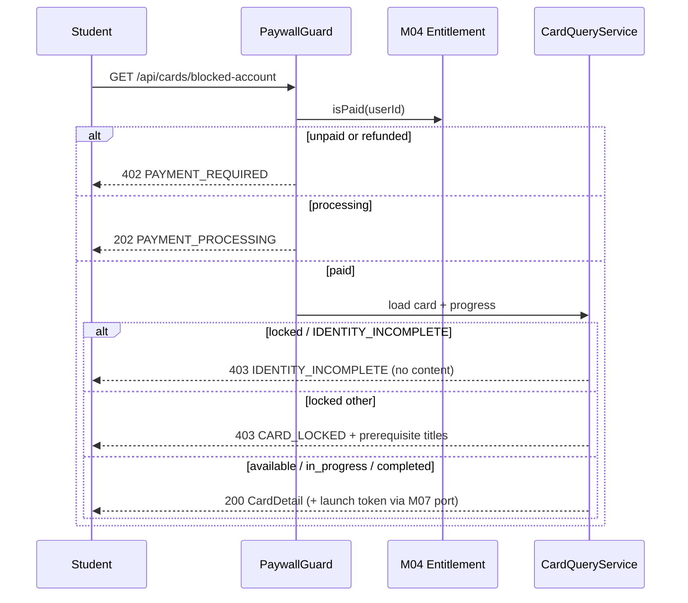

# LLD: M06 — Cards

| Field | Value |
|-------|-------|
| Module | M06 |
| Status | Review |
| Depends on HLD | `hld.md` |
| Last updated | 2026-11-24 |

Conventions: UUID primary keys, `timestamptz` UTC, snake_case. `user_id` references `users.id` (`user_kind = 'student'`). Student routes under `/api/cards`, admin routes under `/api/admin/cards` (admin subdomain). Error shape and codes from `00-error-catalog.md`.

## 1. Database

### Enums

| Enum | Values | Notes |
|------|--------|-------|
| `card_status` | `locked`, `available`, `in_progress`, `completed`, `coming_soon` | Same five values as `00-data-model.md`. `coming_soon` is never stored in `card_progress` (CHECK) and is derived for display |
| `card_lock_reason` | `IDENTITY_INCOMPLETE`, `PREREQUISITES_NOT_MET`, `ADMIN_HOLD` | Set only while `status = 'locked'` |
| `card_type` | `partner`, `accommodation`, `info`, `coming_soon` | |
| `card_completion_mode` | `proof_review`, `lead_booked`, `admin_manual` | Phase 2 adds `partner_webhook`, `partner_csv` (M07 stubs); not accepted by validation yet |
| `publish_status` | `draft`, `pending_review`, `approved`, `published`, `rejected` | From data model; shared with M09 |
| `card_completion_source` | `proof_approved`, `lead_booked`, `admin_manual`, `admin_override`, `partner_webhook`, `partner_csv` | Last two reserved |
| `card_event_cause` | `payment_confirmed`, `identity_completed`, `prereq_satisfied`, `rule_reeval`, `fanout_new_card`, `start`, `complete`, `admin_override` | |

### Tables

| Table | Column | Type | Constraints | Notes |
|-------|--------|------|-------------|-------|
| cards | id | uuid | PK | |
| | slug | text | NOT NULL, UNIQUE, CHECK `slug ~ '^[a-z0-9]+(-[a-z0-9]+)*$'` and length 2–40 | Immutable; used in URLs. Seeds: `blocked-account`, `sim`, `accommodation`, `card-4` |
| | sort_order | integer | NOT NULL | Display order; changes audited, no approval |
| | published_version_id | uuid | FK card_versions(id), NULL until first publish | Pointer cache of the live version |
| | archived_at | timestamptz | | Hides from new students |
| | created_by | uuid | FK users | |
| | created_at / updated_at | timestamptz | NOT NULL default now() | |
| card_versions | id | uuid | PK | |
| | card_id | uuid | NOT NULL, FK cards(id) | |
| | version | integer | NOT NULL, UNIQUE (card_id, version) | Monotonic |
| | publish_status | publish_status | NOT NULL default `draft` | |
| | superseded_at | timestamptz | | Set when a newer version is published |
| | card_type | card_type | NOT NULL | |
| | completion_mode | card_completion_mode | NULL for `coming_soon` | CHECK partner → `proof_review`; accommodation → `lead_booked`; info → `admin_manual` |
| | partner_id | uuid | FK partners(id) (M07) | Required when `card_type = 'partner'`, NULL otherwise |
| | requires_identity | boolean | NOT NULL default false | Seeds: true for cards 1 and 3 |
| | identity_retention_anchor | boolean | NOT NULL default false | Seed: true for Blocked Account. At most one live card may be anchor (partial unique index) |
| | title_i18n | jsonb | NOT NULL | `{en, de?}`; `en` required |
| | summary_i18n | jsonb | NOT NULL | ≤ 200 chars per locale |
| | body_i18n | jsonb | NOT NULL default `{"en":""}` | Markdown, ≤ 20 000 chars, sanitised on render |
| | cta_label_i18n | jsonb | | e.g. "Open account with partner" |
| | coming_soon_blurb_i18n | jsonb | | Used when `card_type = 'coming_soon'` |
| | icon | text | NOT NULL, CHECK in icon allow-list | |
| | unlock_email_template | text | NULL or M11 template key | Seed: `sim_unlocked` on SIM; NULL → generic `card_unlocked` |
| | change_note | text | NOT NULL for non-first versions | ≤ 300 chars |
| | created_by / submitted_by / approved_by | uuid | FK users | Maker-checker: `approved_by <> created_by` (CHECK when set) |
| | approval_request_id | uuid | FK approval_requests | M09 |
| | published_at | timestamptz | | |
| | created_at | timestamptz | NOT NULL default now() | |
| card_unlock_rules | id | uuid | PK | Data-model `sim_unlock_rules`, generalised to any target card |
| | card_id | uuid | NOT NULL, FK cards(id) | Target card (SIM for Phase 1) |
| | version | integer | NOT NULL, UNIQUE (card_id, version) | |
| | publish_status | publish_status | NOT NULL default `draft` | |
| | superseded_at | timestamptz | | |
| | rule | jsonb | NOT NULL | `{mode, requiredCardIds[], min?}` |
| | change_note | text | NOT NULL | |
| | created_by / submitted_by / approved_by | uuid | | Maker-checker |
| | approval_request_id | uuid | | |
| | published_at / created_at | timestamptz | | |
| card_progress | user_id | uuid | PK part, FK users | |
| | card_id | uuid | PK part, FK cards | |
| | status | card_status | NOT NULL, CHECK `status <> 'coming_soon'` | |
| | lock_reason | card_lock_reason | CHECK `(status = 'locked') = (lock_reason IS NOT NULL)` | |
| | unlocked_at | timestamptz | | First time status left `locked`; never cleared (grandfather marker) |
| | unlocked_rule_version_id | uuid | FK card_unlock_rules | Which rule unlocked it, for audit |
| | started_at | timestamptz | | |
| | completed_at | timestamptz | CHECK `(status = 'completed') = (completed_at IS NOT NULL)` | |
| | completion_source | card_completion_source | CHECK required iff completed | |
| | version | integer | NOT NULL default 1 | Optimistic-lock counter, incremented on every change |
| | created_at / updated_at | timestamptz | NOT NULL default now() | |
| card_status_events | id | bigserial | PK | Append-only |
| | user_id, card_id | uuid | NOT NULL | |
| | from_status / to_status | card_status | from NULL on row creation | |
| | from_lock_reason / to_lock_reason | card_lock_reason | | |
| | cause | card_event_cause | NOT NULL | |
| | actor_kind | text | CHECK in (`student`,`admin`,`system`,`partner`) | |
| | actor_id | uuid | | |
| | ref_type / ref_id | text / uuid | | `proof`, `lead`, `approval_request`, `rule_version` |
| | created_at | timestamptz | NOT NULL default now() | |
| student_milestones | user_id | uuid | PK, FK users | |
| | paid_at | timestamptz | | Set on `payment.confirmed` (first time) |
| | identity_completed_at | timestamptz | | Set on `identity.completed` (first time, never cleared) |
| | created_at / updated_at | timestamptz | | |
| notify_requests | id | uuid | PK | |
| | user_id | uuid | NOT NULL, FK users | |
| | card_id | uuid | NOT NULL, FK cards | Must reference a card whose live version is `coming_soon` |
| | created_at | timestamptz | NOT NULL default now() | |
| | cancelled_at | timestamptz | | |
| | notified_at | timestamptz | | Set when `card_available` email was queued |
| | | | UNIQUE (user_id, card_id) | Re-request after cancel clears `cancelled_at` |

### Trigger: no regression

```sql
CREATE FUNCTION card_progress_guard() RETURNS trigger AS $$
DECLARE
  old_rank int; new_rank int; override text;
BEGIN
  old_rank := CASE OLD.status WHEN 'locked' THEN 0 WHEN 'available' THEN 1
                              WHEN 'in_progress' THEN 2 WHEN 'completed' THEN 3 END;
  new_rank := CASE NEW.status WHEN 'locked' THEN 0 WHEN 'available' THEN 1
                              WHEN 'in_progress' THEN 2 WHEN 'completed' THEN 3 END;
  override := current_setting('app.override_approval_id', true);
  IF new_rank < old_rank AND (override IS NULL OR override = '') THEN
    RAISE EXCEPTION 'CARD_REGRESSION_FORBIDDEN' USING ERRCODE = 'P0001';
  END IF;
  IF OLD.unlocked_at IS NOT NULL AND NEW.unlocked_at IS NULL THEN
    RAISE EXCEPTION 'CARD_UNLOCK_MARKER_IMMUTABLE' USING ERRCODE = 'P0001';
  END IF;
  IF OLD.status = 'completed' AND NEW.status = 'completed'
     AND NEW.completed_at IS DISTINCT FROM OLD.completed_at THEN
    RAISE EXCEPTION 'CARD_COMPLETED_AT_IMMUTABLE' USING ERRCODE = 'P0001';
  END IF;
  NEW.version := OLD.version + 1;
  NEW.updated_at := now();
  RETURN NEW;
END $$ LANGUAGE plpgsql;
CREATE TRIGGER trg_card_progress_guard BEFORE UPDATE ON card_progress
  FOR EACH ROW EXECUTE FUNCTION card_progress_guard();
```

`app.override_approval_id` is set with `SET LOCAL` only by `overrideCard` after verifying the approval row (status `approved`, policy `cards.override`, not yet consumed). A second trigger denies `DELETE` on `card_progress` except from the account-deletion saga role.

### Indexes

| Index | Definition | Purpose |
|-------|-----------|---------|
| `card_progress_user` | PK (user_id, card_id) | Dashboard read; row locking per student |
| `card_progress_locked_prereq` | (card_id) WHERE status = 'locked' AND lock_reason = 'PREREQUISITES_NOT_MET' | Rule re-evaluation batches, impact preview |
| `card_progress_locked_identity` | (user_id) WHERE status = 'locked' AND lock_reason = 'IDENTITY_INCOMPLETE' | Identity unlock |
| `card_versions_published` | UNIQUE (card_id) WHERE publish_status = 'published' AND superseded_at IS NULL | One live version |
| `card_versions_anchor` | UNIQUE ((true)) WHERE identity_retention_anchor AND publish_status = 'published' AND superseded_at IS NULL | At most one live anchor card |
| `card_unlock_rules_published` | UNIQUE (card_id) WHERE publish_status = 'published' AND superseded_at IS NULL | One live rule per card |
| `card_status_events_user` | (user_id, created_at DESC) | Admin timeline |
| `card_status_events_card` | (card_id, created_at) | Funnel reporting |
| `notify_requests_pending` | (card_id) WHERE notified_at IS NULL AND cancelled_at IS NULL | Waitlist fan-out |
| `cards_order` | (sort_order) WHERE archived_at IS NULL | Dashboard listing |

### RLS policies

All tables `ENABLE` + `FORCE ROW LEVEL SECURITY`. Session variables `app.user_id`, `app.role`, `app.perms` are set per transaction.

| Table | Policy | Rule |
|-------|--------|------|
| card_progress | `student_self_read` | `FOR SELECT USING (user_id = current_setting('app.user_id')::uuid)` |
| card_progress | `admin_read` | `FOR SELECT USING (app.role = 'admin' AND 'cards.view' = ANY(perms))` |
| card_progress | `engine_write` | `FOR INSERT, UPDATE USING/WITH CHECK (app.role IN ('student','worker','admin'))`; row-level restriction `user_id = app.user_id` for role `student` (so a student session can only touch own rows, and only through CardEngine code paths) |
| card_status_events | `self_read`, `admin_read`, insert-only | No UPDATE/DELETE grant |
| notify_requests | `student_self` | `USING (user_id = app.user_id)`; worker all |
| cards, card_versions, card_unlock_rules | `public_published_read` | Students read only the live version through `CardQueryService` (view `card_live_v`); drafts readable with `cards.view` |
| student_milestones | `student_self_read`, worker write | |

## 2. API endpoints

Guard order on every student route: session (401) → email verified (403) → Terms current (403 `TERMS_REACCEPT_REQUIRED`) → **PaywallGuard** → handler. PaywallGuard calls `EntitlementPort.isPaid(userId)` on each request: unpaid → `402 PAYMENT_REQUIRED`; payment processing → `202 PAYMENT_PROCESSING` (body `{error:{code:"PAYMENT_PROCESSING"}}`); refunded → `402`. Route registration requires `config: { paywall: 'required' | 'exempt' }`; a startup lint fails if a route lacks the flag.

### Student

| Method | Path | Permission | Request | Response | Errors | Rate limit | Idempotency |
|--------|------|------------|---------|----------|--------|------------|-------------|
| GET | `/api/cards` | student, paid | — | `{cards: CardSummary[]}` ordered by `sort_order`; includes derived `coming_soon` cards | 401, 402, 202 | 120/min/user | n/a |
| GET | `/api/cards/:slug` | student, paid | — | `CardDetail` (Available / In progress / Completed) or Coming-soon detail | 402; **403 `IDENTITY_INCOMPLETE`** when `lock_reason = IDENTITY_INCOMPLETE`; **403 `CARD_LOCKED`** for other locks with `details: PrerequisiteSummary[]`; 404 unknown/unpublished/archived-and-never-started slug | 120/min/user | n/a |
| POST | `/api/cards/:slug/start` | student, paid | — (empty body) | `CardSummary` (status `in_progress`; `startedAt`) | 402, 403 (locked, as above), 404, 409 `CONFLICT` if card type is `coming_soon` | 30/min/user | Natural: Available → In progress; repeated call returns 200 with current state; Completed → 200 unchanged |
| POST | `/api/cards/:slug/notify-me` | student, paid | — | `{notifyRequested: true}` (201 first time, 200 repeat) | 402, 404, 409 (card not Coming soon) | 20/h/user | Natural (unique constraint) |
| DELETE | `/api/cards/:slug/notify-me` | student, paid | — | 204 | 402, 404 | 20/h/user | Natural |

### Admin

Permissions in M09 registry: `cards.view`, `cards.edit`, `cards.review`, `cards.publish`, `cards.rules.edit`, `cards.rules.publish`, `cards.override`, `cards.reorder`. Author of a version cannot approve it. All state-changing admin calls require CSRF and are audited.

| Method | Path | Permission | Request | Response | Errors | Rate limit | Idempotency |
|--------|------|------------|---------|----------|--------|------------|-------------|
| GET | `/api/admin/cards` | `cards.view` | `?includeArchived` | `AdminCardRow[]` with live version, draft version, waitlist count, students per status | 403 | 60/min/admin | n/a |
| POST | `/api/admin/cards` | `cards.edit` | `CardCreateInput` (slug + first version) | 201 `{cardId, versionId}` | 400, 409 (slug taken) | 20/h/admin | `Idempotency-Key` |
| GET | `/api/admin/cards/:cardId` | `cards.view` | — | all versions + rules | 403, 404 | 60/min/admin | n/a |
| POST | `/api/admin/cards/:cardId/versions` | `cards.edit` | `{fromVersion?: number}` | 201 draft clone of live (or given) version | 409 (a draft already exists) | 20/h/admin | `Idempotency-Key` |
| PUT | `/api/admin/cards/:cardId/versions/:v` | `cards.edit` | `CardVersionInput` | updated draft | 400, 409 (not `draft` / `rejected`) | 60/h/admin | Natural |
| POST | `/api/admin/cards/:cardId/versions/:v/submit` | `cards.edit` | `{note?}` | status `pending_review` | 409 | 20/h/admin | Natural |
| POST | `/api/admin/cards/:cardId/versions/:v/approve` | `cards.review` | `{note?}` | status `approved` | 403, 409 `APPROVAL_REQUIRED` / author = approver | 20/h/admin | Natural |
| POST | `/api/admin/cards/:cardId/versions/:v/reject` | `cards.review` | `{note}` required | status `rejected` | 409 | 20/h/admin | Natural |
| POST | `/api/admin/cards/:cardId/versions/:v/publish` | `cards.publish` + step-up | — | status `published`; enqueues `cards.fanout` (new card) and `cards.notify.waitlist` (coming soon → live) | 409 (not approved), 400 (validation re-run) | 10/h/admin | Natural |
| PUT | `/api/admin/cards/order` | `cards.reorder` | `{order: [{cardId, sortOrder}]}` | 200 | 400 | 10/h/admin | Natural |
| POST | `/api/admin/cards/:cardId/archive` | `cards.publish` + step-up | `{reason}` | 200 | 409 if referenced by a live unlock rule or is the retention anchor with students pending | 5/h/admin | Natural |
| GET | `/api/admin/cards/:cardId/unlock-rule` | `cards.view` | — | live + draft rule versions | 403, 404 | 60/min | n/a |
| PUT | `/api/admin/cards/:cardId/unlock-rule/draft` | `cards.rules.edit` | `UnlockRuleInput` | draft rule version | 400 (cycle, archived/unpublished/coming-soon card referenced, self reference), 409 | 30/h/admin | Natural |
| POST | `/api/admin/cards/:cardId/unlock-rule/draft/impact` | `cards.rules.edit` | — | `RuleImpact` | 404 (no draft) | 20/h/admin | n/a (read-only) |
| POST | `/api/admin/cards/:cardId/unlock-rule/draft/submit` / `approve` / `reject` / `publish` | `cards.rules.edit` / `cards.review` / `cards.review` / `cards.rules.publish` + step-up | notes | status transition; publish enqueues `cards.rule.reeval` | 409 | 20/h/admin | Natural |
| GET | `/api/admin/students/:userId/cards` | `cards.view` | — | progress rows + `card_status_events` timeline | 403, 404 | 60/min/admin | n/a |
| POST | `/api/admin/students/:userId/cards/:cardId/override` | `cards.override` + step-up + approval policy `cards.override` | `OverrideInput` | 202 `{approvalRequestId}` then, once approved, applied | 409 `APPROVAL_REQUIRED`, 400, 404 | 10/h/admin | `Idempotency-Key` |
| GET | `/api/admin/cards/:cardId/waitlist` | `cards.view` | — | `{pending, notified}` counts only (no emails) | 403 | 30/min | n/a |
| POST | `/api/admin/cards/:cardId/rerun-fanout` | `cards.publish` | — | 202 | 409 (job running) | 5/h/admin | Natural |

### Zod schemas

```ts
// packages/shared/src/cards.ts
import { z } from "zod";

export const CardStatus = z.enum(["locked", "available", "in_progress", "completed"]);
export const DisplayStatus = z.enum(["locked", "available", "in_progress", "completed", "coming_soon"]);
export const LockReason = z.enum(["IDENTITY_INCOMPLETE", "PREREQUISITES_NOT_MET", "ADMIN_HOLD"]);

export const Slug = z.string().min(2).max(40).regex(/^[a-z0-9]+(-[a-z0-9]+)*$/);
const I18n = (max: number) =>
  z.object({ en: z.string().min(1).max(max), de: z.string().min(1).max(max).optional() }).strict();

export const PrerequisiteSummary = z.object({
  slug: Slug, title: z.string(), status: DisplayStatus, satisfied: z.boolean(),
});

export const CardSummary = z.object({
  slug: Slug,
  title: z.string(),
  summary: z.string(),
  icon: z.string(),
  sortOrder: z.number().int(),
  status: DisplayStatus,
  lockReason: LockReason.nullable(),
  prerequisites: z.array(PrerequisiteSummary).optional(),      // only for PREREQUISITES_NOT_MET
  cta: z.enum(["start", "continue", "view", "notify", "none"]),
  notifyRequested: z.boolean(),
  startedAt: z.string().datetime().nullable(),
  completedAt: z.string().datetime().nullable(),
});

export const CardDetail = CardSummary.extend({
  bodyMarkdown: z.string(),                                     // never present for locked cards
  cardType: z.enum(["partner", "accommodation", "info", "coming_soon"]),
  launch: z.object({ kind: z.literal("partner_link"), url: z.string() /* /r/{token} */, expiresAt: z.string().datetime() })
    .nullable(),
  accommodationPath: z.string().nullable(),                     // "/accommodation" for card_type accommodation
  proofState: z.enum(["none", "pending", "rejected", "approved"]).nullable(), // from M07 when completion_mode = proof_review
  degraded: z.boolean(),
});

export const UnlockRule = z.object({
  mode: z.enum(["all", "any", "at_least"]),
  requiredCardIds: z.array(z.string().uuid()).min(1).max(10),
  min: z.number().int().min(1).max(10).optional(),
}).strict().superRefine((r, ctx) => {
  if (new Set(r.requiredCardIds).size !== r.requiredCardIds.length)
    ctx.addIssue({ code: "custom", message: "duplicate card ids" });
  if (r.mode === "at_least") {
    if (r.min === undefined || r.min > r.requiredCardIds.length)
      ctx.addIssue({ code: "custom", message: "min must be 1..requiredCardIds.length" });
  } else if (r.min !== undefined) ctx.addIssue({ code: "custom", message: "min only for at_least" });
});

export const UnlockRuleInput = z.object({ rule: UnlockRule, changeNote: z.string().min(5).max(300) }).strict();

export const CardVersionInput = z.object({
  cardType: z.enum(["partner", "accommodation", "info", "coming_soon"]),
  completionMode: z.enum(["proof_review", "lead_booked", "admin_manual"]).nullable(),
  partnerId: z.string().uuid().nullable(),
  requiresIdentity: z.boolean(),
  identityRetentionAnchor: z.boolean(),
  title: I18n(80), summary: I18n(200), body: I18n(20000),
  ctaLabel: I18n(40).optional(), comingSoonBlurb: I18n(300).optional(),
  icon: z.string().max(40),
  unlockEmailTemplate: z.string().regex(/^[a-z][a-z0-9_]{2,60}$/).nullable(),
  changeNote: z.string().min(5).max(300),
}).strict().superRefine((v, ctx) => {
  const need = (cond: boolean, msg: string) => cond || ctx.addIssue({ code: "custom", message: msg });
  need(v.cardType !== "partner" || (v.partnerId !== null && v.completionMode === "proof_review"), "partner card needs partnerId + proof_review");
  need(v.cardType !== "accommodation" || v.completionMode === "lead_booked", "accommodation card needs lead_booked");
  need(v.cardType !== "info" || v.completionMode === "admin_manual", "info card needs admin_manual");
  need(v.cardType !== "coming_soon" || (v.partnerId === null && v.completionMode === null && !v.requiresIdentity && !v.identityRetentionAnchor), "coming_soon card has no partner/identity/completion");
  need(v.cardType === "partner" || v.partnerId === null, "partnerId only for partner cards");
});

export const CardCreateInput = z.object({ slug: Slug, version: CardVersionInput, sortOrder: z.number().int().min(0).max(1000) }).strict();

export const OverrideInput = z.object({
  toStatus: z.enum(["locked", "available", "in_progress", "completed"]),
  lockReason: z.literal("ADMIN_HOLD").optional(),     // required when toStatus = locked
  reasonCode: z.enum(["SUPPORT_CORRECTION", "PARTNER_CONFIRMED_OFFLINE", "PAYMENT_DISPUTE", "DATA_FIX", "OTHER"]),
  reasonNote: z.string().min(10).max(300),
}).strict();

export const RuleImpact = z.object({
  wouldUnlockNow: z.number().int(),          // locked(PREREQUISITES_NOT_MET) students satisfying the draft rule
  stayLocked: z.number().int(),              // locked(PREREQUISITES_NOT_MET) students not satisfying it
  lockedForOtherReasons: z.number().int(),   // IDENTITY_INCOMPLETE or ADMIN_HOLD
  grandfathered: z.number().int(),           // already available / in_progress / completed: never affected
  computedAt: z.string().datetime(),
});
```

## 3. State machines

### Card progress (per student per card)

```
            (row created on payment.confirmed / fanout)
                         │
        ┌────────────────┼──────────────────────┐
        ▼                ▼                      ▼
 locked:IDENTITY_   locked:PREREQUISITES_   available
 INCOMPLETE         NOT_MET                      │
        │  identity done        │ rule satisfied │ start
        └──► (rule unmet?) ─────┘                ▼
              yes → PREREQ     └──► available ► in_progress ─► completed
              no  → available            └──────────────────────▲
                                         (available → completed allowed)
 Backward moves only via admin override (approved) ─► any lower rank
```

| From | To | Cause | Guard | Side effects (same transaction) |
|------|----|-------|-------|--------------------------------|
| (none) | `locked/IDENTITY_INCOMPLETE` | `payment_confirmed`, `fanout_new_card` | card live, `requires_identity`, `identity_completed_at` is NULL | event row |
| (none) | `locked/PREREQUISITES_NOT_MET` | same | card has live rule not satisfied (and identity requirement met or absent) | event row |
| (none) | `available` | same | no identity requirement or already latched, and no rule or rule satisfied | `unlocked_at = now()` |
| `locked/IDENTITY_INCOMPLETE` | `available` | `identity_completed` | rule absent or satisfied | `unlocked_at`, event, optional unlock email |
| `locked/IDENTITY_INCOMPLETE` | `locked/PREREQUISITES_NOT_MET` | `identity_completed` | rule unsatisfied | event (reason change only) |
| `locked/PREREQUISITES_NOT_MET` | `available` | `prereq_satisfied` (inline after a completion) or `rule_reeval` (batch after rule publish) | live rule satisfied by the student's Completed set | `unlocked_at`, `unlocked_rule_version_id`, event, **outbox email** (`dedupeKey = card_unlocked:{userId}:{cardId}`) |
| `available` | `in_progress` | `start` | none | `started_at` |
| `available` / `in_progress` | `completed` | `complete` | `completion_source` supplied by caller | `completed_at`, event, publish `card.completed`, **evaluate unlock rules for this student's locked rows** |
| `completed` | `completed` | `complete` (repeat) | | No-op, returns `alreadyCompleted: true` |
| any | lower rank | `admin_override` | approved `cards.override` request; `SET LOCAL app.override_approval_id` | event with approval ref; audit before/after |
| `locked/ADMIN_HOLD` | `available` | `admin_override` only | | Automatic evaluation ignores `ADMIN_HOLD` |

**Grandfathering invariant (REQ-CARD-06):** automatic evaluation (inline or batch) executes only

```sql
UPDATE card_progress
   SET status = 'available', lock_reason = NULL, unlocked_at = now(), unlocked_rule_version_id = $rule
 WHERE user_id = $1 AND card_id = $2
   AND status = 'locked' AND lock_reason = 'PREREQUISITES_NOT_MET';
```

Rows in `available`, `in_progress` or `completed` are never selected by any evaluation query, whatever the rule says today. A stricter rule therefore affects only students still Locked; a looser rule can only unlock more students.

**Display status derivation:** a card whose live version has `card_type = 'coming_soon'` is shown as `coming_soon` (no row). All other statuses come from `card_progress`. Archived cards are shown only to students whose row is not `locked`, read-only.

### Card version / rule version

`draft → pending_review → approved → published` (new publish sets the previous live row `superseded_at`); `pending_review → rejected → draft` (edit and resubmit). Only the author may edit a draft; the approver must differ from the author. Publish re-runs validation (rule acyclic, referenced cards live, partner active, anchor uniqueness).

### Waitlist

`requested → notified`, or `requested → cancelled`; `cancelled → requested` on re-request.

## 4. Sequence diagrams

### Happy path — payment, identity, completion, SIM unlock

```mermaid
sequenceDiagram
    participant M4 as M04 webhook handler
    participant E as CardEngine
    participant DB as PostgreSQL
    participant M5 as M05 submit
    participant M7 as M07 proof approve
    participant OB as Outbox (M11)
    M4->>E: onPaymentConfirmed(tx, userId, paidAt)
    E->>DB: upsert student_milestones.paid_at
    E->>DB: insert card_progress rows for live cards (1,3 locked/IDENTITY; SIM locked/PREREQ)
    M5->>E: onIdentityCompleted(tx, userId)
    E->>DB: milestones.identity_completed_at (first time)
    E->>DB: cards 1 and 3 → available (unlocked_at)
    Note over M7,E: later, admin approves proof for Card 1 (and enquiry→Booked completes Card 3)
    M7->>E: completeCard(tx, {userId, cardId: card1, source: proof_approved, ref: proofId})
    E->>DB: SELECT * FROM card_progress WHERE user_id=$1 ORDER BY card_id FOR UPDATE
    E->>DB: card1 → completed; event; publish card.completed (M05 anchor timer)
    E->>E: evaluate rule(SIM) with Completed set {card1} → unsatisfied (needs card3 too)
    M7-->>M7: COMMIT
    Note over E: Card 3 completes later (lead Booked)
    E->>DB: card3 → completed
    E->>E: evaluate rule(SIM) → satisfied
    E->>DB: SIM locked/PREREQ → available (guarded UPDATE), event
    E->>OB: insert sim_unlocked (dedupeKey card_unlocked:{user}:{sim}) — same TX
    Note over DB,OB: COMMIT — unlock and email row exist together or not at all
```

### Happy path — rule change with grandfathering

```mermaid
sequenceDiagram
    participant A1 as Admin A (author)
    participant A2 as Admin B (reviewer)
    participant API as API
    participant J as Queue
    participant W as Worker
    participant DB as PostgreSQL
    A1->>API: PUT /unlock-rule/draft {mode: any, required [card1, card3]}
    A1->>API: POST /draft/impact
    API-->>A1: wouldUnlockNow 412, stayLocked 90, grandfathered 1830
    A1->>API: submit
    A2->>API: approve (author ≠ approver)
    A2->>API: publish (+step-up)
    API->>DB: new rule published; previous superseded; audit; settings version bump
    API->>J: enqueue cards.rule.reeval {cardId, ruleVersionId}
    J->>W: batches of 500 via card_progress_locked_prereq index
    W->>DB: per student TX: lock rows, evaluate, guarded UPDATE only on locked/PREREQ
    W->>DB: outbox sim_unlocked per newly unlocked student (dedupe key)
    Note over W,DB: rows in available / in_progress / completed are never read by the job
```

### Happy path — paywall read



### Failure paths

| Case | Behaviour |
|------|-----------|
| Two prerequisite cards completed simultaneously (different requests) | Both transactions lock the student's rows in `card_id` order; the second waits, then re-reads the Completed set, evaluates, and performs the unlock. The guarded `UPDATE … WHERE status='locked'` makes the unlock single-shot; outbox `dedupeKey` unique index makes the email single-shot |
| Deadlock (`40P01`) | `CardEngine` retries the whole transaction up to 3 times with jitter; caller (M07/M08) transaction also rolls back and retries |
| `completeCard` on a Locked card | `409 CONFLICT` (state not allowed); no write |
| `completeCard` on an already Completed card | Returns `alreadyCompleted: true`; no event, no email |
| Outbox insert fails | Whole transaction rolls back: no unlock without email row |
| `card.completed` handler (M05 anchor update) throws | Transaction rolls back; proof stays pending; admin sees error and retries |
| Rule publish while students complete cards | Inline evaluation reads the live rule at statement time; the batch job re-checks each student; both paths are idempotent |
| Rule becomes unsatisfiable (required card archived) | Prevented: archive returns 409 while referenced; publish validation re-checks |
| Trigger raises `CARD_REGRESSION_FORBIDDEN` | Maps to `500 INTERNAL` with security alert (a code path attempted a regression without approval) |
| Student calls `start` on Locked card | 403 with the matching code; no write |
| Student calls `notify-me` on a live card | 409 |
| Unknown slug or draft/unpublished card | 404 (no existence leak) |
| Payment refunded | Paywall returns 402; `card_progress` untouched |
| M07 launch-token port down | `CardDetail.degraded = true`, `launch = null`; status unaffected |
| Duplicate `payment.confirmed` event | `INSERT … ON CONFLICT DO NOTHING` for rows and milestones; idempotent |

## 5. Validation rules

| Field | Client | API | DB |
|-------|--------|-----|----|
| `slug` (create) | Lower-case kebab, 2–40 | `Slug` | UNIQUE, CHECK regex; immutable (no update path) |
| `title` | Required en, ≤ 80 | `I18n(80)` | jsonb NOT NULL; `title_i18n ? 'en'` CHECK |
| `summary` | ≤ 200 | `I18n(200)` | same |
| `body` | Markdown editor with preview; no raw HTML | ≤ 20 000; server rejects `<script`, `javascript:`, `data:` URLs on save; rendering sanitises again | length CHECK |
| `icon` | Select from allow-list | enum of known icon keys | CHECK in allow-list |
| `cardType` ↔ `completionMode` ↔ `partnerId` | Form shows only valid combinations | `superRefine` rules above | CHECK constraints mirroring them |
| `requiresIdentity`, `identityRetentionAnchor` | Toggles; anchor toggle warns "controls identity deletion timer" | At most one live anchor; anchor requires `partner` type | Partial unique index |
| `unlockEmailTemplate` | Select from M11 template list | Must exist in M11 registry | text, validated at publish |
| unlock rule | Card multi-select (live partner/accommodation/info cards only), mode select, min number | `UnlockRule`; referenced cards must be live and not `coming_soon`; target not in `requiredCardIds`; **acyclic** (DFS across live and draft rules); ≤ 10 cards | jsonb NOT NULL |
| `changeNote` | Required ≥ 5 chars | `.min(5).max(300)` | NOT NULL |
| `sortOrder` | Drag-and-drop | 0–1000 integer, unique among live cards enforced by renumbering | integer |
| override `reasonNote` | Required ≥ 10 chars | `OverrideInput` | stored in approval request and audit |
| notify-me | Single toggle | Card must be `coming_soon` | UNIQUE (user_id, card_id) |
| status transitions | Buttons shown per `cta` | `CardEngine` guard table (§3) | Trigger + CHECK constraints |

## 6. Background jobs

Payloads carry ids and cursors only. No PII.

| Job | Trigger | Retry | Dead letter | Payload rules |
|-----|---------|-------|-------------|---------------|
| `cards.fanout` | Card published (new live card) or `rerun-fanout` | Exponential, 5 attempts; resumable via cursor | `cards.fanout.dead` → alert | `{cardId, versionId, afterUserId}` — No PII. For each user with `student_milestones.paid_at` (batch 500, one transaction per user) insert `card_progress` `ON CONFLICT DO NOTHING` with status from the initial-status rule; cause `fanout_new_card` |
| `cards.rule.reeval` | Unlock rule published | Exponential, 5 attempts; resumable | `cards.rule.reeval.dead` → alert | `{cardId, ruleVersionId, afterUserId}` — No PII. Selects via `card_progress_locked_prereq`; per-student transaction evaluates and applies the guarded `UPDATE`; queues `card_unlocked` outbox rows |
| `cards.notify.waitlist` | Coming-soon card goes live | 5 attempts | alert | `{cardId, afterRequestId}` — No PII. Sends at most `cards.notify.rate_per_min` emails per minute; sets `notified_at`; outbox `dedupeKey = card_available:{requestId}` |
| `cards.invariant.check` | Nightly 02:30 UTC | 2 | alert | `{}`. Queries: (a) events with backward transition lacking an override ref (must be 0); (b) Locked/PREREQ rows whose student currently satisfies the live rule (drift; expect 0 within 1 h of publish); (c) paid students missing a row for a live card; (d) Completed rows without `completed_at`. Non-zero → alert |
| `cards.progress.repair` | Manual (admin button) | n/a | n/a | `{userId?}`. Inserts missing rows; never modifies existing ones |
| `cards.events.prune` | Monthly | 2 | alert | `{olderThan}`. Deletes `card_status_events` older than 24 months for deleted accounts; keeps aggregates |

## 7. Emails

Queued via M11 outbox with `dedupeKey`. Personalisation (first name, email) is resolved by the worker at send time; payloads hold ids only.

| Template key | Trigger | Content summary |
|--------------|---------|-----------------|
| `sim_unlocked` | Card with `unlock_email_template = 'sim_unlocked'` transitions `locked → available` (inline or batch). Once per student per card | "Your SIM card step is now available." Button to the SIM card detail; one-line reminder that the contract is with the SIM partner (NIVO does not hold money); voucher wording only when `GAP-VOUCHER` is resolved |
| `card_unlocked` | Same trigger for cards without a custom template | Generic: "{card title} is now available." Link to card |
| `card_available` | Waitlisted Coming-soon card goes live | "You asked us to notify you: {card title} is now live." Link to card; footer states they asked for this and how to stop |

## 8. Audit events

All written to `audit_log` (M09) in the same transaction as the change. `card_status_events` additionally records every student-level transition.

| Action | Before/After | Reason required |
|--------|--------------|-----------------|
| `card.created` | none → card + version 1 (diff) | No |
| `card.version.updated` | field-level diff of draft (title, type, partner, flags; body hashed) | No |
| `card.version.submitted` / `approved` / `rejected` | `publish_status` transition, note | Note required on reject |
| `card.version.published` | previous live version → new live version | No (approval referenced) |
| `card.reordered` | old → new `sort_order` map | No |
| `card.archived` | active → archived | Yes |
| `card.rule.updated` | draft rule JSON | No |
| `card.rule.published` | previous rule JSON → new rule JSON, impact snapshot (`RuleImpact`) | No (approval referenced) |
| `card.rule.reeval.completed` | counts: evaluated, unlocked | No (system) |
| `card.override.requested` / `applied` | `card_progress` row before/after, approval id | **Yes** (`OverrideInput.reasonCode` + note) |
| `card.fanout.completed` | rows inserted | No (system) |
| `card.progress.repaired` | rows inserted | Yes (operator ticket) |

## 9. Config / admin settings

Edited through M09 settings workflow (draft → review → publish). ✱ = needs maker-checker.

| Key | Default | Bounds | Notes |
|-----|---------|--------|-------|
| `cards.unlock_rule.<cardId>` ✱ | Stored in `card_unlock_rules`, not in settings | | Seed for SIM: `{mode:"all", requiredCardIds:[blocked-account, accommodation]}` (`GAP-CARD-SIM-DEFAULT`) |
| `cards.max_live_cards` | 30 | 4–50 | Dashboard guard |
| `cards.max_required_per_rule` | 10 | 1–10 | |
| `cards.reeval.batch_size` | 500 | 50–2000 | |
| `cards.fanout.batch_size` | 500 | 50–2000 | |
| `cards.notify.rate_per_min` | 100 | 10–600 | Provider limits |
| `cards.override.approval_required` ✱ | true | locked to true in Phase 1 | |
| `cards.paywall.processing_status` | 202 | 202 / 402 | HTTP code for "payment processing" |
| `cards.i18n.fallback_locale` | `en` | | Missing `de` text falls back |
| `cards.body.max_chars` | 20 000 | ≤ 50 000 | |

Seed data (migration, run by M01 migrations with approval record `seed-2026-11`):

| Slug | Type | Completion | Identity | Anchor | Rule | Initial display |
|------|------|------------|----------|--------|------|-----------------|
| `blocked-account` (Card 1) | partner | `proof_review` | yes | **yes** | — | Available after payment + identity |
| `sim` (Card 2) | partner | `proof_review` | no | no | all of [Card 1, Card 3] | Locked until rule met; email template `sim_unlocked` |
| `accommodation` (Card 3) | accommodation | `lead_booked` | yes | no | — | Available after payment + identity |
| `card-4` | coming_soon | — | no | no | — | "Coming soon" + Notify me |

## 10. Logging and redaction

Never logged: card `body` text for student-facing reads (admin edits are logged as hash + length), launch tokens or full `/r/` URLs, session cookies, `reasonNote` text (only `reasonCode`), waitlist email addresses, any identity or payment data (not available to M06 anyway).

Logged: request id, user id (UUID), card slug, old/new status, cause, rule version id, job batch counts, deadlock retries, paywall decision (`paid`/`unpaid`/`processing`). Paywall denials are counted per route as a metric to detect scraping.

## 11. Test cases

Existing IDs keep their meaning from `00-traceability.md`: `T-CARD-001`, `T-CARD-010`, `T-CARD-020`, `T-CARD-030`.

| ID | Layer | Description | Expected |
|----|-------|-------------|----------|
| T-CARD-001 | e2e | Paid + identity-complete student opens dashboard | Four cards with tags: Blocked Account **Available**, SIM **Locked**, Accommodation **Available**, Card 4 **Coming soon** (REQ-CARD-01) |
| T-CARD-002 | integration | Payment confirmed, identity not complete | Rows exist: cards 1, 3 `locked/IDENTITY_INCOMPLETE`; SIM `locked/PREREQUISITES_NOT_MET`; no row for Card 4; `GET /api/cards/blocked-account` → 403 `IDENTITY_INCOMPLETE` |
| T-CARD-003 | integration | Duplicate `payment.confirmed` events | Single set of rows and events |
| T-CARD-004 | integration | Identity completed | Cards 1 and 3 `available` in the same transaction as M05 submit; SIM stays locked |
| T-CARD-005 | unit | Transition guard table | All allowed transitions pass; all others rejected incl. `locked → in_progress`, `completed → available` without override |
| T-CARD-006 | integration | `start` repeated; `start` on Completed | Idempotent 200; no regression |
| T-CARD-007 | integration | `completeCard` from `available` (no start) | `completed`, `started_at` NULL, event recorded |
| T-CARD-008 | integration | Locked card detail | 403 `CARD_LOCKED`, body has prerequisite titles only; no `bodyMarkdown`, no launch token (CTRL-CARD-REDACT) |
| T-CARD-009 | integration | Archived card, student with `completed` row vs. student with `locked` row | First sees read-only; second gets 404 |
| T-CARD-010 | integration | Complete Card 1 then Card 3 (rule: all) | After the second completion, in the same transaction: SIM `available`, `unlocked_at` set, one `sim_unlocked` outbox row; after first completion SIM still locked (REQ-CARD-02, CTRL-CARD-SIM) |
| T-CARD-011 | integration | Unlock and outbox are atomic | Inject outbox failure → rollback: SIM still locked, Card 3 not completed |
| T-CARD-012 | integration | Parallel completion of Card 1 and Card 3 in two connections (100 runs) | SIM unlocked exactly once; exactly one outbox row; no deadlock error escapes |
| T-CARD-013 | unit | `UnlockEvaluator` all / any / at_least | Truth tables, including min = n and empty completed set |
| T-CARD-014 | integration | Student with SIM `in_progress`; admin publishes stricter rule (adds a new required card) | SIM stays `in_progress`; no event with regression (REQ-CARD-06) |
| T-CARD-015 | integration | Same for SIM `available` and SIM `completed` | Unchanged; `unlocked_at` unchanged |
| T-CARD-016 | integration | Student with SIM locked; rule loosened to `any` after Card 1 already Completed | `cards.rule.reeval` unlocks; one email; job never reads non-locked rows (query log assertion) |
| T-CARD-017 | integration | DB trigger: direct `UPDATE … SET status='locked'` on available row | Raises `CARD_REGRESSION_FORBIDDEN`; with valid override id succeeds |
| T-CARD-018 | integration | Admin revokes proof approval (override Card 1 to `in_progress`) after SIM unlocked | SIM remains `available`/`completed` (grandfathered) |
| T-CARD-019 | integration | Identity deleted (M05 `identity.deleted`) | No `card_progress` writes by M06; statuses unchanged (REQ-ID-10 cross-check) |
| T-CARD-020 | integration + e2e | Admin creates "Health insurance" card (partner type) → submit → second admin approves → publish | Card appears for paid students after fan-out (rows created); author cannot approve own draft (409); card has correct initial status (REQ-CARD-03) |
| T-CARD-021 | integration | Publish with invalid combination (partner card without partner, two anchors) | 400 with details |
| T-CARD-022 | unit | Rule validation: self reference, cycle A→B→A, > 10 cards, archived card, coming-soon card | Rejected with specific messages |
| T-CARD-023 | integration | Archive card referenced by a live rule | 409 |
| T-CARD-024 | integration | Impact preview numbers vs. ground truth on seeded dataset | `wouldUnlockNow`, `stayLocked`, `grandfathered` match brute-force counts |
| T-CARD-025 | integration | Reorder cards | Dashboard order changes; audit entry written |
| T-CARD-026 | integration | Fan-out for 5 000 paid students | Rows created once; re-run is no-op; jobs resumable after kill |
| T-CARD-027 | integration | Override flow | Without approval 409 `APPROVAL_REQUIRED`; after second admin approves, applied with event and audit; reuse of the same approval id fails |
| T-CARD-028 | security | Markdown body with `<script>`, `javascript:` link, `onerror` image | Rejected on save and sanitised on render (CTRL-CARD-CONTENT-SAFE) |
| T-CARD-029 | integration | Admin without `cards.publish` | 403 on publish; 200 on view if `cards.view` |
| T-CARD-030 | e2e + integration | Unpaid student opens `/dashboard/cards/blocked-account` directly, and calls `GET /api/cards`, `GET /api/cards/blocked-account`, `POST …/start`, `GET /r/{token}`, `/api/accommodation/*` and `/api/partners/*` student routes | SPA redirects to payment; every API call returns 402 `PAYMENT_REQUIRED` (REQ-CARD-04, CTRL-CARD-PAYWALL) |
| T-CARD-031 | integration | Payment processing | 202 `PAYMENT_PROCESSING` on card routes |
| T-CARD-032 | integration | Refunded student | 402; `card_progress` unchanged; re-payment restores access without losing progress |
| T-CARD-033 | security | Route-matrix test: enumerate all registered Fastify routes | Every student route has `paywall` flag; all `required` ones return 402 for an unpaid session; exempt list equals the documented list (auth, payment, legal, `GET /api/identity/status`) |
| T-CARD-034 | integration | Verified-email and Terms guards order | Unverified → 403 `AUTH_EMAIL_NOT_VERIFIED` before paywall; stale Terms → 403 `TERMS_REACCEPT_REQUIRED` |
| T-CARD-035 | security | IDOR: slug lookups only resolve for the session user; admin endpoints with student session | Own rows only; 403 on admin routes |
| T-CARD-040 | integration | Notify me on Card 4 | 201; repeat 200; DELETE 204; counts only in admin waitlist |
| T-CARD-041 | integration | Notify me on a live card | 409 |
| T-CARD-042 | integration | Card 4 published as live partner card | `cards.fanout` creates rows; `cards.notify.waitlist` queues one `card_available` per waitlisted student; second run sends none; cancelled requests skipped |
| T-CARD-043 | integration | Waitlist rate limit | At most `rate_per_min` emails per minute |
| T-CARD-050 | integration | Anchor flag: completing the anchor card | `card.completed` with `isRetentionAnchor = true` reaches M05 handler in same transaction; failure rolls back completion |
| T-CARD-051 | integration | Nightly invariant check on corrupted fixture | Reports the injected violations |
| T-CARD-052 | integration | `cards.progress.repair` | Missing rows inserted; existing rows untouched |
| T-CARD-053 | integration | Deadlock injection | Retried up to 3 times; success on retry; metric incremented |
| T-CARD-054 | unit | Initial-status function over (identity latch × rule satisfied × type) matrix | Matches §3 table |
| T-CARD-055 | integration | `completeCard` on Locked card | 409; no change |
| T-CARD-056 | integration | M07 launch-token port failure | `degraded = true`, status unaffected |
| T-CARD-060 | integration | Account deletion saga | `card_progress`, `card_status_events`, `notify_requests` removed or anonymised per M02 saga; trigger delete-guard allows only saga role |
| T-CARD-061 | integration | RLS: student A reads B's rows via crafted query in API test harness | Zero rows |
| T-CARD-062 | integration | Admin timeline endpoint | Shows ordered events incl. cause, actor, rule version |
| T-CARD-063 | integration | Settings change `cards.paywall.processing_status = 402` | Published through workflow; takes effect after cache invalidation |
