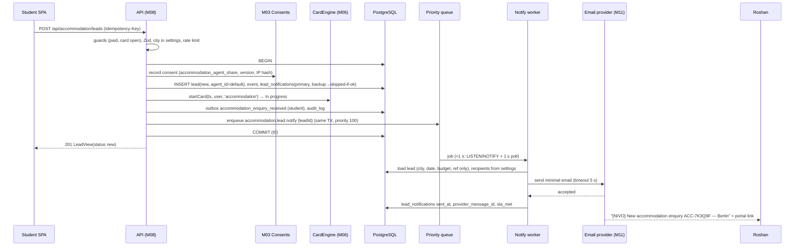

# LLD: M08 — Accommodation

| Field | Value |
|-------|-------|
| Module | M08 |
| Status | Review |
| Depends on HLD | `hld.md` |
| Last updated | 2026-11-24 |

Conventions: UUID primary keys, `timestamptz` UTC, snake_case. Student routes under `/api/accommodation`; agent routes under `/api/agent`; admin routes under `/api/admin/accommodation` (agent and admin routes live on the admin subdomain). Error shape and codes from `00-error-catalog.md`. Student guard order: session → email verified → Terms current → PaywallGuard (M06) → card gate (`accommodation` card must be Available/In progress/Completed) → handler.

## 1. Database

### Enums

| Enum | Values | Notes |
|------|--------|-------|
| `lead_status` | `new`, `contacted`, `viewing`, `booked`, `closed` | From `00-data-model.md` |
| `lead_close_reason` | `completed`, `no_response`, `no_availability`, `student_withdrew`, `duplicate`, `spam` | Required when `closed` |
| `lead_contact_pref` | `email`, `whatsapp`, `phone` | |
| `accommodation_type` | `student_residence`, `shared_flat`, `private_studio`, `any` | |
| `notification_channel` | `email`, `whatsapp` | `whatsapp` reserved, disabled |
| `notification_status` | `queued`, `sending`, `sent`, `failed`, `skipped` | |
| `export_status` | `requested`, `pending_approval`, `approved`, `building`, `ready`, `downloaded`, `expired`, `rejected`, `failed` | |

### Tables

| Table | Column | Type | Constraints | Notes |
|-------|--------|------|-------------|-------|
| accommodation_leads | id | uuid | PK | |
| | public_ref | text | NOT NULL, UNIQUE, CHECK `^ACC-[0-9A-HJKMNP-TV-Z]{6}$` | Crockford base32 from CSPRNG; insert retries up to 5 times on collision |
| | user_id | uuid | FK users(id) ON DELETE SET NULL | NULL after anonymisation |
| | agent_id | uuid | FK users(id), NOT NULL | Assigned agent (`user_kind='agent'`); default from setting at creation |
| | status | lead_status | NOT NULL default `new` | |
| | close_reason | lead_close_reason | CHECK `(status = 'closed') = (close_reason IS NOT NULL)` | |
| | name | varchar(100) | | NULL only when anonymised |
| | email | varchar(254) | | NULL only when anonymised |
| | phone | varchar(16) | CHECK `^\+[1-9][0-9]{6,14}$` | E.164, optional |
| | preferred_contact | lead_contact_pref | NOT NULL default `email` | |
| | city | text | NOT NULL, ≤ 60 | From settings list at creation |
| | arrival_date | date | NOT NULL | |
| | budget_min_eur | integer | CHECK 100–5000 | Monthly |
| | budget_max_eur | integer | NOT NULL, CHECK 100–5000, CHECK `budget_min_eur IS NULL OR budget_min_eur <= budget_max_eur` | |
| | accommodation_type | accommodation_type | NOT NULL | |
| | stay_months | smallint | NOT NULL, CHECK 1–60 | |
| | message | varchar(1000) | | Control characters stripped; rendered as text only |
| | consent_id | uuid | NOT NULL, FK consents(id) | Consent to share with agent (M03) |
| | submitted_at | timestamptz | NOT NULL default now() | |
| | first_contacted_at | timestamptz | | Set at first `contacted` |
| | status_updated_at | timestamptz | NOT NULL default now() | |
| | closed_at | timestamptz | | |
| | anonymised_at | timestamptz | | |
| | version | integer | NOT NULL default 1 | Optimistic lock |
| | created_at / updated_at | timestamptz | NOT NULL default now() | |
| | | | CHECK `anonymised_at IS NOT NULL OR (name IS NOT NULL AND email IS NOT NULL AND user_id IS NOT NULL)` | |
| lead_status_events | id | bigserial | PK | Append-only |
| | lead_id | uuid | NOT NULL, FK accommodation_leads(id) ON DELETE CASCADE | |
| | from_status | lead_status | NULL on creation | |
| | to_status | lead_status | NOT NULL | |
| | close_reason | lead_close_reason | | |
| | actor_kind | text | CHECK in (`student`,`agent`,`admin`,`system`) | |
| | actor_id | uuid | | |
| | note | varchar(300) | | Internal; nulled at anonymisation |
| | created_at | timestamptz | NOT NULL default now() | |
| lead_notes | id | uuid | PK | Internal agent/admin notes, never exposed to students |
| | lead_id | uuid | NOT NULL, FK ON DELETE CASCADE | |
| | author_id | uuid | NOT NULL, FK users | |
| | body | varchar(1000) | NOT NULL | Deleted at anonymisation |
| | created_at | timestamptz | NOT NULL default now() | |
| lead_notifications | id | uuid | PK | |
| | lead_id | uuid | NOT NULL, FK ON DELETE CASCADE | |
| | channel | notification_channel | NOT NULL | |
| | recipient_key | text | NOT NULL | Stable id of the recipient inside the `accommodation.notify.recipients` setting (no email address stored) |
| | recipient_role | text | CHECK in (`primary`,`backup`) | |
| | status | notification_status | NOT NULL default `queued` | |
| | attempts | smallint | NOT NULL default 0 | |
| | queued_at | timestamptz | NOT NULL default now() | |
| | sent_at | timestamptz | | Provider accepted the message |
| | provider_message_id | text | | |
| | last_error_code | text | | `TIMEOUT`, `PROVIDER_4XX`, `PROVIDER_5XX`, `BOUNCE`, `INVALID_RECIPIENT` |
| | sla_met | boolean | GENERATED ALWAYS AS (`sent_at IS NOT NULL AND sent_at - queued_at <= interval '60 seconds'`) STORED | Primary-recipient SLA |
| | | | UNIQUE (lead_id, channel, recipient_key) | |
| accommodation_export_requests | id | uuid | PK | |
| | requested_by | uuid | NOT NULL, FK users | |
| | filters | jsonb | NOT NULL | `{from,to,status[],city[],agentId?}` |
| | reason | varchar(300) | NOT NULL | |
| | status | export_status | NOT NULL | |
| | approval_request_id | uuid | FK approval_requests | M09 policy `exports` |
| | row_count | integer | | |
| | file_sha256 | bytea | | Of the CSV bytes (for audit) |
| | object_key | text | | `exports/accommodation/{id}.csv.enc` |
| | wrapped_dek | bytea | | M05 CryptoService, purpose `exports` |
| | created_at / ready_at / downloaded_at / expires_at | timestamptz | | `expires_at = ready_at + 24 h` |

### Trigger: transition guard and immutability

```sql
CREATE FUNCTION lead_guard() RETURNS trigger AS $$
DECLARE ok boolean;
BEGIN
  IF NEW.user_id IS DISTINCT FROM OLD.user_id AND NEW.anonymised_at IS NULL THEN
    RAISE EXCEPTION 'LEAD_USER_IMMUTABLE';
  END IF;
  IF NEW.consent_id IS DISTINCT FROM OLD.consent_id OR NEW.public_ref IS DISTINCT FROM OLD.public_ref THEN
    RAISE EXCEPTION 'LEAD_IDENTITY_IMMUTABLE';
  END IF;
  IF NEW.status <> OLD.status AND coalesce(current_setting('app.admin_correction_id', true), '') = '' THEN
    ok := (OLD.status, NEW.status) IN (
      ('new','contacted'), ('new','closed'),
      ('contacted','viewing'), ('contacted','booked'), ('contacted','closed'),
      ('viewing','booked'), ('viewing','closed'),
      ('booked','closed'));
    IF NOT ok THEN RAISE EXCEPTION 'LEAD_TRANSITION_FORBIDDEN'; END IF;
  END IF;
  IF OLD.status = 'closed' AND NEW.status <> 'closed' AND coalesce(current_setting('app.admin_correction_id', true), '') = '' THEN
    RAISE EXCEPTION 'LEAD_CLOSED_IMMUTABLE';
  END IF;
  NEW.version := OLD.version + 1; NEW.updated_at := now();
  RETURN NEW;
END $$ LANGUAGE plpgsql;
```

`app.admin_correction_id` is set with `SET LOCAL` only by the admin correction path (permission `leads.correct`, reason supplied, audit row id).

### Indexes

| Index | Definition | Purpose |
|-------|-----------|---------|
| `leads_open_per_user` | UNIQUE (user_id) WHERE status <> 'closed' AND user_id IS NOT NULL | One open enquiry per student |
| `leads_agent_status` | (agent_id, status, submitted_at DESC) | Agent portal list |
| `leads_overdue` | (submitted_at) WHERE status = 'new' | Overdue digest |
| `leads_retention` | (closed_at) WHERE status = 'closed' AND anonymised_at IS NULL | Anonymisation job |
| `leads_name_prefix` | (lower(name) text_pattern_ops) WHERE anonymised_at IS NULL | Agent name-prefix search |
| `leads_ref` | UNIQUE (public_ref) | Lookup |
| `lead_events_lead` | (lead_id, created_at) | Timeline |
| `lead_notes_lead` | (lead_id, created_at) | Notes |
| `lead_notifications_pending` | (queued_at) WHERE status IN ('queued','sending') | Watchdog |
| `export_requests_expiry` | (expires_at) WHERE status = 'ready' | Expiry job |

### RLS policies and DB role isolation

`ENABLE` + `FORCE ROW LEVEL SECURITY` on all lead tables. Variables set per transaction: `app.user_id`, `app.role` (`student` \| `agent` \| `admin` \| `worker`), `app.perms`.

| Table | Policy | Rule |
|-------|--------|------|
| accommodation_leads | `student_own` | `FOR SELECT, INSERT, UPDATE USING/WITH CHECK (app.role = 'student' AND user_id = app.user_id)` |
| accommodation_leads | `agent_own` | `FOR SELECT, UPDATE USING (app.role = 'agent' AND agent_id = app.user_id) WITH CHECK (agent_id = app.user_id)` |
| accommodation_leads | `admin_all` | `FOR SELECT, UPDATE USING (app.role = 'admin' AND 'leads.read_all' = ANY(perms))` |
| accommodation_leads | `worker_all` | `FOR ALL USING (app.role = 'worker')` (notify, retention, export) |
| lead_status_events | `via_lead` | `SELECT USING (EXISTS (SELECT 1 FROM accommodation_leads l WHERE l.id = lead_id))` (inherits lead policies); students get no direct access (API returns a mapped view); `INSERT` allowed to student/agent/admin/worker roles for leads they can see |
| lead_notes | `agent_admin_only` | `SELECT, INSERT` for agent (own leads) and admin with `leads.read_all`; **no policy for students** |
| lead_notifications | `admin_worker` | admin read with `leads.read_all`; worker all; agents no access |
| accommodation_export_requests | `requester_or_approver` | requester sees own; admin with `leads.export` sees all |

**Agent DB role.** Agent requests run `SET LOCAL ROLE nivo_agent_session` after authentication. That role has only:

```sql
GRANT SELECT ON accommodation_leads, lead_notes, lead_status_events TO nivo_agent_session;
GRANT UPDATE (status, close_reason, first_contacted_at, status_updated_at, closed_at, version, updated_at)
      ON accommodation_leads TO nivo_agent_session;
GRANT INSERT ON lead_notes, lead_status_events TO nivo_agent_session;
GRANT USAGE ON SEQUENCE lead_status_events_id_seq TO nivo_agent_session;
-- no grants on users, student_profiles, payments, card_progress, identity_*, proofs, audit_log (audit writes go through a SECURITY DEFINER function)
```

Even a SQL-injection or code defect in an agent route cannot read other modules' tables or change `agent_id`, `user_id`, `consent_id`, name or email.

## 2. API endpoints

### Student

| Method | Path | Permission | Request | Response | Errors | Rate limit | Idempotency |
|--------|------|------------|---------|----------|--------|------------|-------------|
| GET | `/api/accommodation/page` | student, paid, card open | — | `AccommodationPage`: agent profile (name, photo URL, blurb), cities, disclaimer text, consent text (`versionId`, `text`), form defaults (`name`, `email` from M02), `lead: LeadView \| null`, `formEnabled` | 402/202; **403 `IDENTITY_INCOMPLETE`** / **403 `CARD_LOCKED`**; 404 | 60/min/user | n/a |
| POST | `/api/accommodation/leads` | student, paid, card open | `EnquiryInput` | `201 LeadView` | 400 `VALIDATION_FAILED`; 402; 403 (card gate); **409 `CONFLICT`** (open lead exists, or card already Completed); 429 | 3/day/user, 10/day/IP | `Idempotency-Key` required (UUID); replay returns the original `201` body |
| GET | `/api/accommodation/lead` | student, paid | — | `LeadView` (latest lead) | 402; 404 (no lead yet) | 60/min/user | n/a |
| POST | `/api/accommodation/lead/withdraw` | student, paid | `WithdrawInput` | `200 LeadView` (`closed`, `student_withdrew`) | 402, 404, 409 (status `booked` or already closed) | 10/day/user | Natural (repeat returns 200 on already withdrawn) |

### Agent (role `accommodation_agent`; permissions `leads.read_own`, `leads.update_status`, `leads.note`)

| Method | Path | Permission | Request | Response | Errors | Rate limit | Idempotency |
|--------|------|------------|---------|----------|--------|------------|-------------|
| GET | `/api/agent/me` | agent session | — | `{displayName, role, permissions}` | 401 | 60/min | n/a |
| GET | `/api/agent/leads` | `leads.read_own` | `?status&city&q&cursor&limit≤50` (`q`: ref exact or lower-case name prefix) | `{items: AgentLeadRow[], nextCursor}` | 401, 403 | 120/min/agent | n/a |
| GET | `/api/agent/leads/:ref` | `leads.read_own` | — | `AgentLeadDetail` (contact data, message, notes, timeline) | 403, 404 (also for other agents' refs) | 120/min/agent | n/a |
| POST | `/api/agent/leads/:ref/status` | `leads.update_status` | `StatusChangeInput` | `200 AgentLeadDetail` | 400, 403, 404, **409 `CONFLICT`** (illegal transition or stale `expectedVersion`; body includes current status/version) | 60/min/agent | Natural: repeating the same target status with the current version returns 200 without new event |
| POST | `/api/agent/leads/:ref/notes` | `leads.note` | `{body: string(1..1000)}` | `201 {noteId}` | 400, 403, 404 | 60/min/agent | `Idempotency-Key` optional |

Any other path with an agent session returns `403 FORBIDDEN` (route allow-list in the auth hook: `/api/agent/**`, `/api/auth/**` for own session/2FA/logout only).

### Admin (`leads.read_all`, `leads.assign`, `leads.correct`, `leads.export`, `leads.notify_resend`)

| Method | Path | Permission | Request | Response | Errors | Rate limit | Idempotency |
|--------|------|------------|---------|----------|--------|------------|-------------|
| GET | `/api/admin/accommodation/leads` | `leads.read_all` | filters: `status, city, agentId, from, to, q, cursor, limit≤100` | `{items: AdminLeadRow[], nextCursor, counts}` (contact data masked in list: name initials + email domain; full data on detail) | 403 | 60/min/admin | n/a |
| GET | `/api/admin/accommodation/leads/:ref` | `leads.read_all` | — | `AdminLeadDetail` (full contact data, notes, timeline, notifications) | 403, 404 | 60/min/admin | n/a |
| POST | `/api/admin/accommodation/leads/:ref/status` | `leads.correct` + step-up | `AdminCorrectionInput` | `200 AdminLeadDetail` | 400, 403, 404, 409 | 20/h/admin | `Idempotency-Key` |
| POST | `/api/admin/accommodation/leads/:ref/assign` | `leads.assign` | `{agentId: uuid}` | `200` | 400 (not an agent), 403, 404 | 20/h/admin | Natural |
| GET | `/api/admin/accommodation/notifications` | `leads.read_all` | `?status=failed|queued&olderThanSeconds` | list with `attempts`, `lastErrorCode`, ages | 403 | 30/min | n/a |
| POST | `/api/admin/accommodation/notifications/:id/resend` | `leads.notify_resend` | — | `202` | 403, 404, 409 (already `sent`) | 20/h/admin | Natural |
| POST | `/api/admin/accommodation/exports` | `leads.export` + step-up | `ExportRequestInput` | `202 {exportId, status:'pending_approval', approvalRequestId}` | 400, 403, 429 | 5/day/admin | `Idempotency-Key` |
| GET | `/api/admin/accommodation/exports/:id` | `leads.export` (requester or approver) | — | `{status, rowCount?, expiresAt?}` | 403, 404 | 60/min | n/a |
| GET | `/api/admin/accommodation/exports/:id/download` | requester only, `leads.export` + step-up | — | `text/csv; charset=utf-8` stream, `Content-Disposition: attachment; filename="nivo-accommodation-leads-YYYYMMDD-HHmm.csv"`, `no-store`, `nosniff` | 403, 404, **409** (not approved/ready, expired, already downloaded) | 3/day/admin | One-time: first success marks `downloaded` and deletes the object |

Approval of the export request itself is performed in the M09 approvals UI (`approve` by a second admin with `approvals.decide`); M09 calls `ExportBuilder.onApproved(exportId)`.

### Zod schemas

```ts
// packages/shared/src/accommodation.ts
import { z } from "zod";

const clean = (s: string) => s.normalize("NFC").replace(/[\u0000-\u0008\u000B\u000C\u000E-\u001F\u007F]/g, "").trim();

export const LeadName = z.string().transform(clean)
  .pipe(z.string().min(1).max(100).regex(/^[\p{L}\p{M}][\p{L}\p{M}' .\-]*$/u));

export const EnquiryInput = z.object({
  name: LeadName,
  email: z.string().transform((s) => s.trim().toLowerCase()).pipe(z.string().email().max(254)),
  phone: z.string().regex(/^\+[1-9]\d{6,14}$/).optional(),
  preferredContact: z.enum(["email", "whatsapp", "phone"]).default("email"),
  city: z.string().transform(clean).pipe(z.string().min(2).max(60)),       // must be in settings list (API)
  arrivalDate: z.string().date(),                                          // YYYY-MM-DD; today..today+18 months (API, Europe/Berlin)
  budgetMinEur: z.number().int().min(100).max(5000).optional(),
  budgetMaxEur: z.number().int().min(100).max(5000),
  accommodationType: z.enum(["student_residence", "shared_flat", "private_studio", "any"]),
  stayMonths: z.number().int().min(1).max(60),
  message: z.string().transform(clean).pipe(z.string().max(1000)).optional(),
  consentTextVersionId: z.string().uuid(),                                 // active M03 text
  consentAgentShare: z.literal(true),                                      // checkbox unticked by default
}).strict().superRefine((v, ctx) => {
  if (v.budgetMinEur !== undefined && v.budgetMinEur > v.budgetMaxEur)
    ctx.addIssue({ code: "custom", path: ["budgetMinEur"], message: "min must be ≤ max" });
  if ((v.preferredContact === "whatsapp" || v.preferredContact === "phone") && !v.phone)
    ctx.addIssue({ code: "custom", path: ["phone"], message: "phone required for this contact method" });
});

export const WithdrawInput = z.object({ withdrawConsent: z.boolean() }).strict();

export const LeadStatus = z.enum(["new", "contacted", "viewing", "booked", "closed"]);
export const CloseReason = z.enum(["completed", "no_response", "no_availability", "student_withdrew", "duplicate", "spam"]);

export const StatusChangeInput = z.object({
  to: LeadStatus.exclude(["new"]),
  closeReason: CloseReason.exclude(["student_withdrew"]).optional(),       // agents cannot record student withdrawal
  expectedVersion: z.number().int().min(1),
  note: z.string().transform(clean).pipe(z.string().max(300)).optional(),
}).strict().superRefine((v, ctx) => {
  if (v.to === "closed" && !v.closeReason) ctx.addIssue({ code: "custom", path: ["closeReason"], message: "required when closing" });
  if (v.to !== "closed" && v.closeReason) ctx.addIssue({ code: "custom", path: ["closeReason"], message: "only when closing" });
});

export const AdminCorrectionInput = z.object({
  to: LeadStatus,
  closeReason: CloseReason.optional(),
  expectedVersion: z.number().int().min(1),
  reasonCode: z.enum(["AGENT_MISTAKE", "STUDENT_REQUEST", "DUPLICATE", "SPAM", "OTHER"]),
  reasonNote: z.string().transform(clean).pipe(z.string().min(10).max(300)),
}).strict();

export const ExportRequestInput = z.object({
  from: z.string().date(), to: z.string().date(),                          // ≤ 366 days
  status: z.array(LeadStatus).max(5).optional(),
  city: z.array(z.string().max(60)).max(20).optional(),
  agentId: z.string().uuid().optional(),
  reason: z.string().transform(clean).pipe(z.string().min(10).max(300)),
}).strict();

export const LeadView = z.object({
  ref: z.string(), status: LeadStatus,
  statusLabel: z.string(),                         // mapped, see below
  closedKind: z.enum(["completed", "withdrawn", "closed"]).nullable(),
  submittedAt: z.string().datetime(), statusUpdatedAt: z.string().datetime(),
  details: z.object({ city: z.string(), arrivalDate: z.string(), budgetMaxEur: z.number(), accommodationType: z.string(), stayMonths: z.number() }),
  canWithdraw: z.boolean(), canSubmitNew: z.boolean(),
});
```

Student-facing status mapping (no notes, no agent identity beyond the configured profile):

| Status | Label (EN) | Notes |
|--------|-----------|-------|
| `new` | "Received — your enquiry has been sent to {agent}" | |
| `contacted` | "{agent} has contacted you" | |
| `viewing` | "Viewing arranged" | |
| `booked` | "Booked" | Card 3 shows Completed |
| `closed` + `completed` | "Completed" | `closedKind = completed` |
| `closed` + `student_withdrew` | "You withdrew this enquiry" | `closedKind = withdrawn` |
| `closed` + other reasons | "Closed" (no reason shown; invites a new enquiry) | `closedKind = closed`; `spam`/`duplicate` never revealed |

## 3. State machines

### Lead

```
 new ──► contacted ──► viewing ──► booked ──► closed
  │          │  └────────────────────▲          ▲
  │          └──────────── booked ───┘          │
  └──────────────────────────────────────────────┴── any non-closed ──► closed
Admin correction (leads.correct, reason, audit): any status → any status (only path out of closed)
```

| From | To | Actor | Guard | Side effects (same transaction) |
|------|----|-------|-------|--------------------------------|
| (none) | new | student | Card 3 Available/In progress; no open lead; consent given | Consent row (M03), lead + event, notification rows, `startCard`, outbox `accommodation_enquiry_received`, transactional enqueue `accommodation.lead.notify`, audit |
| new | contacted | agent | | `first_contacted_at` (first time), event |
| new | closed | agent (`no_response`, `no_availability`, `duplicate`, `spam`), student (`student_withdrew`) | close reason | `closed_at`, event |
| contacted | viewing | agent | | event |
| contacted | booked | agent | Remote students may be booked without a viewing | **`CardEngine.completeCard(source=lead_booked)`** (see below), event |
| viewing | booked | agent | | same |
| contacted / viewing | closed | agent, student | reason | event |
| booked | closed | agent (`completed`, others) | reason (default `completed` in UI) | event; Card 3 unchanged |
| closed | — | terminal | | Student may submit a new enquiry (a new lead row) |
| any | any | admin correction | `reasonCode` + note; `SET LOCAL app.admin_correction_id` | Event with actor admin; if target is `booked` and card not Completed → `completeCard`; **moving backward never changes card status** |

**Card integration on Booked:**

```
BEGIN
  SELECT lead FOR UPDATE; validate transition + expectedVersion
  UPDATE accommodation_leads SET status='booked', status_updated_at=now() ...
  INSERT lead_status_events
  IF lead.user_id IS NOT NULL THEN
     r := CardEngine.completeCard(tx, {userId, cardSlug:'accommodation', source:'lead_booked', ref:{type:'lead', id}, actor:{kind:'agent', id}})
     -- r ∈ completed | alreadyCompleted | notCompletable(locked)
     IF r = notCompletable THEN  audit('lead.card_completion_skipped'); alert admin; (lead update still commits)
  INSERT audit_log
COMMIT
```

`completeCard` evaluates unlock rules for the student's locked cards in the same transaction and inserts the `sim_unlocked` outbox row when the SIM rule becomes satisfied (REQ-CARD-10). An unexpected M06 error (not `notCompletable`) rolls back the whole transition.

### Notification

`queued → sending → sent`; `sending → queued` (retry scheduled); `queued/sending → failed` after the final attempt; `queued → skipped` (backup recipient not needed because primary succeeded within 2 attempts, or channel disabled). `sent → failed` on bounce webhook (`last_error_code = BOUNCE`).

### Export request

`requested → pending_approval → approved → building → ready → downloaded`; `pending_approval → rejected`; `ready → expired` (24 h); any → `failed`.

## 4. Sequence diagrams

### Happy path — enquiry and notification (≤ 60 s)



### Happy path — agent works the lead; Booked completes Card 3

```mermaid
sequenceDiagram
    participant R as Roshan (agent, 2FA)
    participant API as API (/api/agent)
    participant DB as PostgreSQL (role nivo_agent_session, RLS)
    participant E as CardEngine (M06)
    participant OB as Outbox (M11)
    R->>API: GET /api/agent/leads?status=new
    API->>DB: SELECT … (RLS: agent_id = me)
    R->>API: GET /api/agent/leads/ACC-7K3Q9F
    R->>API: POST /status {to:'contacted', expectedVersion:1}
    R->>API: POST /status {to:'viewing', expectedVersion:2}
    R->>API: POST /status {to:'booked', expectedVersion:3}
    API->>DB: BEGIN; lead FOR UPDATE; guard trigger OK
    API->>E: completeCard(tx, accommodation, source lead_booked)
    E->>DB: card 3 → completed; evaluate unlock rules
    E->>DB: SIM locked → available (if Card 1 already completed)
    E->>OB: sim_unlocked (dedupeKey card_unlocked:{user}:{sim})
    API->>DB: event + audit_log; COMMIT
    API-->>R: 200 AgentLeadDetail
```

### Happy path — CSV export

```mermaid
sequenceDiagram
    participant A1 as Admin A
    participant API as API
    participant M9 as M09 approvals
    participant A2 as Admin B
    participant W as Export worker
    participant O as Object store
    A1->>API: POST /exports {filters, reason} (+step-up)
    API->>M9: approval request (policy exports)
    API-->>A1: 202 pending_approval
    A2->>M9: approve (A2 ≠ A1)
    M9->>W: ExportBuilder.onApproved(id)
    W->>W: query with filters (≤ 10 000 rows), sanitise cells, UTF-8 BOM, CRLF
    W->>O: PUT encrypted CSV (purpose key exports); sha256 recorded
    A1->>API: GET /exports/{id}/download (+step-up)
    API->>O: GET, decrypt, stream; then delete object, status downloaded
    API->>M9: audit: filters, rowCount, sha256, requester, approver
```

### Failure paths

| Case | Behaviour |
|------|-----------|
| Provider timeout or 5xx on primary | Attempt schedule (seconds from queueing): 0, then +5, +10, +20, +60, +300, +900. After the **second** failed attempt the backup recipient is notified immediately (`recipient_role=backup`); the primary keeps retrying. Primary `sla_met` is false if > 60 s |
| No successful send by 45 s | Watchdog (runs every 15 s from a scheduler independent of the notify worker) raises `accommodation.notify.sla_risk`, emails Super Admins and sends the backup notification directly if not yet sent |
| Queue/worker stalled | Notification rows stay `queued`; watchdog (second scheduler) detects age > 45 s and uses the direct send path; lead remains visible in agent portal and admin list |
| All retries exhausted | `failed`, dead-letter alert, admin "Resend" action available |
| Transaction fails after consent insert | Whole transaction rolls back: no lead, no consent row, no card start, no job (transactional enqueue) |
| Duplicate submit (same `Idempotency-Key`) | Original `201` body replayed; no second lead or job |
| Second enquiry while one is open | `409 CONFLICT` (partial unique index backs the check) |
| Student with Card 3 Completed submits | `409`; page shows status only |
| Card 3 Locked (e.g. identity not complete) | `403 IDENTITY_INCOMPLETE` or `403 CARD_LOCKED`; no consent row written |
| Unpaid / refunded | `402`; page not served |
| Agent opens another agent's lead | RLS returns no row → `404` |
| Agent sends stale `expectedVersion` | `409` with current status/version |
| Illegal transition by agent (e.g. `new → booked`) | `409`; trigger is the backstop |
| `completeCard` returns `notCompletable` | Lead transition commits; alert `lead.card_completion_skipped` with lead ref; admin resolves via M06 override |
| `completeCard` throws unexpected error | Entire transition rolls back; agent sees `INTERNAL` with request id |
| Student withdraws while agent sets Booked | Row lock decides; the loser receives `409` |
| Recipient mailbox bounces | Webhook marks `failed/BOUNCE`; alert; backup recipient notified; admin fixes recipient via approved setting change |
| Export approver = requester | `409`/`403`; approval engine rejects |
| Export download twice / after expiry | `409`; object deleted after first download or at expiry |
| Consent text missing | `formEnabled = false`; POST returns `503`-class `INTERNAL` with alert |

## 5. Validation rules

| Field | Client | API | DB |
|-------|--------|-----|----|
| name | Prefilled from account (editable), 1–100, letters/marks/space/`'`/`.`/`-` | `LeadName` (NFC, strip control chars, trim) | `varchar(100)` |
| email | Prefilled (editable), email input | lower-cased, `email()`, ≤ 254; **CR/LF rejected** (header-injection guard) | `varchar(254)` |
| phone | International input, optional; required if contact method is WhatsApp/phone | E.164 regex | CHECK regex |
| preferredContact | Radio, default email | enum | enum |
| city | Select from the configured list | Must be in `accommodation.cities` at submit time | `text ≤ 60` |
| arrivalDate | Date picker, min today | `YYYY-MM-DD`; ≥ today and ≤ today + `accommodation.arrival.max_months_ahead` (Europe/Berlin) | `date` NOT NULL |
| budgetMinEur / budgetMaxEur | Number inputs, step 50 | ints 100–5000; min ≤ max | CHECKs |
| accommodationType | Select | enum | enum |
| stayMonths | Number 1–60 | int 1–60 | CHECK |
| message | Textarea, counter 1000, plain text hint | control chars stripped; ≤ 1000; never interpreted as HTML (all UIs render as text) | `varchar(1000)` |
| consentAgentShare | Checkbox, **unticked**, full consent text with agent name and link to agent's privacy notice | literal `true` + active text version id | `consent_id NOT NULL` |
| status change | Buttons only for allowed next states, confirm dialog for Closed | `StatusChangeInput` + transition table + version check | Trigger |
| agent note | Textarea ≤ 1000 | trimmed, control chars stripped | `varchar(1000)` |
| admin correction | Reason code + note ≥ 10 | `AdminCorrectionInput` | audit + trigger bypass only with `app.admin_correction_id` |
| export range | Date range ≤ 366 days | `from ≤ to`, ≤ 366 days; row count must be ≤ `accommodation.export.max_rows` at build time, else job fails with `TOO_MANY_ROWS` | n/a |

**CSV sanitisation (ExportBuilder):** columns in this order — `lead_ref, student_ref, status, close_reason, submitted_at, first_contacted_at, status_updated_at, closed_at, name, email, phone, preferred_contact, city, arrival_date, budget_min_eur, budget_max_eur, accommodation_type, stay_months, message, agent_name, primary_notification_sla_met`. Rules: UTF-8 with BOM, CRLF line ends, RFC 4180 quoting (quote cells containing `"`, `,`, CR, LF); dates ISO 8601 UTC; any text cell whose first non-space character is `=`, `+`, `-`, `@`, TAB or CR is prefixed with a single quote `'`; the same is applied to cells beginning with the Unicode look-alikes `＝ ＋ － ＠`; numeric columns are written from integers and are never user text; anonymised rows have blank personal columns; `student_ref` is the opaque `public_ref` (blank if anonymised). Known trade-off: international phone numbers start with `+` and therefore appear as `'+49…` in spreadsheets.

## 6. Background jobs

Payloads: ids only (lead id, export id). No names, emails, phones, messages or recipient addresses.

| Job | Trigger | Retry | Dead letter | Payload rules |
|-----|---------|-------|-------------|---------------|
| `accommodation.lead.notify` | Transactional enqueue at lead creation (priority lane, concurrency 4, poll 1 s plus LISTEN/NOTIFY) | Per-notification schedule 0 / 5 / 10 / 20 / 60 / 300 / 900 s; provider timeout 5 s | `accommodation.lead.notify.dead` → alert Super Admins; notification `failed` | `{leadId}` — No PII. Resolves recipients from settings at send time |
| `accommodation.notify.watchdog` | Every 15 s from the scheduler **and** from an independent cron container | n/a (stateless) | alert if watchdog itself has not run for 60 s (heartbeat) | `{}`. Selects notifications `queued/sending` older than `watchdog_threshold_seconds` (45); alerts, sends backup path directly |
| `accommodation.export.build` | Approval granted | 3 attempts, 1 min backoff | `export.dead` → status `failed`, alert | `{exportId}` — No PII. Encrypts output with `exports` purpose key |
| `accommodation.export.expire` | Hourly | 3 | alert | `{}`. Deletes ready exports older than 24 h, sets `expired` |
| `accommodation.lead.retention` | Daily 03:15 UTC | 3 | alert | `{}`. For `closed` leads with `closed_at < now() - retention_months` and `anonymised_at IS NULL`: null `name, email, phone, message, user_id`, delete `lead_notes`, null `lead_status_events.note`, set `anonymised_at`. Idempotent |
| `accommodation.account.anonymise` | Account-deletion saga (M02) and student `withdraw` with `withdrawConsent` | Exponential, 10 attempts | page | `{userId}` or `{leadId}` — No PII. Closes open leads (`student_withdrew`, actor `system`) then anonymises immediately |
| `accommodation.lead.digest` | Daily 06:30 UTC | 3 | alert | `{}`. Queues `accommodation_lead_overdue_digest` when leads are `new` for longer than `accommodation.sla.first_contact_hours` (24); counts and refs only |
| `accommodation.notifications.prune` | Daily | 3 | alert | `{}`. Deletes `lead_notifications` older than 90 days |
| `accommodation.lead.heartbeat` | Every 5 min | none | n/a | `{}`. Emits `notify_oldest_queued_age_seconds`, `notify_primary_sla_breaches_24h`, `lead_retention_overdue_count`, `leads_new_overdue_count`; alerts on thresholds |

## 7. Emails

| Template key | Trigger | Content summary |
|--------------|---------|-----------------|
| `accommodation_lead_agent_notify` | Lead creation; priority lane to configured recipients | To the agent: subject `[NIVO] New accommodation enquiry {ref} — {city}`. Body **only**: reference, city, arrival date, maximum budget, accommodation type, link to the portal lead page (login + 2FA required). **No name, email, phone, message.** Contract test fails if template variables include them. Backup variant says "primary notification delayed" |
| `accommodation_enquiry_received` | Lead creation (outbox, `dedupeKey enquiry_received:{leadId}`) | To the student: confirmation with reference, what happens next, how to check status in the dashboard, how to withdraw; mentions that the agent receives their contact details |
| `accommodation_lead_overdue_digest` | Daily when overdue leads exist | To the agent and admins: counts and refs of `new` leads older than 24 h |
| `accommodation_notify_sla_alert` | Watchdog at 45 s / dead letter | Internal to Super Admins: lead ref, age, last error code (no PII) |
| `accommodation_export_ready` | Export built | Internal to the requester: ready, expires in 24 h, link to admin download page |
| `sim_unlocked` | Queued by M06 when Booked completes Card 3 and the SIM rule is satisfied | See M06 §7 |

## 8. Audit events

| Action | Before/After | Reason required |
|--------|--------------|-----------------|
| `lead.created` | none → new (ref, city, agent id) | No |
| `lead.status.changed` | from → to, close reason, actor kind/id, expected/new version | No (note optional) |
| `lead.card_completed` | card id, M06 outcome (`completed`/`alreadyCompleted`) | No |
| `lead.card_completion_skipped` | lead ref, card status found | No (system alert) |
| `lead.note.added` | note id (body not copied into audit) | No |
| `lead.assigned` | old agent → new agent | No |
| `lead.corrected` | from → to (admin correction) | **Yes** (`reasonCode` + note) |
| `lead.withdrawn` | → closed (`student_withdrew`), `withdrawConsent` flag | No (actor student) |
| `lead.anonymised` | lead ref, trigger (`retention`, `withdrawal`, `account_deletion`) | No (system) |
| `lead.notification.sent` / `failed` / `resent` | channel, recipient key, attempts, error code | Resend: **Yes** |
| `lead.notify.sla_risk` | lead ref, age | No (system) |
| `accommodation.recipients.changed` | recipient keys added/removed (addresses hashed) | **Yes** (setting change via M09 workflow) |
| `export.requested` | filters, reason, requester | **Yes** |
| `export.approved` / `rejected` | approver, approval id | Note on reject |
| `export.downloaded` | rowCount, file sha256, requester, approver | No |
| `agent.access` | list/detail views by agent (lead ref, count) | No (sampled in logs; detail views are always audited) |

## 9. Config / admin settings

Edited via M09 settings workflow (draft → review → publish). ✱ = maker-checker.

| Key | Default | Bounds | Notes |
|-----|---------|--------|-------|
| `accommodation.notify.recipients` ✱ | `[{key:"roshan", role:"primary", email:"<placeholder>", enabled:true}, {key:"ops", role:"backup", email:"<placeholder>", enabled:true}]` | 1 primary, 0–3 backups; addresses validated and test-sent on publish | `GAP-ROSHAN` |
| `accommodation.notify.channels` | `["email"]` | subset of `email`, `whatsapp` (whatsapp locked off in Phase 1) | |
| `accommodation.notify.retry_schedule_seconds` | `[0,5,10,20,60,300,900]` | first entry 0; ≤ 10 entries; sum ≤ 3 600 | |
| `accommodation.notify.provider_timeout_ms` | 5 000 | 1 000–10 000 | |
| `accommodation.notify.watchdog_threshold_seconds` | 45 | 20–55 | |
| `accommodation.notify.sla_seconds` | 60 | 30–120 | Reported SLA |
| `accommodation.default_agent_user_id` ✱ | Roshan's user id | must be `user_kind='agent'` | Assignment at creation |
| `accommodation.agent.display_name`, `.photo_asset_key`, `.blurb_i18n` | placeholders | | Shown on the page (`GAP-ROSHAN`) |
| `accommodation.agent.require_2fa` ✱ | true | locked true | Enforced in M02 login for `agent` users |
| `accommodation.cities` | `["Berlin","Munich","Hamburg","Frankfurt","Cologne","Stuttgart"]` (placeholder, `GAP-ACC-CITIES`) | 1–40 entries | |
| `accommodation.arrival.max_months_ahead` | 18 | 6–36 | |
| `accommodation.enquiry.rate_per_day` | 3 | 1–10 | Per student |
| `accommodation.sla.first_contact_hours` | 24 | 4–168 | Digest threshold |
| `accommodation.retention.closed_months` ✱ | 12 | 3–24 | `GAP-ACC-RETENTION` |
| `accommodation.export.max_rows` | 10 000 | 100–50 000 | |
| `accommodation.export.ttl_hours` | 24 | 1–72 | |
| `accommodation.consent.document_key` | `accommodation-agent-share` | | M03 document key |
| `accommodation.disclaimer_text_key` | `accommodation-disclaimer` | | "NIVO is not a party to any rental contract" |

Permissions registered in M09: agent role `accommodation_agent` = {`leads.read_own`, `leads.update_status`, `leads.note`} and nothing else; admin permissions `leads.read_all`, `leads.assign`, `leads.correct`, `leads.export`, `leads.notify_resend`. Default Super Admin has all admin permissions; Support has `leads.read_all` only.

## 10. Logging and redaction

Never logged: lead `name`, `email`, `phone`, `message`, agent `note` bodies, recipient email addresses (logs carry `recipientKey`), CSV contents, export file bytes, consent text, `Cookie`/`Authorization`/CSRF headers, request bodies for `POST /api/accommodation/leads` and `POST /api/agent/leads/*/notes`.

Logged: request id, user id (UUID), lead ref, agent id, status transitions (`from`, `to`), notification attempts (`attempt`, `latencyMs`, `providerCode`, `errorCode`), SLA gauges, watchdog events, export id with row count and file hash, job counts.

Email provider payload logging is disabled; webhook handlers log only message id and event type.

## 11. Test cases

Existing IDs keep their meaning from `00-traceability.md`: `T-ACC-001`, `T-ACC-010`.

| ID | Layer | Description | Expected |
|----|-------|-------------|----------|
| T-ACC-001 | integration + e2e | Student submits enquiry; fake provider with normal latency, then with first two attempts failing | `lead_notifications` primary `sent_at − queued_at ≤ 60 s` in both cases (≤ 15 s in the normal case); p95 ≤ 20 s over 200 leads; email delivered to the configured primary (REQ-ACC-01, CTRL-ACC-NOTIFY) |
| T-ACC-002 | integration | Open page with profile data | Name and email prefilled from M02; M05 tables never queried (query log assertion) |
| T-ACC-003 | unit | `EnquiryInput` matrix: past arrival date, > 18 months, min > max, 5001 budget, CR/LF in email, phone missing for WhatsApp, 1001-char message, unknown city | `VALIDATION_FAILED` with field details |
| T-ACC-004 | integration | Submit without consent / stale consent version | 400; no lead, no consent row |
| T-ACC-005 | integration | Second enquiry while open; after Closed | `409`; allowed after Closed; rate limit 3/day returns 429 on the 4th |
| T-ACC-006 | integration | Card 3 Locked(`IDENTITY_INCOMPLETE`) / Locked(other) | `403 IDENTITY_INCOMPLETE` / `403 CARD_LOCKED`; no writes |
| T-ACC-007 | integration | Unpaid / refunded student on all `/api/accommodation/*` routes | `402` (REQ-CARD-04) |
| T-ACC-008 | integration | Fault injection after each step of creation (consent, lead insert, notification rows, `startCard`, outbox, enqueue) | Nothing persisted, no job enqueued, no consent row |
| T-ACC-009 | integration | Successful enquiry | Card 3 `in_progress` in the same transaction; `accommodation_enquiry_received` outbox row; audit `lead.created` |
| T-ACC-010 | integration + security | Agent session across the full route matrix; agent DB role direct queries | Only `/api/agent/**` and own auth endpoints return 2xx; every student/admin/other-module route → `403`; `nivo_agent_session` gets `permission denied` on `users`, `student_profiles`, `payments`, `card_progress`, `identity_records`, `proofs`, `audit_log` (REQ-ACC-02, CTRL-ADM-PERM, CTRL-ACC-RLS) |
| T-ACC-011 | integration | Agent B requests Agent A's lead; raw SQL under agent B role | API `404`; SQL returns zero rows |
| T-ACC-012 | integration | Agent attempts to update `agent_id`, `user_id`, `consent_id`, `name` via crafted SQL/API | Column privilege error / validation error |
| T-ACC-013 | integration | Agent response shape | Contains contact data and enquiry details; excludes `user_id`, `public_ref` of student, payment, identity, card statuses |
| T-ACC-014 | integration | Agent login without TOTP | Blocked by M02 (`AUTH_2FA_REQUIRED`); sessions without 2FA cannot call agent routes |
| T-ACC-015 | integration | Student session on `/api/agent/**`; admin without `leads.read_all` on admin routes | `403` |
| T-ACC-016 | security | IDOR: student reads another student's lead by ref | `404`; student API never accepts a ref (returns only own lead) |
| T-ACC-017 | integration | Agent list pagination and search | ≤ 50 per page; ref exact and name-prefix search; no full-text over messages |
| T-ACC-018 | integration | Student endpoints never return notes or agent identity beyond profile settings | Notes absent from `LeadView` (REQ-ACC-05) |
| T-ACC-020 | unit | Transition table | All allowed edges accepted; others rejected incl. `new→booked`, `closed→*` |
| T-ACC-021 | integration | Pipeline new → contacted → viewing → booked → closed | Events recorded with actors; `first_contacted_at` set once; audit rows (REQ-ACC-04) |
| T-ACC-022 | integration | `contacted → booked` (no viewing) | Allowed; `new → booked` → `409` |
| T-ACC-023 | integration | Stale `expectedVersion` | `409` with current status/version; no write |
| T-ACC-024 | integration | Booked with Card 1 already Completed (SIM rule all) | In the same transaction: Card 3 Completed, SIM Available, one `sim_unlocked` outbox row (REQ-CARD-10) |
| T-ACC-025 | integration | Booked when Card 3 already Completed | `alreadyCompleted`; transition commits; no extra email |
| T-ACC-026 | integration | Booked when Card 3 admin-held Locked | Lead transition commits; alert `lead.card_completion_skipped` |
| T-ACC-027 | integration | Fault in `completeCard` / outbox | Lead status unchanged (rollback) |
| T-ACC-028 | integration | Admin correction `booked → contacted` with reason | Allowed with step-up and audit; Card 3 stays Completed; without reason → 400 |
| T-ACC-029 | integration | Close without reason / `student_withdrew` by agent | 400 |
| T-ACC-030 | contract | Render `accommodation_lead_agent_notify` with maximal fixtures | Output contains ref, city, date, budget, type, portal link; **no** name/email/phone/message strings (CTRL-ACC-MINIMAL-EMAIL, RISK-ACC-PII-EMAIL) |
| T-ACC-031 | integration | Failing provider with fake clock | Attempts at 0, 5, 10, 20, 60, 300, 900 s; then `failed` + dead-letter alert |
| T-ACC-032 | integration | Two consecutive primary failures | Backup recipient receives notification at ≤ 20 s; primary continues retrying |
| T-ACC-033 | integration | Provider down for 50 s | Watchdog alert to Super Admins at ~45 s with lead ref only (RISK-ACC-EMAIL-FAIL) |
| T-ACC-034 | integration | Rollback after enqueue attempt vs. commit | No job after rollback; exactly one job after commit |
| T-ACC-035 | integration | Stop queue workers | Watchdog from second scheduler detects age > 45 s and sends via direct path; lead visible in portal |
| T-ACC-036 | integration | Change recipients setting | Needs second admin approval; test mail sent on publish; audit has hashed addresses |
| T-ACC-037 | load | 50 leads/min for 10 minutes | p95 notify latency ≤ 20 s; zero SLA breaches; no duplicate emails |
| T-ACC-038 | integration | Bounce webhook | Notification `failed/BOUNCE`; alert; backup notified |
| T-ACC-039 | unit | `NotificationChannel` contract with fake WhatsApp channel; setting `channels=["whatsapp"]` in Phase 1 | Interface satisfied by fake; real stub refuses to boot with flag on (REQ-ACC-07) |
| T-ACC-040 | e2e | Student sees status progress as agent updates | Labels follow mapping; `statusUpdatedAt` changes; polling refresh ≤ 30 s |
| T-ACC-041 | unit | Closed reason mapping | `spam`/`duplicate`/`no_response`/`no_availability` all show generic "Closed"; `student_withdrew` → "withdrawn"; `completed` → "Completed" |
| T-ACC-042 | integration | Withdraw from `new`, `contacted`, `viewing`; from `booked` | 200 closed `student_withdrew`; `409` for booked |
| T-ACC-043 | integration | Withdraw with `withdrawConsent=true` | Lead anonymised immediately; agent sees closed withdrawn ref without personal data; notes deleted; consent withdrawal row appended (M03) (CTRL-ACC-CONSENT) |
| T-ACC-044 | integration | New enquiry after Closed | Allowed; new lead row; previous remains |
| T-ACC-045 | integration | Confirmation email to student | Queued once (dedupe); no agent contact data |
| T-ACC-046 | integration | Card 3 Completed | `formEnabled=false`; POST → `409` |
| T-ACC-050 | integration + e2e | Export flow: Admin A requests with reason; Admin B approves; A downloads; second download | CSV delivered once; second `409`; object deleted; audit has filters, row count, sha256 (REQ-ACC-06, CTRL-ACC-CSV) |
| T-ACC-051 | integration | Requester tries to approve own export; admin without `leads.export` | Rejected; `403` |
| T-ACC-052 | unit | CSV injection corpus (`=cmd|…`, `+SUM(1)`, `-2+3`, `@HYPERLINK`, TAB/CR prefix, fullwidth `＝`) in name, message, city | Each cell prefixed with `'`; no cell starts with an active character (RISK-ACC-CSV-INJECTION) |
| T-ACC-053 | unit | CSV format: BOM, CRLF, quotes, commas, newlines, emoji, RTL text | Round-trips through a strict RFC 4180 parser with identical values (except the injection prefix) |
| T-ACC-054 | integration | Filters and row cap | Only matching rows; > 10 000 rows → job fails `TOO_MANY_ROWS` with guidance |
| T-ACC-055 | integration | Export audit entry | No personal values; includes file hash |
| T-ACC-056 | integration | Download without step-up / by another admin / after 24 h | 401 / 403 / 409 |
| T-ACC-060 | integration | Retention with fake clock | Closed lead at 12 months + 1 day → personal columns NULL, notes deleted, event notes NULL, non-identifying stats kept; open/new leads untouched; idempotent (CTRL-ACC-RETENTION) |
| T-ACC-061 | integration | Account-deletion saga | Open leads closed (`student_withdrew`) and anonymised; agent portal no longer shows PII (REQ-SEC-02) |
| T-ACC-062 | integration | Heartbeat metrics | Alert when retention overdue > 0 for 1 h or oldest queued notification > 45 s |
| T-ACC-063 | integration | Overdue digest | Sent only when `new` leads older than 24 h exist; counts and refs only |
| T-ACC-064 | security | Log-redaction suite with sentinel name/email/phone/message and recipient address | Sentinels never in logs, Sentry, job payloads, audit rows |
| T-ACC-065 | integration | Consent text unavailable | `formEnabled=false`; POST fails closed with alert |
| T-ACC-066 | security | XSS payloads in name/message/note | Rendered as text in student, agent and admin UIs; no script execution (Playwright assertion) |
| T-ACC-067 | security | CR/LF in name/email/city to inject email headers | Rejected by validation; email template escapes |
| T-ACC-068 | integration | `public_ref` collision | Insert retries (≤ 5) and succeeds; unique constraint upheld |
| T-ACC-069 | integration | Direct SQL: illegal transition, change `consent_id`, edit closed lead | Trigger raises `LEAD_TRANSITION_FORBIDDEN` / `LEAD_IDENTITY_IMMUTABLE` / `LEAD_CLOSED_IMMUTABLE` |
| T-ACC-070 | integration | Settings: remove a city; add a city | Validation follows published setting; unpublished draft has no effect |
| T-ACC-071 | integration | Agent assignment | New lead assigned to default agent; reassignment by admin moves visibility via RLS immediately |
| T-ACC-072 | integration | Rate limits | Submit 3/day/user; agent list 120/min; export 5/day/admin enforced with `429 RATE_LIMITED` |
