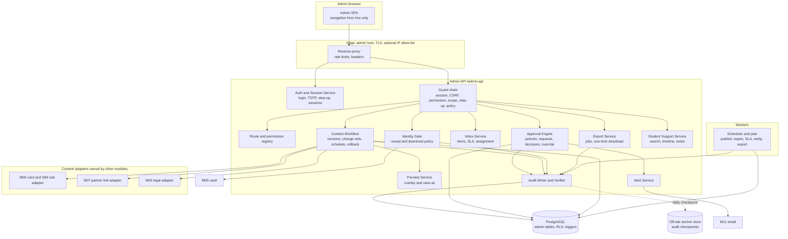
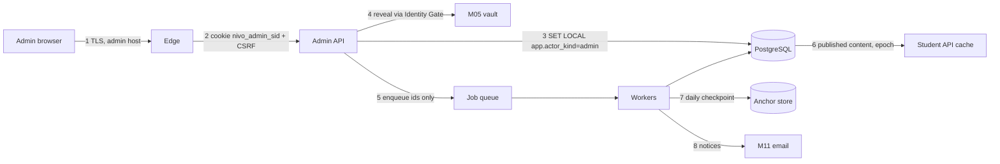

# HLD: M09 — Admin (Permissions, Approvals, Publishing, Audit)

| Field | Value |
|-------|-------|
| Module | M09 |
| Status | Review |
| Owner | NIVO Platform team |
| Last updated | 2026-11-24 |
| Requirements | REQ-ADM-01..11, REQ-AUTH-05 (admin half), REQ-SEC-01 |
| Companion docs | `lld.md`, `permissions.md`; consumers: M02, M03, M04, M05, M06, M07, M08, M10, M11 |

## 1. Purpose and scope

M09 is the control plane for everything staff do. It decides **who may do what** (permission registry, roles, scopes), **which actions need a second person** (maker-checker), **how content reaches students** (draft → review → publish with preview and rollback), **how risky actions are re-authenticated** (step-up), and **how all of it is proven afterwards** (tamper-evident audit log). It also hosts the admin app shell: approvals inbox, student support view, reports, exports and alerts.

**In scope**

- Admin accounts, mandatory TOTP 2FA, short idle timeout, separate host and cookie, no login-as-student.
- Permission registry (84 keys), eight system roles, custom roles, scoped assignments, escalation and separation-of-duties guards.
- Approval engine: policies, requests, decisions bound to a payload hash, expiry, SLA, emergency Super Admin override with alerts and review.
- Step-up authentication (password or TOTP within 300 s) for every High and Critical action.
- Generic content workflow with change sets, schedule, rollback, cache invalidation by epoch; adapters for content owned by M03, M06 and M07; HTTPS link allow-list; preview as student with synthetic or real (read-only) state.
- Approvals inbox: proofs, change requests, refunds, manual payments, deletion requests, role changes, exports, identity bulk access, override reviews, fraud flags.
- Identity reveal and file download gate (reason, velocity limits, alerts); the vault itself stays in M05.
- Student support view (search, timeline, notes, resend email), reports, export framework, alerts.
- Audit log: append-only, hash-chained, HMAC-signed, checkpointed and verifiable.

**Out of scope**

- Business logic of payments (M04), identity storage and encryption (M05), card engine (M06), partner links and proofs (M07), leads (M08), consultancies (M10), email delivery (M11). M09 gates and records their admin actions; it does not implement them.
- Student and consultancy authentication (M02, M10).
- A general-purpose CMS or page builder; only the typed content kinds listed above.
- SSO or SCIM for staff (Phase 3 if the team grows).

## 2. Requirements covered

New IDs (★) are proposed additions to `00-traceability.md`.

| ID | Statement | Priority | Tests |
|----|-----------|----------|-------|
| REQ-ADM-01 | Permission registry with no wildcards, custom roles, the eight system roles, scoped assignments; every route declares a permission | Must | T-ADM-001..009 |
| REQ-ADM-02 | Maker-checker approval policies; requester cannot approve their own request; decisions bound to the payload they saw | Must | T-ADM-010..019 |
| REQ-ADM-03 | Draft / review / publish for cards, partner links, texts, SIM rules, contact blocks and legal text; preview; HTTPS allow-list; rollback; cache invalidation | Must | T-ADM-020..029 |
| REQ-ADM-04 | Tamper-evident append-only audit log (hash chain, signatures, checkpoints, verification) | Must | T-ADM-030..039 |
| REQ-ADM-05 ★ | Step-up authentication (password or TOTP within 5 minutes) for sensitive actions; emergency Super Admin override with reason, immediate alert and mandatory review | Must | T-ADM-040..049 |
| REQ-ADM-06 ★ | Admin sessions: mandatory 2FA, 15 minute idle and 8 hour absolute timeout, separate host and cookie, CSRF, lockout, optional IP allow-list, no login-as-student | Must | T-ADM-050..059, T-ADM-080..085 |
| REQ-ADM-07 ★ | One approvals inbox for proofs, change requests, refunds, manual payments and deletion requests (plus roles, exports, identity, fraud) with SLA, assignment, bulk decision for proofs | Must | T-ADM-060..067 |
| REQ-ADM-08 ★ | Identity reveal and file download require permission, step-up, a reason code, velocity limits and alerts; every reveal is audited | Must | T-ADM-070..079 |
| REQ-ADM-09 ★ | Student support view: exact-match search, timeline, notes, masked identity, resend email, preview as student | Should | T-ADM-090..099 |
| REQ-ADM-10 ★ | Exports go through one framework: permission, step-up, approval where set, purpose, row cap, expiry, one-time download, formula-safe CSV | Must | T-ADM-090..099 |
| REQ-ADM-11 ★ | Reports (funnel, payments, queues) show counts and amounts only; alerts for override, reveal velocity, failed logins, policy weakening, audit mismatch | Should | T-ADM-090..099 |
| REQ-AUTH-05 | Admin 2FA mandatory (admin half) | Must | T-ADM-050, T-AUTH-040 |

## 3. Component diagram

| Component | Responsibility |
|-----------|----------------|
| Admin SPA | Renders what `/me` allows; never the authority. Student components run in read-only mode for preview |
| Auth and Session Service | Password + TOTP login, invite and enrolment, recovery codes, sessions (idle and absolute timeout, concurrent cap), step-up, lockout, new-device alert |
| Guard chain | One middleware order for every admin route: session → CSRF and Origin → permission from the route registry → scope → step-up → approval policy. Routes without a declared permission fail at boot |
| Route and permission registry | Code registry mirrored into `permissions`; generated route × role matrix test |
| Approval Engine | Creates requests with a frozen policy snapshot and payload hash, collects decisions, enforces requester ≠ approver in code and in a DB trigger, executes handlers registered by M04, M05, M07, M10 and M09 itself, handles expiry and emergency override |
| Content Workflow | State machine for versions, change sets, schedule, rollback; `ContentAdapter` contract for delegated content; cache epoch bump on publish |
| Preview Service | Short-lived tokens (not cookies) that overlay draft versions on a synthetic student state or render one real student's state read-only |
| Inbox Service | Unifies work items from several tables, with per-item view and decide permissions, SLA and bulk proof decisions |
| Identity Gate | The only way admin code reaches M05 plaintext: permission, step-up, reason, velocity limit, audit-before-return |
| Export Service | Job lifecycle, filters allow-list, `csvSafe`, encrypted temporary file, one-time authenticated download |
| Student Support Service | Exact-match search, timeline composition from events, append-only notes |
| Alert Service | De-duplicated alerts to Super Admins and the auditor (in-app and email through M11) |
| Audit Writer and Verifier | Serialised append with HMAC chain, redaction map, checkpoints, verification job, export with proof |
| Scheduler and jobs | `content.publish_scheduled`, approval expiry, SLA reminders, export expiry, audit verification and checkpoint, session cleanup |

## 4. Data flows and trust boundaries

| # | Flow | Initiator | Boundary crossed | Data | Notes |
|---|------|-----------|------------------|------|-------|
| 1 | Admin traffic | Admin | Internet → Edge | credentials, requests | Separate host; optional global and per-admin IP allow-list; HSTS; strict CSP |
| 2 | Authenticated call | Admin SPA | Edge → API | cookie `__Host-nivo_admin_sid` (SameSite=Strict), CSRF header | Student and consultancy cookies never accepted on this host |
| 3 | DB access | API | API → DB | admin tables | Transaction starts with `app.actor_kind='admin'`; student and consultancy contexts see zero rows in admin tables |
| 4 | Identity reveal | Identity Gate | M09 → M05 | field names, reason, plaintext returned to caller only | Audit row committed before the plaintext leaves; response `no-store`, hidden after 60 s in the UI |
| 5 | Async work | API | API → queue | ids only | No PII in job payloads |
| 6 | Publication | Workflow | DB → Student API | live version id and `live_epoch` | Student API caches by epoch with TTL ≤ 60 s; publish bumps the epoch |
| 7 | Audit anchoring | Worker | App → off-site | chain head hash and seq | Detects whole-database rewrite; see `GAP-ADM-ANCHOR-STORE` |
| 8 | Notices | Alert and approval services | App → M11 | template key, admin id, ids | No student PII |

**Trust boundaries specific to M09**

- **Admin origin** is a separate trust zone from the student origin (host, cookie, CSP, CSRF).
- **Database context:** admin tables are readable only when `app.actor_kind` is `admin` or `system`; audit insert is open to every module, read is not.
- **Plaintext identity** crosses a boundary only through the Identity Gate; admin list and detail endpoints return masked values.
- **Approval payloads** are IDs and parameters only; free-text PII is rejected by the per-action Zod schema.

## 5. Inputs / outputs to other modules

| From / To | Contract | Failure behaviour |
|-----------|----------|-------------------|
| M01 → M09 | DB roles, RLS bootstrap, job queue, secrets (`audit_hmac_key`, TOTP encryption key), object storage for exports, anchor store credentials | Missing audit key → admin API refuses writes (fail closed) |
| M02 ↔ M09 | M02 supplies Argon2id, TOTP and token primitives. Admin account and session storage is M09's (`ADR` in §8, `GAP-ADM-ACCOUNT-MODEL`) | If the decision flips to M02-owned staff accounts, `admin_accounts` becomes a profile table; the permission model is unchanged |
| M03 → M09 | `legal` content adapter; version and consent tables stay in M03; publish handler `legal.publish` | Handler failure leaves the version `approved`, alert `publish_failed`, retry |
| M04 → M09 | Approval handlers `payments.mark_paid`, `payments.refund`; `audit.append` in the same transaction as the money change; payment review queue | Handler failure → request `failed` with code; nothing half-applied (handler re-validates inside one transaction) |
| M05 → M09 | Identity Gate calls `IdentityVault.reveal(fields)` and `signedFileUrl()`; M05 `deletion_requests` surface in the inbox; handler `identity.purge`, `identity.bulk_access` | Audit failure aborts the reveal and returns no data |
| M06 → M09 | `card` and `sim_rule` adapters; handler `cards.override`; cache epoch consumer; impact report for SIM rules | Impact failure blocks submit (`PUBLISH_VALIDATION_FAILED`) |
| M07 → M09 | `partner_link` adapter; link allow-list; proof queue items; handlers `proofs.approve`, `partners.csv_import`; export builder for clicks | Allow-list violation blocks save and publish |
| M08 → M09 | Agent permissions (`leads:*`), lead admin routes, export builder `leads`, contact block (recipients) as inline content | Missing permission → 403, never fallback to broader role |
| M10 ↔ M09 | `consultancies:*`, `exports:consultancy`, handler `consultancies.reassign_student`, `fraud_flag` inbox items | Approval failure leaves attribution unchanged |
| M11 ← M09 | Templates `admin_invite`, `approval_requested_notice`, `approval_decision_notice`, `admin_security_alert`, `admin_new_login`, `admin_2fa_reset`, `export_ready_notice` | Email failure never blocks the action; in-app alert remains |
| All → M09 | Audit library `audit.append(tx, event)`; permission middleware; approval request API; alert API | Audit write failure aborts the business transaction for sensitive actions |

## 6. External dependencies

| Dependency | Purpose | Fallback |
|------------|---------|----------|
| PostgreSQL 16 (RLS, triggers, advisory locks) | State, isolation, audit serialisation | None; fail closed |
| Object storage (private bucket, envelope encryption) | Export files, 24 h life | Export fails, retry; no inline fallback |
| Off-site anchor store (object-lock bucket or equivalent) | Audit checkpoint anchoring | Checkpoints still stored in DB, alert `anchor_failed`, retry |
| TOTP and Argon2id libraries (M02 primitives) | 2FA and passwords | Recovery codes; Super Admin assisted reset with approval |
| Breached-password range API (k-anonymity) | Reject known-breached admin passwords | Local top-100k list; log `breach_check_degraded` |
| Email (M11) | Invites, notices | Alerts remain in-app |

## 7. Data classification

| Data | Class | Lawful basis | Retention |
|------|-------|--------------|-----------|
| Admin accounts (email, name, password hash, TOTP secret, recovery code hashes) | Personal + secret | Art. 6(1)(b)/(f) employment or contractor relationship; `GAP-ADM-LEGAL-CONTRACT` | Life of account + 12 months, then anonymised; audit entries keep the opaque admin id |
| Admin sessions (token hash, IP, UA label) | Personal (technical) | Art. 6(1)(f) security | 90 days after expiry |
| Approval requests and decisions (ids, parameters, reasons, comments) | Internal (pseudonymous ids; no PII payloads) | Art. 6(1)(f), (c) accountability | 8 years for financial actions, 3 years otherwise (`GAP-ADM-AUDIT-RETENTION`) |
| Audit log | Internal (opaque ids only; redaction map applied before write) | Art. 6(1)(f), (c) | Default 3 years, financial 8 years; append-only, so retention is by archived chain segment, not by row deletion |
| Content versions, change sets, allow-list | Internal / Public once live | Art. 6(1)(f) | Life of product; superseded versions kept for rollback and audit |
| Student notes (free text) | Personal (about a student) | Art. 6(1)(b)/(f) support | Deleted on erasure of the student; guidance forbids special-category data |
| Inbox items | Internal | Art. 6(1)(f) | Resolved + 12 months |
| Preview sessions (token hash, student id for view-as, reason) | Internal / Personal | Art. 6(1)(f) | Expire after 15 minutes; row removed after 30 days |
| Export files | Personal (up to full contact data) | Per export kind | Encrypted, deleted 24 h after ready or after 3 downloads |
| Alerts | Internal | Art. 6(1)(f) | 24 months |

## 8. Key decisions

| Decision | Chosen | Alternatives rejected | Why |
|----------|--------|----------------------|-----|
| Admin identities | Separate `admin_accounts` and `admin_sessions` in M09; M02 supplies primitives | Staff as rows in student `users` (as drafted in M02) | A SQL or logic bug on the student side cannot reach admin credentials; separate cookie and host; simpler RLS. Needs M02 edit; tracked as `GAP-ADM-ACCOUNT-MODEL` |
| Authorisation model | Explicit permission keys, roles are sets of keys, scopes on assignments, deny by default | Hard-coded roles; wildcard or `admin` flag | Custom roles are required; wildcards hide privilege creep; scopes keep the model unchanged when staff are added |
| Maker-checker default | One approver other than the requester; two-approver policies allowed when SOD-005 holds | Always two approvers | Two founders cannot satisfy two plus a requester; one independent person still stops single-actor fraud |
| Approval binding | Decision stores the payload hash it saw; execution re-validates in one transaction | Approve by request id only | Prevents approve-then-swap; handler re-checks state so stale approvals cannot misapply |
| Self-approval prevention | Application check **and** DB trigger on `approval_decisions` and `admin_roles` | Application check only | Survives a handler bug or direct SQL by an app role |
| Step-up | Password or TOTP within 300 s, enforced per request from `step_up_at`; TOTP replay guard | Re-login; per-session flag | A time window is simple and testable; every H and C route enforces it uniformly |
| Emergency override | Super Admin only, selected policies, 3 per day, reason ≥ 20, critical alert, review by another Super Admin within 24 h | None (deadlock when the other founder is away); open override for all | Avoids a stuck business while making misuse visible; hard-floor actions (money, identity, access) are excluded |
| Content storage | Inline versions for texts and contact blocks; **delegated** versions (owner tables) for cards, SIM rules, partner links, legal via `ContentAdapter` | One generic table for all; M09 reimplementing owner validation | M03, M06, M07 already own typed, validated version tables; M09 owns workflow, approval, schedule, epoch |
| Publication visibility | `live_epoch` per entity plus TTL ≤ 60 s student-side cache | Push invalidation only | Simple, bounded staleness, no cross-service push dependency |
| Preview | Token in a header, bound to the admin session, read-only DTO rendering; no student session issued | Login-as-student; impersonation cookie | Plan forbids login-as-student; no write path can exist because no student credential is created |
| Audit integrity | Per-entry HMAC chain with gapless `seq`, serialised by advisory lock, checkpoints, off-site anchor, verification job | Plain table with triggers only; external SIEM only | Detects edits and deletions even by a DB admin who lacks the HMAC key; anchoring detects whole-chain replacement |
| Audit content | Opaque ids and redacted before/after only | Full snapshots | Keeps the log erasure-compatible and prevents the log itself from becoming a PII store |
| Identity reveal limits | 5 per 10 min and 20 per day per admin, shared with file downloads; beyond that use approved bulk access | No limit; hard block | Normal support is a handful per day; volume needs a second person and an incident-grade reason |
| Admin app host | `admin.<domain>`, own cookie `__Host-nivo_admin_sid` | Path under the student host | Cookie path is not a boundary; separate origin limits XSS and CSRF blast radius |
| Route prefix | `/admin-api` for M09 routes; other modules keep theirs; one registry and guard chain | Force one prefix now | Prefix is not a security boundary; alignment is cosmetic and tracked |

## 9. Failure modes (summary)

| Failure | Impact | Detection | Recovery |
|---------|--------|-----------|----------|
| Both Super Admins locked out (lost TOTP) | No one can approve or administer | Support contact; failed login alerts | Sealed offline recovery procedure with DB-level re-enrolment, audited out-of-band (`GAP-ADM-BREAKGLASS`) |
| Approval pool smaller than policy | Requests cannot be approved | SOD-005 at save; SLA alerts | Emergency override where allowed; temporarily add an approver |
| Approver acts on a stale or swapped payload | Wrong action executed | Payload hash check | Decision rejected `CONFLICT`; request re-created |
| Handler fails after approval | Action not applied | Request `failed` with code, alert | Retry from inbox, or cancel and re-request |
| Publish fails mid-way | Partial content | Single transaction per entity, change set all-or-nothing, `publish_failed` alert | Retry; rollback creates a new version |
| Scheduled publish missed | Content late | Job lag alert > 2 min | Job catches up on next run; manual publish |
| Student cache serves old content | Short staleness | Epoch vs TTL metric | Bounded by TTL (≤ 60 s) |
| Audit write fails | Business action blocked for sensitive actions | Error rate, alert | Fix storage; actions retry |
| Chain break or mismatch | Evidence integrity doubt | Verification job and checkpoint compare | Critical alert, freeze exports of audit, incident process, restore from anchor |
| Anchor store down | Weaker tamper evidence | `anchor_failed` alert | Retry; checkpoints continue in DB |
| Insider browses identity data | Privacy breach | Velocity alert at 10 distinct students/day, reasons audited | Revoke role, review audit, notify if needed |
| Phished admin password | Account takeover | New-device alert, TOTP, step-up, IP allow-list option | Revoke sessions, reset, review audit |
| Broken partner link published | Students cannot complete a step | Link health (M07), alerts | Rollback or emergency publish |
| Wrong SIM rule published | Wrong unlock (grandfathering protects unlocked students) | Impact preview, approval | Rollback; already-unlocked students stay unlocked |
| Export leaves with staff | Mass disclosure | Approval, one-time download, expiry, audit | Revoke, incident response |
| Role edited to escalate | Privilege creep | Escalation guard, approval, critical alert on `C` permission grant | Revert role version |

## 10. Security and privacy controls (summary)

| Control ID | Control | Layer | Mitigates |
|------------|---------|-------|-----------|
| CTRL-ADM-PERM | Permission registry, route-must-declare-permission CI gate, deny by default, scopes, escalation guard, SOD rules, generated authorisation matrix | API, DB, CI | RISK-ADM-PRIV-ESC |
| CTRL-ADM-APPROVAL | Approval policies with frozen snapshot, payload-hash-bound decisions, requester ≠ approver in code and trigger, expiry, executor re-validation | API, DB | RISK-ADM-INSIDER-FRAUD, RISK-ADM-SELF-APPROVAL |
| CTRL-ADM-STEPUP | 300 s step-up on every H/C route, TOTP replay guard, five failures revoke session | API | RISK-ADM-SESSION-HIJACK |
| CTRL-ADM-EMERGENCY | Super Admin only, allowed policies only, daily cap, reason, immediate critical alert, mandatory review, escalation | API, Jobs | RISK-ADM-OVERRIDE-ABUSE |
| CTRL-ADM-PUBLISH | Versioned workflow, validation, impact report, HTTPS allow-list, approval, approved-validity window, rollback, epoch invalidation | API, DB | RISK-ADM-BAD-PUBLISH, RISK-ADM-LINK-HIJACK |
| CTRL-ADM-AUDIT | Append-only table, no UPDATE/DELETE privilege, trigger, HMAC hash chain, gapless seq, checkpoints, off-site anchor, verification and alert | DB, Jobs | RISK-ADM-AUDIT-TAMPER |
| CTRL-ADM-REVEAL | Identity Gate: permission, step-up, reason code, velocity limit, audit-before-return, masked by default, short-lived single-use file URL | API | RISK-ADM-IDENTITY-LEAK |
| CTRL-ADM-SESSION | Mandatory TOTP, 15 min idle, 8 h absolute, concurrent cap, `__Host-` cookie SameSite=Strict, CSRF and Origin check, lockout ladder, IP allow-list option, new-device alert | Edge, API | RISK-ADM-ACCOUNT-TAKEOVER |
| CTRL-ADM-NOIMPERSONATE | No student credential or session can be minted by admin code; preview is a read-only DTO with inert links | API | RISK-ADM-IMPERSONATION |
| CTRL-ADM-EXPORT | Permission + step-up + approval + purpose + row cap + encrypted temporary file + 24 h expiry + download limit + `csvSafe` | API, Storage | RISK-ADM-EXPORT-EXFIL |
| CTRL-ADM-ISOLATION | Admin tables readable only for `app.actor_kind` admin/system; separate host, cookie and CSP | DB, Edge | RISK-ADM-CROSS-ORIGIN |
| CTRL-ADM-REDACT | Redaction map for audit before/after, logger redaction list, canary test for PII in logs, audit and job payloads | API, CI | RISK-ADM-PII-IN-LOGS |

Asset → control → risk:

| Asset | Controls | Risks |
|-------|----------|-------|
| Admin privileges and roles | CTRL-ADM-PERM, CTRL-ADM-APPROVAL | RISK-ADM-PRIV-ESC, RISK-ADM-SELF-APPROVAL |
| Money-moving actions (mark-paid, refund) | CTRL-ADM-APPROVAL, CTRL-ADM-STEPUP | RISK-ADM-INSIDER-FRAUD |
| Identity plaintext and files | CTRL-ADM-REVEAL, CTRL-ADM-STEPUP | RISK-ADM-IDENTITY-LEAK |
| Admin credentials and sessions | CTRL-ADM-SESSION, CTRL-ADM-ISOLATION | RISK-ADM-ACCOUNT-TAKEOVER, RISK-ADM-CROSS-ORIGIN |
| Student-facing content, links, SIM rules, legal text | CTRL-ADM-PUBLISH | RISK-ADM-BAD-PUBLISH, RISK-ADM-LINK-HIJACK |
| Audit log | CTRL-ADM-AUDIT, CTRL-ADM-REDACT | RISK-ADM-AUDIT-TAMPER, RISK-ADM-PII-IN-LOGS |
| Export files | CTRL-ADM-EXPORT | RISK-ADM-EXPORT-EXFIL |
| Emergency path | CTRL-ADM-EMERGENCY | RISK-ADM-OVERRIDE-ABUSE |
| Student accounts | CTRL-ADM-NOIMPERSONATE | RISK-ADM-IMPERSONATION |

Risk definitions:

| Risk ID | Threat |
|---------|--------|
| RISK-ADM-PRIV-ESC | A role or assignment is edited to grant more than intended, or a route ships without a permission |
| RISK-ADM-SELF-APPROVAL | One person requests and approves, directly or through a colluding second account they control |
| RISK-ADM-INSIDER-FRAUD | An insider marks a student paid or refunds money to themselves or an accomplice |
| RISK-ADM-SESSION-HIJACK | A stolen session performs a sensitive action |
| RISK-ADM-OVERRIDE-ABUSE | Emergency override used to bypass maker-checker routinely |
| RISK-ADM-BAD-PUBLISH | Wrong or unreviewed content, SIM rule or legal text goes live |
| RISK-ADM-LINK-HIJACK | A partner link is changed to a phishing or look-alike host, or HTTP |
| RISK-ADM-AUDIT-TAMPER | Audit rows are edited, deleted or the chain is replaced |
| RISK-ADM-IDENTITY-LEAK | Passport data or scans are viewed or exfiltrated by an admin |
| RISK-ADM-ACCOUNT-TAKEOVER | Admin credentials are phished, guessed or reused |
| RISK-ADM-IMPERSONATION | An admin acts as a student |
| RISK-ADM-EXPORT-EXFIL | Bulk personal data leaves through exports |
| RISK-ADM-CROSS-ORIGIN | Student-origin XSS, CSRF or cookie confusion reaches admin actions |
| RISK-ADM-PII-IN-LOGS | Personal data lands in logs, audit rows, job payloads or alerts |

## 11. Test strategy

- **Unit:** permission key validation, scope union (property test), SOD evaluation, policy validation (SOD-005, hard floors), approval state machine, step-up window (fake clock, boundaries), TOTP replay, hash-chain functions, redaction map, content state machine, `csvSafe` shared with M10.
- **Integration (Testcontainers):** generated route × role × scope matrix; triggers (`trg_forbid_self_approval`, `trg_last_super_admin`, `trg_audit_append_only`, `trg_admin_roles_guard`); approval execution and rollback of a failed handler; publish, schedule, rollback and epoch; identity gate limits; export lifecycle; RLS with student and consultancy actor kinds seeing zero rows in admin tables.
- **Security:** CSRF and Origin, cookie attributes and host binding, IDOR on student ids (out-of-scope returns 404), direct SQL tampering of `audit_log` as the app role (permission denied), brute-force and lockout, preview token misuse, link allow-list bypass attempts (userinfo, punycode, redirects, scheme), PII canary in logs, audit and jobs.
- **E2E (Playwright):** invite and 2FA enrolment; refund with second approver; card publish with preview and rollback; proof approve in inbox; identity reveal with reason; emergency override and acknowledgement; export approval and one-time download.
- **Chaos / ops:** kill the worker mid-publish; break the audit key; take the anchor store down; verify alerts fire.
- **Mutation:** guard chain, approval engine, hash-chain verification.
- Test IDs `T-ADM-001..099` in `lld.md` §11.

## 12. Open questions

| ID | Question | Owner | Status |
|----|----------|-------|--------|
| GAP-ADM-ACCOUNT-MODEL | M02 drafted staff as rows in `users` with `staff_kind`, a shared `sessions` table, cookie `__Host-nivo_staff_sid` and a 72 h invite (`auth_staff_invite`). M09 specifies separate `admin_accounts` / `admin_sessions`, cookie `__Host-nivo_admin_sid`, 24 h invite (`admin_invite`). One model must win before implementation; M10 and M08 already assume separate principals | Engineering lead | Provisional (**High**): default is M09's separate model |
| GAP-ADM-KEY-ALIGNMENT | M03–M08 LLDs use dotted or `staff:` permission names, their own policy keys and different step-up (10 min) and reveal limits (20 per hour). Mapping is in `permissions.md` §7; the LLDs need editing | Engineering | Open (Medium) |
| GAP-ADM-ADAPTER-ALIGNMENT | M03, M06, M07 each drafted their own review and publish endpoints. They must call `ContentWorkflow` and drop their local approve logic | Engineering | Open (Medium) |
| GAP-ADM-LEGAL-CONTRACT | Confidentiality and data-protection undertakings for admins and contractors; access policy; relation to the accommodation agent's role (`GAP-ACC-AGENT-CONTROLLER`) | Lawyer | Open (Medium) |
| GAP-ADM-AUDIT-RETENTION | Retention periods for audit entries (default 3 years, financial 8) and how archive of chain segments satisfies erasure and tax rules | Lawyer / tax consultant | Open (Medium) |
| GAP-ADM-ANCHOR-STORE | Where daily audit checkpoints are anchored off the primary database (object-lock bucket in another account, emailed digest to the auditor) | Engineering / M01 | Open (Medium) |
| GAP-ADM-TEAM-SIZE | With two founders the default is one independent approver; real separation grows with staff. Revisit policies at the third admin | Product owner | Open (Medium) |
| GAP-ADM-BREAKGLASS | Procedure when no Super Admin can sign in (sealed recovery, who holds it, how it is audited) | Product owner / ops | Open (Medium) |
| GAP-ADM-REFUND-AFTER-SIM | Refund once SIM is unlocked or a partner step is complete: revoke access, partner notification, which approver | Product owner / lawyer (`GAP-REFUND`) | Open (Medium) |
| GAP-ADM-REVEAL-REASONS | Acceptable reason codes for viewing passport data and their legal basis (`GAP-IDENTITY-PURPOSE`) | Lawyer | Open (Medium) |
| GAP-ADM-WORDING-LINT | Forbidden and warned phrases for student-facing texts (guarantees, endorsements, "free") | Product owner / lawyer | Open (Low) |
| GAP-ADM-IPALLOW | Whether to enforce an IP allow-list given founders' changing IPs; default off | Engineering | Open (Low) |
| GAP-ADM-DEVICE-ALERT | New-device alert uses UA family and IP prefix only (no geo-IP vendor) | Engineering | Open (Low) |
| GAP-ADM-SOD-004 | SOD-004 is warn-only at first; decide whether to block after a pilot | Engineering | Open (Low) |
| GAP-ADM-DSR-EXPORT | M05 listed `identity.export`; decide whether an admin-built DSR export needs its own key | M05 / M09 | Open (Low) |
| GAP-ADM-TRACE-SYNC | Add REQ-ADM-05..11, new error codes (`SELF_APPROVAL_FORBIDDEN`, `APPROVAL_EXPIRED`, `EMERGENCY_NOT_ALLOWED`, `PUBLISH_VALIDATION_FAILED`) and the export test range T-ADM-090..099 (shared security matrix cites T-ADM-040) to the shared registers | Engineering | Open (Low) |
