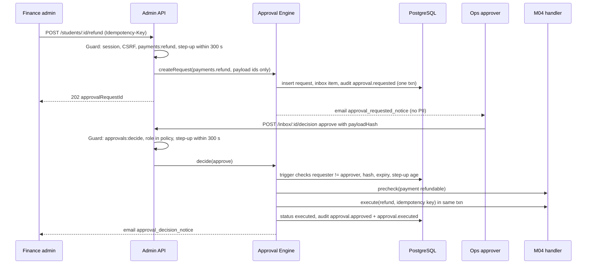
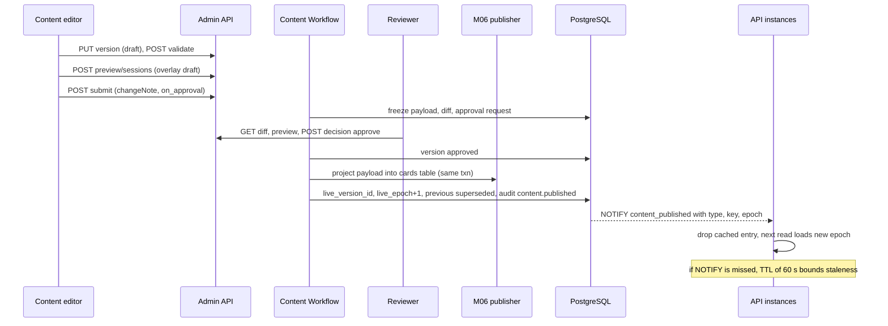
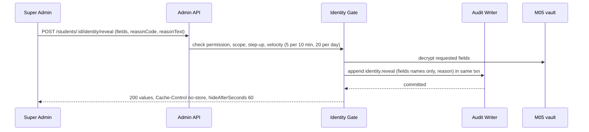
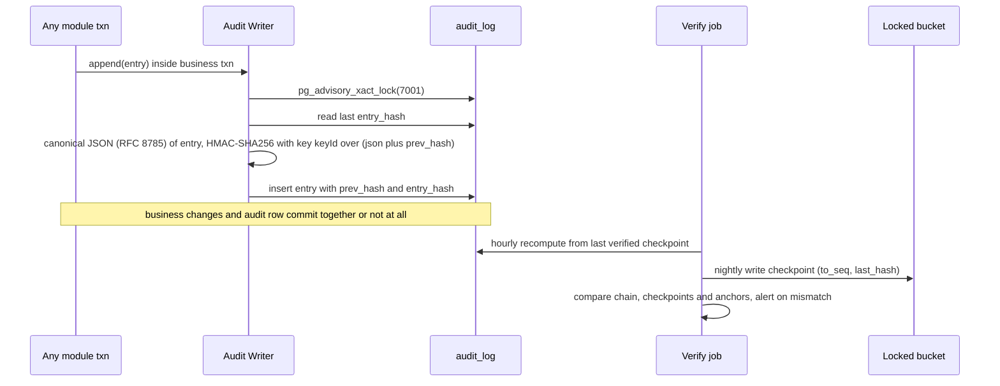
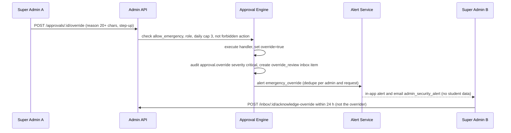

# LLD: M09 — Admin (Permissions, Approvals, Publishing, Audit)

| Field | Value |
|-------|-------|
| Module | M09 |
| Status | Review |
| Depends on HLD | `hld.md` |
| Registry / roles / policies | `permissions.md` |
| Requirements | REQ-ADM-01..11, REQ-AUTH-05 (admin half) |
| Last updated | 2026-11-24 |

Conventions: all timestamps `timestamptz` UTC; ids `uuid` (`gen_random_uuid()`); enums are Postgres enums; money is never stored by M09. API prefix `/admin-api`, served only on the admin host. All JSON bodies are validated by Zod with `.strict()` (unknown fields rejected). All admin responses carry `Cache-Control: no-store`.

## 1. Database

### Tables

| Table | Column | Type | Constraints | Notes |
|-------|--------|------|-------------|-------|
| `admin_accounts` | id | uuid | PK | |
| | email | citext | UNIQUE NOT NULL | Lower-cased; separate from student `users` |
| | display_name | text | NOT NULL, CHECK length 1..80 | |
| | status | admin_status | NOT NULL DEFAULT `invited` | `invited`, `active`, `suspended`, `disabled` |
| | password_hash | text | NULL until invite accepted | Argon2id (M02 primitive) |
| | password_changed_at | timestamptz | | |
| | totp_secret_enc | bytea | NULL until enrolled | AES-256-GCM field encryption (CTRL-ENC-FIELD-AES) |
| | totp_key_id | text | | Key id for rotation |
| | totp_enrolled_at | timestamptz | | |
| | totp_last_step | bigint | | Last accepted 30 s time-step; replay guard |
| | failed_login_count | int | NOT NULL DEFAULT 0 | Reset on success |
| | locked_until | timestamptz | | Progressive lock |
| | last_login_at | timestamptz | | |
| | invite_token_hash | bytea | UNIQUE | SHA-256 of 256-bit token; cleared on accept |
| | invite_expires_at | timestamptz | | 24 h |
| | ip_allowlist | cidr[] | NOT NULL DEFAULT `{}` | Empty = no per-admin restriction |
| | perm_version | int | NOT NULL DEFAULT 1 | Bumped on any role/scope change |
| | created_by | uuid | FK `admin_accounts` NULL | NULL only for bootstrap Super Admins |
| | created_at / updated_at / disabled_at | timestamptz | | |
| | row_version | int | NOT NULL DEFAULT 1 | Optimistic lock |
| | | | CHECK `status <> 'active' OR (password_hash IS NOT NULL AND totp_enrolled_at IS NOT NULL)` | Active admins always have 2FA |
| `admin_recovery_codes` | id | uuid | PK | |
| | admin_id | uuid | FK, NOT NULL | 10 codes per enrolment |
| | code_hash | text | NOT NULL | Argon2id of 80-bit code |
| | used_at | timestamptz | | Single use |
| `admin_sessions` | id | uuid | PK | Public id used in session list |
| | token_hash | bytea | UNIQUE NOT NULL | SHA-256 of 256-bit token |
| | admin_id | uuid | FK NOT NULL | |
| | mfa_passed_at | timestamptz | NOT NULL | A row exists only after TOTP/recovery success |
| | created_at / last_seen_at | timestamptz | NOT NULL | |
| | idle_expires_at | timestamptz | NOT NULL | `last_seen_at + idle_timeout` |
| | abs_expires_at | timestamptz | NOT NULL | `created_at + 8 h` |
| | step_up_at | timestamptz | | Last successful step-up |
| | step_up_method | text | CHECK in (`password`,`totp`) | |
| | csrf_token_hash | bytea | NOT NULL | Synchroniser token |
| | ip | inet | NOT NULL | |
| | ua_hash | bytea | | |
| | ua_label | text | | e.g. "Chrome on Windows" |
| | revoked_at / revoked_by / revoked_reason | timestamptz / uuid / text | | |
| `permissions` | key | text | PK, CHECK `^[a-z_]+(:[a-z_]+){1,2}$` | Mirror of code registry |
| | category | text | NOT NULL | |
| | description | text | NOT NULL | |
| | sensitivity | char(1) | CHECK in (L,M,H,C) | |
| | requires_step_up | boolean | NOT NULL | |
| | scopes | text[] | NOT NULL DEFAULT `{}` | Subset of `countries`,`lead_type`,`assigned_only`,`consultancy_ids` |
| | approval_action | text | NULL | Policy key evaluated on use |
| | introduced_in / deprecated_at | text / timestamptz | | |
| `roles` | id | uuid | PK | |
| | key | text | UNIQUE NOT NULL | `^[a-z0-9_]{3,40}$` |
| | name | text | UNIQUE NOT NULL | |
| | description | text | | |
| | is_system | boolean | NOT NULL DEFAULT false | |
| | is_super | boolean | NOT NULL DEFAULT false | CHECK `NOT is_super OR is_system`; partial UNIQUE (`is_super`) WHERE true |
| | exclusive | boolean | NOT NULL DEFAULT false | SOD-001 |
| | version | int | NOT NULL DEFAULT 1 | |
| | archived_at | timestamptz | | Archive only if no active assignments |
| | created_by / created_at / updated_at | | | |
| `role_permissions` | role_id | uuid | FK, PK(role_id, permission_key) | Not populated for Super Admin (computed) |
| | permission_key | text | FK `permissions` | |
| `role_versions` | role_id, version | uuid, int | PK | Immutable history |
| | permission_keys | text[] | NOT NULL | |
| | exclusive | boolean | | |
| | changed_by / approval_request_id / changed_at | | | |
| `admin_roles` | admin_id | uuid | FK, PK(admin_id, role_id) | |
| | role_id | uuid | FK | |
| | scope | jsonb | NULL = unrestricted | `{countries?:string[], lead_type?:string[], assigned_only?:boolean, consultancy_ids?:uuid[]}` validated by Zod and CHECK `jsonb_typeof(scope) = 'object'` |
| | assigned_by | uuid | FK | |
| | assigned_at | timestamptz | | |
| | approval_request_id | uuid | FK NULL | NULL only for bootstrap/migration |
| `approval_policies` | action_key | text | PK | See `permissions.md` §4 |
| | required | boolean | NOT NULL | |
| | approver_count | smallint | CHECK 1..2 | |
| | approver_role_ids | uuid[] | NOT NULL, CHECK `cardinality > 0` | |
| | expiry_hours | int | CHECK 1..336 | |
| | reason_mandatory | boolean | NOT NULL | |
| | step_up_required | boolean | NOT NULL DEFAULT true, CHECK `step_up_required` | Floor: cannot be false |
| | allow_emergency | boolean | NOT NULL | |
| | bulk_cap | int | NULL | Inbox bulk cap where bulk allowed |
| | sla_hours | int | NOT NULL | |
| | version | int | NOT NULL | |
| | updated_by / updated_at | | | |
| `approval_policy_versions` | action_key, version | text, int | PK | Immutable history of policies (JSON snapshot) |
| | snapshot | jsonb | NOT NULL | |
| | changed_by / approval_request_id / changed_at | | | |
| `approval_requests` | id | uuid | PK | |
| | action_key | text | FK `approval_policies`, NOT NULL | |
| | status | approval_status | NOT NULL DEFAULT `pending` | `pending`,`approved`,`executing`,`executed`,`failed`,`rejected`,`expired`,`cancelled` |
| | requested_by | uuid | FK `admin_accounts` NOT NULL | |
| | requested_at | timestamptz | NOT NULL | |
| | target_type / target_id | text / text | NOT NULL | e.g. `payment` / uuid |
| | payload | jsonb | NOT NULL | IDs and parameters only; Zod-validated per action; **no PII** |
| | payload_hash | bytea | NOT NULL | SHA-256 of RFC 8785 canonical JSON of `{action_key,target,payload}` |
| | summary | jsonb | NOT NULL | Safe, templated description (codes, masked refs) shown to approvers |
| | context | jsonb | | e.g. `{affected:12,grandfathered:3}` |
| | reason | text | CHECK length ≤ 1000 | Mandatory per policy |
| | policy_snapshot | jsonb | NOT NULL | Policy as of creation |
| | required_approvals | smallint | NOT NULL | |
| | approvals_count | smallint | NOT NULL DEFAULT 0 | |
| | expires_at | timestamptz | NOT NULL | |
| | decided_at / executed_at | timestamptz | | |
| | execution_result | jsonb | | Result code only |
| | failure_code | text | | |
| | override | boolean | NOT NULL DEFAULT false | |
| | override_by / override_at | uuid / timestamptz | | |
| | override_reason | text | CHECK length ≥ 20 when `override` | |
| | override_review_item_id | uuid | FK `inbox_items` | |
| | assignee_id | uuid | FK NULL | |
| | sla_due_at | timestamptz | NOT NULL | |
| | idempotency_key | uuid | NOT NULL | UNIQUE (`requested_by`, `idempotency_key`) |
| | | | Partial UNIQUE (`action_key`,`target_type`,`target_id`) WHERE status IN (`pending`,`approved`,`executing`) | One open request per target and action |
| `approval_decisions` | id | uuid | PK | |
| | request_id | uuid | FK NOT NULL | |
| | approver_id | uuid | FK NOT NULL | UNIQUE (`request_id`,`approver_id`) |
| | decision | text | CHECK in (`approve`,`reject`) | |
| | comment | text | CHECK length ≤ 1000 | |
| | reason_template_key | text | FK `reject_reason_templates` NULL | |
| | payload_hash | bytea | NOT NULL | Must equal request hash (trigger) |
| | step_up_at | timestamptz | NOT NULL | Must be within 300 s of `decided_at` (trigger) |
| | decided_at | timestamptz | NOT NULL | |
| | ip | inet | | |
| `inbox_items` | id | uuid | PK | |
| | item_type | inbox_type | NOT NULL | `proof`,`change_request`,`refund`,`manual_payment`,`deletion_request`,`consultancy_request`,`role_change`,`export_request`,`identity_bulk`,`override_review`,`fraud_flag` |
| | source_table / source_id | text / uuid | NOT NULL, UNIQUE (`source_table`,`source_id`) | `proofs`, `approval_requests`, `deletion_requests`, `referral_flags` … |
| | status | text | CHECK in (`open`,`resolved`) | |
| | outcome | text | CHECK in (`approved`,`rejected`,`cancelled`,`expired`,`failed`,`acknowledged`) | |
| | title_key | text | NOT NULL | i18n key for display |
| | summary | jsonb | NOT NULL | IDs and codes only |
| | view_permission | text | FK `permissions` NOT NULL | Who may see the item |
| | decide_permission | text | FK `permissions` NOT NULL | Who may decide |
| | country | char(2) | NULL | For `countries` scope |
| | requester_admin_id | uuid | FK NULL | NULL for student-originated items |
| | assignee_id | uuid | FK NULL | |
| | sla_due_at | timestamptz | NOT NULL | |
| | reminded_at | timestamptz | | Last SLA reminder |
| | created_at / resolved_at / resolved_by | | | |
| `inbox_comments` | id, item_id, author_id, body (text, ≤ 2000), created_at | | FK; append-only | |
| `reject_reason_templates` | key | text | PK | e.g. `proof_unreadable`, `proof_wrong_document` |
| | applies_to | text | NOT NULL | `proof`, `deletion_request`, `generic` |
| | text_key | text | NOT NULL | i18n key (EN now, DE later) |
| | active / sort_order | boolean / int | | |
| `content_entities` | id | uuid | PK | |
| | type | content_type | NOT NULL | `card`,`partner_link`,`text`,`sim_rule`,`contact_block`,`legal` |
| | key | text | NOT NULL, UNIQUE (`type`,`key`) | e.g. `card:blocked_account`, `link:expatrio`, `text:card1.helper` |
| | live_version_id | uuid | FK `content_versions` DEFERRABLE NULL | |
| | live_epoch | bigint | NOT NULL DEFAULT 0 | Monotonic per entity; bumped on publish/rollback |
| | created_by / created_at | | | |
| `content_versions` | id | uuid | PK | |
| | entity_id | uuid | FK NOT NULL | |
| | version_no | int | NOT NULL, UNIQUE (`entity_id`,`version_no`) | |
| | status | content_status | NOT NULL DEFAULT `draft` | `draft`,`in_review`,`approved`,`rejected`,`scheduled`,`published`,`superseded`,`discarded`,`expired` |
| | storage | text | NOT NULL DEFAULT `inline`, CHECK in (`inline`,`delegated`) | `inline` for `text`, `contact_block`; `delegated` for `card`, `sim_rule`, `partner_link`, `legal` (see §2.4 "Delegated content types") |
| | owner_ref | jsonb | NULL | Delegated only: `{"module":"M06","table":"card_versions","id":"uuid"}`; CHECK `(storage='inline') = (owner_ref IS NULL)` |
| | payload | jsonb | NULL when delegated, NOT NULL when inline | Zod schema per type (`schema_version`); immutable once not `draft` (trigger); CHECK `(storage='inline') = (payload IS NOT NULL)` |
| | schema_version | smallint | NOT NULL | |
| | payload_hash | bytea | NOT NULL | Inline: SHA-256 of canonical JSON. Delegated: the owner's `content_hash` returned by `adapter.freeze()` at submit |
| | base_version_id | uuid | FK NULL | Live version at draft creation (stale-base check) |
| | change_note | text | CHECK length 10..1000 when submitted | |
| | diff | jsonb | | Computed at submit against live |
| | validation_report | jsonb | | Errors/warnings from last validation |
| | impact | jsonb | | e.g. SIM rule `{affected,grandfathered}` |
| | change_set_id | uuid | FK NULL | |
| | approval_request_id | uuid | FK NULL | |
| | publish_mode | text | CHECK in (`on_approval`,`manual`,`scheduled`) | |
| | publish_at | timestamptz | | Required if `scheduled`; must be > now + 1 min |
| | approved_at / approved_expires_at | timestamptz | | Approved version must be published within 14 days |
| | rollback_of_version_id | uuid | FK NULL | Set when created by rollback |
| | created_by / created_at / submitted_by / submitted_at / published_by / published_at | | | |
| | | | Partial UNIQUE (`entity_id`) WHERE status IN (`draft`,`in_review`,`approved`,`scheduled`) | At most one open version per entity |
| `change_sets` | id | uuid | PK | |
| | title | text | NOT NULL, ≤ 120 | |
| | status | text | `draft`,`in_review`,`approved`,`scheduled`,`published`,`discarded` | |
| | approval_request_id | uuid | FK NULL | Strictest policy of members |
| | publish_mode / publish_at | text / timestamptz | | |
| | created_by / created_at | | | |
| `link_domain_allowlist` | id | uuid | PK | |
| | hostname | citext | UNIQUE NOT NULL | Lower-case IDNA ASCII (A-label) |
| | include_subdomains | boolean | NOT NULL DEFAULT false | |
| | partner_key | text | NOT NULL | e.g. `expatrio`, `vodafone` |
| | added_by / added_at / approval_request_id / removed_at | | | |
| `preview_sessions` | id | uuid | PK | |
| | admin_id / session_id | uuid / uuid | FK NOT NULL | Bound to the admin session |
| | mode | text | CHECK in (`synthetic`,`view_as_student`) | |
| | student_id | uuid | NULL | Only for `view_as_student` |
| | student_state | jsonb | | Synthetic: `{paid,identityComplete,cards:{[key]:status}}` |
| | overlay_version_ids | uuid[] | NOT NULL DEFAULT `{}` | Draft versions overlaid on live content |
| | reason / reason_code | text | NOT NULL when `view_as_student` | |
| | token_hash | bytea | UNIQUE NOT NULL | |
| | expires_at | timestamptz | NOT NULL | 15 min |
| | created_at / revoked_at | | | |
| `audit_log` | seq | bigint | PK, CHECK `seq > 0` | Chain order. Assigned by the writer as `last.seq + 1` while holding the advisory lock (gapless; not a sequence/identity, so rolled-back transactions never leave holes) |
| | chain_id | smallint | NOT NULL DEFAULT 1 | Reserved for sharding |
| | id | uuid | UNIQUE NOT NULL | |
| | occurred_at | timestamptz | NOT NULL | UTC, set by app inside the lock |
| | actor_type | text | CHECK in (`admin`,`consultancy_user`,`student`,`system`) | |
| | actor_id | uuid | NULL for system | |
| | actor_roles | text[] | NOT NULL DEFAULT `{}` | Role keys at time of action |
| | session_id | uuid | | |
| | action | text | NOT NULL | Must exist in code `AUDIT_ACTIONS` (CHECK via lookup test, not DB) |
| | severity | text | CHECK in (`info`,`notice`,`warning`,`critical`) | |
| | outcome | text | CHECK in (`success`,`denied`,`failed`) | |
| | target_type / target_id | text / text | | Opaque ids only |
| | before / after | jsonb | | Masked per redaction map |
| | reason / reason_code | text | | |
| | approval_request_id | uuid | | |
| | request_id | uuid | | |
| | ip | inet | | Admin/consultancy actors only |
| | ua_label | text | | |
| | key_id | text | NOT NULL | HMAC key id |
| | prev_hash | bytea | NOT NULL, CHECK `octet_length = 32` | Genesis = 32 zero bytes |
| | entry_hash | bytea | UNIQUE NOT NULL, CHECK `octet_length = 32` | |
| `audit_checkpoints` | id | uuid | PK | |
| | chain_id / from_seq / to_seq | smallint / bigint / bigint | NOT NULL | |
| | last_hash | bytea | NOT NULL | |
| | entry_count | bigint | NOT NULL | |
| | anchor_ref | text | | Object key + version id in locked bucket |
| | anchor_status | text | `pending`,`anchored`,`failed` | |
| | verify_status / verified_at | text / timestamptz | `pending`,`ok`,`mismatch` | |
| | created_at | timestamptz | | |
| `admin_alerts` | id | uuid | PK | |
| | type | text | NOT NULL | See §6 |
| | severity | text | `notice`,`warning`,`critical` | |
| | dedupe_key | text | NOT NULL | e.g. `override:{adminId}`; one alert per key per 10 min |
| | subject_admin_id | uuid | FK NULL | |
| | details | jsonb | NOT NULL | IDs and counts only |
| | created_at / notified_at / acked_by / acked_at | | | |
| `export_jobs` | id | uuid | PK | |
| | kind | text | `students`,`leads`,`payments`,`consultancy`,`partner_clicks`,`audit` | `leads` and `partner_clicks` are built by M08 (`accommodation_export_requests`) and M07 respectively; for these kinds M09 supplies the approval request, step-up gate, audit and one-time download semantics and the owner supplies the query (`ExportBuilder.onApproved(exportId)`); the `export_jobs` row is created in both cases so the audit view is uniform |
| | requested_by | uuid | FK `admin_accounts` NOT NULL | |
| | status | text | `awaiting_approval`,`queued`,`running`,`ready`,`failed`,`expired`,`cancelled` | |
| | filters / filter_hash | jsonb / bytea | NOT NULL | Filters contain IDs and enums, no free text PII |
| | purpose | text | NOT NULL, length 10..300 | |
| | approval_request_id | uuid | FK NULL | |
| | row_cap / row_count | int | NOT NULL | Cap default 5 000 (students), 20 000 (others) |
| | file_key | text | | Random key in private bucket, envelope-encrypted |
| | file_sha256 / size_bytes | bytea / bigint | | |
| | downloaded_count / last_downloaded_at | int / timestamptz | CHECK `downloaded_count <= 3` | |
| | created_at / started_at / ready_at / expires_at | | | `expires_at = ready_at + 24 h` |
| | failure_code | text | | |
| `system_settings` | key | text | PK | e.g. `admin.idle_timeout_minutes` |
| | value | jsonb | NOT NULL | Zod schema per key with hard bounds |
| | version | int | NOT NULL | |
| | updated_by / updated_at / approval_request_id | | | |
| `student_notes` | id | uuid | PK | |
| | student_id | uuid | NOT NULL | |
| | author_id | uuid | FK `admin_accounts` NOT NULL | |
| | body | text | CHECK length 1..2000 | Append-only; deleted only by erasure saga |
| | created_at | timestamptz | | |

Platform tables used (owned elsewhere): `idempotency_keys` (M01: `scope`, `key`, `request_hash`, `response_status`, `response_ref`, `expires_at`), `rate_limit_counters` (M01), `domain_events` (M01 outbox), `card_progress_events` (M06), `legal_document_versions` (M03).

### Database functions and triggers

| Name | On | Rule |
|------|----|------|
| `trg_audit_append_only` | `audit_log` BEFORE UPDATE OR DELETE; statement-level BEFORE TRUNCATE | Always `RAISE EXCEPTION 'audit_log is append-only'`. Also `REVOKE UPDATE, DELETE, TRUNCATE` from `app_api`; table owner is the migration role, never used at runtime |
| `trg_forbid_self_approval` | `approval_decisions` BEFORE INSERT | Raises if `approver_id = request.requested_by`; if `request.status <> 'pending'`; if `request.expires_at < now()`; if `payload_hash <> request.payload_hash`; if `now() - step_up_at > 300 s` |
| `trg_approval_immutable` | `approval_requests` BEFORE UPDATE | Raises if `payload`, `payload_hash`, `action_key`, `requested_by`, `policy_snapshot` change |
| `trg_content_payload_immutable` | `content_versions` BEFORE UPDATE | Raises if `payload` changes while `OLD.status <> 'draft'` |
| `trg_last_super_admin` | `admin_roles` and `admin_accounts` (constraint trigger, DEFERRABLE INITIALLY DEFERRED) | After change, `count(active admins with is_super role) >= 1` or raise `LAST_SUPER_ADMIN` |
| `trg_admin_roles_guard` | `admin_roles` BEFORE INSERT/UPDATE/DELETE | Raises if `admin_id` equals `app.requester_id` or `app.approver_id` GUC (set by Approval Engine on execution) — nobody edits their own roles; raises on SOD-001 (`exclusive` role plus another role) |
| `trg_role_perm_guard` | `role_permissions` BEFORE write | Raises if the role is `is_super`; raises if role is held by `app.requester_id` or `app.approver_id` |
| `fn_effective_permissions(admin_id)` | function (STABLE) | Union of `role_permissions` (non-super) plus all registry keys when a super role is assigned; skips suspended/disabled admins |
| `fn_next_audit_lock()` | `pg_advisory_xact_lock(7001)` wrapper | Serialises chain appends |

### Indexes

| Index | Purpose |
|-------|---------|
| `admin_sessions (admin_id) WHERE revoked_at IS NULL`; `(token_hash)` unique; `(idle_expires_at)` | Lookup, cleanup |
| `admin_roles (role_id)` | Role usage counts |
| `approval_requests (status, expires_at)` | Expiry job |
| `approval_requests (requested_by, requested_at DESC)`; `(assignee_id) WHERE status='pending'` | "My requests" and assigned |
| `approval_decisions (request_id)` | Decision lookup |
| `inbox_items (status, item_type, sla_due_at)` WHERE `status='open'`; `(assignee_id) WHERE status='open'`; `(country)` | Filters, SLA job |
| `content_versions (entity_id, version_no DESC)`; `(status, publish_at) WHERE status='scheduled'`; `(change_set_id)` | History, scheduler |
| `audit_log (target_type, target_id, seq DESC)`; `(actor_id, seq DESC)`; `(action, occurred_at DESC)`; `(actor_id, action, occurred_at)` for velocity limits; `(severity, occurred_at) WHERE severity IN ('warning','critical')` | Search and reveal velocity checks |
| `admin_alerts (dedupe_key, created_at DESC)`; `(acked_at) WHERE acked_at IS NULL` | Dedupe, unacked list |
| `export_jobs (status, expires_at)` | Expiry job |
| `student_notes (student_id, created_at DESC)` | Notes |

### RLS policies

All M09 tables: `ENABLE` and `FORCE ROW LEVEL SECURITY`.

| Table(s) | Policy |
|----------|--------|
| `admin_accounts`, `admin_sessions`, `admin_recovery_codes`, `roles`, `role_*`, `admin_roles`, `approval_*`, `inbox_*`, `content_*`, `change_sets`, `link_domain_allowlist`, `preview_sessions`, `export_jobs`, `system_settings`, `student_notes`, `admin_alerts`, `audit_checkpoints` | `USING / WITH CHECK (current_setting('app.actor_kind', true) IN ('admin','system'))`. Student and consultancy transactions (`app.actor_kind` = `student` / `consultancy`) see zero rows even if an injection reaches SQL |
| `audit_log` | `SELECT`: actor kind `admin` or `system`. `INSERT`: any actor kind (every module writes audit). No UPDATE/DELETE policy and no privilege |
| `inbox_items` | Additional `AND (country IS NULL OR current_setting('app.admin_countries', true) IN ('', NULL) OR country = ANY(string_to_array(current_setting('app.admin_countries', true), ',')))` — defence in depth for country-scoped admins; the API also filters by `view_permission` |
| `content_entities`, `content_versions` for student/runtime reads | Students never read these tables. Runtime tables (`cards`, `settings`, `sim_unlock_rules`) hold only published projections |
| View `admin_student_v` | `security_invoker`, joins student tables and applies the `countries` scope via `app.admin_countries` |

Every API request that touches the DB begins its transaction with `set_config('app.actor_kind', 'admin', true)`, `app.actor_id`, `app.admin_countries` (comma list or empty). The Approval Engine sets `app.requester_id` and `app.approver_id` during execution.

## 2. API endpoints

All routes live under `/admin-api` unless stated. `SU` = step-up required (`STEP_UP_REQUIRED` if `now − step_up_at > 300 s`). `Perm` is the registry key (see `permissions.md`). `{type}` maps to `cards:*`, `settings:links:*`, `settings:texts:*`, `settings:sim_rules:*`, `settings:contact:*`, `legal:*`. Mutations accept `Idempotency-Key: <uuid>` (required where marked ✓). Default rate limit: 120 req/min per admin session plus 600 req/min per IP (edge). Errors always include the common set `UNAUTHORIZED`, `FORBIDDEN`, `VALIDATION_FAILED`, `RATE_LIMITED`, `INTERNAL`; the Errors column lists extras. Every mutation additionally returns `CSRF_INVALID` (403) for a missing or wrong CSRF token or `Origin`, and, where `Idempotency-Key` is supported, `IDEMPOTENCY_CONFLICT` (409) when the key is reused with a different body. M09-specific codes not yet in `00-error-catalog.md`: `SELF_APPROVAL_FORBIDDEN` (403), `APPROVAL_EXPIRED` (409), `EMERGENCY_NOT_ALLOWED` (403), `PUBLISH_VALIDATION_FAILED` (422); see §5.

**Route prefixes and other modules.** M09-owned routes use `/admin-api`. Admin routes owned by M03–M08 keep the prefixes in their own LLDs (`/admin/…`, `/api/admin/…`, `/api/agent/…`); all are served only on the admin host and all pass through the single route registry and guard chain (session → CSRF → permission → scope → step-up → approval policy), so the prefix is not a security boundary. Those LLDs were drafted before this registry existed and use dotted or `staff:` permission names. The canonical keys are the colon form in `permissions.md`; `permissions.md` §7 gives the mapping table and `GAP-ADM-KEY-ALIGNMENT` tracks updating those LLDs.

### 2.1 Authentication and sessions

| Method | Path | Permission | Request | Response | Errors | Rate limit | Idempotency |
|--------|------|------------|---------|----------|--------|------------|-------------|
| POST | `/auth/login` | public | `{email,password}` | 200 `{challengeId, expiresIn:300}` (same shape and timing for unknown email, constant-time dummy hash) | `AUTH_INVALID_CREDENTIALS`, `AUTH_LOCKED` | 5 / 15 min per IP+email; 30 / h per IP | — |
| POST | `/auth/login/totp` | challenge | `{challengeId, code}` | 200 + `Set-Cookie`; body `{csrfToken, session:{idleExpiresAt,absExpiresAt}}` | `AUTH_2FA_INVALID`, `AUTH_LOCKED` | 5 / challenge | — |
| POST | `/auth/login/recovery` | challenge | `{challengeId, recoveryCode}` | as above; consumes code; alert `admin.recovery_code_used` | same | 5 / challenge | — |
| POST | `/auth/invite/accept` | invite token | `{token, password}` (≥ 14 chars, breached-password check) | 200 `{enrolment:{otpauthUri, secretBase32}}` (shown once) | `VALIDATION_FAILED`, `AUTH_TOKEN_INVALID` (expired/used/unknown) | 10 / h per IP | — |
| POST | `/auth/invite/enroll` | invite token | `{token, code}` | 200 `{recoveryCodes[10]}` shown once; account becomes `active` | `AUTH_TOKEN_INVALID`, `AUTH_2FA_INVALID` | 10 / h | — |
| POST | `/auth/logout` | session | — | 204; session revoked | — | 30 / min | ✓ idempotent by nature |
| GET | `/auth/session` | session | — | `{admin, csrfToken, idleExpiresAt, absExpiresAt, stepUpValidUntil}` | | 60 / min | — |
| POST | `/auth/step-up` | session | `{method:'password'|'totp', credential}` | 200 `{stepUpValidUntil}` | `AUTH_INVALID_CREDENTIALS` (password method), `AUTH_2FA_INVALID` (TOTP method); 5 failures revoke session | 5 / 5 min | — |
| POST | `/auth/password/change` | session + SU | `{currentPassword,newPassword}` | 204; other sessions revoked | `VALIDATION_FAILED` | 5 / h | — |
| GET | `/me` | session | — | `{id,displayName,roles[],permissions[],scopes}` (drives navigation only) | | 60 / min | — |
| GET | `/me/sessions` | session | — | list (`id,ip,uaLabel,createdAt,lastSeenAt,current`) | | 30 / min | — |
| DELETE | `/me/sessions/:id` | session | — | 204 | `NOT_FOUND` | 30 / min | ✓ |
| POST | `/me/sessions/revoke-others` | session + SU | — | `{revoked:n}` | | 5 / h | — |

### 2.2 Admin accounts, roles, permissions, policies

| Method | Path | Permission | Request | Response | Errors | Rate limit | Idempotency |
|--------|------|------------|---------|----------|--------|------------|-------------|
| GET | `/permissions` | `roles:read` | — | registry with sensitivity, scopes, approvalAction | | 60 / min | — |
| GET | `/roles` | `roles:read` | — | roles with permission keys, assignee counts | | 60 / min | — |
| GET | `/roles/:id` / `/roles/:id/versions` | `roles:read` | — | role / history | `NOT_FOUND` | 60 / min | — |
| POST | `/roles` | `roles:manage` + SU, approval `roles.update` | `RoleUpsert` | 202 `{approvalRequestId}` | `CONFLICT`, `VALIDATION_FAILED` (escalation/SOD) | 10 / h | ✓ |
| PUT | `/roles/:id` | `roles:manage` + SU, approval `roles.update` | `RoleUpsert` + `rowVersion` | 202 | `NOT_FOUND`, `CONFLICT` | 10 / h | ✓ |
| POST | `/roles/:id/archive` / `/reset-default` | `roles:manage` + SU, approval `roles.update` | `{reason}` | 202 | `CONFLICT` (has assignments) | 10 / h | ✓ |
| GET | `/admins` / `/admins/:id` | `admins:read` | filters | list/detail (no secrets) | `NOT_FOUND` | 60 / min | — |
| POST | `/admins` | `admins:manage` + SU, approval `admins.create` | `{email,displayName,roles:[{roleId,scope?}],reason}` | 202 | `CONFLICT` (email exists) | 10 / h | ✓ |
| POST | `/admins/:id/roles` | `admins:manage` + SU, approval `admins.assign_role` | `{roleId,scope?,reason}` | 202 | `VALIDATION_FAILED` (SOD, escalation, self), `CONFLICT` | 10 / h | ✓ |
| DELETE | `/admins/:id/roles/:roleId` | same | `{reason}` | 202 | `CONFLICT` (`LAST_SUPER_ADMIN`) | 10 / h | ✓ |
| POST | `/admins/:id/suspend` | `admins:manage` + SU (no approval) | `{reason}` | 200; sessions revoked immediately; alert | `CONFLICT` (`LAST_SUPER_ADMIN`, self) | 10 / h | ✓ |
| POST | `/admins/:id/reactivate` | `admins:manage` + SU, approval `admins.assign_role` | `{reason}` | 202 | `CONFLICT` | 10 / h | ✓ |
| POST | `/admins/:id/reset-2fa` | `admins:reset_2fa` + SU, approval `admins.reset_2fa` | `{reason, verificationNote}` | 202; on execution clears TOTP, revokes sessions, re-invite | `CONFLICT` | 5 / h | ✓ |
| GET / DELETE | `/admins/:id/sessions[/:sid]` | `admins:sessions:manage` + SU (DELETE) | — | list / 204 + alert | `NOT_FOUND` | 30 / min | ✓ |
| GET | `/approval-policies` | `approvals:policy:read` | — | policies | | 60 / min | — |
| PUT | `/approval-policies/:actionKey` | `approvals:policy:manage` + SU, approval `approvals.policy.update` | `PolicyUpsert` | 202 | `VALIDATION_FAILED` (SOD-005, hard floors) | 10 / h | ✓ |
| GET | `/approval-policies/:actionKey/versions` | `approvals:policy:read` | — | history | | 60 / min | — |
| GET / PUT | `/settings/admin-security` | `settings:admin_security:edit` + SU, approval `settings.admin_security.update` (PUT) | `AdminSecuritySettings` | 200 / 202 | `VALIDATION_FAILED` (outside hard bounds) | 10 / h | ✓ |

### 2.3 Approvals and inbox

| Method | Path | Permission | Request | Response | Errors | Rate limit | Idempotency |
|--------|------|------------|---------|----------|--------|------------|-------------|
| GET | `/inbox` | `approvals:read` plus per-item `view_permission` and scope | `InboxQuery` (type, status, assignee, ageGte, mine, cursor, limit ≤ 50) | `{items[], nextCursor, counts}` | | 60 / min | — |
| GET | `/inbox/:id` | per item | — | item with evidence links (proof via 60 s signed URL, audited), requester, age, SLA, comments, decisions | `NOT_FOUND` | 60 / min | — |
| POST | `/inbox/:id/assign` | `approvals:assign` | `{assigneeId|null}` | 200 | `FORBIDDEN`, `CONFLICT` | 60 / min | ✓ |
| POST | `/inbox/:id/comments` | per item view | `{body}` ≤ 2000 | 201 | | 30 / min | — |
| POST | `/inbox/:id/decision` | item `decide_permission` (+ SU for `approvals:decide` items) | `Decision` | 200 `{status}`; delegates to Approval Engine, M07 (`proofs`), M05 (`deletion_requests`) | `SELF_APPROVAL_FORBIDDEN`, `APPROVAL_EXPIRED`, `STEP_UP_REQUIRED`, `CONFLICT` | 60 / min | ✓ |
| POST | `/inbox/bulk-decision` | `proofs:approve`/`proofs:reject` | `{ids[≤25], decision, reasonTemplateKey?, confirmCount}` | `{ok[],failed[]}` | `VALIDATION_FAILED` (non-proof item, count mismatch, > cap) | 6 / min | ✓ |
| GET | `/approvals/:id` | requester, or `approvals:read` + view permission | — | request, summary, decisions, policy snapshot | `NOT_FOUND` | 60 / min | — |
| POST | `/approvals/:id/cancel` | requester only | `{reason?}` | 200 | `CONFLICT` (not pending) | 30 / min | ✓ |
| POST | `/approvals/:id/override` | `approvals:emergency_override` + SU | `{reason(≥20)}` | 200 executed; alerts others | `EMERGENCY_NOT_ALLOWED`, `APPROVAL_EXPIRED`, `STEP_UP_REQUIRED` | 3 / day per admin | ✓ |
| POST | `/inbox/:id/acknowledge-override` | `approvals:decide` + SU (not the overrider) | `{comment}` | 200 | `FORBIDDEN` (self) | 30 / min | ✓ |

Action-initiating endpoints owned by other modules return `202 {approvalRequestId,status:'pending'}` when the policy requires approval, or `200` when not: `POST /students/:id/mark-paid` (`students:mark_paid`), `POST /students/:id/refund` (`payments:refund`), `POST /identity/bulk-access` (`identity:bulk_access`), `POST /students/:id/identity/purge` (`identity:purge`), `POST /consultancies/reassign-student` (`consultancies:reassign_student`), `POST /partners/csv-import` (`partners:csv_import`).

### 2.4 Content workflow (draft → review → publish)

#### Delegated content types

M03 (legal versions), M06 (`card_versions`, unlock-rule versions) and M07 (partner link versions) already own typed version tables with domain validation. M09 does **not** duplicate that storage. For `card`, `sim_rule`, `partner_link` and `legal` the `content_versions` row is a workflow record (`storage = 'delegated'`, `owner_ref` points at the owner row). M09 owns the state machine, approval request, change sets, scheduling, preview overlay registration and cache epoch; the owner module supplies a `ContentAdapter`:

```ts
// packages/shared/src/content-adapter.ts
export interface ContentAdapter<T extends ContentType> {
  readonly type: T;
  readonly perms: { read: PermKey; edit: PermKey; publish: PermKey };
  createDraft(tx: Tx, input: unknown, actor: Actor): Promise<OwnerRef>;
  updateDraft(tx: Tx, ref: OwnerRef, input: unknown, expectedRowVersion: number): Promise<void>;
  validate(tx: Tx, ref: OwnerRef): Promise<ValidationReport>;       // domain rules (cycles, URL template, variables)
  impact?(tx: Tx, ref: OwnerRef): Promise<ImpactReport>;            // e.g. SIM rule {affected, grandfathered}
  diff(tx: Tx, ref: OwnerRef, against: OwnerRef | 'live'): Promise<StructuredDiff>;
  freeze(tx: Tx, ref: OwnerRef): Promise<{ contentHash: Buffer }>;  // locks edits, returns hash bound into the approval payload
  publish(tx: Tx, ref: OwnerRef, ctx: { epoch: bigint; approvalRequestId?: string }): Promise<void>; // owner side effects (supersede, upsert state, enqueue jobs)
  previewOverlay(ref: OwnerRef): Promise<unknown>;                  // DTO fragment used by the preview service
  onRollback?(tx: Tx, toRef: OwnerRef): Promise<OwnerRef>;          // creates a new owner version cloned from toRef
}
```

Rules:
- Owner modules keep their domain endpoints for list/read/edit; their own `submit`/`approve`/`reject`/`publish`/`withdraw` endpoints become thin wrappers over `ContentWorkflow` (M09) or are removed. There is exactly one approval decision path (Approval Engine, `CTRL-ADM-APPROVAL`), so "author ≠ approver" is enforced once, in the database trigger `trg_forbid_self_approval`.
- Owner review permissions (`cards.review`, `partners.link.review`) are replaced by `approvals:decide` plus the policy's approver roles (`content.publish.card`, `content.publish.partner_link`, `content.publish.sim_rule`, `content.publish.legal`).
- Owner-side scheduling already implemented by M03 (`legal.activate_scheduled`) stays; M09 calls `adapter.publish` at `publish_at` for types without their own scheduler and sets `approved_expires_at` for all.
- A delegated version's owner row becomes immutable on `freeze()`; `adapter.publish` must be idempotent per `(ref, epoch)`.
- `GAP-ADM-ADAPTER-ALIGNMENT` tracks the M03/M06/M07 edits needed to call `ContentWorkflow`.

| Method | Path | Permission | Request | Response | Errors | Rate limit | Idempotency |
|--------|------|------------|---------|----------|--------|------------|-------------|
| GET | `/content` | `content:review` or `{type}:read` | `?type&status&q` | entities with live and open version | | 60 / min | — |
| GET | `/content/:type/:key` | same | — | entity, versions, live | `NOT_FOUND` | 60 / min | — |
| POST | `/content/:type` | `{type}:edit` (+ `cards:create` for cards) | `{key, payload}` | 201 draft v1 | `CONFLICT` (key exists) | 30 / min | ✓ |
| POST | `/content/:type/:key/drafts` | `{type}:edit` | `{fromVersionId?}` default live | 201 | `CONFLICT` (open version exists) | 30 / min | ✓ |
| PUT | `/content/versions/:id` | `{type}:edit` | `{payload, rowVersion}` | 200 | `CONFLICT` (not draft / stale), `VALIDATION_FAILED` | 60 / min | — |
| POST | `/content/versions/:id/validate` | `{type}:edit` | — | `{errors[],warnings[],impact?}` | | 30 / min | — |
| GET | `/content/versions/:id/diff` | `content:review` | `?against=live|versionId` | structured diff | | 60 / min | — |
| POST | `/content/versions/:id/submit` | `{type}:edit` | `{changeNote, publishMode, publishAt?, impactAck?}` | 202 `{approvalRequestId}` or 200 (policy not required: status `approved`) | `PUBLISH_VALIDATION_FAILED`, `CONFLICT` | 30 / min | ✓ |
| POST | `/content/versions/:id/withdraw` | author | — | 200 back to `draft`; approval cancelled | `CONFLICT` | 30 / min | ✓ |
| POST | `/content/versions/:id/discard` | author or `{type}:publish` | `{reason}` | 200 | `CONFLICT` | 30 / min | ✓ |
| POST | `/content/versions/:id/rebase` | `{type}:edit` | — | 200 new draft on current live (conflicts listed) | `CONFLICT` | 10 / min | ✓ |
| POST | `/content/versions/:id/publish` | `{type}:publish` + SU | `{impactAck?}` | 200 `{epoch}` | `APPROVAL_REQUIRED`, `APPROVAL_EXPIRED`, `PUBLISH_VALIDATION_FAILED`, `CONFLICT` (stale base) | 10 / min | ✓ |
| POST | `/content/versions/:id/schedule` | `{type}:publish` + SU | `{publishAt}` | 200 | same | 10 / min | ✓ |
| POST | `/content/:type/:key/rollback` | `{type}:publish` + SU, same policy as publish | `{toVersionId, changeNote}` | 202 or 200 (new version) | `CONFLICT` (open version exists) | 5 / min | ✓ |
| POST | `/change-sets` / `/change-sets/:id/items` | any `{type}:edit` for each item | `{title}` / `{versionId}` | 201 / 200 | `CONFLICT` | 30 / min | ✓ |
| POST | `/change-sets/:id/submit` / `/publish` | each member's `edit` / `publish` + SU | as submit/publish | 202 / 200 | as above; all-or-nothing | 10 / min | ✓ |
| GET / POST / DELETE | `/link-allowlist` | `settings:link_allowlist:edit` + SU (writes), approval `settings.allowlist.update` | `{hostname, includeSubdomains, partnerKey}` | list / 202 | `VALIDATION_FAILED` | 10 / h | ✓ |
| GET / POST / PUT | `/reject-reasons` | `settings:reject_reasons:edit` (writes) | template | | | 30 / min | — |

### 2.5 Preview and view-as

| Method | Path | Permission | Request | Response | Errors | Rate limit | Idempotency |
|--------|------|------------|---------|----------|--------|------------|-------------|
| POST | `/preview/sessions` | `content:review` | `PreviewCreate` (synthetic state, overlay draft ids) | 201 `{previewToken, expiresAt}` (token returned in body, **not a cookie**) | `NOT_FOUND`, `VALIDATION_FAILED` | 30 / min | — |
| POST | `/preview/view-as` | `students:view_as` + SU, scope | `{studentId, reasonCode, reasonText}` | 201 `{previewToken, expiresAt}` | `NOT_FOUND` (also for out-of-scope) | 20 / h | — |
| GET | `/preview/dashboard` | valid `X-Preview-Token` bound to caller's session | — | student dashboard DTO (same shape as student API), identity block masked, `X-Preview: true` | `UNAUTHORIZED` | 120 / min | — |
| GET | `/preview/cards/:key` | same | — | card detail DTO | `NOT_FOUND` | 120 / min | — |
| DELETE | `/preview/sessions/:id` | owner | — | 204 | | 30 / min | ✓ |

Every other method on `/preview/*` returns 405. Preview responses are rendered by the admin SPA with student components in `readOnly` mode; links are inert (no partner click logging, no redirects).

### 2.6 Students, identity gates, reports

| Method | Path | Permission | Request | Response | Errors | Rate limit | Idempotency |
|--------|------|------------|---------|----------|--------|------------|-------------|
| GET | `/students` | `students:read` (scope) | `StudentQuery`: `q` (exact email OR student UUID OR pseudonym id, never partial), filters, cursor, limit ≤ 50 | list `{id,firstName,lastInitial,country,intake,status,paid,createdAt}` | | 30 / min | — |
| GET | `/students/:id` | `students:read` (scope) | — | detail (registration fields, consents, referral, card progress, payment status); audited `student.viewed` | `NOT_FOUND` (also out-of-scope) | 60 / min | — |
| GET | `/students/:id/timeline` | `students:read` | `cursor` | ordered events (registered, verified, paid, identity complete, card transitions, proofs, leads, emails by template and status, admin actions on the student) | `NOT_FOUND` | 60 / min | — |
| GET / POST | `/students/:id/notes` | `students:notes:read` / `students:notes:write` | `{body}` | list / 201 | | 30 / min | — |
| POST | `/students/:id/resend-email` | `students:resend_email` | `{template:'auth_verify_email'|'welcome'}` | 202 | `CONFLICT` (already verified, cooldown 5 min) | 10 / h per student | ✓ |
| GET | `/students/:id/identity` | `identity:view_masked` | — | masked fields only | `NOT_FOUND` (no identity yet) | 60 / min | — |
| POST | `/students/:id/identity/reveal` | `identity:reveal` + SU | `RevealRequest` | 200 `{values:{field:string}, hideAfterSeconds:60}`; `Cache-Control: no-store` | `NOT_FOUND`, `RATE_LIMITED`, `STEP_UP_REQUIRED`, `APPROVAL_REQUIRED` (velocity exceeded → use bulk) | 5 / 10 min, 20 / day per admin | ✓ (replay returns 409, no second reveal) |
| POST | `/students/:id/identity/files/:fileId/download-url` | `identity:download_file` + SU | `{reasonCode, reasonText}` | 200 `{url, expiresIn:60}` single-use URL | same | 5 / 10 min, 20 / day (shared with reveal) | ✓ |
| GET | `/reports/funnel` | `reports:read` | `?from&to&country&consultancyId` | counts per stage (registered, verified, paid, identity complete, card 1 started/completed, SIM unlocked, accommodation lead) | | 30 / min | — |
| GET | `/reports/payments` / `/reports/queues` | `reports:read` | range | counts and amounts only / proof, approval, deletion queue sizes and ages | | 30 / min | — |

### 2.7 Exports, audit, alerts

| Method | Path | Permission | Request | Response | Errors | Rate limit | Idempotency |
|--------|------|------------|---------|----------|--------|------------|-------------|
| POST | `/exports` | `exports:{kind}` + SU, approval `exports.students` / `exports.payments` / `exports.leads` / `exports.partner_clicks` where set (see `permissions.md` §4) | `ExportCreate` | 202 `{exportId,status}` (`awaiting_approval` or `queued`) | `VALIDATION_FAILED` (row cap), `CONFLICT` | 3 / h per admin | ✓ |
| GET | `/exports/:id` | requester or `audit:read` | — | status, rowCount, expiresAt (never contents) | `NOT_FOUND` | 60 / min | — |
| GET | `/exports/:id/download` | requester + SU | — | CSV stream, `Content-Disposition: attachment`, `X-Content-Type-Options: nosniff`, `no-store` | `NOT_FOUND`, `CONFLICT` (expired / 3 downloads used) | 5 / h | — |
| DELETE | `/exports/:id` | requester | — | 204; file deleted | | 30 / min | ✓ |
| GET | `/audit` | `audit:read` | `AuditQuery`: actorId, action, targetType+targetId, from, to, severity, outcome, cursor (limit ≤ 100). Target search by UUID only | entries (without hash internals) | | 30 / min | — |
| GET | `/audit/:seq` | `audit:read` | — | entry with `prevHash`, `entryHash`, `keyId`, and verification status | `NOT_FOUND` | 60 / min | — |
| POST | `/audit/verify` | `audit:verify` | `{fromSeq?,toSeq?}` | 202 job id; `GET /audit/verify/:jobId` result | | 5 / h | ✓ |
| GET | `/audit/checkpoints` | `audit:verify` | | list with anchor and verify status | | 30 / min | — |
| POST | `/audit/export` | `audit:export` + SU | `{from,to,filters}` | 202 export (kind `audit`) with `chainProof` | | 3 / h | ✓ |
| GET | `/alerts` | `alerts:read` | `?unacked` | alerts | | 60 / min | — |
| POST | `/alerts/:id/ack` | `alerts:ack` | `{note?}` | 200 | `NOT_FOUND` | 30 / min | ✓ |

### Zod schemas

```ts
// packages/shared/src/admin.ts
import { z } from 'zod';

export const PermissionKey = z
  .string()
  .regex(/^[a-z_]+(:[a-z_]+){1,2}$/)          // no '*' possible
  .refine((k) => PERMISSION_KEYS.has(k), 'unknown permission');

export const Scope = z
  .object({
    countries: z.array(z.string().regex(/^[A-Z]{2}$/)).max(60).optional(),
    lead_type: z.array(z.enum(['accommodation'])).optional(),
    assigned_only: z.boolean().optional(),
    consultancy_ids: z.array(z.string().uuid()).max(200).optional(),
  })
  .strict()
  .nullable();

export const RoleUpsert = z
  .object({
    key: z.string().regex(/^[a-z0-9_]{3,40}$/),
    name: z.string().min(3).max(60),
    description: z.string().max(300).optional(),
    permissionKeys: z.array(PermissionKey).min(1).max(80),
    exclusive: z.boolean().default(false),
    reason: z.string().min(10).max(1000),
    rowVersion: z.number().int().optional(),
  })
  .strict();

export const PolicyUpsert = z
  .object({
    required: z.boolean(),
    approverCount: z.union([z.literal(1), z.literal(2)]),
    approverRoleIds: z.array(z.string().uuid()).min(1),
    expiryHours: z.number().int().min(1).max(336),
    reasonMandatory: z.boolean(),
    allowEmergency: z.boolean(),
    slaHours: z.number().int().min(1).max(336),
    reason: z.string().min(10).max(1000),
  })
  .strict();

export const Decision = z
  .object({
    decision: z.enum(['approve', 'reject']),
    comment: z.string().max(1000).optional(),
    reasonTemplateKey: z.string().max(60).optional(),   // required on reject for proofs/deletions
    payloadHash: z.string().regex(/^[0-9a-f]{64}$/),    // what the approver saw
  })
  .strict();

export const StepUp = z
  .object({
    method: z.enum(['password', 'totp']),
    credential: z.string().min(6).max(256),
  })
  .strict();

export const RevealRequest = z
  .object({
    fields: z
      .array(z.enum(['passportNumber', 'fatherName', 'motherName', 'currentAddress', 'permanentAddress']))
      .min(1)
      .max(5),
    reasonCode: z.enum(['support_ticket', 'verification_check', 'legal_request', 'data_correction', 'other']),
    // code list is provisional until GAP-IDENTITY-PURPOSE is closed
    reasonText: z.string().trim().min(15).max(500),
    ticketRef: z.string().max(40).optional(),
  })
  .strict();

export const ContentSubmit = z
  .object({
    changeNote: z.string().trim().min(10).max(1000),
    publishMode: z.enum(['on_approval', 'manual', 'scheduled']),
    publishAt: z.string().datetime().optional(),
    impactAck: z.boolean().optional(),
  })
  .strict()
  .refine((v) => (v.publishMode === 'scheduled') === !!v.publishAt, 'publishAt iff scheduled');

export const PreviewCreate = z
  .object({
    studentState: z
      .object({
        paid: z.boolean(),
        identityComplete: z.boolean(),
        cards: z.record(z.enum(['locked', 'available', 'in_progress', 'completed'])),
      })
      .strict(),
    overlayVersionIds: z.array(z.string().uuid()).max(20).default([]),
  })
  .strict();

export const ExportCreate = z
  .object({
    kind: z.enum(['students', 'leads', 'payments', 'consultancy', 'partner_clicks', 'audit']),
    filters: z.record(z.union([z.string().max(64), z.array(z.string().max(64)).max(50)])).default({}),
    purpose: z.string().trim().min(10).max(300),
  })
  .strict();

export const InboxQuery = z
  .object({
    type: z.array(z.enum(INBOX_TYPES)).optional(),
    status: z.enum(['open', 'resolved']).default('open'),
    assigneeId: z.string().uuid().optional(),
    mine: z.boolean().optional(),
    ageGteHours: z.number().int().min(0).max(720).optional(),
    cursor: z.string().max(200).optional(),
    limit: z.number().int().min(1).max(50).default(25),
  })
  .strict();

export const ApprovalActionHandler = <T extends z.ZodTypeAny>(h: {
  key: ApprovalActionKey;
  payload: T;                                           // PII-free params
  summarise(p: z.infer<T>): { titleKey: string; params: Record<string, string | number> };
  precheck(tx: Tx, p: z.infer<T>): Promise<{ ok: true; context?: object } | { ok: false; code: string }>;
  execute(tx: Tx, p: z.infer<T>, ctx: ExecCtx): Promise<{ resultCode: string }>;   // idempotent
}) => h;
```

Proposed additions to `00-error-catalog.md` (not applied here):

| Code | HTTP | When | User message |
|------|------|------|--------------|
| `SELF_APPROVAL_FORBIDDEN` | 403 | Approver is the requester | You cannot approve your own request. |
| `APPROVAL_EXPIRED` | 409 | Request or approved version expired | This request has expired. Please create a new one. |
| `EMERGENCY_NOT_ALLOWED` | 403 | Override on a forbidden action, not Super Admin, daily cap, or reason too short | Emergency override is not available for this action. |
| `PUBLISH_VALIDATION_FAILED` | 422 | Link, placeholder, text or SIM-rule validation failed; `details[]` lists fields | Fix the highlighted items before publishing. |

## 3. State machines

### 3.1 Approval request

| From | Event | To | Side effects |
|------|-------|----|--------------|
| (none) | request created | `pending` | Policy snapshot, payload hash, inbox item, notice mail to eligible approvers (excluding requester) |
| `pending` | approver approves and `approvals_count + 1 = required` | `approved` → `executing` | Same transaction: decision row, audit `approval.approved`, run handler `precheck` and `execute` |
| `pending` | approver approves, count < required | `pending` | Decision recorded, audit |
| `pending` | any approver rejects | `rejected` | Reason template; requester notified; inbox resolved; handler `onRejected` (e.g. content version → `rejected`) |
| `pending` | requester cancels | `cancelled` | Inbox resolved; version back to `draft` if content |
| `pending` | `expires_at` passed (job) | `expired` | Requester notified; content version back to `draft` |
| `pending` | emergency override | `executing` | Flags set, alerts, review item (see §4) |
| `executing` | handler success | `executed` | `execution_result`, audit `approval.executed`, notices |
| `executing` | handler error or precheck fails | `failed` | Transaction rolled back to savepoint, `failure_code` stored, requester + approver notified; a new request is needed |

Terminal states: `executed`, `failed`, `rejected`, `expired`, `cancelled`. No transition out. Expiry is evaluated both by the job and at decision time (trigger).

### 3.2 Content version

| From | Event | To | Side effects |
|------|-------|----|--------------|
| (none) | create / `drafts` | `draft` | `base_version_id` = live version |
| `draft` | edit | `draft` | `payload_hash` updated, validation cleared |
| `draft` | submit (validation OK, policy required) | `in_review` | Diff computed, impact computed, approval request created, payload frozen |
| `draft` | submit (policy not required) | `approved` | `approved_at` set, audit `content.approved` with `approvedBy=system(policy)` |
| `in_review` | approval granted | `approved` | `approved_expires_at = now + 14 d`; if `publish_mode=on_approval` publish is attempted in the same transaction, re-checking the author's `*:publish` and active status |
| `in_review` | approval rejected | `rejected` | Author can create a new draft from it (`fromVersionId`) |
| `in_review` | withdraw / approval cancelled or expired | `draft` | Payload editable again |
| `approved` | publish (manual or on approval) | `published` | Publisher runs (projection into runtime tables) → `live_version_id`, `live_epoch + 1` → previous live `superseded` → `NOTIFY content_published` → audit |
| `approved` | schedule | `scheduled` | `publish_at` stored |
| `scheduled` | scheduler tick at `publish_at` | `published` | As above, system actor on behalf of the scheduler; fails → stays `scheduled`, alert after 3 attempts |
| `scheduled` | cancel | `approved` | |
| `approved` | `approved_expires_at` passed | `expired` | Notify author |
| `draft`/`in_review`/`approved`/`scheduled` | discard | `discarded` | |

Publish pre-conditions (all re-checked at publish time): live version id equals `base_version_id` (else `CONFLICT` stale base → `rebase`); validation passes again; approval valid; for SIM rules the impact is recomputed and, if `affected` changed by more than 0 since approval, the publisher must re-acknowledge; for change sets every member satisfies its own conditions.

Rollback = create a new version whose payload copies version *K*, `rollback_of_version_id=K`, then run the normal submit path using the **same policy as publish**. Fast path: rolling back to the immediately previous live version where the policy requires approval still needs an approver, but with the `emergency` option available and an inbox priority flag.

### 3.3 Other lifecycles

| Entity | Transitions |
|--------|-------------|
| Admin account | `invited` → `active` (invite accepted and TOTP enrolled) → `suspended` ↔ `active` (reactivate via approval) → `disabled` (terminal, off-boarding; sessions revoked, email retained 12 months then anonymised). Locked is a temporary flag (`locked_until`), not a status |
| Admin session | `active` → `idle_expired` / `abs_expired` / `revoked` / `logged_out` (all terminal). Any request on an active session slides `idle_expires_at` (capped by `abs_expires_at`) |
| Inbox item | `open` (optionally assigned) → `resolved` with outcome. Re-open is not allowed; follow-up is a new item |
| Export job | `awaiting_approval` → `queued` → `running` → `ready` → `expired`; failure → `failed`; requester cancel → `cancelled`; approval rejected → `cancelled` |
| Change set | `draft` → `in_review` → `approved` → `published` / `scheduled`; any member rejected → all members `rejected` |
| Preview session | active until `expires_at` (15 min) or revoked or admin session ends |

## 4. Sequence diagrams

### Happy path A — Refund with maker-checker and step-up



### Happy path B — Publish a card with cache invalidation



### Happy path C — Identity reveal



### Happy path D — Audit append and verification



### Failure paths

| # | Scenario | Behaviour |
|---|----------|-----------|
| F1 | Requester posts the decision (self-approve) via API or direct SQL | Service returns `SELF_APPROVAL_FORBIDDEN` (403); a direct insert raises in `trg_forbid_self_approval`. Audit `approval.self_approval_attempt` (warning) |
| F2 | Payload swapped after approval (TOCTOU) | Payload and hash are immutable (trigger); decisions carry the hash they saw; mismatch → 409 `CONFLICT` and approver must reload |
| F3 | Step-up expired during decision | 401 `STEP_UP_REQUIRED`; UI opens step-up dialog and replays; decision stays unsaved |
| F4 | Handler `precheck` fails (e.g. payment already refunded) | Request `failed` with `failure_code`; no side effects; requester told why |
| F5 | Handler `execute` throws after partial work | Savepoint rollback; request `failed`; handler must be idempotent (M04 uses the request id as Stripe idempotency key) |
| F6 | Audit append fails (DB error or lock timeout 5 s) | Business transaction rolls back; API 500 `INTERNAL` with `requestId`; alert `audit_write_failed` |
| F7 | Reveal when audit is unavailable | Nothing revealed (audit-before-return); `503` |
| F8 | Publish while another version went live (stale base) | `CONFLICT`; author uses `rebase`; approval is invalidated because payload changes |
| F9 | Validation fails at publish time (allow-list changed since submit) | `PUBLISH_VALIDATION_FAILED`; version stays `approved` and the publisher can discard or fix via new draft |
| F10 | Publisher (M06/M03) error | Publish transaction rolls back; version stays `approved`; alert after 3 failed scheduled attempts |
| F11 | `NOTIFY` lost or API instance restarted | Cache entries carry `epoch` and a 60 s TTL; `/health/content` reports per-instance epoch skew and alerts if skew persists beyond 2 × TTL |
| F12 | Approval pool too small | Policy save blocked by SOD-005; at runtime SLA breach alert; emergency override where allowed |
| F13 | Emergency override | See the diagram below this table |
| F14 | Admin session idle-expired mid-action | 401; client redirects to login; no partial writes |
| F15 | Stale `rowVersion` on edit | 409 `CONFLICT`; UI shows a merge dialog |
| F16 | Chain mismatch detected | `audit_integrity_status=broken` flag; critical alert to all Super Admins and Auditors; admin writes continue (availability) but a banner shows until investigated; mismatch details recorded as a new audit entry |



If the review is not acknowledged within 24 h the alert escalates (re-sent every 4 h, shown on the Auditor dashboard).

## 5. Validation rules

| Field | Client | API | DB |
|-------|--------|-----|----|
| Admin email | Format | Normalised, ≤ 254, unique | `citext UNIQUE` |
| Admin password | Strength meter | ≥ 14 chars, not in breached set (k-anonymity), not equal to email | Hash only |
| TOTP code | 6 digits | Window ±1 step, `step > totp_last_step` | `totp_last_step` |
| Reason (all gated actions) | min 10 chars (override 20) | Trimmed, length per schema, rejects only-punctuation/repeated-char strings | Length CHECK |
| Role key / name | pattern | `^[a-z0-9_]{3,40}$`, unique | UNIQUE |
| Role permissions | Group toggles expand to explicit keys | Every key in registry; none `deprecated`; each held by the actor (escalation guard); SOD checks | FK to `permissions` |
| Scope | Country picker | Countries ISO-3166 alpha-2 known; `lead_type` known; `consultancy_ids` exist | jsonb object CHECK |
| Policy | Disabled controls for hard floors | `approverCount ≤ eligible admins − 1`; `required=false` and `emergency=true` rejected for hard-floor actions; role ids exist and non-archived | `step_up_required` CHECK; counts |
| Approval payload | n/a | Per-action Zod `.strict()`; IDs exist; **no free-text PII allowed** (payload keys on allow-list) | jsonb NOT NULL |
| Content key | Slug | `^[a-z0-9_.:-]{3,80}$` | UNIQUE(type,key) |
| Card payload | Form | title 1..60, helper ≤ 280, order int, `requiredForSim` bool, `comingSoon` bool, `partnerLinkKey` exists and `published` | jsonb |
| Text payload | Form | 1..1000 chars, plain text or limited Markdown (bold, italic, links); HTML stripped; placeholders limited to `{firstName}`; wording lint (GAP-ADM-WORDING-LINT) warns, blocks on listed forbidden phrases | jsonb |
| Partner link payload | URL field | See link rules below | jsonb |
| SIM rule payload | Rule builder | `requiredCardKeys[]` exist, are published, none comingSoon; at least 1 required card; no cycles | jsonb |
| Contact block | Form | Email format, phone E.164 via libphonenumber, name ≤ 80 | jsonb |
| Legal payload | Editor | Delegated type: `owner_ref` points at the M03 version row; changeNote; `requiresReaccept` bool is read from it | `owner_ref` CHECK |
| `publishAt` | Date picker | > now + 1 min, < now + 90 d | CHECK when scheduled |
| Reveal request | Field chooser + reason | `RevealRequest`; student exists, in scope, identity not deleted | n/a |
| Export purpose | min 10 | 10..300, filters keys on allow-list per kind | NOT NULL |
| Inbox bulk | Count confirmation | ≤ 25, only `proof` items, `confirmCount = ids.length` | n/a |
| CSV cells (exports) | n/a | Shared `csvSafe()` on every string cell (`packages/shared`, specified in M10 LLD §5) | n/a |

**Partner link rules** (executed on `validate`, `submit` and again on `publish`):

1. Parse with WHATWG `URL`; scheme must be exactly `https:`; no `username`/`password` (blocks `https://good.com@evil.com`); no port other than 443; length ≤ 2048; no control characters or backslashes.
2. Host converted to IDNA ASCII (A-label) lower-case; reject if conversion changes characters in a mixed-script way (homograph); reject IP literals and `localhost`.
3. Host must equal an `link_domain_allowlist.hostname`, or be a subdomain when `include_subdomains` is true (match on label boundary: `a.expatrio.com` matches `expatrio.com`, `evilexpatrio.com` does not).
4. Placeholders `{...}` only from `{studentId}` (opaque id for partners, not the student's email), `{refCode}`, `{clickId}`; any other brace token fails; each placeholder must appear in a partner template if the partner template declares it required; no placeholder in the host part.
5. Redirect-style parameters (`url=`, `redirect=`, `next=`) pointing off-allow-list fail (open-redirect guard).
6. Optional reachability check through M07's SSRF-safe checker (private ranges blocked, 3 s timeout); a failing check is a **warning**, not a blocker.
7. Preview shows the resolved URL with sample values and the visible link text.

## 6. Background jobs

All jobs run on the platform queue; payloads carry IDs only. Retries use exponential backoff with jitter.

| Job | Trigger | Retry | Dead letter | Payload rules |
|-----|---------|-------|-------------|---------------|
| `approvals.expire` | Every 5 min | 3 | DLQ + alert if lag > 15 min | none (`{}`) |
| `approvals.sla_reminder` | Every 15 min | 3 | DLQ | `{}`; reminds assignee/approver pool at 50% and 100% of SLA, escalates to Super Admins at 150% |
| `content.publish_scheduled` | Every minute, row-lock `FOR UPDATE SKIP LOCKED` | 3 per version | DLQ + alert `publish_failed` | `{versionId}` |
| `content.approval_expire` | Hourly | 3 | DLQ | `{}` |
| `audit.anchor` | Daily 02:00 UTC | 5 (1 h backoff) | DLQ + critical alert | `{chainId}` |
| `audit.verify_incremental` | Hourly | 3 | critical alert on mismatch | `{chainId}` |
| `audit.verify_full` | Weekly (Sun 03:00 UTC) | 1 | critical alert | `{chainId}` |
| `sessions.cleanup` | Daily | 3 | DLQ | `{}`; deletes sessions expired > 90 days |
| `alerts.escalate` | Every 5 min | 3 | DLQ | `{}`; re-notifies unacknowledged critical alerts every 4 h |
| `exports.generate` | On `queued` | 3 | `failed` + alert | `{exportId}` |
| `exports.expire` | Hourly | 3 | DLQ | `{}`; deletes files past `expires_at` |
| `admins.inactivity_review` | Monthly | 1 | DLQ | `{}`; notice to Super Admins for admins inactive > 90 days (suggest suspend) |
| `students.notes_purge` | Called by M05 erasure saga | 5 | DLQ + alert | `{studentId}` |

## 7. Emails

All emails are rendered by M11 with typed contexts; no student PII in any of them.

| Template key | Trigger | Content summary |
|--------------|---------|-----------------|
| `admin_invite` | `admins.create` executed | "You have been invited as admin"; one-time link (24 h) to set password and enrol 2FA |
| `approval_requested_notice` | Approval request created | To eligible approvers except requester: action label, requester display name, age/SLA, link to inbox |
| `approval_decision_notice` | Approved/rejected/failed/expired/cancelled | To requester: outcome, deciding admin display name, link |
| `admin_security_alert` | Alert Service (override, role change, reveal velocity, failed logins, export, audit mismatch, policy weakened) | To all Super Admins (and Auditors for audit mismatch): event type, actor display name, time, link to alert |
| `admin_new_login` | Login from new device or IP prefix | To the admin: time, approximate location, "not you? sign out everywhere" link |
| `admin_2fa_reset` | `admins.reset_2fa` executed | To the admin: re-enrol link, plus notice to Super Admins |
| `export_ready_notice` | Export ready | To requester: link to authenticated download page, expiry |

## 8. Audit events

Every row is written by `audit.append()` inside the same transaction as the change. `before/after` are masked by the redaction map (§10): secrets, tokens, identity values and personal fields are never stored; ids and enum values are.

| Action | Before/After | Reason required |
|--------|--------------|-----------------|
| `auth.login.success` / `auth.login.failed` / `auth.login.locked` | none / `{reason:code}` | No |
| `auth.step_up.success` / `auth.step_up.failed` | `{method}` | No |
| `auth.session.revoked` | `{sessionId, by}` | Yes when revoking another admin's session |
| `auth.password.changed`, `auth.totp.enrolled`, `auth.recovery_code.used` | none | No |
| `admin.invited`, `admin.activated`, `admin.suspended`, `admin.reactivated` | status before/after | Yes |
| `admin.role_assigned`, `admin.role_revoked`, `admin.scope_changed` | role keys, scope before/after | Yes |
| `admin.2fa_reset` | none | Yes (+ verification note) |
| `role.created`, `role.updated`, `role.archived` | permission keys before/after, `exclusive` | Yes |
| `policy.updated` | full policy before/after; `weakening:true` flag | Yes |
| `approval.requested`, `approval.cancelled`, `approval.expired` | summary, payload hash | Per policy |
| `approval.approved`, `approval.rejected` | decision, template key | Reject: yes |
| `approval.executed`, `approval.failed` | result/failure code | No |
| `approval.override` (critical) | `{overrideBy, actionKey}` | Yes (≥ 20 chars) |
| `approval.override_reviewed` | reviewer id | Comment |
| `approval.self_approval_attempt` (warning) | request id | No |
| `content.draft_created`, `content.draft_updated` | payload hash before/after (diff on demand) | No |
| `content.submitted`, `content.approved`, `content.rejected`, `content.withdrawn`, `content.discarded`, `content.rebased` | version ids, status | Submit/discard: change note |
| `content.published`, `content.scheduled`, `content.rolled_back` | previous live id → new live id, epoch | Change note |
| `allowlist.added`, `allowlist.removed` | hostname | Yes |
| `settings.updated` | key, value before/after | Yes |
| `preview.synthetic_started` | overlay version ids | No |
| `preview.view_as_started` (notice) | `{studentId}` | Yes |
| `student.viewed` | `{sections:[…]}` | No |
| `student.searched` | `{queryKind:'email'|'id'|'pseudonym', resultCount}` — term not stored | No |
| `student.note_added` | note id (body not stored in audit) | No |
| `student.email_resent` | template key | No |
| `identity.masked_viewed` | `{fields}` | No |
| `identity.reveal` (warning) | `{fields}` (names only) | Yes |
| `identity.reveal_denied` (warning) | `{cause: velocity|scope|permission}` | n/a |
| `identity.file_downloaded` (warning) | `{fileId, kind}` | Yes |
| `identity.bulk_access`, `identity.purge` (critical) | counts, request id | Yes |
| `proof.approved`, `proof.rejected` (written by M07 through shared audit lib) | proof id, template key | Reject: yes |
| `inbox.assigned`, `inbox.comment_added`, `inbox.bulk_decision` | ids, counts | No |
| `export.requested`, `export.ready`, `export.downloaded`, `export.expired`, `export.deleted` | kind, filter hash, row count, file sha256 | Purpose |
| `audit.viewed` (notice), `audit.exported` (warning), `audit.verified`, `audit.verify_failed` (critical), `audit.checkpoint_anchored` | filter hash / range / hashes | Export: yes |
| `alert.created`, `alert.acked` | type | Ack note optional |

Domain modules (M04, M05, M07, M08, M10, M11) call the same `audit.append()` and own their action names; they must register them in `AUDIT_ACTIONS` or CI fails (T-ADM-030).

**Entry hashing**

```
canonical = JCS({ seq, chain_id, id, occurred_at, actor_type, actor_id, actor_roles,
                  session_id, action, severity, outcome, target_type, target_id, before, after,
                  reason, reason_code, approval_request_id, request_id, ip, ua_label, key_id })
entry_hash = HMAC_SHA256(auditKeys[key_id], len(canonical) || canonical || prev_hash)
```

`seq` is part of the hashed input (add `seq` to the canonical object) so reordering or deleting rows breaks the chain; the writer takes `last.seq + 1` under the advisory lock, so the sequence is gapless and verification also checks that `seq` increases by exactly 1 and `prev_hash` equals the previous `entry_hash`. Key rotation: new `key_id` for new entries; old entries verify with their stored key id; keys are retained for the retention period.

## 9. Config / admin settings

Editable via `system_settings` (approval `settings.admin_security.update` unless noted). Each key has a Zod schema and **hard bounds in code** that the UI cannot exceed.

| Key | Default | Allowed range (hard bounds) | Notes |
|-----|---------|----------------------------|-------|
| `admin.idle_timeout_minutes` | 15 | 5–30 | |
| `admin.absolute_timeout_hours` | 8 | 2–12 | |
| `admin.step_up_window_seconds` | 300 | 60–600 | Plan says last 5 min |
| `admin.max_concurrent_sessions` | 3 | 1–5 | Oldest revoked when exceeded |
| `admin.login_lockout` | 5 failures → 15 min, doubling to max 4 h | fixed ladder | |
| `admin.ip_allowlist_global` | empty | CIDR list ≤ 50 | Enforced at edge and app; empty = off |
| `admin.password_min_length` | 14 | 12–64 | |
| `identity.reveal_limit_10min` / `identity.reveal_limit_day` | 5 / 20 | 1–10 / 5–50 | Shared by reveals and file downloads |
| `identity.signed_url_seconds` | 60 | 15–120 | |
| `approvals.override_daily_cap` | 3 | 1–5 | Per admin |
| `approvals.override_review_hours` | 24 | 4–72 | |
| `content.approved_valid_days` | 14 | 1–30 | |
| `content.cache_ttl_seconds` | 60 | 15–300 | Upper bound of staleness |
| `export.row_cap_students` / `export.row_cap_other` | 5 000 / 20 000 | ≤ 20 000 / ≤ 100 000 | |
| `export.expiry_hours` / `export.max_downloads` | 24 / 3 | 1–72 / 1–5 | |
| `inbox.bulk_cap` | 25 | 1–50 | |
| `alerts.reveal_alert_threshold_day` | 10 | 5–50 | Alert before limit is reached |
| `audit.retention_years_default` / `audit.retention_years_financial` | 3 / 8 | ≥ 1 / ≥ 8 | Pending GAP-ADM-AUDIT-RETENTION |

Config precedence: code defaults → `system_settings` row. Changes take effect for new sessions/requests within 30 s (settings cache TTL).

## 10. Logging and redaction

Structured JSON logs (pino) with `requestId`, `adminId`, `route`, `status`, `latencyMs`.

**Never logged or placed in audit values, error responses, metrics labels or URLs:**

- Passwords, password hashes, TOTP secrets, TOTP/recovery codes, invite tokens, session tokens, CSRF tokens, preview tokens, signed file URLs.
- Request/response bodies of `/auth/*`, `/identity/*`, `/exports/*/download`, `/preview/*`.
- Any revealed identity value, masked or unmasked passport number, parents' names, addresses, signature or passport files.
- Student email, phone and names in logs (IDs only); student search terms.
- `Authorization` and `Cookie` headers.
- Notes bodies, export file contents.

Mechanisms: pino `redact` paths for headers and known fields; a Zod-schema-driven `AUDIT_REDACTION` map per target type that replaces listed fields with `"[REDACTED]"` (or `{len:n}` for free text) before hashing; a CI test that boots the API, performs every flow in the E2E suite with canary values (`CANARY-PASSPORT-9f3a…`) and asserts the canaries appear in none of: log output, audit rows, job payloads, error bodies (T-ADM-075, T-ADM-035). Audit `ip` is stored for admin and consultancy actors only; student IPs are never put in the audit log.

## 11. Test cases

All layers follow the TDD rule: tests are written first from this list. Coverage target: ≥ 90% branch on permissions, approvals, audit and content state machine, with Stryker mutation checks.

### Permissions and roles

| ID | Layer | Description | Expected |
|----|-------|-------------|----------|
| T-ADM-001 | integration/security | Generated matrix: every registered route × every system role × a sample custom role × scoped/unscoped assignments vs `authz-matrix.json` | Allowed iff declared; IDOR/out-of-scope → 404; no drift |
| T-ADM-002 | unit/CI | Route registered without a declared permission | Boot fails; CI red |
| T-ADM-003 | CI | `registry.ts` ↔ `permissions` table ↔ `permissions.md` consistency | Mismatch fails build / start-up |
| T-ADM-004 | unit | Key containing `*` or unknown segment rejected by `PermissionKey` | `VALIDATION_FAILED` |
| T-ADM-005 | property | Scope union across assignments is monotonic; `null` dominates | Holds for random inputs |
| T-ADM-006 | integration | Remove/suspend/demote last active Super Admin (API and raw SQL) | Rejected by trigger |
| T-ADM-007 | integration | Role/assignment grants a permission the actor lacks | Rejected (escalation guard) |
| T-ADM-008 | integration | Admin edits own assignments; admin edits a role they hold | Rejected (service + trigger) |
| T-ADM-009 | unit | SOD-001..005 evaluation; `exclusive` Auditor with second role | Blocked / warned per rule |

### Maker-checker and approvals

| ID | Layer | Description | Expected |
|----|-------|-------------|----------|
| T-ADM-010 | integration | Refund request with `required` policy | 202; pending; policy snapshot and payload hash stored; inbox item created |
| T-ADM-011 | integration/security | Requester approves own request via API and via direct SQL insert | 403 `SELF_APPROVAL_FORBIDDEN`; trigger raises; audit `self_approval_attempt` |
| T-ADM-012 | integration | Approver without role in policy / without `approvals:decide` | 403 |
| T-ADM-013 | integration | Two-approver policy: one approve → pending; second distinct approve → executed; one reject → rejected | State per §3.1 |
| T-ADM-014 | integration | Expiry: decision after `expires_at`; job marks `expired` | `APPROVAL_EXPIRED`; content back to draft |
| T-ADM-015 | security | Payload modified after approval or decision with wrong hash | Immutable trigger; 409 |
| T-ADM-016 | integration | Second pending request for same action and target | 409 `CONFLICT` |
| T-ADM-017 | integration | Handler `execute` fails | Status `failed`, no side effects, notices sent |
| T-ADM-018 | integration | Policy change vs pending requests; weakening alert; hard floors reject `required=false` | Snapshot honoured; alert; 422 |
| T-ADM-019 | unit | SOD-005: policy with fewer eligible approvers than required + 1 | Rejected |

### Publish workflow

| ID | Layer | Description | Expected |
|----|-------|-------------|----------|
| T-ADM-020 | integration | Draft and in-review versions invisible to student endpoints | Student sees live only |
| T-ADM-021 | integration | Publish projects to runtime tables, bumps epoch, `NOTIFY` invalidates two API instances | Both serve new value ≤ 1 s; ≤ 60 s without NOTIFY |
| T-ADM-022 | integration | Rollback creates new version with old payload, same approval path | Live restored; history linear |
| T-ADM-023 | unit/security | Link validator table: `http:`, userinfo trick, IP literal, `localhost`, punycode lookalike, `evilexpatrio.com`, unknown placeholder, redirect param, > 2048 chars, port 8443 | All rejected; valid allow-listed link passes |
| T-ADM-024 | integration | Stale base on publish; rebase flow | `CONFLICT`; rebase creates draft with merged fields |
| T-ADM-025 | integration | Legal publish with `requiresReaccept` calls M03 activation; failure rolls back | Atomic |
| T-ADM-026 | integration | SIM rule submit shows `{affected,grandfathered}`; publish needs `impactAck`; unlocked students unaffected | Grandfathering preserved (with M06 fixtures) |
| T-ADM-027 | integration | Change set (new card + SIM rule) one member fails | Nothing published |
| T-ADM-028 | integration | Scheduled publish with two workers | Published exactly once at `publish_at` |
| T-ADM-029 | integration | Second open version for same entity | 409 |

### Audit

| ID | Layer | Description | Expected |
|----|-------|-------------|----------|
| T-ADM-030 | integration | Generated: every mutating route writes ≥ 1 audit row; `AUDIT_ACTIONS` registry complete | Pass |
| T-ADM-031 | integration/security | UPDATE/DELETE/TRUNCATE on `audit_log` as `app_api` and as table owner | Fails (grants, trigger) |
| T-ADM-032 | integration | Alter one row's `after` in DB, then run verify | Mismatch at the exact `seq`; critical alert |
| T-ADM-033 | integration | 50 concurrent appends | Gapless, no forks, valid chain |
| T-ADM-034 | integration | Force audit insert failure inside an action | Business change rolled back |
| T-ADM-035 | property/security | Canary secrets and identity values never appear in `before/after` | Pass |
| T-ADM-036 | integration | Delete tail rows + recompute chain (attacker with DB write but no HMAC key) | Verify fails against anchor and HMAC |
| T-ADM-037 | integration | `GET /audit` logs `audit.viewed`; export raises alert | Pass |
| T-ADM-038 | unit | Canonical JSON determinism across key order and number formatting | Same bytes |
| T-ADM-039 | integration | Key rotation: entries before and after rotation verify | Pass |

### Step-up, emergency override, sessions

| ID | Layer | Description | Expected |
|----|-------|-------------|----------|
| T-ADM-040 | integration | `H`/`C` route without recent step-up | 401 `STEP_UP_REQUIRED` |
| T-ADM-041 | unit | Step-up expiry at 300 s (fake clock), boundary 299/301 | Per rule |
| T-ADM-042 | integration | TOTP code reuse in same step | Rejected |
| T-ADM-043 | integration | 5 wrong step-up credentials | Session revoked; alert |
| T-ADM-044 | integration | Approval decision without step-up | 401 |
| T-ADM-045 | integration | Override by Super Admin: executes, `override=true`, critical audit, alert to other Super Admins, review item | Pass; non-Super Admin → 403 |
| T-ADM-046 | integration | Override on `roles.update`, `identity.purge`, exports, security settings | `EMERGENCY_NOT_ALLOWED` |
| T-ADM-047 | integration | 4th override in a day; reason < 20 chars | Rejected |
| T-ADM-048 | integration | Overrider acknowledges own review | 403 |
| T-ADM-049 | unit | Password step-up uses Argon2 verify; counts failures | Pass |
| T-ADM-050 | integration | Admin without TOTP enrolment tries to obtain session | Impossible; invite flow forces enrol |
| T-ADM-051 | integration | Idle 15 min and absolute 8 h expiry (fake clock) | 401 |
| T-ADM-052 | security | Cookie `__Host-nivo_admin_sid`: Secure, HttpOnly, SameSite=Strict, Path=/, no Domain | Pass |
| T-ADM-053 | security | Admin cookie sent to student host / student cookie to `/admin-api` / consultancy cookie to `/admin-api` | Never accepted |
| T-ADM-054 | security | Missing/invalid CSRF token on mutation | 403 `CSRF_INVALID` |
| T-ADM-055 | security | Session id rotates on login; old pre-auth token cannot be reused | Pass |
| T-ADM-056 | integration | 4th session revokes oldest; remote logout takes effect immediately | Next request 401 |
| T-ADM-057 | integration | Lockout ladder; alert at 10 failures | Pass |
| T-ADM-058 | integration | IP allow-list (global and per-admin) | 403 outside list |
| T-ADM-059 | integration | Invite token single-use, 24 h expiry; recovery codes single-use | Pass |

### Inbox

| ID | Layer | Description | Expected |
|----|-------|-------------|----------|
| T-ADM-060 | integration | Proof upload creates inbox item in same transaction; rollback removes both | Pass |
| T-ADM-061 | integration | Filter by type/status/age/assignee; assign; comment | Pass |
| T-ADM-062 | integration | Reject needs template; student notification job enqueued (ID-only payload) | Pass |
| T-ADM-063 | integration | Bulk: 26 ids, non-proof item, wrong `confirmCount` | Rejected; refunds never bulk |
| T-ADM-064 | integration | SLA reminders at 50/100/150%, each once | Pass |
| T-ADM-065 | security | Inbox visibility by `view_permission` and country scope | No leakage |
| T-ADM-066 | integration | Deletion-request decision needs step-up and reason; triggers M05 saga | Pass |
| T-ADM-067 | integration | Inbox insert failure rolls back source transaction | Pass |

### Identity gates

| ID | Layer | Description | Expected |
|----|-------|-------------|----------|
| T-ADM-070 | integration | Reveal without permission | 403 and `identity.reveal_denied` audit |
| T-ADM-071 | integration | Reveal without reason / short reason | 400 |
| T-ADM-072 | integration | Reveal without step-up | 401 |
| T-ADM-073 | integration | Audit failure during reveal | No values returned (503) |
| T-ADM-074 | integration | 6th reveal in 10 min; 21st in a day; alert at threshold | 429/`APPROVAL_REQUIRED`; alert |
| T-ADM-075 | security | Canary identity value absent from logs, audit, errors; response `no-store` | Pass |
| T-ADM-076 | integration | File URL single-use and expires in 60 s | Second use 403; expired 403 |
| T-ADM-077 | security | Country-scoped admin reveals out-of-scope student | 404 |
| T-ADM-078 | integration | Support role gets masked values only | Pass |
| T-ADM-079 | integration | Bulk access without approval | Rejected |

### Preview and no-impersonation

| ID | Layer | Description | Expected |
|----|-------|-------------|----------|
| T-ADM-080 | E2E | Synthetic preview of a draft card in Locked/Available/In progress/Completed with paid/unpaid | Draft overlay visible only in preview |
| T-ADM-081 | security | Preview issues no `Set-Cookie`; non-GET calls → 405; links inert | Pass |
| T-ADM-082 | integration | View-as: reason required, scope enforced, audit `preview.view_as_started`, identity masked, writes impossible | Pass |
| T-ADM-083 | static/integration | No code path creates a student session from an admin identity (AST check on `createStudentSession` callers + runtime test) | Pass |
| T-ADM-084 | integration | Preview token bound to admin session, 15 min expiry | Pass |
| T-ADM-085 | security | Student names containing `<script>`, `=cmd`, RTL override rendered in admin list, notes and preview | Escaped, inert |

### Exports, students, reports

| ID | Layer | Description | Expected |
|----|-------|-------------|----------|
| T-ADM-090 | integration | Export needs permission + step-up + approval where set; requester cannot approve | Pass |
| T-ADM-091 | property | `csvSafe` over arbitrary strings: no cell begins with `= + - @ TAB CR` (after leading whitespace trim) | Holds |
| T-ADM-092 | integration | Row cap, 24 h expiry, 3 downloads, file deleted on expiry | Pass |
| T-ADM-093 | integration | Export raises alert and audit with row count and file hash | Pass |
| T-ADM-094 | integration | Country-scoped export contains only in-scope rows | Pass |
| T-ADM-095 | security | Scoped list/detail/timeline; out-of-scope id | 404 |
| T-ADM-096 | integration | Search: exact email/UUID/pseudonym only; partial → 400; rate limit | Pass |
| T-ADM-097 | integration | Timeline merges M02/M04/M05/M06/M07/M08/M11 events in time order, no PII beyond ids | Pass |
| T-ADM-098 | integration | Notes append-only; in DSR export; purged by erasure saga | Pass |
| T-ADM-099 | integration | Reports return counts only; no PII fields | Pass |
