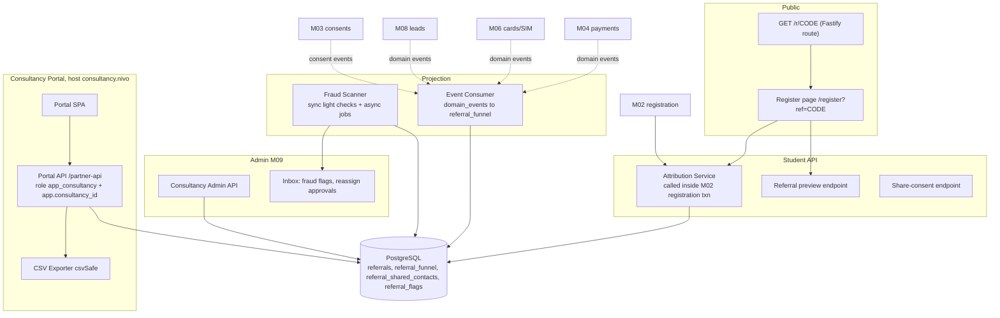
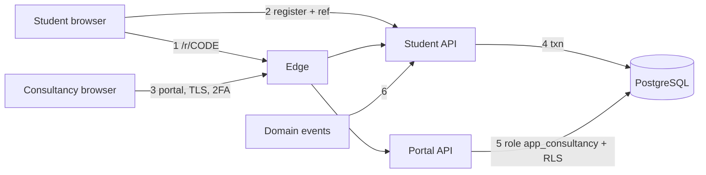

# HLD: M10 — Consultancy (Referral Attribution and Isolated Dashboard)

| Field | Value |
|-------|-------|
| Module | M10 |
| Status | Review |
| Owner | NIVO Platform team |
| Last updated | 2026-11-24 |
| Requirements | REQ-CON-01..08, REQ-AUTH-05 (consultancy half), REQ-SEC-01 |
| Companion docs | `lld.md`; M09 (`hld.md`, `permissions.md`) for admin side; M02 for registration; M03 for consent records; M11 for email |

## 1. Purpose and scope

Consultancies (education agents) refer students to NIVO. M10 lets an admin create a consultancy with a referral code, attributes students to it at registration, and gives each consultancy a dashboard that shows **only its own students, pseudonymised**, with funnel counts and a CSV export. It also detects abusive referral patterns for human review.

**In scope**

- Consultancy records, status lifecycle, referral code, link and QR, agreement/DPA dates, optional commission note (Phase 2 holds real terms).
- `/r/CODE` → `/register?ref=CODE` redirect; "Referred by" prefilled and editable field; attribution saved in the registration transaction; **locked** afterwards; admin override only through approval.
- Optional student consent "share my progress with my consultancy" (unticked) controlling email/phone visibility.
- Consultancy user accounts with mandatory 2FA on a separate host and cookie scope.
- Funnel projection (`referral_funnel`), pseudonymised reporting view, dashboard API, charts, filters, formula-safe CSV export.
- Row Level Security on `consultancy_id`, dedicated low-privilege DB role, API checks, tests.
- Anti-fraud flags: self-referral, duplicates, bursts, code probing; admin review; no automatic penalty against students.
- Admin-side stats, reassign (approval-gated), suspend/reactivate.

**Out of scope**

- Commission calculation and payouts (Phase 2); only a free-text internal note and flag hooks are provided.
- Consultancy–student messaging; consultancy access to documents, identity, payment or accommodation details.
- Cookie/localStorage-based attribution (rejected, ADR in §8).
- The consultancy agreement/AVV legal text itself (lawyer deliverable; M10 records that it exists).

## 2. Requirements covered

New IDs (★) are proposed additions to `00-traceability.md`.

| ID | Statement | Priority | Tests |
|----|-----------|----------|-------|
| REQ-CON-01 | Referral link `/r/CODE` redirects to `/register?ref=CODE`; code attributed to the student at registration | Must | T-CON-001..009 |
| REQ-CON-02 | A consultancy sees only its own students; enforced by RLS on `consultancy_id` plus API checks plus tests | Must | T-CON-010..019 |
| REQ-CON-03 ★ | Admin creates a consultancy (name, contact, unique referral code, link, QR, status active/suspended, optional commission note); activation requires recorded agreement and DPA | Must | T-CON-050..055 |
| REQ-CON-04 ★ | Code stays in the URL through registration with a pre-filled editable "Referred by" field; no cookies or storage; code locked after registration; change only by admin with approval and audit | Must | T-CON-001..006 |
| REQ-CON-05 ★ | Dashboard shows funnel counts and pseudonymised students (no passport, address, payment details; email/phone only with the student's share consent), date filters, charts | Must | T-CON-020..029 |
| REQ-CON-06 ★ | Anti-fraud flags: self-referral, duplicates, suspicious bursts, code probing; reviewed by admin | Must | T-CON-030..039 |
| REQ-CON-07 ★ | CSV export of the same limited fields, formula-injection safe | Must | T-CON-040..045 |
| REQ-CON-08 ★ | Consultancy users sign in with password + mandatory TOTP on their own host; short sessions | Must | T-CON-056..059 |
| REQ-AUTH-05 | Admin/consultancy 2FA mandatory (consultancy half) | Must | T-CON-056, T-AUTH-040 |

## 3. Component diagram

| Component | Responsibility |
|-----------|----------------|
| Redirect route | `/r/:code` → 302 to `/register?ref=<normalised>`; no cookie; same response for valid/unknown/suspended codes |
| Attribution Service | Validates code, creates `referrals` row inside the registration transaction, records URL code and typed code, share consent, hashed IP prefix; triggers fraud scan job |
| Preview endpoint | Tells the register page whether a code is valid and which consultancy name to show |
| Event Consumer | Idempotent projection of student milestones into `referral_funnel`; manages `referral_shared_contacts` according to consent |
| Fraud Scanner | Creates `referral_flags` and inbox items; never blocks a student |
| Portal API | The only path for consultancy users; runs each request under `SET LOCAL ROLE app_consultancy` with `app.consultancy_id` |
| CSV Exporter | Streams capped CSV with `csvSafe` encoding and audit entry |
| Consultancy Admin API | CRUD, users, suspension, stats, flags, reassign (via M09 approval) |

## 4. Data flows and trust boundaries

| # | Flow | Initiator | Boundary crossed | Data | Notes |
|---|------|-----------|------------------|------|-------|
| 1 | Student follows referral link | Student | Internet → Edge | referral code (non-secret, printed on flyers) | No cookie; `Referrer-Policy: no-referrer` |
| 2 | Registration with referral fields | Student | Internet → App | code(s), share-consent flag, campaign tag | Server derives IP prefix hash; raw IP not stored by M10 |
| 3 | Consultancy login and dashboard | Consultancy user | Internet → Edge → App | credentials; pseudonymised report | Separate host and cookie; 2FA |
| 4 | Attribution write | App | App → DB | referral row | Same transaction as user creation |
| 5 | Dashboard read | App as `app_consultancy` | App → DB | funnel rows for one consultancy | RLS filter + column-limited view; role has no grants on student, payment, identity, lead tables |
| 6 | Event projection | Job | Intra-app | IDs and milestone timestamps | Payload carries event id only |

**Trust boundary specific to M10:** the **consultancy database context** (role `app_consultancy`) is a separate trust zone. Even full SQL injection in a portal endpoint can only read `consultancy_student_report_v` rows for one `consultancy_id`.

## 5. Inputs / outputs to other modules

| From / To | Contract | Failure behaviour |
|-----------|----------|-------------------|
| M02 → M10 | `ReferralService.attributeAtRegistration(tx, studentId, input, ctx)` inside the registration transaction; input `{urlCode?, fieldCode?, campaign?, shareConsent}` | Invalid code → `REFERRAL_CODE_INVALID` field error before user creation; DB error rolls back registration (attribution is cheap and local) |
| M10 → M02 UI | `GET /api/referrals/preview?code=`; register page shows "You were invited by [Name]" | Preview failure → field still usable; server validates again on submit |
| M03 → M10 | Consent record type `consultancy_share` (versioned text); event `consent.changed` | Missing consent record → `share_consent=false` (fail private) |
| M04 → M10 | Events `payment.paid`, `payment.refunded` | Late/missed event: nightly reconcile repairs |
| M06 → M10 | Events `card.completed` (card key), `sim.unlocked`; config key of "card 1" | Same |
| M08 → M10 | Event `lead.created` (accommodation) | Same |
| M05 → M10 | Event `student.deleted` (erasure saga) → strip PII from funnel row, delete shared contact and dedupe keys, null `student_id` | Saga retries; failure alerts (privacy-critical) |
| M09 ↔ M10 | Permissions `consultancies:*`, `exports:consultancy`; approval handler `consultancies.reassign_student`; inbox items `fraud_flag`; audit lib; alerts | Approval failure leaves attribution unchanged |
| M11 ← M10 | Templates `consultancy_invite`, `consultancy_access_suspended`, `referral_flag_notice` | Email failure does not block action |
| M01 → M10 | DB roles (`app_consultancy`), RLS bootstrap, job queue, rate limits, secrets (`dedupe_hmac_key`) | Missing key → fraud dedupe disabled and alert (registration unaffected) |

## 6. External dependencies

| Dependency | Purpose | Fallback |
|------------|---------|----------|
| PostgreSQL 16 RLS and roles | Isolation | None; isolation is mandatory (fail closed: if `app.consultancy_id` is unset the policy returns no rows) |
| `qrcode` library (server-side SVG) | Referral QR | Link still usable; QR regenerated on demand |
| TOTP / Argon2id primitives (M02) | Consultancy 2FA | Recovery codes; admin-assisted reset |
| Disposable-email domain list (static file, updated monthly) | Fraud signal | Signal skipped |
| Email (M11) | Invites, suspension notice | Resend from admin |

## 7. Data classification

| Data | Class | Lawful basis | Retention |
|------|-------|--------------|-----------|
| Consultancy record (name, contact person, contact email/phone, code, agreement dates, commission note) | Internal / Personal (business contact) | Art. 6(1)(b) contract with consultancy; (f) | Life of relationship + 3 years, then anonymise contact fields |
| Consultancy users (email, name, password hash, TOTP secret) | Personal + secret | Art. 6(1)(b)/(f) | Life of account + 12 months |
| `referrals` (student id, code entered, URL code, source, campaign, share consent flag, IP-prefix HMAC) | Personal (pseudonymous link between a student and a referrer) | Art. 6(1)(f) legitimate interest in attributing referrals, with notice at registration; GAP-CON-LAWFUL-BASIS | Life of student record; `ip_prefix_hmac` nulled after 30 days; student link removed on erasure |
| `referral_funnel` (pseudonym id, display name = first name + last initial, country, intake, stage timestamps) | Personal, pseudonymised toward the consultancy | Art. 6(1)(f) (referrer's visibility of progress), minimised; GAP-CON-LAWFUL-BASIS | Until erasure; then PII columns nulled, counts kept as non-personal aggregates |
| `referral_shared_contacts` (email, phone) | Personal | Art. 6(1)(a) consent (separate, unticked, versioned, withdrawable) | Deleted on withdrawal, reassignment, suspension of sharing, or erasure |
| `referral_flags` (hashes, counts, ids) | Internal | Art. 6(1)(f) fraud prevention | 24 months |
| `referral_dedupe_keys` (HMAC of normalised email/phone) | Personal (pseudonymous) | Art. 6(1)(f) | Life of student record; deleted on erasure |
| Dashboard CSV exports | Personal (pseudonymised) | As source | Streamed, not stored; audit holds row count only |

What a consultancy can **never** see: passport data, any identity field, address, payment details (amounts, method, refund state), documents, card-level details, accommodation lead content, admin notes, flags about itself or others. It can see: pseudonym id, first name + last initial, country, intake, funnel stage and stage dates, campaign tag, and email/phone **only** when that student ticked the share consent for that consultancy.

## 8. Key decisions

| Decision | Chosen | Alternatives rejected | Why |
|----------|--------|----------------------|-----|
| Attribution carrier | URL param + pre-filled editable field, no cookie/storage | Cookie or localStorage with consent | No consent banner dependency; plan decision. Accepted loss: if the student leaves before signing up, attribution is lost unless the link is reopened or the code is typed (GAP-CON-ATTR-LOSS, accepted) |
| What counts as the code | Field value at submit; URL code stored too | URL only | Student's explicit edit wins; both stored for dispute resolution |
| Invalid code at submit | Field error `REFERRAL_CODE_INVALID`; student can clear and continue | Silently drop; block registration | Avoid silent attribution loss while never trapping the student |
| Lock | DB column privileges: app role cannot update attribution columns; only a SECURITY DEFINER function used by the approved override handler can | App-level only | Cannot be bypassed by a bug; matches "changes only by admin with an audit entry" |
| Isolation mechanism | RLS on `consultancy_id` + dedicated DB role `app_consultancy` + column-limited view + API checks | API checks only; separate DB | Defence in depth; SQL injection in portal cannot reach student tables |
| Source of dashboard data | Own projection tables fed by events, rebuilt by reconcile job | Live views over student tables | Plan rule: "only through a pseudonymised reporting view; never through the student tables" |
| Pseudonym id | Random `S-XXXXXXXXXX` (Crockford base32, 50 bits) stored, unique | Hash of student id | Not derivable; admin can look up by it |
| Contact sharing | Separate table populated only on consent; removed on withdrawal/reassign | Column in funnel row gated by flag | Data exists only while justified; simple to delete |
| Reassignment | Resets share consent for the new consultancy, removes old shared contact | Carry consent over | Consent was given to a specific recipient |
| Fraud response | Flags + human review; never auto-block students | Auto-reject registrations | Students are not at fault; false positives would cost conversions |
| Consultancy host | `consultancy.<domain>`, own cookie `__Host-nivo_cons_sid` | Path `/consultancy` in admin host | Cookie path is not a boundary; lower-trust users isolated from admin origin (plan says "separate area of the admin app": same repo and design system, separate host) |
| CSV | Synchronous capped stream, `csvSafe` | Stored files; XLSX | Nothing persisted; formula-injection controlled in one function |
| Consultancy activation | Requires agreement and DPA dates | Allow before paperwork | Plan: AVV/data-sharing clause needed before sharing data |

## 9. Failure modes (summary)

| Failure | Impact | Detection | Recovery |
|---------|--------|-----------|----------|
| Cross-consultancy data exposure (policy bug) | Privacy breach | RLS test matrix T-CON-010..019 in CI; canary student rows per tenant in staging | Disable portal, incident process |
| Student leaves before registering | Attribution lost | Metrics: `/r/` hits vs referred registrations | Accepted; consultancy can give typed code; admin override with approval |
| Typed code with look-alike characters | Wrong or no attribution | Crockford normalisation; preview shows consultancy name | Student sees name before submitting |
| Event missed or out of order | Funnel counts wrong | Nightly `referrals.reconcile` diff; alert if drift > 0 | `referrals.rebuild_funnel` |
| Self-referral / fake accounts / bursts | Inflated numbers, future commission fraud | Fraud flags | Admin review; suspend consultancy; confirm flags |
| Consultancy suspended mid-funnel | Dashboard blocked; students unaffected | Status check on every portal request | Reactivate; attribution unchanged |
| CSV formula injection via display name | Code execution in spreadsheet app | `csvSafe` property tests | Patch helper |
| Consent withdrawn but contact still visible | Privacy breach | Contact row deleted in same txn as consent change; test T-CON-024 | Hotfix + incident |
| Erasure leaves PII in projection | Art. 17 breach | Saga test T-CON-061 | Re-run saga step |
| Consultancy 2FA lost | Locked out | Recovery codes | Admin reset with approval trail |
| Code enumeration | Consultancy discovery | Uniform redirect; probe rate limit + flag | Block IP at edge |
| Referral link health (`/r/` down) | Lost referrals | Uptime check | Standard ops |

## 10. Security and privacy controls (summary)

| Control ID | Control | Layer | Mitigates |
|------------|---------|-------|-----------|
| CTRL-CON-ATTR | Attribution in registration txn; URL + editable field; lock via column privileges and SECURITY DEFINER override function; `referral_changes` history | API, DB | RISK-CON-ATTR-TAMPER |
| CTRL-CON-RLS | RLS on `consultancy_id`, role `app_consultancy`, column-limited view, fail-closed GUC, API ownership checks, generated isolation tests | DB, API, CI | RISK-CON-CROSS-TENANT |
| CTRL-CON-PSEUDO | Pseudonym id, first name + last initial only, contact only with consent, no identity/payment/address | API, DB | RISK-CON-OVEREXPOSURE |
| CTRL-CON-CONSENT | Separate unticked versioned consent; contact rows tied to consent lifecycle | API, DB, M03 | RISK-CON-OVEREXPOSURE |
| CTRL-CON-FRAUD | Flags, thresholds, review inbox, no auto-block, redacted evidence | Jobs, API | RISK-CON-FRAUD |
| CTRL-CON-CSV | `csvSafe`, row cap, audit, no storage | API | RISK-CON-CSV-INJECTION |
| CTRL-CON-AUTH | Mandatory TOTP, separate host/cookie, 30 min idle, 12 h absolute, max 2 sessions, lockout, invite-only | Edge, API | RISK-CON-ACCOUNT-TAKEOVER |
| CTRL-CON-ERASURE | Funnel PII nulling, contact/dedupe key deletion on `student.deleted` | Jobs, DB | RISK-CON-ERASURE-GAP |
| CTRL-CON-AGREEMENT | Activation CHECK requires agreement and DPA dates | DB | RISK-CON-NO-CONTRACT |

Asset → control → risk:

| Asset | Controls | Risks |
|-------|----------|-------|
| Referral attribution | CTRL-CON-ATTR | RISK-CON-ATTR-TAMPER |
| Consultancy report data | CTRL-CON-RLS, CTRL-CON-PSEUDO | RISK-CON-CROSS-TENANT, RISK-CON-OVEREXPOSURE |
| Shared contact data | CTRL-CON-CONSENT, CTRL-CON-ERASURE | RISK-CON-OVEREXPOSURE, RISK-CON-ERASURE-GAP |
| Consultancy credentials | CTRL-CON-AUTH | RISK-CON-ACCOUNT-TAKEOVER |
| Exports | CTRL-CON-CSV | RISK-CON-CSV-INJECTION |
| Referral integrity | CTRL-CON-FRAUD | RISK-CON-FRAUD |

## 11. Test strategy

- **Unit:** code normalisation (property), attribution decision table, pseudonym generator, `csvSafe` (fast-check), display-name derivation, fraud rule functions, consultancy state machine.
- **Integration (Testcontainers):** RLS and role grants with two seeded consultancies (A/B) and canary rows; column-privilege lock on `referrals`; SECURITY DEFINER override; event projection idempotency and reorder; consent lifecycle; erasure saga step; fraud thresholds.
- **Isolation matrix (generated):** every portal endpoint × consultancy A session × consultancy B ids → 404/empty; SQL probes as `app_consultancy` against every non-granted table → permission denied.
- **Security:** IDOR on pseudonym ids, injection attempts in filters, CSV payloads in names, session/cookie checks (host binding), redirect behaviour (`/r/` uniform response, no open redirect: code only ever placed in query string of a fixed path).
- **E2E (Playwright):** flyer link → register with prefilled field → edit → consent tick → portal shows new student; suspended consultancy; export opens safely in a CSV parser test.
- **Mutation:** attribution, RLS policy generator, `csvSafe`, fraud rules.
- Test IDs T-CON-001..069 in `lld.md` §11.

## 12. Open questions

| ID | Question | Owner | Status |
|----|----------|-------|--------|
| GAP-CON-LAWFUL-BASIS | Is Art. 6(1)(f) sufficient for showing first name + last initial, country, intake and stage to the referring consultancy without consent, or must the name also require the share consent? Default config `name_requires_consent=false` per plan; switchable | Lawyer | Open (**High**) |
| GAP-CON-AGREEMENT | Consultancy agreement incl. AVV/data-sharing clause, commission terms (Phase 2), visibility rules; student privacy notice wording ("you were invited by X") | Lawyer / product owner | Open (Medium) |
| GAP-CON-IP-NOTICE | IP-prefix HMAC for burst detection needs a mention in the Privacy Policy (30-day retention) | Lawyer | Open (Medium) |
| GAP-CON-ATTR-LOSS | Attribution lost if student leaves before registering (no cookies) | Product owner | Accepted (Low) |
| GAP-CON-CODE-ROTATION | Rotating a leaked code without breaking printed material (alias codes) | M10 | Open (Low), Phase 2 |
| GAP-CON-NAME-PARSING | First-name / last-initial derivation for mononyms and multi-part names | M10 | Open (Low) |
| GAP-CON-THRESHOLDS | Burst thresholds are initial guesses; tune with launch data | M10 / ops | Open (Low) |
| GAP-CON-DEDUPE-SCOPE | Duplicate detection covers only referred students; an organic user re-registering via alias is not matched | M10 | Open (Low) |
