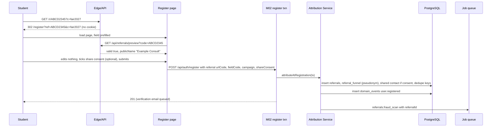
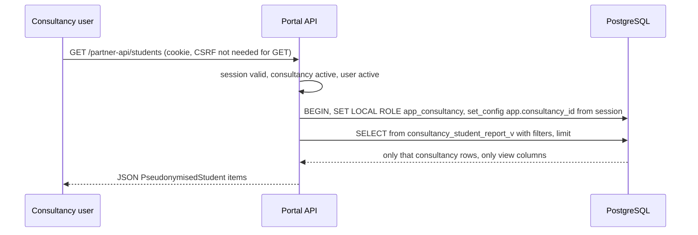
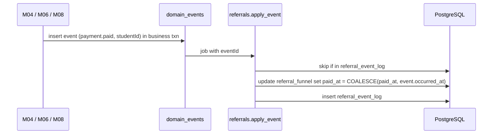
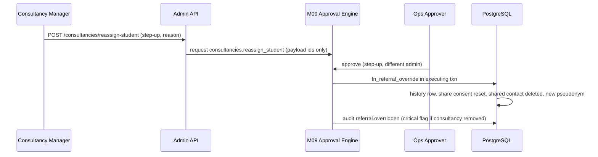

# LLD: M10 — Consultancy (Referral Attribution and Isolated Dashboard)

| Field | Value |
|-------|-------|
| Module | M10 |
| Status | Review |
| Depends on HLD | `hld.md` |
| Also depends on | M09 `lld.md` (approvals, audit, sessions pattern), M02 registration, M03 consents |
| Last updated | 2026-11-24 |

Conventions as in M09 LLD: UTC `timestamptz`, `uuid` ids, Zod `.strict()`, `Cache-Control: no-store` on authenticated responses. Hosts: student app `<domain>`, admin `admin.<domain>`, consultancy portal `consultancy.<domain>`. Portal API prefix `/partner-api`; admin API prefix `/admin-api`.

## 1. Database

### Tables

| Table | Column | Type | Constraints | Notes |
|-------|--------|------|-------------|-------|
| `consultancies` | id | uuid | PK | |
| | code | text | UNIQUE NOT NULL, CHECK `^[0-9A-HJKMNP-TV-Z]{4,12}$` | Crockford base32 alphabet (no I, L, O, U); generated 8 chars by default; admin may set a custom code in the same alphabet; reserved list rejected (`NIVO`, `ADMIN`, `TEST`, …); **immutable** |
| | name | text | NOT NULL, CHECK length 2..100, UNIQUE (`lower(name)`) | Internal name |
| | public_name | text | NOT NULL, CHECK length 2..60 | Shown to students ("You were invited by …") |
| | legal_name | text | | |
| | contact_name | text | NOT NULL | |
| | contact_email | citext | NOT NULL | Used by self-referral check |
| | contact_phone | text | CHECK E.164 pattern | Used by self-referral check |
| | status | consultancy_status | NOT NULL DEFAULT `pending_agreement` | `pending_agreement`, `active`, `suspended`, `archived` |
| | agreement_signed_at | date | | |
| | agreement_ref | text | | Document reference (kept off-platform) |
| | dpa_signed_at | date | | AVV / data-sharing clause |
| | dpa_ref | text | | |
| | commission_note | text | CHECK length ≤ 2000 | Internal free text; real terms are Phase 2 |
| | suspended_at / suspended_reason | timestamptz / text | | |
| | created_by | uuid | FK `admin_accounts` NOT NULL | |
| | created_at / updated_at | timestamptz | | |
| | row_version | int | NOT NULL DEFAULT 1 | |
| | | | CHECK `status NOT IN ('active') OR (agreement_signed_at IS NOT NULL AND dpa_signed_at IS NOT NULL)` | No activation without paperwork |
| `consultancy_users` | id | uuid | PK | |
| | consultancy_id | uuid | FK NOT NULL | |
| | email | citext | UNIQUE NOT NULL | |
| | display_name | text | NOT NULL ≤ 80 | |
| | status | text | `invited`,`active`,`disabled` | |
| | password_hash | text | | Argon2id |
| | totp_secret_enc / totp_key_id / totp_enrolled_at / totp_last_step | bytea / text / timestamptz / bigint | | As `admin_accounts` |
| | failed_login_count / locked_until / last_login_at | int / timestamptz / timestamptz | | |
| | invite_token_hash / invite_expires_at | bytea / timestamptz | | 24 h |
| | created_by | uuid | FK `admin_accounts` | |
| | created_at / updated_at / disabled_at | | | |
| | | | CHECK `status <> 'active' OR (password_hash IS NOT NULL AND totp_enrolled_at IS NOT NULL)` | 2FA always on |
| `consultancy_recovery_codes` | id, consultancy_user_id, code_hash, used_at | | FK; single use | |
| `consultancy_sessions` | id | uuid | PK | |
| | token_hash | bytea | UNIQUE NOT NULL | |
| | consultancy_user_id / consultancy_id | uuid / uuid | FK NOT NULL | `consultancy_id` denormalised for GUC |
| | mfa_passed_at | timestamptz | NOT NULL | |
| | created_at / last_seen_at / idle_expires_at / abs_expires_at | timestamptz | NOT NULL | Idle 30 min, absolute 12 h |
| | csrf_token_hash | bytea | NOT NULL | |
| | ip / ua_hash / ua_label | inet / bytea / text | | |
| | revoked_at / revoked_reason | | | |
| `referrals` | id | uuid | PK | |
| | student_id | uuid | UNIQUE, FK `users` ON DELETE SET NULL | One attribution per student; nulled by erasure saga |
| | consultancy_id | uuid | FK NULL | NULL when unattributed |
| | url_code | text | CHECK `^[0-9A-HJKMNP-TV-Z]{4,12}$` or NULL | Normalised code present in the URL at page load |
| | field_code | text | same CHECK, NULL | Normalised code in the field at submit |
| | attribution_source | text | NOT NULL, CHECK in (`link`,`typed`,`admin_override`,`none`) | `link`: field = URL code; `typed`: field set and no/different URL code; `none`: field empty or no code |
| | url_field_mismatch | boolean | NOT NULL DEFAULT false | URL code present and differs from field (informational) |
| | campaign_tag | text | CHECK `^[a-z0-9_-]{1,32}$` or NULL | |
| | share_consent | boolean | NOT NULL DEFAULT false | CHECK `NOT share_consent OR consultancy_id IS NOT NULL` |
| | share_consent_version | text | | M03 consent text version |
| | share_consent_at | timestamptz | | |
| | ip_prefix_hmac | bytea | NULL | HMAC of /24 (IPv4) or /48 (IPv6) with `dedupe_hmac_key`; nulled after 30 days |
| | created_at | timestamptz | NOT NULL | Registration time |
| | locked_at | timestamptz | NOT NULL DEFAULT now() | Attribution locked from creation |
| | | | CHECK `consultancy_id IS NOT NULL OR attribution_source = 'none'` | |
| `referral_changes` | id | uuid | PK | Immutable history |
| | referral_id | uuid | FK NOT NULL | |
| | from_consultancy_id / to_consultancy_id | uuid / uuid | FK NULL | |
| | approval_request_id | uuid | FK `approval_requests` NOT NULL | |
| | reason | text | NOT NULL | |
| | changed_by / changed_at | uuid / timestamptz | | |
| `referral_funnel` | id | uuid | PK | Projection, one row per referred student |
| | referral_id | uuid | UNIQUE FK NOT NULL | |
| | student_id | uuid | UNIQUE NULL | Nulled on erasure |
| | consultancy_id | uuid | FK NOT NULL | RLS key |
| | pseudonym_id | text | UNIQUE NOT NULL, CHECK `^S-[0-9A-HJKMNP-TV-Z]{10}$` | Random; regenerated on reassignment |
| | display_name | text | NULL | First name + last initial, ≤ 24 chars; NULL after erasure |
| | country | char(2) | NULL | NULL after erasure |
| | intake_term | text | NULL | From M02 intake value; NULL after erasure |
| | campaign_tag | text | NULL | |
| | registered_at | timestamptz | NOT NULL | |
| | email_verified_at | timestamptz | | Stage timestamps set once (COALESCE) |
| | paid_at | timestamptz | | Admin and consultancy see only that the stage was reached |
| | refunded_at | timestamptz | | **Admin only** (excluded from consultancy view) |
| | card1_completed_at | timestamptz | | |
| | sim_unlocked_at | timestamptz | | |
| | accommodation_lead_at | timestamptz | | Only the fact that a lead exists |
| | erased_at | timestamptz | | |
| | updated_at | timestamptz | NOT NULL | |
| `referral_shared_contacts` | referral_id | uuid | PK, FK | Exists only while consent is active |
| | consultancy_id | uuid | FK NOT NULL | RLS key |
| | email | citext | NOT NULL | |
| | phone | text | | E.164 |
| | consent_version / consented_at / updated_at | text / timestamptz / timestamptz | | |
| `referral_dedupe_keys` | id | uuid | PK | |
| | referral_id | uuid | FK NOT NULL ON DELETE CASCADE | |
| | kind | text | `email`,`phone` | |
| | key_hmac | bytea | NOT NULL | HMAC-SHA256 of normalised value |
| | created_at | timestamptz | | |
| `referral_flags` | id | uuid | PK | |
| | consultancy_id / referral_id | uuid / uuid | FK NULL | |
| | flag_type | text | CHECK in (`self_referral`,`self_referral_domain`,`duplicate_contact`,`burst_registrations`,`burst_ip`,`disposable_email`,`code_probe`,`suspended_code_use`,`refund_after_paid`) | |
| | severity | text | `low`,`medium`,`high` | |
| | evidence | jsonb | NOT NULL | Counts, window, ids, hashes. **No raw email/phone/IP** |
| | status | text | `open`,`confirmed`,`dismissed` | |
| | dedupe_key | text | UNIQUE NOT NULL | e.g. `burst:{consultancyId}:{hourBucket}` |
| | inbox_item_id | uuid | FK NULL | For severity ≥ medium |
| | created_at / reviewed_by / reviewed_at / review_note | | | |
| `referral_event_log` | event_id | uuid | PK | Idempotency of projection |
| | applied_at | timestamptz | NOT NULL | |

Platform tables used: `domain_events` (M01), `users` / `student_profiles` (M02), `consents` (M03), `approval_requests` (M09), `audit_log` (M09), `rate_limit_counters` (M01).

### Reporting view and DB roles

```sql
-- roles
CREATE ROLE app_consultancy NOLOGIN;          -- API does SET LOCAL ROLE app_consultancy per portal txn
CREATE ROLE nivo_report_owner NOLOGIN;        -- owns the view; SELECT only on referral_funnel + referral_shared_contacts

CREATE VIEW consultancy_student_report_v WITH (security_barrier = true) AS
SELECT f.pseudonym_id,
       f.display_name,
       f.country,
       f.intake_term,
       f.campaign_tag,
       f.registered_at, f.email_verified_at, f.paid_at,
       f.card1_completed_at, f.sim_unlocked_at,
       (f.accommodation_lead_at IS NOT NULL) AS has_accommodation_lead,
       f.accommodation_lead_at,
       CASE WHEN f.sim_unlocked_at      IS NOT NULL THEN 'sim_unlocked'
            WHEN f.card1_completed_at   IS NOT NULL THEN 'card1_completed'
            WHEN f.paid_at              IS NOT NULL THEN 'paid'
            WHEN f.email_verified_at    IS NOT NULL THEN 'email_verified'
            ELSE 'registered' END                AS stage,
       c.email  AS contact_email,   -- NULL unless a shared-contact row exists (consent)
       c.phone  AS contact_phone
FROM referral_funnel f
LEFT JOIN referral_shared_contacts c ON c.referral_id = f.referral_id
WHERE f.consultancy_id = NULLIF(current_setting('app.consultancy_id', true), '')::uuid;

ALTER VIEW consultancy_student_report_v OWNER TO nivo_report_owner;
REVOKE ALL ON ALL TABLES IN SCHEMA public FROM app_consultancy;
GRANT SELECT ON consultancy_student_report_v TO app_consultancy;
GRANT SELECT (id, public_name, code, status) ON consultancies TO app_consultancy;   -- own row via RLS
```

`refunded_at`, `student_id`, `referral_id`, flags and every other table are not reachable from `app_consultancy`. The view's `WHERE` clause is deliberately redundant with RLS (belt and braces) and fails closed: an unset GUC yields `NULL`, which matches no rows.

### Column privileges (lock on attribution)

```sql
REVOKE UPDATE ON referrals FROM app_api;
GRANT  UPDATE (share_consent, share_consent_version, share_consent_at, ip_prefix_hmac, student_id) ON referrals TO app_api;
GRANT  INSERT, SELECT ON referrals TO app_api;
GRANT  INSERT, SELECT ON referral_changes TO app_api;    -- no UPDATE/DELETE
```

Attribution columns (`consultancy_id`, `url_code`, `field_code`, `attribution_source`, `url_field_mismatch`, `campaign_tag`, `locked_at`) can therefore only change through:

```sql
CREATE FUNCTION fn_referral_override(p_referral uuid, p_to uuid, p_request uuid, p_reason text, p_actor uuid)
RETURNS void LANGUAGE plpgsql SECURITY DEFINER SET search_path = public AS $$
  -- 1. approval_requests row p_request must have action_key='consultancies.reassign_student', status='executing',
  --    payload->>'referralId' = p_referral and payload->>'toConsultancyId' = p_to (or both null) else RAISE
  -- 2. insert referral_changes (from, to, request, reason, actor)
  -- 3. update referrals set consultancy_id=p_to, attribution_source='admin_override',
  --        share_consent=false, share_consent_at=NULL, share_consent_version=NULL
  -- 4. delete from referral_shared_contacts where referral_id=p_referral
  -- 5. update referral_funnel set consultancy_id=p_to, pseudonym_id=<new random>, updated_at=now()
  --    (delete funnel row when p_to is NULL)
$$;
REVOKE ALL ON FUNCTION fn_referral_override FROM PUBLIC; GRANT EXECUTE ON FUNCTION fn_referral_override TO app_api;
```

### Indexes

| Index | Purpose |
|-------|---------|
| `consultancies (code)` unique; `(status)` | Redirect lookup, lists |
| `referral_funnel (consultancy_id, registered_at DESC)` | Dashboard list and funnel |
| `referral_funnel (consultancy_id, paid_at)`, `(consultancy_id, card1_completed_at)`, `(consultancy_id, sim_unlocked_at)`, `(consultancy_id, email_verified_at)` | Time series per stage |
| `referral_funnel (pseudonym_id)` unique | Search |
| `referrals (consultancy_id, created_at)`; `(ip_prefix_hmac, created_at) WHERE ip_prefix_hmac IS NOT NULL` | Burst checks |
| `referral_dedupe_keys (kind, key_hmac)` | Duplicate checks |
| `referral_flags (status, severity, created_at)`; `(consultancy_id, status)` | Review lists |
| `consultancy_sessions (consultancy_user_id) WHERE revoked_at IS NULL` | Session cap |
| `consultancy_users (consultancy_id)` | Users list |

### RLS policies

All tables below: `ENABLE` and `FORCE ROW LEVEL SECURITY`; policies are `TO PUBLIC` (predicates use GUCs, so they also bind the view owner).

| Table | Policy |
|-------|--------|
| `referral_funnel`, `referral_shared_contacts` | `USING (consultancy_id = NULLIF(current_setting('app.consultancy_id', true), '')::uuid OR current_setting('app.actor_kind', true) IN ('admin','system'))`; `WITH CHECK (current_setting('app.actor_kind', true) IN ('admin','system'))` — the portal is read-only |
| `consultancies` | `USING (id = NULLIF(current_setting('app.consultancy_id', true), '')::uuid OR current_setting('app.actor_kind', true) IN ('admin','system'))` |
| `consultancy_users`, `consultancy_sessions`, `consultancy_recovery_codes` | `USING (current_setting('app.actor_kind', true) IN ('admin','system'))` (portal auth runs as `system` before a session exists; afterwards the portal never reads these) |
| `referrals`, `referral_changes`, `referral_dedupe_keys`, `referral_flags`, `referral_event_log` | `USING (current_setting('app.actor_kind', true) IN ('admin','system'))`; students may insert their own `referrals` row only through the registration function running as `system` |

Portal transaction preamble:

```sql
BEGIN;
SET LOCAL ROLE app_consultancy;
SELECT set_config('app.actor_kind', 'consultancy', true),
       set_config('app.consultancy_id', $1, true);   -- taken from the session row, never from request input
```

## 2. API endpoints

`SU` = admin step-up required (M09). Portal routes use the `consultancy-session` guard: valid `__Host-nivo_cons_sid`, CSRF header on mutations, consultancy `status = 'active'`, user `active`; any other state → `UNAUTHORIZED`; a missing or wrong CSRF header on a mutation → `CSRF_INVALID`. Default rate limits: portal 60 req/min per session; public routes per IP as stated.

### 2.1 Public and student routes

| Method | Path | Permission | Request | Response | Errors | Rate limit | Idempotency |
|--------|------|------------|---------|----------|--------|------------|-------------|
| GET | `/r/:code` (not `/api`) | public | Optional `?c=tag` | **Always** `302` to `/register?ref=<normalised>[&c=<tag>]` when `:code` matches the code format after normalisation, else `302 /register`. Headers: `Cache-Control: no-store`, `Referrer-Policy: no-referrer`; no `Set-Cookie`. Unknown, suspended and pending codes behave identically | — | 60 / min per IP; ≥ 20 distinct unknown codes / min → `code_probe` flag + edge block | n/a |
| GET | `/api/referrals/preview` | public | `?code=` | `{valid:true, publicName}` or `{valid:false}` (constant-time lookup, same latency) | `RATE_LIMITED` | 30 / min per IP | — |
| POST | `/api/auth/register` (owned by M02; referral part) | public | adds `referral: ReferralInput` | M02 response; M10 runs inside the same transaction | `REFERRAL_CODE_INVALID` (field error), `VALIDATION_FAILED` | M02 limits | M02 |
| GET | `/api/me/referral` | student-session | — | `{referredBy:{publicName}|null, shareConsent, lockedAt}` | | 30 / min | — |
| PUT | `/api/me/referral/share-consent` | student-session | `{granted:boolean}` | 200 `{shareConsent}`; writes M03 consent record, updates `referrals`, upserts/deletes `referral_shared_contacts` in one transaction | `CONFLICT` (not attributed) | 10 / h | ✓ (naturally idempotent) |

### 2.2 Consultancy portal (`/partner-api`, host `consultancy.<domain>`)

| Method | Path | Permission | Request | Response | Errors | Rate limit | Idempotency |
|--------|------|------------|---------|----------|--------|------------|-------------|
| POST | `/auth/login` | public | `{email,password}` | `{challengeId}` (uniform for unknown email) | `AUTH_INVALID_CREDENTIALS`, `AUTH_LOCKED` | 5 / 15 min per IP+email | — |
| POST | `/auth/login/totp` / `/auth/login/recovery` | challenge | `{challengeId, code|recoveryCode}` | cookie + `{csrfToken}` | `AUTH_2FA_INVALID`, `AUTH_LOCKED` | 5 / challenge | — |
| POST | `/auth/invite/accept` / `/auth/invite/enroll` | invite token | as M09 | enrolment secret once; recovery codes once | `AUTH_TOKEN_INVALID`, `AUTH_2FA_INVALID` | 10 / h | — |
| POST | `/auth/logout` | session | — | 204 | | 30 / min | ✓ |
| GET | `/me` | session | — | `{displayName, consultancy:{publicName, code}, idleExpiresAt}` | | 60 / min | — |
| GET | `/funnel` | session | `FunnelQuery` (`from`, `to`, `campaign?`, `country?`, `intake?`) | `{registered, emailVerified, paid, card1Completed, simUnlocked, accommodationLead, conversion:{…}}` — "reached" counts, no payment amounts | `VALIDATION_FAILED` | 60 / min | — |
| GET | `/timeseries` | session | `?metric=registered|emailVerified|paid|card1Completed|simUnlocked|accommodationLead&granularity=day|week&from&to` | `[{bucket, count}]` UTC buckets | `VALIDATION_FAILED` (range > 24 months) | 60 / min | — |
| GET | `/students` | session | `StudentsQuery` (`stage`, `country`, `intake`, `campaign`, `from`, `to`, `q` exact pseudonym or display-name prefix ≥ 2 chars, `cursor`, `limit ≤ 100`) | `{items:[PseudonymisedStudent], nextCursor}` | | 60 / min | — |
| GET | `/export.csv` | session | same filters as `/students` | CSV stream (§5), max 10 000 rows; `Content-Disposition: attachment; filename="nivo-students-<CODE>-<YYYYMMDD>.csv"`; `X-Content-Type-Options: nosniff` | `EXPORT_LIMIT_EXCEEDED` | 5 / h per user | — |
| GET | `/referral-link` | session | `?c=tag` | `{url:"https://<domain>/r/<CODE>[?c=tag]"}` | `VALIDATION_FAILED` | 60 / min | — |
| GET | `/referral-link/qr.svg` | session | `?c=tag` | `image/svg+xml`, error correction M, quiet zone 4 | `VALIDATION_FAILED` | 30 / min | — |

`PseudonymisedStudent` = `{pseudonymId, displayName, country, intake, stage, hasAccommodationLead, campaign, registeredAt, emailVerifiedAt, paidAt, card1CompletedAt, simUnlockedAt, contact?: {email, phone}}` (`contact` only present when the student consented for this consultancy).

### 2.3 Admin side (`/admin-api`, permissions per `permissions.md`)

| Method | Path | Permission | Request | Response | Errors | Rate limit | Idempotency |
|--------|------|------------|---------|----------|--------|------------|-------------|
| GET | `/consultancies` | `consultancies:read` | `?status&q&cursor` | list with counts | | 60 / min | — |
| POST | `/consultancies` | `consultancies:manage` + SU | `ConsultancyCreate` | 201 `{id, code, link}` (status `pending_agreement`) | `CONFLICT` (code/name), `VALIDATION_FAILED` | 10 / h | ✓ |
| GET | `/consultancies/:id` | `consultancies:read` | — | detail incl. stats summary | `NOT_FOUND` | 60 / min | — |
| PATCH | `/consultancies/:id` | `consultancies:manage` + SU | `ConsultancyUpdate` + `rowVersion` (code not editable) | 200 | `CONFLICT` | 20 / h | — |
| POST | `/consultancies/:id/activate` | `consultancies:manage` + SU | `{reason}` | 200 | `CONFLICT` (agreement/DPA dates missing) | 10 / h | ✓ |
| POST | `/consultancies/:id/suspend` | `consultancies:manage` + SU | `{reason}` | 200; sessions revoked; alert to Super Admins; email to contact | `CONFLICT` | 10 / h | ✓ |
| POST | `/consultancies/:id/reactivate` | `consultancies:manage` + SU | `{reason}` | 200 | `CONFLICT` | 10 / h | ✓ |
| POST | `/consultancies/:id/archive` | `consultancies:manage` + SU | `{reason}` | 200 (must be suspended first) | `CONFLICT` | 5 / h | ✓ |
| GET | `/consultancies/:id/users` | `consultancies:read` | | list | | 60 / min | — |
| POST | `/consultancies/:id/users` | `consultancies:users:manage` + SU | `{email, displayName}` | 201 invite sent | `CONFLICT` | 10 / h | ✓ |
| POST | `/consultancies/:id/users/:uid/disable` / `/reset-2fa` | `consultancies:users:manage` + SU | `{reason}` | 200 | `NOT_FOUND` | 10 / h | ✓ |
| GET | `/consultancies/:id/stats` | `consultancies:read` | `FunnelQuery` | funnel including refunded counts and per-campaign split | | 30 / min | — |
| GET | `/consultancies/:id/students` | `consultancies:read` | as portal `StudentsQuery` | pseudonymised list (same fields as portal; admin sees `referralId` for lookups) | | 60 / min | — |
| GET | `/consultancies/:id/referral-link` / `/qr.svg` | `consultancies:read` | `?c=` | as portal | | 60 / min | — |
| GET | `/consultancies/:id/export.csv` | `exports:consultancy` + SU | filters | CSV as portal (admin audit action) | `EXPORT_LIMIT_EXCEEDED` | 5 / h | — |
| GET | `/students/:studentId/referral` | `students:read` | — | referral record, history, flags (no consultancy PII beyond name) | `NOT_FOUND` | 60 / min | — |
| POST | `/consultancies/reassign-student` | `consultancies:reassign_student` + SU, approval `consultancies.reassign_student` | `ReassignRequest` | 202 `{approvalRequestId}` | `CONFLICT`, `NOT_FOUND` | 10 / h | ✓ |
| GET | `/referral-flags` | `consultancies:fraud:review` | `?status&severity&consultancyId&cursor` | flags with evidence | | 60 / min | — |
| POST | `/referral-flags/:id/review` | `consultancies:fraud:review` | `{decision:'confirmed'|'dismissed', note}` | 200 | `CONFLICT` | 30 / min | ✓ |

### Zod schemas

```ts
// packages/shared/src/consultancy.ts
const Code = z.string().trim().min(4).max(24)
  .transform(normaliseCode)                      // upper-case, strip spaces and '-', O→0, I/L→1
  .refine((c) => /^[0-9A-HJKMNP-TV-Z]{4,12}$/.test(c), 'invalid code');

export const ReferralInput = z.object({
  urlCode: Code.optional(),                      // value of ?ref= when the page loaded
  fieldCode: Code.optional(),                    // value of the editable "Referred by" field at submit
  campaign: z.string().regex(/^[a-z0-9_-]{1,32}$/).optional(),
  shareConsent: z.boolean().default(false),      // checkbox is rendered only when preview said valid
}).strict();

export const ConsultancyCreate = z.object({
  name: z.string().trim().min(2).max(100),
  publicName: z.string().trim().min(2).max(60),
  legalName: z.string().trim().max(150).optional(),
  contactName: z.string().trim().min(2).max(80),
  contactEmail: z.string().email().max(254),
  contactPhone: z.string().regex(/^\+[1-9]\d{6,14}$/).optional(),
  customCode: z.string().regex(/^[0-9A-HJKMNP-TV-Z]{4,12}$/).optional(),   // else generated
  commissionNote: z.string().max(2000).optional(),
  agreementSignedAt: z.string().date().optional(),
  agreementRef: z.string().max(80).optional(),
  dpaSignedAt: z.string().date().optional(),
  dpaRef: z.string().max(80).optional(),
}).strict();

export const FunnelQuery = z.object({
  from: z.string().date().optional(),
  to: z.string().date().optional(),
  campaign: z.string().regex(/^[a-z0-9_-]{1,32}$/).optional(),
  country: z.string().regex(/^[A-Z]{2}$/).optional(),
  intake: z.string().max(20).optional(),
}).strict().refine(rangeWithin24Months, 'range too long');

export const StudentsQuery = FunnelQuery.extend({
  stage: z.enum(['registered','email_verified','paid','card1_completed','sim_unlocked']).optional(),
  q: z.string().trim().min(2).max(40).optional(),
  cursor: z.string().max(200).optional(),
  limit: z.number().int().min(1).max(100).default(50),
}).strict();

export const ReassignRequest = z.object({
  studentId: z.string().uuid(),
  toConsultancyId: z.string().uuid().nullable(),     // null = remove attribution
  reason: z.string().trim().min(10).max(1000),
}).strict();

export const ShareConsentInput = z.object({ granted: z.boolean() }).strict();
```

Proposed additions to `00-error-catalog.md` (not applied here):

| Code | HTTP | When | User message |
|------|------|------|--------------|
| `REFERRAL_CODE_INVALID` | 422 | Code unknown, suspended, pending or malformed at registration | We don't recognise this referral code. Check it or clear the field to continue. |
| `EXPORT_LIMIT_EXCEEDED` | 422 | More than 10 000 rows | Too many rows. Narrow the date range or filters. |

## 3. State machines

### 3.1 Consultancy

| From | Event | To | Side effects |
|------|-------|----|--------------|
| (none) | admin creates | `pending_agreement` | Code issued; `/r/CODE` redirects but **no attribution** (code treated as invalid) |
| `pending_agreement` | activate (CHECK: agreement + DPA dates) | `active` | Audit; users may log in; code valid |
| `active` | suspend | `suspended` | Sessions revoked; code invalid for new registrations; email to contact; alert; existing attributions and projection untouched |
| `suspended` | reactivate | `active` | Audit |
| `suspended` | archive | `archived` | Users disabled; code stays reserved forever; data retained per §7 HLD |

No transition out of `archived`. `pending_agreement → suspended` is not allowed.

### 3.2 Referral attribution (immutable)

`created` (at registration) → `locked` immediately. The only mutation is `fn_referral_override` (approved), which writes `referral_changes`, resets share consent and re-pseudonymises. A student can never change attribution; the Profile page shows it read-only.

Attribution decision table (evaluated by `attributeAtRegistration`):

| `urlCode` | `fieldCode` | Consultancy for `fieldCode` | Result |
|-----------|-------------|-----------------------------|--------|
| none | none | n/a | `none` |
| X | X | active | `link`, consultancy of X |
| X | Y ≠ X | Y active | `typed`, consultancy of Y, `url_field_mismatch=true` |
| X | Y ≠ X | Y unknown/inactive | **422 `REFERRAL_CODE_INVALID`** |
| X | none (cleared) | n/a | `none` (student's choice honoured); `url_code` kept for disputes |
| none | Y | Y active | `typed` |
| any | Y | Y unknown/suspended/pending | **422 `REFERRAL_CODE_INVALID`** |

### 3.3 Fraud flag

`open` → `confirmed` or `dismissed` (terminal). Confirming does not change any student; the reviewer may separately suspend the consultancy or request reassignment.

### 3.4 Consultancy user / session

As M09 admin accounts/sessions, with idle 30 min, absolute 12 h, max 2 concurrent sessions. A user of a non-`active` consultancy cannot log in and existing sessions are revoked on suspension.

## 4. Sequence diagrams

### Happy path A — Referral through registration



### Happy path B — Dashboard request under RLS



### Happy path C — Funnel projection



### Happy path D — Admin reassigns attribution



### Failure paths

| # | Scenario | Behaviour |
|---|----------|-----------|
| F1 | Unknown, suspended or pending code at `/r/` | Same 302 as for a valid code; register page preview says `valid:false`, field stays editable, no consultancy name shown |
| F2 | Code becomes invalid between preview and submit (suspension) | Submit returns 422 `REFERRAL_CODE_INVALID`; form data preserved; student clears field or fixes it |
| F3 | Student typed a look-alike (`O` vs `0`) | Normalised to Crockford; preview shows consultancy name for confirmation |
| F4 | Attribution insert fails | Whole registration rolls back (M02 shows generic error, student retries); no half-registered student |
| F5 | Event missed/duplicated/out of order | `referral_event_log` makes handlers idempotent; `COALESCE` timestamps; nightly reconcile compares counts to source tables and repairs; drift alert |
| F6 | Share consent withdrawn | One transaction: M03 consent record, `referrals.share_consent=false`, delete `referral_shared_contacts` row; next portal request no longer returns contact |
| F7 | Consultancy A requests B's pseudonym or id | Not found (RLS yields 0 rows) — never 403, no existence leak |
| F8 | `app.consultancy_id` missing (bug) | View and policies return no rows (fail closed) |
| F9 | SQL injection in `q` filter | Parameterised queries; and even if exploited, role has SELECT on one view only |
| F10 | Consultancy suspended while logged in | Next request rejected; sessions revoked at suspension; CSV in progress is aborted (stream checks status every 1 000 rows) |
| F11 | Student erased | `referrals.erase_student` job: funnel row `display_name`, `country`, `intake_term`, `student_id` set NULL, `erased_at` set; shared contact and dedupe keys deleted; `referrals.student_id` NULL; counts remain |
| F12 | Fraud scan job fails | Retry 5 times; DLQ alert; registration unaffected |
| F13 | Attempt to update attribution columns from app code | Permission denied by column privileges (T-CON-005) |
| F14 | Approval for override expires | Nothing changes (M09 `expired`) |
| F15 | CSV over row cap | 422 `EXPORT_LIMIT_EXCEEDED`; nothing streamed |

## 5. Validation rules

| Field | Client | API | DB |
|-------|--------|-----|----|
| Referral code (typed/URL) | Upper-case on blur, strip spaces/hyphens, show consultancy name via preview | `Code` schema: trim, upper-case, remove spaces and `-`, map `O→0`, `I,L→1`, validate `^[0-9A-HJKMNP-TV-Z]{4,12}$`; compare against `consultancies.code` where `status='active'` | CHECK pattern, UNIQUE |
| Campaign tag | Pre-filled from URL, hidden | `^[a-z0-9_-]{1,32}$`, else dropped silently (not an error) | CHECK |
| Share consent | Unticked checkbox, visible only with valid code; text from M03 consent version | Boolean; `true` requires a valid attributed consultancy | CHECK `share_consent → consultancy_id NOT NULL` |
| Consultancy name / public name | Length counters | 2..100 / 2..60, no control characters or bidi overrides, unique case-insensitive | CHECK, UNIQUE |
| Contact email | Email format | RFC 5322 practical, ≤ 254, normalised | `citext` |
| Contact phone | libphonenumber → E.164 | `^\+[1-9]\d{6,14}$` | CHECK |
| Custom code | Uppercase, alphabet hint | Alphabet `^[0-9A-HJKMNP-TV-Z]{4,12}$`, not reserved, not already used | UNIQUE |
| Dates (`from`, `to`) | Date pickers | ISO date, `from ≤ to`, range ≤ 24 months, not in the future beyond today | n/a |
| `q` | Min 2 chars | Trim; exact pseudonym `S-…` or display-name prefix (parameterised `ILIKE 'prefix%'` with escaped wildcards) | n/a |
| `limit` / `cursor` | | `1..100`; opaque signed cursor `(registered_at, pseudonym_id)` | n/a |
| Display name | n/a | Derived: first whitespace token (≤ 20 chars, NFC, bidi controls stripped) + space + first letter of last token + `.`; single token → token only | CHECK length ≤ 24 |
| Pseudonym id | n/a | `S-` + 10 random Crockford chars from CSPRNG, retry on collision | UNIQUE, CHECK |
| Reassign target | Searchable list of active consultancies | Student exists, has referral or none; target active or null; differs from current | FKs |
| Fraud review note | | 10..1000 chars | |

### CSV safety (`csvSafe`, `packages/shared/src/csv.ts`)

```ts
const BIDI = /[\u200E\u200F\u202A-\u202E\u2066-\u2069]/g;
const CTRL = /[\u0000-\u0008\u000B\u000C\u000E-\u001F\u007F]/g;
const DANGEROUS_START = /^[\s\u00A0\u1680\u2000-\u200D\u2028\u2029\u202F\u205F\u3000\uFEFF]*[=+\-@\t\r|]/;

export function csvSafe(v: unknown): string {
  if (v === null || v === undefined) return '""';
  if (typeof v === 'number' || typeof v === 'boolean') return `"${String(v)}"`;   // typed values only
  if (v instanceof Date) return `"${v.toISOString()}"`;
  let s = String(v).normalize('NFC').replace(BIDI, '').replace(CTRL, '').replace(/[\r\n\t]+/g, ' ');
  if (DANGEROUS_START.test(s)) s = `'${s}`;          // neutralises =, +, -, @, |, and whitespace-padded variants
  return `"${s.replace(/"/g, '""')}"`;
}
```

Rules: every cell is quoted; header row is static text; rows end with CRLF; file is UTF-8 with BOM; **string** cells (including phone numbers such as `+49…` and display names) go through `csvSafe`, only genuine `number`/`boolean`/`Date` values are exempt; the same helper is used by every M09 export and by the consultancy export (single implementation, T-CON-040..045, T-ADM-091). Excel shows the leading apostrophe as a text marker, so a phone appears as `+49…`.

Export columns (consultancy and admin consultancy export): `pseudonym_id, display_name, country, intake, stage, campaign, registered_at, email_verified_at, paid_at, card1_completed_at, sim_unlocked_at, has_accommodation_lead, contact_email, contact_phone` (the last two are empty unless consented). Dates are ISO-8601 UTC dates. No payment amounts, no refund state, no ids other than the pseudonym.

## 6. Background jobs

Payloads carry IDs only (never email, phone, name or IP).

| Job | Trigger | Retry | Dead letter | Payload rules |
|-----|---------|-------|-------------|---------------|
| `referrals.apply_event` | Domain event inserted (`user.email_verified`, `payment.paid`, `payment.refunded`, `card.completed`, `sim.unlocked`, `lead.created`, `consent.changed`, `user.contact_changed`) | 5, exponential, idempotent via `referral_event_log` | DLQ + alert (lag > 5 min) | `{eventId}` — handler loads event, resolves student, reads contact only when consent requires it |
| `referrals.fraud_scan` | After registration attribution | 5 | DLQ + alert | `{referralId}` |
| `referrals.burst_scan` | Every 5 min | 3 | DLQ | `{}` |
| `referrals.reconcile` | Nightly 03:30 UTC | 3 | DLQ + alert if drift | `{}`; compares funnel counts per consultancy with source tables, repairs and logs `referral.reconciled` |
| `referrals.rebuild_funnel` | Manual from ops runbook or reconcile drift | 1 | DLQ | `{consultancyId?}` |
| `referrals.erase_student` | M05 erasure saga | 5 | DLQ + critical alert | `{studentId}` |
| `referrals.scrub_ip_hmac` | Daily | 3 | DLQ | `{}`; nulls `ip_prefix_hmac` older than 30 days |
| `referrals.flag_digest` | Daily 07:00 UTC | 3 | DLQ | `{}`; digest of open low-severity flags to Consultancy Managers |
| `consultancy.sessions_cleanup` | Daily | 3 | DLQ | `{}` |

**Fraud rules** (initial thresholds in `system_settings`, tunable without release; GAP-CON-THRESHOLDS):

| Flag | Rule | Severity |
|------|------|----------|
| `self_referral` | Normalised student email equals consultancy `contact_email` or any consultancy user email; or student phone (E.164) equals `contact_phone`. Normalisation: lower-case, trim, strip `+tag`, strip dots for `gmail.com`/`googlemail.com` | high |
| `self_referral_domain` | Student email domain equals the consultancy contact domain and the domain is not on the public-provider list | low |
| `duplicate_contact` | `referral_dedupe_keys` already has the same email or phone HMAC on another referral (any consultancy) | medium (high if same consultancy ≥ 3 times) |
| `burst_registrations` | For one consultancy: > 15 registrations in 10 min, or > 40 in 1 h, or > 5× its trailing 7-day hourly average with ≥ 10 registrations | medium; high if both 10-min and 1-h limits hit |
| `burst_ip` | ≥ 5 referrals of the same consultancy sharing `ip_prefix_hmac` within 1 h | medium |
| `disposable_email` | ≥ 3 registrations in 1 h from a disposable-domain list for one consultancy | low |
| `code_probe` | ≥ 20 distinct unknown codes from one IP in 1 min (counted at `/r/` and preview) | medium (not tied to a consultancy) |
| `suspended_code_use` | Registration attempt with a suspended consultancy's code | low |
| `refund_after_paid` | Referred student refunded within 14 days of payment | low (informational, Phase 2 commission input) |

Flags are idempotent by `dedupe_key`, never block or delay a student, and create an M09 inbox item (`fraud_flag`) when severity ≥ medium. Evidence stores counts, windows, referral ids and HMACs only.

## 7. Emails

Rendered by M11, no student PII.

| Template key | Trigger | Content summary |
|--------------|---------|-----------------|
| `consultancy_invite` | Consultancy user invited | Consultancy public name, invited-by admin display name, one-time 24 h link to set password and enrol 2FA |
| `consultancy_access_suspended` | Consultancy suspended | To the consultancy contact: access paused; contact NIVO; no reason details |
| `consultancy_2fa_reset` | Consultancy user 2FA reset | Re-enrol link; "not requested? contact NIVO" |
| `referral_flag_notice` | High-severity flag created | To Consultancy Managers/Super Admins: flag type, consultancy name, link to review (no student data) |

## 8. Audit events

Written with the M09 audit library inside the same transaction.

| Action | Before/After | Reason required |
|--------|--------------|-----------------|
| `consultancy.created` | after: id, code, status | No |
| `consultancy.updated` | changed fields (contact email/phone masked to domain / last 3) | No |
| `consultancy.agreement_recorded` | dates and refs | No |
| `consultancy.activated`, `consultancy.reactivated` | status | Yes |
| `consultancy.suspended` (warning), `consultancy.archived` | status | Yes |
| `consultancy.user_invited`, `consultancy.user_disabled`, `consultancy.user_2fa_reset` | user id | Yes (disable, reset) |
| `consultancy.login.success` / `.failed` / `.locked` (actor type `consultancy_user`) | none | No |
| `consultancy.dashboard_opened` (info, once per session per day) | none | No |
| `consultancy.export_downloaded` (notice) | row count, filter hash | No |
| `referral.attributed` (system, info) | after: `{consultancyId, source, mismatch}` | No |
| `referral.overridden` (warning) | before/after consultancy id | Yes (approval reason) |
| `referral.share_consent_changed` | granted true/false, version | No |
| `referral.flag_raised` | type, severity, evidence hash | No |
| `referral.flag_reviewed` | decision | Yes (note) |
| `referral.erased` | referral id | No |
| `referral.reconciled` | drift counts | No |

## 9. Config / admin settings

| Key | Default | Allowed range | Notes |
|-----|---------|---------------|-------|
| `referrals.card1_key` | `blocked_account` | existing card key | Defines "Card 1 completed" |
| `referrals.name_requires_consent` | `false` | boolean | Switch for GAP-CON-LAWFUL-BASIS; when `true`, `display_name` is NULL in the view unless share consent exists |
| `referrals.export_row_cap` | 10 000 | 1 000–50 000 | |
| `referrals.burst.reg_10min` / `reg_1h` / `ratio_7d` | 15 / 40 / 5 | 5–100 / 10–300 / 2–20 | |
| `referrals.burst.ip_same_prefix_1h` | 5 | 3–20 | |
| `referrals.burst.disposable_1h` | 3 | 2–20 | |
| `referrals.code_probe_per_min` | 20 | 5–200 | |
| `referrals.ip_hmac_retention_days` | 30 | 7–90 | |
| `consultancy.idle_timeout_minutes` / `absolute_timeout_hours` / `max_sessions` | 30 / 12 / 2 | 10–60 / 4–12 / 1–3 | Hard bounds in code |
| `referrals.reserved_codes` | list | | Admin-visible, change via `settings.admin_security.update`-class approval |

Reserved codes, the public-provider list and the disposable-domain list are versioned files in `packages/shared`, reviewed in PRs.

## 10. Logging and redaction

Never logged or stored in audit/job payloads/metrics: student email, phone, names, IP (only the HMAC prefix in `referrals`), referral share-contact values, CSV contents, session/CSRF/invite tokens, TOTP secrets, passwords, recovery codes. Logs carry ids (`consultancyId`, `consultancyUserId`, `referralId`) and `requestId`. Referral codes are not secret and may be logged; **unknown** codes are logged as a 6-character prefix hash to avoid storing probing noise. Portal access logs record route, status, row count and filter hash (not filter text for `q`). A CI canary test seeds students with canary names/emails/phones and asserts they appear in no log, audit row or job payload, and appear in portal output only as specified (T-CON-027).

## 11. Test cases

Two consultancies (A, B) with canary students are seeded for every integration test. Coverage: ≥ 90% branch on attribution, RLS policies, fraud rules and `csvSafe`; Stryker on those domains.

### Attribution and redirect

| ID | Layer | Description | Expected |
|----|-------|-------------|----------|
| T-CON-001 | integration/E2E | `/r/CODE?c=tag` → register prefilled → submit | `referrals` row `link`, funnel row, pseudonym, consultancy A |
| T-CON-002 | unit | Decision table (§3.2) for every row | As specified |
| T-CON-003 | integration | `/r/` for valid, unknown, suspended, pending, malformed codes | Same redirect shape and latency class; no cookie; no open redirect |
| T-CON-004 | unit/property | Code normalisation (O/0, I/L/1, spaces, hyphens, case) | Idempotent, alphabet-valid |
| T-CON-005 | integration/security | App role updates attribution columns; direct SQL as `app_api` | Permission denied; only `fn_referral_override` can |
| T-CON-006 | integration | Student edits referral via API/profile | No endpoint exists; read-only |
| T-CON-007 | integration | Invalid field code → 422; clear field → registration proceeds as `none` | Pass |
| T-CON-008 | integration | Attribution failure rolls back registration | No user row |
| T-CON-009 | integration | Override without executing approval row; wrong payload | Function raises |

### Isolation (RLS)

| ID | Layer | Description | Expected |
|----|-------|-------------|----------|
| T-CON-010 | integration/security | As `app_consultancy` with GUC = A: select view | Only A canaries |
| T-CON-011 | integration/security | GUC unset/empty/garbage | Zero rows, no error leak |
| T-CON-012 | integration/security | As `app_consultancy`: select/insert/update/delete on `users`, `payments`, `identity_*`, `leads`, `referrals`, `referral_funnel`, `referral_flags` | Permission denied |
| T-CON-013 | integration | Admin context reads both A and B; student context reads none | Pass |
| T-CON-014 | generated/security | Every portal endpoint with session A and B's pseudonym ids, cursors, filters | 404/empty, never B data |
| T-CON-015 | security | GUC spoofing via request headers/body/query | Ignored; derived only from session row |
| T-CON-016 | security | SQL injection corpus on `q`, dates, cursor | No injection; errors uniform |
| T-CON-017 | integration | Suspended consultancy session and login | 401; sessions revoked |
| T-CON-018 | integration | Portal cookie on admin/student host and vice versa | Rejected |
| T-CON-019 | integration | Policy regeneration test: every table with `consultancy_id` has FORCE RLS and a policy | CI fails if missing |

### Dashboard and pseudonymisation

| ID | Layer | Description | Expected |
|----|-------|-------------|----------|
| T-CON-020 | integration | Funnel counts across all stages with refunds, late and duplicate events | Correct reached-counts; idempotent |
| T-CON-021 | integration | Response schema excludes passport, address, payment amounts, refund state, ids other than pseudonym | Exact key allow-list |
| T-CON-022 | integration | Contact visible only with consent for this consultancy | Pass |
| T-CON-023 | integration | Display name derivation table (mononym, multi-part, unicode, bidi) | As rule |
| T-CON-024 | integration | Withdraw consent → contact row deleted in same txn; next read omits contact | Pass |
| T-CON-025 | integration | Reassign → consent reset, contact removed, new pseudonym, old consultancy no longer sees student | Pass |
| T-CON-026 | integration | Time series buckets in UTC, date filters, 24-month cap | Pass |
| T-CON-027 | security | Canary PII absent from logs, audit, jobs; present in portal only as allowed | Pass |
| T-CON-028 | integration | `name_requires_consent=true` hides display name without consent | Pass |
| T-CON-029 | E2E | Empty state (no students), loading, error states, mobile viewport, axe | Pass |

### Anti-fraud

| ID | Layer | Description | Expected |
|----|-------|-------------|----------|
| T-CON-030 | unit | Self-referral: exact email, `+tag`, gmail dots, phone E.164, domain match | Flags per table |
| T-CON-031 | unit | Duplicate contact via HMAC across consultancies | `duplicate_contact` |
| T-CON-032 | integration | Burst thresholds: 15/10 min, 40/h, 5× baseline | Flag, inbox item |
| T-CON-033 | integration | Same IP-prefix burst; IP HMAC nulled after 30 days | Pass |
| T-CON-034 | integration | Flags never block or delay registration | Registration 201 |
| T-CON-035 | integration | Flag idempotency by `dedupe_key`; evidence has no raw PII | Pass |
| T-CON-036 | integration | Code probe from one IP | Edge block + flag |
| T-CON-037 | integration | Review confirm/dismiss with note; audit | Pass |
| T-CON-038 | integration | `refund_after_paid` low flag | Pass |
| T-CON-039 | integration | Disposable-domain list | Pass |

### Export

| ID | Layer | Description | Expected |
|----|-------|-------------|----------|
| T-CON-040 | property | `csvSafe` over arbitrary Unicode strings: parsed cell never starts (after whitespace) with `= + - @ | TAB CR` unless prefixed by `'` | Holds |
| T-CON-041 | unit | Payload corpus: `=cmd|' /C calc'!A0`, `@SUM(1+1)`, `+49…`, `-2+3`, ` =1+1`, NBSP/ZWSP padded, bidi override | Neutralised; round-trips through a CSV parser |
| T-CON-042 | integration | Export columns equal allow-list; contacts only for consented rows | Pass |
| T-CON-043 | integration | > 10 000 rows | 422 `EXPORT_LIMIT_EXCEEDED`, nothing streamed |
| T-CON-044 | integration | Audit entry with row count and filter hash; rate limit 5 / h | Pass |
| T-CON-045 | integration | Suspension during streaming aborts export | Pass |

### Admin management and auth

| ID | Layer | Description | Expected |
|----|-------|-------------|----------|
| T-CON-050 | integration | Create consultancy: generated code unique, status `pending_agreement`, `/r/` gives no attribution | Pass |
| T-CON-051 | integration | Activate without agreement/DPA | CHECK violation → 409 |
| T-CON-052 | integration | Code immutability (API and SQL) | Rejected |
| T-CON-053 | integration | Reassign needs approval; requester ≠ approver; history row | Pass (with M09) |
| T-CON-054 | integration | Suspend: sessions revoked, email sent, alert, projection kept | Pass |
| T-CON-055 | integration | Permission matrix for `consultancies:*` and `exports:consultancy` | Matches registry |
| T-CON-056 | integration | Consultancy login requires TOTP; no session without 2FA enrolment | Pass |
| T-CON-057 | integration | Idle 30 min / absolute 12 h; max 2 sessions | Pass |
| T-CON-058 | security | Cookie `__Host-nivo_cons_sid` attributes; CSRF on mutations | Pass |
| T-CON-059 | integration | Invite single-use, 24 h expiry; recovery codes | Pass |

### Lifecycle and erasure

| ID | Layer | Description | Expected |
|----|-------|-------------|----------|
| T-CON-060 | integration | Reconcile repairs a deleted event and drift alert fires | Pass |
| T-CON-061 | integration | Erasure saga strips funnel PII, deletes contact and dedupe keys, keeps counts | Pass |
| T-CON-062 | integration | Out-of-order events (paid before verified) | Stage timestamps set once, stage computed by precedence |
| T-CON-063 | integration | QR and link generation with/without campaign tag; invalid tag rejected | Pass |
| T-CON-064 | integration | Share-consent endpoint idempotent; M03 record written | Pass |
| T-CON-065 | integration | Pseudonym collision retry | Unique |
