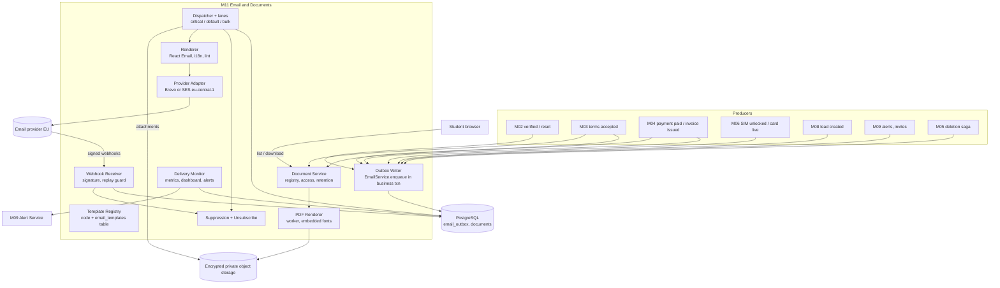
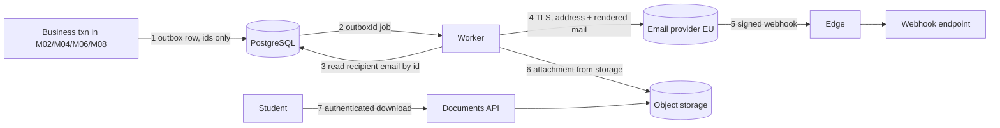

# HLD: M11 — Emails and Documents

| Field | Value |
|-------|-------|
| Module | M11 |
| Status | Review |
| Owner | NIVO Platform team |
| Last updated | 2026-11-24 |
| Requirements | REQ-DOC-01..06, REQ-PAY-03, REQ-ACC-01, REQ-LEG-03 (Terms PDF), REQ-LEG-04 (re-accept copy) |
| Companion docs | `lld.md`; M04 (invoice data), M03 (Terms versions, consents), M08 (leads), M06 (notify requests), M09 (alerts, permissions) |

## 1. Purpose and scope

M11 is the platform's single path for outbound email and for student-facing documents. It owns the template registry and renderer, a transactional outbox with retries, provider integration and webhooks, suppression/unsubscribe handling, delivery monitoring, and the **Documents** section (invoices and the accepted Terms PDF), including PDF rendering and secure download.

**In scope**

- Five product templates: `welcome`, `pay_receipt`, `sim_unlocked`, `accommodation_enquiry_received`, `coming_soon_notify`, plus the agent notification `accommodation_lead_agent_notify` required by REQ-ACC-01.
- Rendering engine for **dependent templates** registered by other modules (verification, password reset, proof rejected, refund, Terms update, deletion confirmation, admin/consultancy mails). Their content belongs to the owning module; sending rules, PII rules and monitoring belong to M11.
- Outbox pattern (rows inserted in the business transaction), worker lanes, retry/backoff, dead letter, resend.
- Provider adapter (EU provider, Brevo or SES eu-central-1), signed webhook intake, bounce/complaint handling, suppression, one-click unsubscribe for the coming-soon notice.
- Documents: `invoice`, `credit_note`, `terms_acceptance`; PDF rendering jobs; encrypted storage; list/download for the student; controlled admin access (permissions from M09).
- Delivery monitoring: metrics, admin dashboard, alert rules.
- **No PII in any job payload**: only IDs.

**Out of scope**

- Invoice numbering, VAT logic and refunds (M04); Terms text and consent records (M03); notify-request creation (M06).
- Admin-editable email HTML (templates are code, reviewed and tested; German translations come as i18n keys).
- Marketing or newsletter email; open/click tracking (disabled by design).
- SMS/WhatsApp (later add-on per plan).
- Transactional email for non-NIVO parties (partners).

## 2. Requirements covered

New IDs (★) are proposed additions to `00-traceability.md`.

| ID | Statement | Priority | Tests |
|----|-----------|----------|-------|
| REQ-DOC-01 | Transactional emails: welcome, payment receipt, SIM unlocked, accommodation enquiry received, coming-soon notify | Must | T-DOC-001..013 |
| REQ-DOC-02 ★ | Every email states what happened and offers one next action; EN now, DE keys ready; accessible HTML + plain text; no tracking | Must | T-DOC-003..006 |
| REQ-DOC-03 ★ | Documents section lists invoices and the accepted Terms PDF; student-only secure download | Must | T-DOC-030..043 |
| REQ-DOC-04 ★ | Delivery monitoring: status per message, provider webhooks, dashboard, alerts, resend | Must | T-DOC-016..019, T-DOC-050..058 |
| REQ-DOC-05 ★ | No PII in job payloads or outbox context beyond IDs | Must | T-DOC-021..024 |
| REQ-DOC-06 ★ | Suppression (bounce, complaint) and one-click unsubscribe for the coming-soon notice | Must | T-DOC-014..015 |
| REQ-PAY-03 | Invoice PDF emailed and in Documents | Must | T-PAY-020, T-DOC-007, T-DOC-030 |
| REQ-ACC-01 | Accommodation enquiry received; agent notified ≤ 1 min | Must | T-ACC-001, T-DOC-011..012 |
| REQ-LEG-03 | Terms acceptance saved with version and time; accepted Terms PDF stored in Documents | Must | T-LEG-020, T-DOC-033 |

## 3. Component diagram

| Component | Responsibility |
|-----------|----------------|
| Template Registry | Source of truth for template keys: category, recipient kind, owner module, criticality, context schema, retention class. Code is authoritative; `email_templates` mirrors it for monitoring and toggles |
| Outbox Writer | `enqueue(tx, …)` inserts one `email_outbox` row (IDs only) with a unique `dedupe_key`; exactly-once enqueue per business event |
| Dispatcher | Picks rows with `SKIP LOCKED` in priority lanes, resolves the recipient address at send time, checks suppression and expiry, renders, sends, records status |
| Renderer | Typed context builder per template (reads fresh data by ID), React Email → HTML + text, i18n by key, lint rules (one primary action, links on allow-listed base URL) |
| Provider Adapter | Thin interface: `send`, `verifyWebhook`, `parseEvents`; circuit breaker; optional secondary adapter |
| Webhook Receiver | Verifies signatures, rejects replays, maps provider events to outbox rows, updates delivery events and suppressions; stores no raw payloads |
| Suppression + Unsubscribe | HMAC-hashed address list with scopes; stateless signed unsubscribe tokens; confirm page and RFC 8058 one-click |
| Delivery Monitor | Metrics, dashboard API, alert rules, health endpoint independent of the provider |
| Document Service | Registers documents, enforces ownership, serves downloads, applies retention |
| PDF Renderer | Deterministic PDFs for invoice, credit note and Terms acceptance; no network access |

## 4. Data flows and trust boundaries

| # | Flow | Initiator | Boundary crossed | Data | Notes |
|---|------|-----------|------------------|------|-------|
| 1 | Enqueue | Producer module | Intra-app (DB) | template key, recipient id, context ids, dedupe key | Same transaction as the business change; no addresses, names or amounts |
| 2 | Dispatch job | Queue | Intra-app | `{outboxId}` | Payload schema is strict; PII guard rejects anything else |
| 3 | Address resolution | Worker | App → DB | address read at send time only | Not stored in outbox, not logged |
| 4 | Send | Worker | **App → Email provider (processor)** | address, subject, body, attachments | Provider under DPA, EU region; display names omitted; tracking off |
| 5 | Webhook | Provider | **Provider → Internet → Edge → App** | event type, provider message id, address (for suppression) | Signature + timestamp checked; address hashed immediately, never persisted |
| 6 | Attachment | Worker | Intra-app → storage | invoice PDF (decrypted in memory) | ≤ 1 MB |
| 7 | Document download | Student | Internet → App → storage | PDF stream | Session + ownership check; `no-store`; no public URL |

Trust boundaries: Internet → Edge; Edge → App; App → DB/Storage/Secrets; **App → Email provider** (processor, outside our control; minimise what is sent); **Provider → App webhook** (untrusted input until the signature verifies).

## 5. Inputs / outputs to other modules

| From / To | Contract | Failure behaviour |
|-----------|----------|-------------------|
| M02 → M11 | `EmailService.enqueue` for `welcome` (event `user.email_verified`), `auth_verify_email`, `auth_password_reset`; M11 → M02 event `email.hard_bounced` (show banner "update your email") | Enqueue failure rolls back the business action only for security-critical templates; `welcome` failure never blocks (best effort inside txn, outbox row simply exists) |
| M02 → M11 | `student_profiles.customer_ref` (short reference printed on documents) and `users.locale` | Missing ref → fall back to invoice number only |
| M03 → M11 | Event `terms.accepted` `{consentId}` → job renders Terms PDF from `legal_document_versions`; `legal_terms_updated` template | Render failure → document `failed`, retry, alert; acceptance itself is not blocked |
| M04 → M11 | Event `invoice.issued` `{invoiceId}` (invoice data owned by M04); enqueue `pay_receipt` and `pay_refund_issued` | Receipt sent without attachment after 120 s if PDF not ready |
| M06 → M11 | Event `sim.unlocked` → `sim_unlocked`; event `card.published_live` `{cardId}` → fan-out for `coming_soon_notify`; M11 calls M06 `notifyRequests.listPending(cardId, cursor)` and `markNotified(id)` | Fan-out is resumable and idempotent per `notify_request` id |
| M08 → M11 | Event `lead.created` `{leadId}` → `accommodation_enquiry_received` (student) and `accommodation_lead_agent_notify` (agent, config recipient) | Agent mail: 3 attempts then fallback recipient + alert |
| M05 → M11 | Deletion saga enqueues `identity_deletion_confirmed` **before** purging the address; saga waits for status `sent` (max 24 h) | On timeout the saga proceeds and logs `confirmation_not_sent` |
| M09 → M11 | Templates for admin invites, approvals, security alerts; permissions `emails:*`, `documents:*`; Alert Service channel | Alert also visible in-app |
| M10 → M11 | Consultancy templates | As above |
| M11 → M09 | Alerts (`email_delivery_degraded`, `invoice_render_failed`), audit entries, student timeline events (email status per template) | Alert failure is logged; health endpoint still turns red |
| M01 → M11 | Queue, storage with envelope encryption, secrets (provider key, `email_hmac_key`, `unsub_hmac_key`), DNS records (SPF/DKIM/DMARC), health checks | Missing key → start-up failure |

## 6. External dependencies

| Dependency | Purpose | Fallback |
|------------|---------|----------|
| EU email provider (Brevo, or Amazon SES eu-central-1) — decision GAP-DOC-PROVIDER | Delivery | Circuit breaker; optional secondary adapter (not configured by default, GAP-DOC-PROVIDER-FAILOVER); queue retains messages up to template `max_age` |
| DNS (SPF, DKIM, DMARC on `mail.<domain>`) | Authentication / reputation | Daily self-check alert |
| Object storage (M01) | PDFs | Retry; documents `failed` visible in dashboard |
| PDF library (`@react-pdf/renderer`) with embedded Poppins | Render PDFs offline | Retry then alert |
| Secrets manager | HMAC and provider keys | None (start-up failure) |

## 7. Data classification

| Data | Class | Lawful basis | Retention |
|------|-------|--------------|-----------|
| `email_outbox` rows (template key, recipient id, context ids, status, attempts) | Internal / Personal (pseudonymous id) | Art. 6(1)(b) contract; (f) operations | 90 days after final status; `pay_receipt` and `pay_refund_issued` rows 3 years after year-end (proof of dispatch; limitation period) |
| `email_delivery_events` (event type, reason code, time) | Internal | Art. 6(1)(f) | 90 days |
| Recipient email address in transit | Personal | Art. 6(1)(b), (a) for coming-soon, (f) security | Not stored by M11 (read from `users` at send time) |
| `email_suppressions` (HMAC of address, scope, reason) | Personal (pseudonymous) | Art. 6(1)(f) protect sender reputation and honour opt-outs; Art. 6(1)(c) for unsubscribe | Hard bounce/invalid 24 months; complaint 5 years; unsubscribe until re-subscribe, max 3 years |
| Rendered email body | Personal | Same as purpose | **Never stored** by NIVO; provider retains per DPA (log retention configured to minimum) |
| Invoice PDF | Financial record; minimal personal data by default (no recipient name/address; invoice number, date, net/VAT/gross, customer reference) | Art. 6(1)(c) tax and commercial law; (b) | Fiscal retention, default 8 years after year-end of issue — to be confirmed by tax consultant (GAP-DOC-INVOICE-RETENTION) |
| Terms-acceptance PDF | Personal (name as registered, customer ref, timestamp, version, text hash) | Art. 6(1)(b), (c) evidence of consent; (f) | Until account erasure (consent record in M03 remains per its own rule) |
| Document metadata (`documents`) | Personal (student id) | Same | Same as document; `student_id` nulled on erasure for retained invoices |
| Signed unsubscribe tokens | Pseudonymous | Art. 6(1)(c)/(a) | Stateless; valid indefinitely |
| Admin-side delivery dashboard output | Internal (ids, statuses) | Art. 6(1)(f) | n/a |

## 8. Key decisions

| Decision | Chosen | Alternatives rejected | Why |
|----------|--------|----------------------|-----|
| Enqueue mechanism | Transactional outbox + queue job carrying only `outboxId` | Direct send in request; payload with address and variables | Atomic with business change; retries and dedupe; no PII in jobs |
| Recipient address | Resolved from the owning table at send time, never stored in outbox/job/log | Copy address into payload | Honours rule "no PII beyond IDs"; address changes and erasure respected |
| Template ownership | Code-managed React Email templates with i18n keys; engine in M11, copy owned by producing module; no admin HTML editor | Admin-editable templates | Removes injection and broken-link risk; review in PR; copy deck stays the single source |
| Delivery semantics | At-least-once with dedupe key; duplicates possible only if a worker crashes between provider accept and commit | Exactly-once | Not achievable with the provider; a duplicate receipt is harmless |
| Content freshness | Render at send time from IDs | Pre-render at enqueue | Fresh data, no content stored; `template_version` hash recorded for reproducibility |
| Tracking | Open and click tracking **off**; verified daily | Provider default tracking | TDDDG/GDPR: tracking pixels need consent; not needed |
| Suppression storage | HMAC-SHA256(address, key) | Plain address list | Pseudonymous; webhook address hashed immediately |
| Unsubscribe | Stateless HMAC-signed token, GET confirm page + POST, RFC 8058 one-click | Stored tokens; GET-triggered unsubscribe | Works indefinitely; prefetchers cannot unsubscribe users |
| Priority lanes | `critical` (verify, reset, receipt, agent notify), `default`, `bulk` (coming-soon fan-out) with separate concurrency and rate limit | Single queue | A 5 000-recipient fan-out must not delay a receipt or Roshan's notification |
| Agent notification content | **No student PII**: lead reference, city, arrival date, maximum budget, accommodation type (as defined in M08 §7), link to the lead in the agent portal (login + 2FA) | Full lead details in the email | Email is unencrypted in transit between servers and persists in mailboxes; data minimisation. Roshan opens the lead in the admin (GAP-DOC-AGENT-NOTIFY-CONTENT) |
| Invoice layout | Small-amount invoice layout: no recipient name or address; customer reference and invoice number | Full name and address on invoice | €149 qualifies as small amount invoice in Germany (to be confirmed by tax consultant); avoids personal data in a record that must outlive erasure |
| PDF immutability | Invoices and credit notes immutable; correction = credit note + new invoice (M04) | Regenerate on demand | Fiscal integrity; hash stored |
| Document download | Streamed through the API with session + ownership check, `no-store` | Signed public URLs | Avoids URL leakage; files are small |
| Receipt as contract confirmation | Receipt contains, or links to, contract confirmation, withdrawal information and confirmation of the early-start consent, plus attached invoice and Terms version link | Plain receipt | Consumer-law durable-medium confirmation; wording from lawyer (GAP-DOC-RECEIPT-LEGAL) |
| Provider failover | Adapter interface + circuit breaker now; secondary provider optional later | Hard-wire one provider | Keeps option without second DPA before launch |

## 9. Failure modes (summary)

| Failure | Impact | Detection | Recovery |
|---------|--------|-----------|----------|
| Provider outage / 5xx / rate limit | Delayed mails (verification, receipt) | Queue age and failure alerts; circuit breaker | Backoff retries; optional secondary; student UI shows "resend" (M02) |
| Webhook endpoint down or signature secret rotated wrongly | Statuses stale, bounces unknown | Webhook silence alert (30 min with sends) | Fix secret; provider retries; backfill via provider events API |
| Hard-bounced address keeps receiving mail | Reputation damage | Suppression check before send; bounce-rate alert | Suppression; M02 banner |
| Worker crash after provider accept | Possible duplicate | `sending` row older than 2 min flagged; provider message id stored ASAP | Duplicate accepted; documented |
| Invoice PDF render fails | No attachment / Documents empty | `invoice_render_failed` critical alert | Retry; receipt sent without attachment after 120 s; later render fills Documents |
| Receipt email lost | Student unsure; legal confirmation gap | Critical-queue alerts; `pay_receipt` failure alert | Admin resend (`emails:resend`); document still in Documents |
| Agent notification lost | Lead not contacted ≤ 1 min (REQ-ACC-01) | Age > 45 s warning, > 120 s critical | Fallback recipient after 3 attempts; alert |
| PII leaks into payload/log | Privacy breach | CI canary tests; runtime payload guard | Fix and purge queue |
| Unsubscribe ignored (bug) | Unlawful email | T-DOC-014; complaint rate alert | Hotfix, apology process |
| Fan-out storms | Delays, reputation issues | Lane rate limits; bulk lane isolated | Throttle |
| Erasure race: address gone before `identity_deletion_confirmed` sends | Confirmation not delivered | Saga waits for `sent` | Timeout log |
| DNS auth broken (SPF/DKIM/DMARC) | Mail marked spam | Daily self-check | Fix DNS |
| Document IDOR | Another student's invoice exposed | Ownership tests; 404 on mismatch | Patch |
| Clock/timezone | Wrong dates on documents | Store UTC; render Europe/Berlin explicitly with offset | Fix |

## 10. Security and privacy controls (summary)

| Control ID | Control | Layer | Mitigates |
|------------|---------|-------|-----------|
| CTRL-DOC-EMAIL | Outbox pattern, dedupe keys, lanes, retries, DLQ, template registry, lint rules, tracking disabled, SPF/DKIM/DMARC self-check | API, jobs, DNS | RISK-DOC-DELIVERY-FAIL, RISK-DOC-PHISHING-SPOOF |
| CTRL-DOC-NOPII | Strict job schemas, PII guard in `enqueue()`, address resolved at send time, canary tests across logs/jobs/DLQ | API, jobs, CI | RISK-DOC-PII-LEAK |
| CTRL-DOC-WEBHOOK | Signature verification, timestamp window, idempotent events, no raw payload storage | API | RISK-DOC-WEBHOOK-FORGERY |
| CTRL-DOC-SUPPRESS | HMAC suppression list with scopes, unsubscribe via signed token and one-click, no GET side effects | API, DB | RISK-DOC-UNLAWFUL-MAIL, RISK-DOC-REPUTATION |
| CTRL-DOC-ACCESS | Session + ownership check on documents (404 on mismatch), `no-store`, `sandbox` CSP, random storage keys, admin access needs permission + step-up + audit | API, storage | RISK-DOC-IDOR |
| CTRL-DOC-INTEGRITY | Invoice/credit note immutable, SHA-256 stored, deterministic render, fiscal retention with legal hold | DB, jobs | RISK-DOC-TAMPER |
| CTRL-DOC-RETENTION | Retention jobs per class, erasure handling (Terms PDF deleted, invoice unlinked) | Jobs | RISK-DOC-OVERRETENTION |
| CTRL-DOC-AGENT-MIN | Agent notification contains no student PII | Templates | RISK-DOC-PII-LEAK |

Asset → control → risk:

| Asset | Controls | Risks |
|-------|----------|-------|
| Recipient addresses | CTRL-DOC-NOPII, CTRL-DOC-SUPPRESS | RISK-DOC-PII-LEAK, RISK-DOC-UNLAWFUL-MAIL |
| Outbound mail integrity/deliverability | CTRL-DOC-EMAIL | RISK-DOC-DELIVERY-FAIL, RISK-DOC-PHISHING-SPOOF |
| Provider webhooks | CTRL-DOC-WEBHOOK | RISK-DOC-WEBHOOK-FORGERY |
| Invoices / Terms PDFs | CTRL-DOC-ACCESS, CTRL-DOC-INTEGRITY, CTRL-DOC-RETENTION | RISK-DOC-IDOR, RISK-DOC-TAMPER, RISK-DOC-OVERRETENTION |
| Lead notifications | CTRL-DOC-AGENT-MIN | RISK-DOC-PII-LEAK |

## 11. Test strategy

- **Unit:** context builders and Zod schemas, PII guard (fast-check with emails/phones/names injected into every field), dedupe key builders, retry schedule, suppression scope logic, unsubscribe token sign/verify, filename builder, PDF layout functions, template lint.
- **Integration (Testcontainers + provider fake):** outbox atomicity with business transaction rollback, worker concurrency with `SKIP LOCKED`, lane isolation under 5 000-row fan-out, webhook signature and replay, suppression application, fallback recipient, receipt attachment wait, retention jobs.
- **Rendering:** snapshot tests (EN) per template and layout; DE key completeness check; plain-text parity; link allow-list; one-primary-CTA lint; axe-style checks on HTML (alt text, contrast tokens, language attribute).
- **PDF:** golden-file tests (text extraction), determinism, sanitisation of hostile names, size limits.
- **Security:** IDOR on documents, download headers, canary PII scans of logs/jobs/DLQ/provider requests, SSRF none (no remote fetch in renderer), forged webhooks.
- **E2E (Playwright + mail catcher in staging):** register → verify → welcome; pay → receipt with invoice and Documents entry; SIM unlock mail; accommodation enquiry both mails ≤ 60 s; coming-soon notify + unsubscribe page.
- **Resilience:** provider 5xx/timeouts, crash between accept and commit, webhook outage, PDF render failure.
- Test IDs T-DOC-001..058 in `lld.md` §11.

## 12. Open questions

| ID | Question | Owner | Status |
|----|----------|-------|--------|
| GAP-DOC-INVOICE-RETENTION | Invoice content (small-amount layout without name/address vs full recipient data) and retention period (8 vs 10 years) given erasure requests; credit-note handling | Tax consultant / lawyer | Open (**High**) |
| GAP-DOC-RECEIPT-LEGAL | Required content of the order confirmation email (contract confirmation on durable medium, withdrawal information, confirmation of express early-start consent) and whether the Terms PDF must be attached | Lawyer | Open (**High**) |
| GAP-DOC-NOTIFY-LAW | Is the coming-soon "Notify me" email advertising (UWG §7) needing stricter consent, or a requested service notification? Current design: consent at click, one email per card, unsubscribe link | Lawyer | Open (Medium) |
| GAP-DOC-UNSUB-RULES | Notification preferences and unsubscribe rules beyond coming-soon (plan gap register) | Product owner | Open (Medium) |
| GAP-DOC-PROVIDER | Provider choice (Brevo vs SES eu-central-1), DPA, webhook authentication method, log retention minimum | Product owner / M01 | Open (Medium) |
| GAP-DOC-PROVIDER-FAILOVER | Secondary provider for critical templates (needs second DPA) | Product owner | Open (Medium) |
| GAP-DOC-SUPPRESSION-ADMIN | `emails:suppression:manage` is now in the M09 registry (High sensitivity, step-up, Super Admin only). Open question: whether Phase 1 ships the UI or lifts suppressions only through the student changing email or re-subscribing | M09 / M11 | Open (Low) |
| GAP-DOC-TEMPLATE-ALIGNMENT | M02–M08 LLDs named their own templates before this catalogue existed. Canonical keys are the producer names listed in `lld.md` §7 (e.g. `pay_receipt`, `auth_verify_email`, `legal_terms_updated`). Remaining edits: M02 drops `auth_email_verified` in favour of `welcome`; M06 uses `coming_soon_notify` instead of `card_available`; producers call `EmailService.enqueue` instead of `email.send {userId}` jobs | M02, M03, M06 / M11 | Open (Medium) |
| GAP-DOC-CUSTOMER-REF | M02 must provide `customer_ref` and `locale` on the student profile | M02 | Open (Low) |
| GAP-DOC-AGENT-NOTIFY-CONTENT | Confirm with Roshan that a PII-free notification with a login link is acceptable (REQ-ACC-01 says "notify") | Product owner | Open (Low) |
| GAP-DOC-DE-TEMPLATES | German copy and legal wording for all templates (Phase 3) | Product owner | Open (Low) |
| GAP-DOC-PDF-FORMAT | PDF/A archival profile for invoices if the tax consultant requires it | Tax consultant | Open (Low) |
