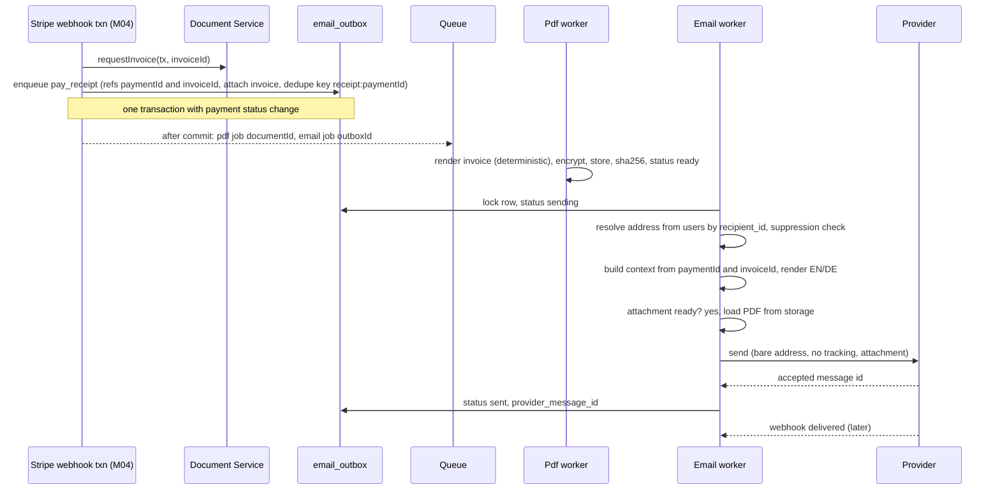
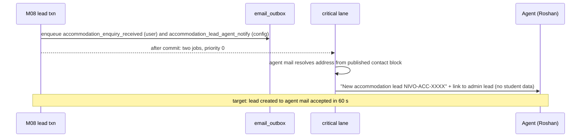
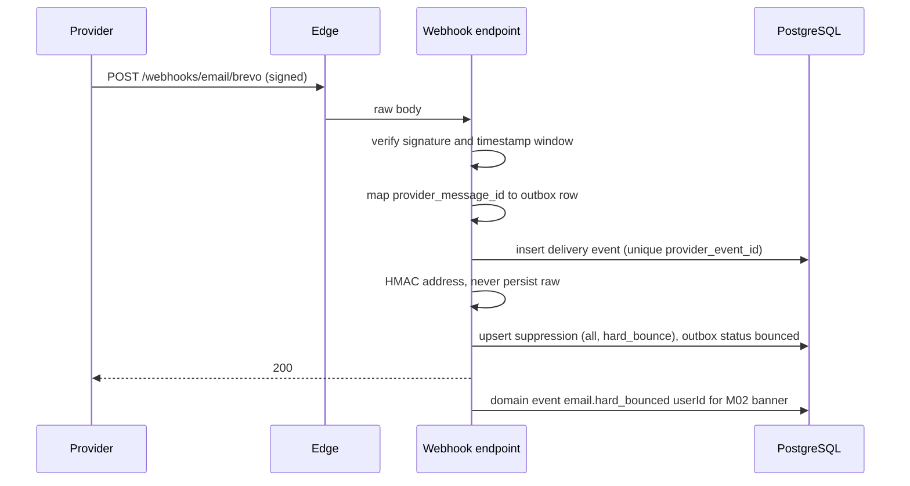
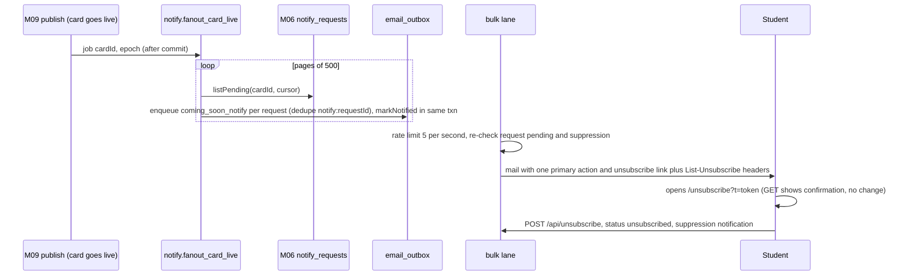
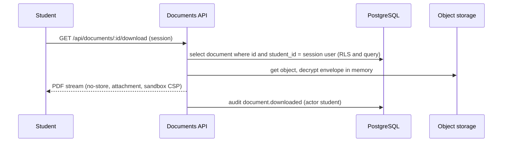

# LLD: M11 — Emails and Documents

| Field | Value |
|-------|-------|
| Module | M11 |
| Status | Review |
| Depends on HLD | `hld.md` |
| Also depends on | M09 `lld.md` (permissions, audit, alerts), M04 (invoices), M03 (Terms), M06 (notify requests), M08 (leads) |
| Last updated | 2026-11-24 |

Conventions: UTC `timestamptz`, `uuid` ids, Zod `.strict()`, authenticated responses `Cache-Control: no-store`. Student API prefix `/api`, admin API `/admin-api`, webhooks `/webhooks`. Dates shown to users are rendered in `Europe/Berlin` with explicit offset.

## 1. Database

### Tables

| Table | Column | Type | Constraints | Notes |
|-------|--------|------|-------------|-------|
| `email_templates` | key | text | PK, CHECK `^[a-z0-9_]{3,60}$` | Mirror of code registry (boot check) |
| | category | text | NOT NULL, CHECK in (`transactional`,`notification`,`security`,`admin_ops`) | Drives suppression and unsubscribe rules |
| | owner_module | text | NOT NULL | e.g. `M04` |
| | recipient_kind | text | NOT NULL, CHECK in (`user`,`admin`,`consultancy_user`,`config`) | |
| | priority | smallint | NOT NULL, CHECK in (0,1,2) | 0 critical lane, 1 default, 2 bulk |
| | critical | boolean | NOT NULL | Alerts on delay/failure |
| | resendable | boolean | NOT NULL | Admin resend allowed |
| | max_age_seconds | int | NOT NULL | Message expires if not sent in time (verify 24 h, reset 1 h, receipt 7 d, …) |
| | retention_class | text | NOT NULL, CHECK in (`standard`,`receipt`) | 90 days vs 3 years after year-end |
| | enabled | boolean | NOT NULL DEFAULT true | Kill switch (deploy/runbook) |
| | context_schema_version | smallint | NOT NULL | |
| `email_outbox` | id | uuid | PK | |
| | template_key | text | FK `email_templates` NOT NULL | |
| | template_version | text | NOT NULL | SHA-256 (first 16 hex) of the compiled template + i18n bundle at send time |
| | locale | text | NOT NULL DEFAULT `en` | `en`, `de` |
| | recipient_kind | text | NOT NULL | Copied from template |
| | recipient_id | uuid | NULL | `users.id`, `admin_accounts.id` or `consultancy_users.id`; nulled by erasure for `user` rows |
| | config_key | text | NULL | e.g. `accommodation.agent_contact`, `accommodation.fallback_contact`; resolved from published settings at send time |
| | context_refs | jsonb | NOT NULL DEFAULT `{}` | **IDs and enums only** (see allow-list, §2 Zod); validated by CHECK `jsonb_typeof = 'object'` and by the PII guard |
| | attachment_refs | jsonb | NOT NULL DEFAULT `[]` | `[{documentType, sourceId}]` |
| | dedupe_key | text | UNIQUE NOT NULL | e.g. `receipt:{paymentId}`, `welcome:{userId}`, `sim_unlocked:{userId}`, `notify:{notifyRequestId}`, `lead_student:{leadId}`, `lead_agent:{leadId}`, `manual:{outboxId}:{n}` |
| | status | email_status | NOT NULL DEFAULT `queued` | `queued`,`sending`,`sent`,`delivered`,`deferred`,`bounced`,`failed`,`suppressed`,`expired`,`cancelled` |
| | priority | smallint | NOT NULL | Copy of template priority |
| | attempt_count | smallint | NOT NULL DEFAULT 0 | |
| | next_attempt_at | timestamptz | NOT NULL DEFAULT now() | |
| | attach_wait_until | timestamptz | NULL | `created_at + 120 s` when attachments pending |
| | last_error_code | text | | Internal code (`PROVIDER_5XX`, `PROVIDER_4XX_INVALID`, `RENDER_FAILED`, `RECIPIENT_MISSING`, …); never provider text containing an address |
| | provider | text | | `brevo`,`ses` |
| | provider_message_id | text | UNIQUE NULL | Stored immediately after provider acceptance |
| | created_by_event | uuid | NULL | `domain_events.id` |
| | created_at / queued_at / sent_at / delivered_at / failed_at / expires_at | timestamptz | | |
| | | | CHECK `(recipient_id IS NOT NULL AND config_key IS NULL) OR (recipient_id IS NULL AND config_key IS NOT NULL) OR (recipient_kind = 'user' AND recipient_id IS NULL AND config_key IS NULL AND status IN ('cancelled','expired','failed'))` | Exactly one resolver (`recipient_id` xor `config_key`); the third branch covers rows of erased users whose `recipient_id` was nulled |
| `email_delivery_events` | id | uuid | PK | |
| | outbox_id | uuid | FK NOT NULL | |
| | provider_event_id | text | UNIQUE NOT NULL | Idempotency of webhooks |
| | event_type | text | CHECK in (`accepted`,`delivered`,`deferred`,`soft_bounce`,`hard_bounce`,`complaint`,`blocked`,`unsubscribed`,`dropped`) | |
| | reason_code | text | | Normalised code; no free text |
| | occurred_at / received_at | timestamptz | NOT NULL | |
| `email_suppressions` | id | uuid | PK | |
| | address_hmac | bytea | NOT NULL | HMAC-SHA256(lower-cased address, `email_hmac_key`) |
| | scope | text | CHECK in (`notification`,`non_security`,`all`) | `notification`: unsubscribe; `non_security`: complaint; `all`: hard bounce / invalid |
| | reason | text | CHECK in (`unsubscribe`,`complaint`,`hard_bounce`,`invalid`,`manual`) | |
| | source_outbox_id | uuid | FK NULL | |
| | created_at / expires_at | timestamptz | | `expires_at` per retention (24 months / 5 years / 3 years) |
| | | | UNIQUE (`address_hmac`, `scope`) | |
| `documents` | id | uuid | PK | |
| | student_id | uuid | FK `users` ON DELETE SET NULL | NULL after erasure for retained invoices |
| | doc_type | text | NOT NULL, CHECK in (`invoice`,`credit_note`,`terms_acceptance`) | |
| | source_type / source_id | text / uuid | NOT NULL | `invoice`→`invoices.id` (M04); `consent`→`consents.id` (M03) |
| | | | UNIQUE (`doc_type`,`source_id`) | One document per source; re-acceptance has a new consent id |
| | status | text | NOT NULL DEFAULT `queued`, CHECK in (`queued`,`rendering`,`ready`,`failed`,`deleted`) | |
| | title_key | text | NOT NULL | i18n key (`documents.invoice.title`) |
| | display_number | text | | Invoice/credit-note number or Terms version label |
| | locale | text | NOT NULL | |
| | mime | text | NOT NULL DEFAULT `application/pdf` | |
| | storage_key | text | UNIQUE NULL | Random 256-bit key; set when `ready` |
| | key_id | text | | Envelope-encryption key id (M01) |
| | size_bytes / page_count | int | | CHECK `size_bytes <= 2000000` |
| | sha256 | bytea | CHECK `octet_length = 32` when ready | |
| | document_date | date | NOT NULL | Invoice date / acceptance date (render input; makes output deterministic) |
| | retention_class | text | NOT NULL, CHECK in (`tax_invoice`,`consent_evidence`) | |
| | delete_after | date | NULL | `tax_invoice`: 31 Dec of issue year + `invoice.retention_years`; `consent_evidence`: NULL (deleted on erasure) |
| | legal_hold | boolean | NOT NULL DEFAULT false | Blocks deletion |
| | attempt_count / last_error_code | smallint / text | | |
| | created_at / ready_at / erased_at | timestamptz | | |
| | | | CHECK `status <> 'ready' OR (storage_key IS NOT NULL AND sha256 IS NOT NULL AND size_bytes IS NOT NULL)` | |
| `email_metrics_hourly` | hour, template_key, status | timestamptz, text, text | PK (all) | Aggregated counters kept after outbox rows are deleted |
| | count | int | NOT NULL | |
| | p50_send_ms / p95_send_ms / p95_deliver_ms | int | | Time from `created_at` |

Platform/other-module tables used: `users` (email, locale, name for rendering only), `student_profiles.customer_ref`, `invoices` (M04), `legal_document_versions` and `consents` (M03), `notify_requests` (M06: `id`, `student_id`, `card_id`, `status`, `consent_version`, `created_at`, `notified_at`), `accommodation_leads` (M08), published settings (M09 contact block), `domain_events`, `audit_log`.

Triggers: `trg_documents_immutable` (BEFORE UPDATE: for `invoice` and `credit_note` rows once `ready`, columns `storage_key`, `sha256`, `size_bytes`, `document_date`, `source_id`, `display_number` cannot change; status may only move to `deleted` via the retention function), `trg_outbox_context_guard` (BEFORE INSERT/UPDATE: rejects `context_refs`/`attachment_refs` whose keys are not in the allow-list or whose string values match an email, phone or whitespace-containing pattern — last line of defence behind the application guard).

### Indexes

| Index | Purpose |
|-------|---------|
| `email_outbox (priority, next_attempt_at) WHERE status IN ('queued','deferred')` | Dispatcher pick-up |
| `email_outbox (status, created_at)`; `(template_key, created_at DESC)` | Dashboard and monitoring |
| `email_outbox (recipient_id, created_at DESC)` | Student timeline |
| `email_outbox (status) WHERE status = 'sending'` and `(updated)` | Stuck-send detection |
| `email_delivery_events (outbox_id, occurred_at)` | Message history |
| `email_suppressions (address_hmac)`; `(expires_at)` | Send-time check, cleanup |
| `documents (student_id, document_date DESC)` | Documents list |
| `documents (delete_after) WHERE legal_hold = false AND status = 'ready'` | Retention job |
| `documents (status, created_at)` | Render monitoring |

### RLS policies

| Table | Policy |
|-------|--------|
| `email_outbox`, `email_delivery_events`, `email_suppressions`, `email_templates`, `email_metrics_hourly` | `USING (current_setting('app.actor_kind', true) IN ('admin','system'))`; students and consultancies never read |
| `documents` | `SELECT`: `current_setting('app.actor_kind', true) IN ('admin','system') OR (current_setting('app.actor_kind', true) = 'student' AND student_id = NULLIF(current_setting('app.actor_id', true), '')::uuid)`. `INSERT/UPDATE`: actor kind `system` only (workers) |
| Admin document reads | Through the API with `countries` scope joined from the student profile (M09 `admin_student_v`) |

## 2. API endpoints

`Perm` values are M09 registry keys. SU = step-up required. Idempotency applies to mutating admin calls.

### 2.1 Student and public

| Method | Path | Permission | Request | Response | Errors | Rate limit | Idempotency |
|--------|------|------------|---------|----------|--------|------------|-------------|
| GET | `/api/documents` | student-session (verified email) | `?cursor&limit≤50` | `[{id, docType, title, displayNumber, documentDate, sizeBytes, status}]` newest first; only the caller's rows | `UNAUTHORIZED` | 60 / min | — |
| GET | `/api/documents/:id/download` | student-session + ownership | — | `200` PDF stream. Headers: `Content-Type: application/pdf`, `Content-Disposition: attachment; filename="NIVO-Invoice-<number>.pdf"`, `Cache-Control: private, no-store`, `X-Content-Type-Options: nosniff`, `Content-Security-Policy: sandbox` | `NOT_FOUND` (other student's id too), `DOCUMENT_NOT_READY` (202 with `Retry-After: 10`) | 30 / min per student | — |
| GET | `/unsubscribe` | public (SPA page) | `?t=<token>` | HTML confirm page (no state change) | — | 30 / min per IP | — |
| POST | `/api/unsubscribe` | token | `{token}` | 200 `{status:'unsubscribed'}`; cancels pending notify requests, adds `notification` suppression | `NOT_FOUND` (bad/tampered token, uniform) | 10 / min per IP | ✓ idempotent |
| POST | `/api/unsubscribe/one-click?t=<token>` | token | body `List-Unsubscribe=One-Click` (RFC 8058) | 200 | `NOT_FOUND` | 30 / min per IP | ✓ idempotent |
| POST | `/webhooks/email/:provider` | provider signature | Raw body (JSON; for SES an SNS envelope) | `200` after verification and processing; processing errors → `500` so the provider retries | `UNAUTHORIZED` (bad signature/timestamp), `NOT_FOUND` (unknown provider) | 600 / min per IP (provider ranges allow-listed at edge where published) | by `provider_event_id` |

### 2.2 Admin (`/admin-api`)

| Method | Path | Permission | Request | Response | Errors | Rate limit | Idempotency |
|--------|------|------------|---------|----------|--------|------------|-------------|
| GET | `/emails/summary` | `emails:read_delivery` | `?range=24h|7d|30d` | per template: counts by status, p50/p95 time to send and to delivered, oldest queued age, DLQ count, webhook last received, bounce and complaint rates | | 30 / min | — |
| GET | `/emails/templates` | `emails:read_delivery` | — | registry rows with last sent, enabled, critical | | 30 / min | — |
| GET | `/emails/outbox` | `emails:read_delivery` | `OutboxQuery` (`status`, `template`, `recipientId`, `from`, `to`, `cursor`) | rows: ids, template, status, attempts, error code, timestamps — **no addresses, no bodies** | `VALIDATION_FAILED` | 60 / min | — |
| GET | `/emails/outbox/:id` | `emails:read_delivery` | — | row + delivery events | `NOT_FOUND` | 60 / min | — |
| POST | `/emails/outbox/:id/resend` | `emails:resend` | `{reason}` | 202 `{newOutboxId}` | `CONFLICT` (not resendable / status / limit 3 reached / address suppressed) | 10 / h per admin | ✓ |
| GET | `/students/:id/emails` | `students:read` + `emails:read_delivery` | `cursor` | template + status + times | `NOT_FOUND` | 60 / min | — |
| GET | `/students/:id/documents` | `documents:read` (scope) | — | document metadata | `NOT_FOUND` | 60 / min | — |
| GET | `/documents/:id/download` | `documents:download` + SU (scope) | — | PDF stream, same headers; audited `document.downloaded_by_admin` | `NOT_FOUND`, `STEP_UP_REQUIRED`, `DOCUMENT_NOT_READY` | 20 / h | — |
| GET | `/health/email` (internal, unauthenticated from monitoring network only) | internal | — | `{criticalQueueAgeSeconds, dlqCount, ok}` — independent of provider reachability | | — | — |

### 2.3 Internal service interfaces (not HTTP)

```ts
// apps/api/src/modules/email/service.ts
EmailService.enqueue(tx: Tx, input: EnqueueInput): Promise<{ outboxId: string; created: boolean }>;
DocumentService.requestInvoice(tx: Tx, invoiceId: string): Promise<void>;          // M04 txn
DocumentService.requestTermsAcceptance(tx: Tx, consentId: string): Promise<void>;  // M03 txn
DocumentService.eraseForStudent(tx: Tx, studentId: string): Promise<void>;         // M05 saga
```

### Zod schemas

```ts
// packages/shared/src/email.ts
const Uuid = z.string().uuid();

/** The ONLY keys that may appear in job payloads or outbox context. Values are uuid | enum | int | boolean. */
export const ALLOWED_REF_KEYS = [
  'outboxId','paymentId','invoiceId','consentId','leadId','cardId','notifyRequestId',
  'studentId','userId','adminId','eventId','documentId','approvalRequestId','alertId',
] as const;

export const EmailRefs = z.object({
  paymentId: Uuid.optional(), invoiceId: Uuid.optional(), leadId: Uuid.optional(),
  cardId: Uuid.optional(), notifyRequestId: Uuid.optional(), consentId: Uuid.optional(),
  approvalRequestId: Uuid.optional(), alertId: Uuid.optional(),
  variant: z.enum(['default','no_attachment']).optional(),
}).strict();

export const EnqueueInput = z.object({
  templateKey: z.enum(TEMPLATE_KEYS),
  recipient: z.discriminatedUnion('kind', [
    z.object({ kind: z.literal('user'), id: Uuid }),
    z.object({ kind: z.literal('admin'), id: Uuid }),
    z.object({ kind: z.literal('consultancy_user'), id: Uuid }),
    z.object({ kind: z.literal('config'), key: z.enum(['accommodation.agent_contact','accommodation.fallback_contact','admin.super_admins']) }),
  ]),
  refs: EmailRefs.default({}),
  attachments: z.array(z.object({ documentType: z.enum(['invoice','terms_acceptance']), sourceId: Uuid })).max(2).default([]),
  dedupeKey: z.string().min(8).max(120).regex(/^[a-z_]+:[0-9a-f-]{36}(:[a-z0-9_-]+)?$/),
  notBefore: z.date().optional(),
}).strict();

export const EmailJobPayload = z.object({ outboxId: Uuid }).strict();
export const DocumentJobPayload = z.object({ documentId: Uuid }).strict();

export const ResendInput = z.object({ reason: z.string().trim().min(10).max(500) }).strict();
export const UnsubscribeInput = z.object({ token: z.string().min(20).max(300) }).strict();
export const OutboxQuery = z.object({
  status: z.array(z.enum(EMAIL_STATUSES)).optional(),
  template: z.enum(TEMPLATE_KEYS).optional(),
  recipientId: Uuid.optional(),
  from: z.string().datetime().optional(), to: z.string().datetime().optional(),
  cursor: z.string().max(200).optional(), limit: z.number().int().min(1).max(100).default(50),
}).strict();

/** Runtime guard used by enqueue(), the job wrapper and the DB trigger mirror. */
export function assertIdsOnly(obj: unknown, path = ''): void {
  // keys must be in ALLOWED_REF_KEYS (or the `variant` enum key); string values must be a UUID or a
  // short [a-z_]+ enum token; reject '@', digits-with-spaces/phone patterns, whitespace, length > 64.
}
```

Unsubscribe token: `base64url(notifyRequestId or userId) + '.' + base64url(HMAC-SHA256(id || ':unsub:v1', unsub_hmac_key))`, no expiry; verification is constant-time.

Proposed addition to `00-error-catalog.md` (not applied here):

| Code | HTTP | When | User message |
|------|------|------|--------------|
| `DOCUMENT_NOT_READY` | 202 | Document is queued or rendering | We are preparing your document. Please try again in a minute. |

## 3. State machines

### 3.1 Email outbox

| From | Event | To | Side effects |
|------|-------|----|--------------|
| (none) | `enqueue` (unique `dedupe_key`; duplicates ignored) | `queued` | `expires_at = created_at + template.max_age`; job `{outboxId}` after commit; sweeper catches missed ones |
| `queued` / `deferred` | worker picks (`SKIP LOCKED`), template enabled, not expired | `sending` | `attempt_count + 1` |
| `queued` | `now > expires_at` | `expired` | Metric; no mail; alert if critical |
| `sending` | recipient missing/erased | `cancelled` | `RECIPIENT_MISSING` |
| `sending` | suppression matches category/scope | `suppressed` | Never sent; metric |
| `sending` | attachments pending and `now < attach_wait_until` | `queued` | `next_attempt_at = now + 15 s` |
| `sending` | provider accepts | `sent` | `provider_message_id` saved in the same transaction as status |
| `sending` | provider 5xx/timeout/429 | `deferred` | Backoff (below); after final attempt → `failed` |
| `sending` | provider 4xx invalid address | `failed` | Suppression `all`/`invalid`; M02 `email.hard_bounced` if verification mail |
| `sending` | render error | `failed` after retries | Alert (critical templates) |
| `sent` | webhook delivered | `delivered` | |
| `sent`/`delivered` | webhook hard bounce | `bounced` | Suppression `all`/`hard_bounce`; event to M02 |
| `sent`/`delivered` | webhook complaint | `delivered` (unchanged) + suppression | Scope `non_security` |
| `failed`/`expired` | admin resend | new row `queued` | Original unchanged |
| `queued`/`deferred` | cancel (user deleted / notify cancelled) | `cancelled` | |

Retry schedule (attempts at 0, 30 s, 2 min, 10 min, 30 min, 2 h): critical lane stops after 6 attempts; default after 8 (adds 6 h, 12 h); bulk after 5. `sending` rows stuck > 2 min are returned to `deferred` by the sweeper **only if `provider_message_id` is NULL** (otherwise treated as sent).

### 3.2 Document

`queued` → `rendering` → `ready`; `rendering` → `queued` (retry, up to 5, backoff 1/5/15/60/240 min) → `failed` (alert); `ready` → `deleted` (retention or erasure). `failed` can be re-queued by a system retry job or ops. Invoices and credit notes are immutable after `ready`.

### 3.3 Notification request fan-out (M06 data, M11 process)

`pending` (M06) → `notified` after outbox row created (same transaction as `markNotified`) → mail sent. Student unsubscribe or "cancel" sets `cancelled`. Re-pressing "Notify me" on another card creates a new `pending` request and removes the address's `notification` suppression (explicit new consent).

### 3.4 Suppression

Created by webhook/unsubscribe → `active` until `expires_at` → removed by cleanup job. Removal earlier: student re-subscribes (scope `notification` only) or changes email address (new address has no suppression).

## 4. Sequence diagrams

### Happy path A — Payment receipt with invoice



### Happy path B — Accommodation enquiry



### Happy path C — Webhook bounce



### Happy path D — Coming-soon fan-out and unsubscribe



### Happy path E — Student downloads a document



### Failure paths

| # | Scenario | Behaviour |
|---|----------|-----------|
| F1 | Provider 5xx/timeout/429 | `deferred`, backoff per schedule, circuit breaker opens after 5 consecutive failures in 2 min (critical mails then use secondary adapter if configured, else wait); alert at queue age thresholds |
| F2 | Provider rejects address (4xx invalid) | `failed`, suppression `all/invalid`, student sees "update your email" banner (M02) |
| F3 | Worker crashes before provider call | Row stays `sending`; sweeper → `deferred` (no `provider_message_id`) → retried once |
| F4 | Worker crashes after provider accepted, before commit | Possible duplicate on retry (accepted risk). Mitigation: `provider_message_id` written in the same statement as `sent` immediately after the API response; custom header `X-NIVO-Msg: <outboxId>` lets ops find duplicates |
| F5 | Invoice not ready when receipt is sent | `attach_wait_until` 120 s; then variant `no_attachment` ("your invoice is available in Documents") — the receipt is never blocked longer |
| F6 | Invoice render fails | Retry 5×; `invoice_render_failed` critical alert; receipt already sent without attachment; Documents shows "preparing" (202) |
| F7 | Agent notification fails | Retries (critical lane); after 3 failures: resend to `accommodation.fallback_contact` and alert (REQ-ACC-01 fallback) |
| F8 | Recipient suppressed | `suppressed`; for `security` category only scope `all` blocks; student UI offers resend/change email |
| F9 | Forged webhook | `401`, no state change, counter + alert if > 10/h |
| F10 | Webhook for unknown message id | `200` (avoid provider retry storms), counter `unmatched_events` |
| F11 | Duplicate webhook | Unique `provider_event_id` → no-op |
| F12 | Template lint/render error at send | `failed` with `RENDER_FAILED`, alert; deployment gate prevents most (CI snapshots) |
| F13 | User erased between enqueue and send | `cancelled` (`RECIPIENT_MISSING`) except `identity_deletion_confirmed`, which the saga holds back until sent |
| F14 | Fan-out job interrupted | Re-run is idempotent: dedupe keys and `markNotified` in one txn |
| F15 | Hostile name in Terms PDF | Rendered as escaped text, clipped to 120 chars, control/bidi characters stripped |
| F16 | Admin tries to resend a coming-soon mail | `CONFLICT` (not resendable; consent covers one send) |
| F17 | Storage unavailable on download | `503`; document stays `ready`; retry |

## 5. Validation rules

| Field | Client | API | DB |
|-------|--------|-----|----|
| Template key | n/a | Must exist in registry and be `enabled` | FK |
| Recipient | n/a | Exactly one of user/admin/consultancy_user id or config key; user must exist and (for non-security templates) have verified email | CHECK |
| `context_refs` / job payloads | n/a | `assertIdsOnly`: allow-listed keys, values UUID or short enum; reject `@`, phone-like digit runs, whitespace, strings > 64 chars | Trigger `trg_outbox_context_guard` |
| Dedupe key | n/a | `^[a-z_]+:[0-9a-f-]{36}(:[a-z0-9_-]+)?$` | UNIQUE |
| Subject / preheader | n/a | From i18n keys only; max 70 / 110 chars; **no interpolation of names, emails or amounts**; lint fails otherwise | n/a |
| Links in mail | n/a | Built from `PUBLIC_BASE_URL` allow-list (student app, admin, consultancy hosts) plus partner-neutral paths; no user-supplied URLs; no tokens other than those owned by M02/M09/M10 flows | n/a |
| Primary action | n/a | Exactly one element with `data-cta="primary"` per template (EN lint) | n/a |
| Attachment | n/a | PDF only, ≤ 1 MB (`email.max_attachment_bytes`), max 2 | n/a |
| Locale | n/a | `en` or `de`; missing key falls back to `en` and increments `email_i18n_fallback` | CHECK |
| Unsubscribe token | n/a | Format and HMAC valid (constant-time); otherwise `NOT_FOUND` | n/a |
| Webhook | n/a | Signature, timestamp within 5 min (SNS: certificate URL host and TopicArn checks), body ≤ 1 MB, JSON schema per provider | UNIQUE event id |
| Resend reason | min 10 chars | 10..500 | n/a |
| Document id | n/a | UUID; ownership; status | RLS |
| Invoice render input | n/a | M04 invoice row complete (number, date, net, VAT rate, VAT amount, gross, currency EUR, customer ref); `gross = net + vat` check | CHECK in M04 |
| PDF text fields | n/a | NFC, strip control and bidi chars, clip names to 120 chars | n/a |
| Email accessibility | n/a | `lang` attribute, alt text on every image, text contrast tokens ≥ 4.5:1, base font ≥ 16 px, plain-text part present | n/a |

## 6. Background jobs

All payloads are `{outboxId}`, `{documentId}` or other ID-only objects, enforced by the same strict schemas and guard.

| Job | Trigger | Retry | Dead letter | Payload rules |
|-----|---------|-------|-------------|---------------|
| `email.send` | After commit of enqueue; lanes `critical` (concurrency 5), `default` (3), `bulk` (2, 5 msgs/s) | Per §3.1 schedule | Outbox `failed` + DLQ + alert (critical) | `{outboxId}` |
| `email.sweep` | Every minute | 3 | DLQ | `{}`; re-enqueues rows `queued/deferred` without a live job, recovers stuck `sending` |
| `email.expire` | Every 5 min | 3 | DLQ | `{}`; marks past-`expires_at` rows `expired` |
| `email.metrics_rollup` | Hourly | 3 | DLQ | `{}`; writes `email_metrics_hourly` |
| `email.monitor` | Every minute | 3 | DLQ | `{}`; evaluates alert rules (§9) via M09 Alert Service |
| `email.dns_check` | Daily | 3 | alert | `{}`; checks SPF, DKIM, DMARC records and provider tracking flags |
| `email.retention` | Daily 04:00 UTC | 3 | DLQ | `{}`; deletes outbox/events per retention class, expired suppressions |
| `notify.fanout_card_live` | M09 publish hook for a card that left Coming soon | 5 | DLQ + alert | `{cardId}` |
| `document.render_invoice` | `invoice.issued` | 5 (1/5/15/60/240 min) | `failed` + critical alert | `{documentId}` |
| `document.render_terms` | `terms.accepted` | 5 | `failed` + alert | `{documentId}` |
| `document.retention` | Daily 04:30 UTC | 3 | DLQ | `{}`; deletes `ready` documents past `delete_after` unless `legal_hold`; writes audit |
| `document.erase_student` | M05 erasure saga | 5 | DLQ + critical alert | `{studentId}`; deletes `terms_acceptance` files, sets `student_id` NULL on retained invoices |
| `email.provider_backfill` | Manual (runbook) after webhook outage | 1 | n/a | `{from,to}` timestamps only |

## 7. Emails

### Template catalogue

`Cat` = category. `Lane` = priority (0 critical, 1 default, 2 bulk). `R` = resendable. Subjects shown are EN i18n values (no PII). Every email: what happened, one primary action, why you got this, support contact, Impressum link; plain-text twin; no tracking.

| Template key | Cat | Lane | R | Trigger (producer) | Content summary |
|--------------|-----|:---:|:-:|--------------------|-----------------|
| `welcome` | transactional | 1 | Y | `user.email_verified` (M02); dedupe `welcome:{userId}` | Subject "Your NIVO account is ready". Confirms email verified; explains the next step with one CTA: "Pay and unlock your dashboard" (unpaid) or "Open your dashboard" (paid, read at render). Mentions what NIVO covers and that partner costs are paid to partners. Replaces M02's `auth_email_verified` (one email on verification, not two; M02 §7 to be updated, `GAP-DOC-TEMPLATE-ALIGNMENT`) |
| `pay_receipt` | transactional | 0 | Y | Payment confirmed by verified Stripe webhook (M04); dedupe `receipt:{paymentId}`; attachment invoice | Subject "Your NIVO payment receipt and invoice". Amount €149.00 incl. VAT, date, invoice number; **contract confirmation, withdrawal information and confirmation of the express early-start consent** (wording from lawyer, GAP-DOC-RECEIPT-LEGAL); invoice PDF attached; link to accepted Terms in Documents. CTA: "Complete your details" (identity step) |
| `sim_unlocked` | transactional | 1 | Y | `sim.unlocked` (M06); dedupe `sim_unlocked:{userId}` | Subject "Your SIM card step is now unlocked". States which steps were completed; partner disclosure line ("you continue on the partner's website, your contract is with the partner"). CTA: "Open the SIM card step" |
| `accommodation_enquiry_received` | transactional | 1 | Y | `lead.created` (M08); dedupe `lead_student:{leadId}` | Subject "We received your accommodation enquiry". Reference number, what happens next and expected response time (wording from copy deck; must match real SLA, plan gap). CTA: "View your enquiry" |
| `accommodation_lead_agent_notify` | transactional | 0 | Y | `lead.created` (M08); recipient config `accommodation.agent_contact`; dedupe `lead_agent:{leadId}` | Subject "[NIVO] New accommodation enquiry {ref} — {city}" (M08 wording; reference is a pseudonymous id). Body, read from the lead row at render time: reference, city, arrival date, maximum budget, accommodation type, link to the portal lead page. **No student name, email, phone or message**; a contract test fails if the context allow-list contains them. Backup-recipient variant says "primary notification delayed". CTA: "Open lead" (admin login + 2FA). Fallback contact after 3 failures |
| `coming_soon_notify` | notification | 2 | N | Card leaves Coming soon (M06/M09 via `notify.fanout_card_live`); dedupe `notify:{notifyRequestId}` | Subject "A new NIVO step is now available". Card title from published content, one CTA "Open the step"; footer: "You asked us to tell you when this step opens" + unsubscribe link; headers `List-Unsubscribe`, `List-Unsubscribe-Post` |

### Dependent templates (copy owned by the producing module; sent through M11)

| Template key | Cat | Lane | R | Producer / trigger | Notes |
|--------------|-----|:---:|:-:|--------------------|-------|
| `auth_verify_email` | security | 0 | N | M02 register / resend / login while unverified | Link token in URL fragment owned by M02; `max_age` 24 h |
| `auth_account_exists` | security | 0 | N | M02 register with existing email | No verification link; links to login and reset; `max_age` 1 h |
| `auth_password_reset` | security | 0 | N | M02 forgot password | Single-use link; `max_age` 30 min |
| `auth_password_changed`, `auth_account_locked`, `auth_2fa_enabled`, `auth_2fa_disabled`, `auth_recovery_code_used`, `auth_2fa_reset_by_admin` | security | 0 | N | M02 | Notices without links to sensitive actions except reset; `max_age` 24 h; **not** suppressible by unsubscribe |
| `legal_terms_updated`, `legal_privacy_updated` | transactional | 1 | Y | M03 publish with `notify_users` | Summary and link; acceptance on next sign-in (Terms) or information only (Privacy) |
| `legal_reaccept_reminder` | transactional | 1 | Y | M03 daily job | Once per version |
| `legal_publish_approval_request`, `legal_review_reminder` | admin_ops | 1 | N | M03 | Internal, no student data |
| `pay_failed`, `pay_processing_delay`, `pay_manual_confirmation`, `pay_refund_issued` | transactional | 0 | Y | M04 | `pay_refund_issued` and `pay_manual_confirmation` carry the invoice or credit-note attachment and retention class `receipt`; `pay_failed` and `pay_processing_delay` retention class `standard` |
| `pay_refund_approval_request`, `pay_mark_paid_approval_request`, `pay_request_decided`, `pay_review_alert`, `pay_ledger_discrepancy` | admin_ops | 0–1 | N | M04 | Internal; payment ids and reasons only. Recipients are expanded by the producer to one outbox row per admin (holders of the approver permission, excluding the requester) |
| `identity_received`, `identity_retention_notice`, `identity_export_ready`, `identity_deletion_received`, `identity_deletion_confirmed` | transactional | 1 | N | M05 | Never contain identity values or file names. `identity_deletion_confirmed` is sent **before** the address is purged and the saga waits for `sent` (max 24 h), retention class `standard` |
| `card_unlocked`, `card_available` | transactional / notification | 1 / 2 | N | M06 | `card_available` is the M06 name for the waitlist email: `coming_soon_notify` above is its canonical template and `card_available` is kept as an alias (same renderer) until M06 is updated, tracked by `GAP-DOC-TEMPLATE-ALIGNMENT` |
| `proof_received`, `proof_approved`, `proof_rejected` | transactional | 1 | Y | M07 | No proof content or file names; `proof_rejected` reason text comes from the reject-reason template key (M09 `reject_reason_templates`) |
| `admin_proof_queue_digest` | admin_ops | 2 | N | M07 | Counts and oldest age only |
| `accommodation_lead_overdue_digest`, `accommodation_notify_sla_alert`, `accommodation_export_ready` | admin_ops | 1 / 0 / 1 | N | M08 | Internal; lead references and counts only |
| `admin_invite`, `admin_security_alert`, `admin_new_login`, `admin_2fa_reset`, `approval_requested_notice`, `approval_decision_notice`, `export_ready_notice` | admin_ops / security | 0–1 | N | M09 | See M09 LLD §7; no student PII. `admin_invite` is the same email as M02's `auth_staff_invite`; one key survives once `GAP-ADM-ACCOUNT-MODEL` is decided |
| `consultancy_invite`, `consultancy_access_suspended`, `consultancy_2fa_reset`, `referral_flag_notice` | admin_ops / security | 1 | N | M10 | See M10 LLD §7 |
| `delivery_alert` | admin_ops | 0 | N | M11 monitor | Template key, status, count, link to dashboard; no addresses |

## 8. Audit events

Written via the M09 audit library in the same transaction as the change. No addresses, no email bodies.

| Action | Before/After | Reason required |
|--------|--------------|-----------------|
| `email.resend_requested` | outbox id → new outbox id, template key | Yes |
| `email.suppression_added` (system) | scope, reason (no address) | No |
| `email.unsubscribed` (actor student/system) | scope | No |
| `email.delivery_alert_raised` | alert type, template key | No |
| `email.template_toggled` (ops runbook) | enabled before/after | Yes |
| `document.rendered` (system, info) | document id, type, sha256 | No |
| `document.render_failed` (warning) | document id, error code | No |
| `document.downloaded` (actor student) | document id, type | No |
| `document.downloaded_by_admin` (notice) | document id, type, student id | No (step-up required) |
| `document.deleted` (system) | document id, reason `retention` or `erasure` | Yes (code) |
| `document.legal_hold_set` / `_cleared` | document id | Yes |

## 9. Config / admin settings

Stored in `system_settings` (M09) or environment, with hard bounds in code. Provider keys and HMAC keys live in the secrets manager only.

| Key | Default | Allowed range | Notes |
|-----|---------|---------------|-------|
| `email.provider` | `brevo` or `ses` (GAP-DOC-PROVIDER) | enum | Env, deploy-time |
| `email.secondary_provider` | none | enum or none | GAP-DOC-PROVIDER-FAILOVER |
| `email.from_address` / `email.reply_to` | `no-reply@mail.<domain>` / `support@<domain>` | valid, own domain | |
| `email.tracking_enabled` | **false** | fixed false | `email.dns_check` alerts if provider differs |
| `email.attach_wait_seconds` | 120 | 30–300 | |
| `email.max_attachment_bytes` | 1 000 000 | ≤ 5 000 000 | |
| `email.lane.critical.concurrency` / `default` / `bulk` | 5 / 3 / 2 | 1–20 | |
| `email.lane.bulk.rate_per_second` | 5 | 1–20 | |
| `email.agent_notify_sla_seconds` | 60 | 30–120 | Alert at 45 s warning, 120 s critical |
| `email.agent_fallback_after_attempts` | 3 | 2–5 | |
| `email.resend_max_per_original` | 3 | 1–5 | |
| `email.retention_days_standard` | 90 | 30–180 | |
| `email.retention_years_receipt` | 3 | ≥ 3 | After year-end |
| `invoice.show_recipient_name` | **false** | boolean | GAP-DOC-INVOICE-RETENTION; when `true`, retained invoices need access restriction and erasure rules (legal hold) |
| `invoice.retention_years` | 8 | 6–10 | Years after 31 Dec of issue; tax consultant to confirm |
| `company.legal_block` | from legal settings | n/a | Company name, address, VAT/tax number, register data printed on PDFs and email footers (published through M09 workflow) |
| `docs.max_pdf_bytes` | 2 000 000 | ≤ 5 000 000 | |
| `alerts.email.critical_queue_age_seconds` | 120 | 60–600 | |
| `alerts.email.bounce_rate_pct` / `complaint_rate_pct` | 5 / 0.1 | 1–20 / 0.05–1 | Rolling 1 h, min 20 sends |
| `alerts.email.webhook_silence_minutes` | 30 | 10–120 | |

**Alert rules** (evaluated by `email.monitor`, delivered through M09 Alert Service and the independent `/health/email` probe):

| Rule | Condition | Severity |
|------|-----------|----------|
| A1 | Critical template message unsent: age > 120 s (agent notify: > 45 s warning, > 120 s critical); > 10 min critical for all critical templates | warning / critical |
| A2 | Any critical template message in `failed` | critical |
| A3 | Hard-bounce rate > 5% or complaint rate > 0.1% (rolling 1 h, ≥ 20 sends) | warning / critical |
| A4 | Provider webhooks silent > 30 min while sends occurred | warning |
| A5 | DLQ depth > 0 | warning |
| A6 | SPF/DKIM/DMARC check fails | critical |
| A7 | Provider tracking enabled | warning |
| A8 | Invoice render failed | critical; other document render failure > 0 in 15 min warning |
| A9 | `email_i18n_fallback` > 0 in production for `de` | notice |

## 10. Logging and redaction

Logs carry `outboxId`, `templateKey`, `status`, `attempt`, `lane`, `providerMessageId`, `requestId`, latency. **Never logged:** recipient addresses, names, rendered subject/body, attachments, unsubscribe tokens, webhook raw bodies, provider API keys, HMAC keys, signed URLs, document contents, `Authorization` headers. Provider error responses are mapped to internal codes before logging (provider text can echo addresses). Webhook handler logs only event type, provider message id and outcome. Metrics labels are limited to template key, status and lane. The provider's own log/retention for message content is set to the minimum available (GAP-DOC-PROVIDER). Canary tests (T-DOC-023) assert canary addresses and names appear in none of: application logs, audit rows, job payloads, DLQ, outbox, delivery events, error bodies, metrics.

## 11. Test cases

Written first (TDD). Provider and storage are test doubles; clock is injectable. Coverage ≥ 90% branch on outbox state machine, PII guard, suppression logic, document access; Stryker on those.

### Templates and triggers

| ID | Layer | Description | Expected |
|----|-------|-------------|----------|
| T-DOC-001 | integration | Each of the five core templates (+ agent notify) is enqueued by its trigger exactly once, also on event replay | One outbox row per dedupe key |
| T-DOC-002 | integration | Duplicate event; business transaction rollback | Single row / no row |
| T-DOC-003 | unit/lint | Exactly one `data-cta="primary"`; subject ≤ 70, preheader ≤ 110; plain-text twin present | Pass for every template |
| T-DOC-004 | unit/lint | Links only on allow-listed base URLs; no tracking pixels or external images; alt text; `lang`; font/contrast tokens | Pass |
| T-DOC-005 | snapshot | EN render with fixtures for every template and variant; DE keys complete; fallback counted | Snapshots match; no missing keys |
| T-DOC-006 | unit/property | Subjects and preheaders never contain canary names/emails/amounts | Holds |
| T-DOC-007 | integration | Receipt includes legal blocks (contract confirmation, withdrawal info, early-start consent confirmation) and attached invoice, link to Terms | Pass (wording per lawyer) |
| T-DOC-008 | integration | Receipt with invoice not ready | Waits ≤ 120 s, then sends `no_attachment` variant |
| T-DOC-009 | integration | `welcome` only after verification; CTA reflects paid/unpaid | Pass |
| T-DOC-010 | integration | `sim_unlocked` once per student despite repeated events | One mail |
| T-DOC-011 | integration/time | Lead created → student confirmation and agent notification accepted within 60 s (fake clock + fake provider); agent mail contains no student PII | Pass |
| T-DOC-012 | integration | Agent mail fails 3× | Fallback recipient + alert |
| T-DOC-013 | integration | Coming-soon fan-out: only pending requests, once each, consent/suppression re-checked at send, bulk lane rate | Pass |

### Suppression, webhooks, retries

| ID | Layer | Description | Expected |
|----|-------|-------------|----------|
| T-DOC-014 | integration/security | Unsubscribe: GET has no effect; POST confirms; one-click works; tampered token → 404; re-pressing Notify me lifts `notification` suppression | Pass |
| T-DOC-015 | integration | Suppression scopes per category: `notification` blocks only coming-soon; `non_security` blocks all but security; `all` blocks everything | Pass |
| T-DOC-016 | security | Webhook invalid signature → 401; stale timestamp/replay rejected; duplicate `provider_event_id` idempotent | Pass |
| T-DOC-017 | integration | Hard bounce → `bounced`, suppression `all`, M02 event; soft bounce → no suppression | Pass |
| T-DOC-018 | integration | Backoff schedule; 4xx invalid → `failed` + suppression; critical failure → DLQ + alert | Pass |
| T-DOC-019 | resilience | Crash after provider accept (message id stored → no re-send) vs before accept (one retry) | Pass |
| T-DOC-020 | unit | Dedupe key builders unique per event and stable | Pass |

### No PII and security

| ID | Layer | Description | Expected |
|----|-------|-------------|----------|
| T-DOC-021 | unit/property | `assertIdsOnly` rejects any payload containing emails, phones, names, addresses, whitespace, long strings; accepts UUIDs/enums | Holds |
| T-DOC-022 | integration | After a full E2E run, scan every queue payload, DLQ entry and `context_refs` | Only allow-listed keys with UUID/enum values |
| T-DOC-023 | security | Canary addresses/names absent from logs, audit, errors, metrics, outbox, delivery events | Pass |
| T-DOC-024 | integration | Provider request has bare address (no display name), minimal headers, tracking off | Pass |
| T-DOC-025 | integration | DNS self-check failure raises critical alert (mock resolver) | Pass |
| T-DOC-026 | integration | Provider tracking enabled raises warning | Pass |
| T-DOC-027 | unit | Locale resolution and fallback | Pass |
| T-DOC-028 | integration | `auth_verify_email`/`auth_password_reset` older than `max_age` expire unsent | `expired` |
| T-DOC-029 | integration | `identity_deletion_confirmed`: saga waits for `sent`, then purges address; timeout path logs | Pass |

### Documents

| ID | Layer | Description | Expected |
|----|-------|-------------|----------|
| T-DOC-030 | integration | `invoice.issued` → render → `ready`, hash stored; UPDATE of immutable columns blocked | Pass |
| T-DOC-031 | unit/golden | Invoice fields and layout; name omitted when `show_recipient_name=false`, present when true; credit note references original | Pass |
| T-DOC-032 | unit | Same input yields identical bytes (dates from `document_date`) | Equal SHA-256 |
| T-DOC-033 | integration | Terms PDF per acceptance: version, acceptance timestamp, text hash match M03 version | Pass |
| T-DOC-034 | security | List returns only own rows; other id → 404; unauthenticated → 401 | Pass |
| T-DOC-035 | integration | Download headers, filename free of PII, rate limit | Pass |
| T-DOC-036 | integration | Unpaid student sees Terms PDF only | Pass |
| T-DOC-037 | integration | Admin download needs `documents:download` + step-up + audit + country scope | Pass |
| T-DOC-038 | integration | Erasure: Terms PDF deleted, invoice retained with `student_id` NULL | Pass |
| T-DOC-039 | integration | Retention: `delete_after` honoured; `legal_hold` blocks | Pass |
| T-DOC-040 | integration | Render failure retries and alert; receipt still sent | Pass |
| T-DOC-041 | integration | Random storage keys, envelope encryption, no public URL | Pass |
| T-DOC-042 | unit/security | Hostile strings (long, bidi, control, markup) in Terms PDF | Escaped/clipped |
| T-DOC-043 | integration | Rendering/queued document download | 202 `DOCUMENT_NOT_READY` |
| T-DOC-044 | integration | Re-accepted Terms creates a new document; older retained | Pass |
| T-DOC-045 | unit | Size limits (`docs.max_pdf_bytes`, attachment cap) | Enforced |

### Monitoring

| ID | Layer | Description | Expected |
|----|-------|-------------|----------|
| T-DOC-050 | integration | Summary metrics and p50/p95 correctness on seeded data | Pass |
| T-DOC-051 | integration/time | Alert rules A1–A9 fire at thresholds and clear | Pass |
| T-DOC-052 | security | Outbox list shows no addresses/bodies; permission matrix for `emails:*`, `documents:*` | Pass |
| T-DOC-053 | integration | Resend: only resendable, new dedupe key, limit 3, audit with reason, not for suppressed address | Pass |
| T-DOC-054 | integration | `/health/email` independent of provider reachability | Pass |
| T-DOC-055 | integration | Retention job per class (90 days, receipt 3 years after year-end), metrics preserved | Pass |
| T-DOC-056 | integration | Circuit breaker opens/closes; optional secondary adapter | Pass |
| T-DOC-057 | resilience/perf | 5 000-recipient fan-out does not delay critical lane beyond SLA | Pass |
| T-DOC-058 | integration | Student timeline shows email status per template without addresses | Pass |
| T-DOC-059 | E2E | Register → verify → welcome; pay → receipt + invoice + Documents; SIM mail; accommodation mails; coming-soon + unsubscribe | Pass |
