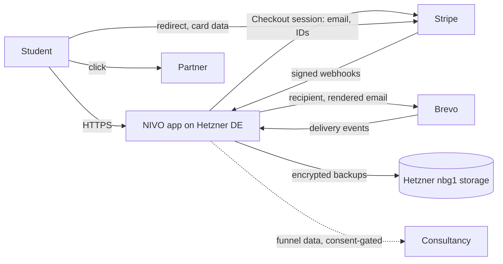

# Processor and Recipient Register

| Field | Value |
|-------|-------|
| Status | Review |
| Owner | NIVO management with counsel |
| Last updated | 2026-11-24 |
| Purpose | Single list of every third party that processes or receives personal data from NIVO, with the legal instrument, location and review status. Feeds RoPA (`ropa.md`) and the Privacy Policy |
| Rule | **No new processor, sub-processor or third-party script goes live without a row here, a signed DPA (where a processor) and an ADR if it changes CSP or the data flows** |

## 1. Processors (Art. 28 GDPR)

| # | Provider | Role | Service / module | Personal data | Location | Contract / DPA | Transfer mechanism | Sub-processors | Security evidence | Status |
|---|----------|------|------------------|---------------|----------|----------------|--------------------|----------------|-------------------|--------|
| 1 | Hetzner Online GmbH | Processor | Hosting: VMs, volumes, object storage (private buckets), firewall, backups storage (M01) | All platform data (encrypted at rest with keys held by NIVO; Hetzner has no keys) | Germany (fsn1 app/DB, nbg1 backups); Helsinki excluded (T-INFRA-024) | Hetzner AV-Vertrag (DPA) — sign via customer account before first production data | None (EU) | Per Hetzner list | ISO 27001 certificate; data centre parks in Germany | To sign |
| 2 | Stripe Payments Europe, Ltd. | Processor for checkout processing; **independent controller** for its own fraud, AML and regulatory obligations | Stripe Checkout, refunds, events (M04) | Email (prefill), name on card (entered at Stripe), payment method data (Stripe only), amount, metadata IDs (payment ID, user ID — no names) | Ireland; processing may involve Stripe Inc. (US) | Stripe DPA (Stripe Services Agreement, online acceptance) | EU–US DPF and SCCs per Stripe DPA | Per Stripe list | PCI DSS Level 1; NIVO scope SAQ A | To accept and archive PDF |
| 3 | Brevo (Sendinblue SAS) *(provisional, `GAP-EMAIL-PROVIDER`; alternative AWS SES eu-central-1)* | Processor | Transactional email delivery and delivery events (M11) | Recipient address, template-rendered content (names, links, invoice PDFs for receipts) | France / EU data centres | Brevo DPA | None if EU-only; confirm sub-processors | Per Brevo list | ISO 27001 | To sign when provider is confirmed |
| 4 | GitHub, Inc. (Microsoft) | Processor (limited) | Source hosting, CI (M01). **No student personal data** is stored there; developer account data only. Secrets are encrypted (SOPS) | Developer names, emails | US (EU option via GitHub Enterprise Cloud with data residency — not used) | GitHub DPA | DPF/SCC | Per GitHub | — | To sign; confirm no personal data in test fixtures (CI check) |
| 5 | Domain registrar / DNS provider *(to select)* | Processor | DNS, domain registration | Registrant contact (company) | EU preferred | DPA with provider | — | — | — | Select (`GAP-DNS-PROVIDER`) |
| 6 | Uptime monitoring (self-hosted Uptime Kuma) | — | Self-hosted on NIVO monitoring VM | None beyond operator emails | Germany | n/a (no external provider) | — | — | — | n/a |
| 7 | GlitchTip (self-hosted) | — | Error reports with scrubbing (no bodies/headers/emails) | Technical data, request IDs | Germany | n/a | — | — | `beforeSend` scrubber test T-INFRA-005 | n/a |
| 8 | Plausible Analytics EU *(Phase 2 option, `GAP-ANALYTICS`)* | Processor | Cookieless analytics, only after counsel confirms no § 25 TDDDG consent is needed, else consent-gated | Aggregated page views | EU | DPA | — | — | Not enabled at launch | Not used |
| 9 | Professional advisers (tax consultant, lawyer, auditor) | Processor / independent professional | Access to invoices, legal documents, audit extracts when engaged | Invoice data (name, amount), extracts as needed | Germany/EU | Engagement terms + confidentiality (§ 203 StGB for lawyers); DPA for tax software if used | — | — | — | To sign |

## 2. Independent controllers receiving data by the student's action or legal basis

| Recipient | Data they receive | Basis and notice | Contract / instrument |
|-----------|-------------------|------------------|-----------------------|
| Partners (blocked account, SIM, insurance, etc.) | Only what is in the tracked URL: NIVO referral code, opaque `public_ref`, `click_id`. The student then registers directly with the partner and gives their own data there | Student-initiated click, disclosure copy `partner.disclosure` shown next to every partner button | Partner agreement (referral/commission terms) — no personal data processing by NIVO on their behalf. If Phase 2 automation sends completion data back, a data-sharing clause is added (`GAP-PARTNER-LINKS`) |
| Accommodation agent (Roshan) | Name, email, phone, enquiry details | Student ticks explicit sharing consent in the enquiry form; agent is staff or contractor under NIVO (role `accommodation_agent`) | If external contractor: DPA / confidentiality clause (`GAP-ROSHAN`); if agency: independent controller notice |
| Consultancies | Pseudonymised funnel data; email/phone only with consent | Legitimate interest + consent per `consultancy-data-sharing.md` | Consultancy agreement incl. data-sharing and confidentiality clauses, required before activation (M10 rule) |
| Supervisory authorities, courts, tax authorities | As required by law | Art. 6(1)(c) | n/a |
| Stripe (own controller role) | See above | Art. 6(1)(c)/(f) | Stripe privacy notice referenced in Privacy Policy |

## 3. Data flow by processor (what leaves the NIVO platform)

## 4. Review procedure

| Step | Frequency | Owner |
|------|-----------|-------|
| Check each processor's current sub-processor list and security certificates | Every 6 months | Engineering |
| Confirm DPAs are signed and archived in the contracts folder | Before go-live; annually | Management |
| Verify no unregistered outbound destinations: CSP `connect-src 'self'`, egress allow-list on workers, `T-INFRA-031` | Every release | Engineering |
| Re-run transfer impact assessment when a processor changes location | On change | Counsel |
| Update Privacy Policy recipient list from this register | On change | Counsel + Engineering |

## 5. Onboarding checklist for a new processor

- [ ] Purpose, data categories and lawful basis defined; RoPA updated.
- [ ] DPA signed (Art. 28(3) terms) or contract with confidentiality clause.
- [ ] Location and transfer mechanism documented; TIA if non-EU.
- [ ] Minimisation reviewed: can the call carry IDs instead of PII? (`No PII in queue payloads` rule applies to jobs.)
- [ ] CSP/network impact assessed; ADR if CSP changes.
- [ ] Credentials stored in SOPS with rotation date in M01 table.
- [ ] Privacy Policy updated; cookie inventory updated if cookies/storage are involved.
- [ ] Incident contact recorded in `incident-response.md` sheet.
- [ ] Exit plan: how to export/delete data at contract end.

## 6. Open items

| ID | Item | Owner |
|----|------|-------|
| GAP-EMAIL-PROVIDER | Confirm Brevo vs SES eu-central-1 | Engineering |
| GAP-DNS-PROVIDER | Choose registrar/DNS and sign DPA | Founders |
| GAP-TRANSFER-STAFF | Remote access by non-EU staff (see RoPA §5) | Counsel |
| GAP-ROSHAN | Legal relationship of the accommodation agent (employee, contractor, agency) | Founders |
| GAP-STRIPE-ROLE | Counsel to confirm Stripe's processor vs controller split wording for the Privacy Policy | Counsel |
