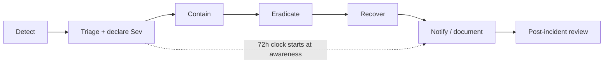

# Incident Response Plan

| Field | Value |
|-------|-------|
| Status | Review |
| Owner | NIVO UG management (Incident Lead) with Engineering on-call |
| Last updated | 2026-11-24 |
| Applies to | Security incidents and personal data breaches affecting the NIVO student platform (student, admin and consultancy hosts, workers, database, object storage, third-party processors) |
| Related | `docs/privacy/dsr-runbook.md`, `docs/privacy/ropa.md`, `docs/privacy/processor-register.md`, `docs/design/00-fmea.md`, M01 LLD (alerts, restore), M09 LLD (audit, alerts) |

## 1. Objectives

1. Contain harm to students quickly; protect identity documents above everything else.
2. Meet legal clocks: **GDPR Art. 33 — notify the supervisory authority within 72 hours** of becoming aware of a personal data breach (unless unlikely to result in a risk); **Art. 34 — notify affected students without undue delay** when the risk is high; **Art. 33(5) — document every breach**, even those not reported.
3. Preserve evidence (audit chain, logs, backups) so root cause and scope can be proven.
4. Learn: every Sev 1/2 ends with a blameless post-incident review and design/test changes (new `RISK-*`, new `T-*`).

Supervisory authority: Berliner Beauftragte für Datenschutz und Informationsfreiheit (NIVO UG is established in Berlin). Contact details and online reporting link are kept in the on-call sheet (`GAP-IR-CONTACTS`).

## 2. Roles

| Role | Who (initial) | Responsibilities |
|------|---------------|------------------|
| Incident Lead (IL) | Founder / managing director (Anoop Sai Tummula) | Declares severity, owns decisions, approves external communication, signs the authority notification |
| Technical Lead (TL) | Engineering on-call | Triage, containment, forensics, recovery |
| Second Super Admin | Co-founder (Abhishek) | Dual control for break-glass actions (rotating keys, suspending admins, restore) |
| Privacy contact / DPO function | External DPO or privacy counsel (`GAP-DPO`: decide whether a DPO must be appointed; likely not mandatory under § 38 BDSG for < 20 persons, but sensitive-data processing at scale is under review) | Breach risk assessment, authority and data subject notifications |
| Legal counsel | External lawyer | Contract and liability questions, consultancy / partner notifications |
| Communications | Founder | Student, consultancy, partner and press messaging |
| Scribe | Anyone not doing technical work | Timeline log (UTC), decisions, evidence list |

On-call: Engineering rotation by week; phone numbers in the sealed on-call sheet. Alert routes: Uptime Kuma, Prometheus Alertmanager → email + push to on-call; direct-SMTP fallback for backup/DB failures (M01).

## 3. Severity

| Sev | Definition | Examples | Response start | Target containment |
|-----|-----------|----------|----------------|--------------------|
| **Sev 1 — Critical** | Confirmed or highly likely exposure/alteration of identity data, payment integrity compromise, loss of control of admin plane, ransomware, unrecoverable data loss | Passport data downloaded by attacker; admin credentials stolen and used; audit chain break confirmed; encryption key leak; Stripe webhook secret leak with forged `paid` events | Immediately (≤ 15 min) | ≤ 4 h |
| **Sev 2 — High** | Likely personal data exposure of limited scope, successful attack without confirmed data loss, prolonged outage of payment or login | Consultancy cross-tenant read bug exploited once; credential stuffing causing account takeovers; webhook delivery down > 1 h | ≤ 30 min | ≤ 24 h |
| **Sev 3 — Medium** | Security weakness being actively probed or a contained control failure | Rate-limit bypass found; single-user account takeover with no data export; DLQ growing on retention jobs | ≤ 4 h (business hours) | ≤ 3 days |
| **Sev 4 — Low** | Minor, no data impact | Dependency CVE without exploit path; failed scan | Next working day | Sprint |

Rule of thumb: if identity documents or admin privileges are involved, start at Sev 1 and downgrade later.

## 4. Lifecycle

### 4.1 Detect (sources)

- Alerts: 5xx rate, DLQ > 0, backup stale, worker heartbeat missing, `identity_retention_overdue_count`, `audit_verify_failed`, `audit_write_failed`, reconciliation mismatches, webhook signature-failure spike, reveal/export velocity alerts (M09), new-device staff login alerts, failed-login spikes.
- Humans: students or admins reporting, pen-tester, security researcher (`security@` + `/.well-known/security.txt`), processor notifications (Stripe, Hetzner, Brevo).
- Audit chain verification hourly (M09): a mismatch is an automatic Sev 1 candidate.

### 4.2 Triage (first 30 minutes)

1. Scribe opens an incident record (`INC-YYYYMMDD-n`) with UTC timeline.
2. TL answers: what happened, since when, which systems, which data classes (Sensitive / Personal / Internal), how many students, is it ongoing.
3. IL assigns severity and **records the moment of awareness** (starts the 72 h clock).
4. Decide containment option (§5). Do not delete evidence.

### 4.3 Containment toolbox (fast actions that already exist)

| Action | How | Who can do it |
|--------|-----|---------------|
| Revoke all sessions of one user | M02 `session_epoch` bump / `POST /admin/auth/users/:id/sessions/revoke` | Super Admin (step-up) |
| Revoke all student sessions | Epoch bump for realm `student` (ops script, audited) | Two operators |
| Suspend an admin or consultancy user | M09 `admins.suspend` (instant, no approval) / consultancy suspend | Super Admin |
| Disable identity reveal/download | Feature flag `identity.reveal_enabled = false` (M09 settings, no approval needed to *reduce* access) | Super Admin |
| Pause uploads | Edge rule returning 503 for upload routes; ClamAV outage mode | Operator |
| Block an IP range / country | Caddy / Hetzner Cloud Firewall rule | Operator |
| Disable checkout | Setting `payments.checkout_enabled = false` | Super Admin |
| Rotate secrets | SOPS secret rotation runbook (Stripe, `TOKEN_HMAC_KEY`, `CSRF_HMAC_KEY`, `IP_HASH_KEY`, DB passwords); KEK rotation drill | Two operators |
| Consultancy lockdown | Suspend consultancy (M10) — removes shared contacts from view | Super Admin |
| Read-only mode | Maintenance mode flag at the edge (static page, API 503 except webhooks) | Operator |
| Isolate a VM | Hetzner firewall deny-all except operator IP; snapshot volume first | Operator |

### 4.4 Eradicate and recover

- Patch root cause behind a failing test written first (TDD).
- Rebuild affected hosts from the signed image and OpenTofu stack rather than repairing in place when compromise of the host is suspected.
- Restore data only from backups verified clean; after any restore from backup, **run `identity.ledger.replay`** (M05) so deleted identity records are not resurrected, and re-run the audit chain verification.
- Rotate every secret that touched the compromised system.
- Re-enable features gradually; keep heightened monitoring for 14 days.

## 5. Playbooks

### P1 — Suspected account takeover wave (credential stuffing)

Signals: spike in `AUTH_INVALID_CREDENTIALS`, `auth.lockout.triggered`, successful logins from new IP ranges, password-reset volume.
Steps: tighten IP and email rate limits (M01 settings), enable temporary CAPTCHA-free throttle (progressive delays), force password reset for confirmed compromised accounts (epoch bump + reset email), notify affected students (`auth_password_changed` equivalent), check whether any account exported/revealed identity data (`identity_access_log`), review payments for anomalies.
Notify authority only if data access by unauthorised persons is confirmed.

### P2 — Identity data exposure (Sev 1)

Signals: reveal/download alerts, object storage access from unexpected principal, DB snapshot leak, KEK exposure.
Steps: freeze reveal/download; revoke sessions of implicated actors; snapshot logs and `audit_log` ranges; determine record count via `identity_access_log` and storage access logs; if KEK exposed, rotate KEK and re-wrap DEKs (`identity.kek.rewrap`) — **ciphertext in leaked backups remains decryptable with the leaked KEK**, so treat as full exposure of those records; notify authority ≤ 72 h and **all affected students** (high risk: passport data); offer guidance (monitor misuse of passport copy, report to issuing authority); consider offering support for passport replacement costs (management decision).

### P3 — Malicious admin / insider

Signals: velocity alerts, SOD warning breaches, `approvals:emergency_override` use outside business need, exports without matching tickets.
Steps: suspend admin (instant), revoke sessions, preserve audit slices (signed export `audit:export`), review all approvals where the actor was requester/approver, rotate secrets the person knew, HR/legal handling, notify per P2 if identity data was taken.

### P4 — Payment integrity / Stripe compromise

Signals: webhook signature failures, `paid` payments without matching Stripe session, amount mismatches, unexpected refunds.
Steps: disable checkout, rotate `STRIPE_WEBHOOK_SECRET` and restricted API key in Stripe dashboard first, list Stripe events for the window and replay through the verified processor only, run reconciliation (`payments:reconcile`), review entitlements granted in window, invoice/credit-note corrections, inform Stripe if their systems are implicated.

### P5 — Malware upload / AV failure

Signals: ClamAV detections spike, `identity.file.scan.dead` DLQ, sandbox worker anomalies.
Steps: pause uploads, keep files in quarantine (never promoted), snapshot sandbox worker, update signature DB, rescan queue, verify sandbox has no egress (T-ID-063), contact affected students.

### P6 — Consultancy data leakage or cross-tenant exposure

Signals: RLS test failure in CI/prod canary, consultancy reports unexpected rows, shared contacts present after withdrawal.
Steps: suspend all consultancy access, query access logs for `consultancy_id` mismatches, determine rows seen, delete shared contacts, notify authority and affected students if personal data was visible to the wrong consultancy; notify the consultancies involved under the data-sharing agreement (`docs/privacy/consultancy-data-sharing.md`).

### P7 — Ransomware / destruction of data

Steps: isolate hosts, preserve disks, restore on fresh infrastructure from pgBackRest (RPO ≤ 5 min, RTO ≤ 4 h), run `identity.ledger.replay`, verify audit chain and anchors (object-locked checkpoints), rotate all secrets, treat as breach if exfiltration cannot be ruled out.

### P8 — Key loss (availability breach)

Signals: key canary mismatch, identity decrypt failures.
Steps: restore key from sealed dual-custody escrow (2-of-3 Shamir), verify canary; if unrecoverable, identity data is permanently lost — Art. 33 notification (availability), ask affected students to resubmit (cards already latched stay unlocked).

### P9 — Third-party processor incident (Stripe, Hetzner, Brevo)

Steps: collect processor statement, identify our data at risk (processor register), assess whether we became aware of a breach, notify authority within 72 h of our awareness when personal data is affected, communicate with students if risk is high.

### P10 — Email provider misuse / phishing using NIVO brand

Steps: verify SPF/DKIM/DMARC alignment, publish warning banner, rotate email API key, review `email_outbox` for unexpected templates, request takedown for lookalike domains.

## 6. Breach risk assessment (Art. 33/34)

| Question | Notes |
|----------|-------|
| Categories of data | Identity (passport, parents, addresses, signature), payment metadata, contact data, credentials (hashes), progress data |
| Number of data subjects and records | From `identity_access_log`, auth logs, storage logs |
| Nature of breach | Confidentiality / integrity / availability |
| Likelihood and severity of harm | Identity theft, fraud, discrimination, loss of confidentiality of immigration information — treat identity-document breaches as **high risk** by default |
| Mitigations already in place | Encryption (with key not compromised?), masking, short-lived URLs |
| Decision | Notify authority (Y/N) and why; notify students (Y/N) and why |
| Approval | IL + privacy contact; recorded with timestamp |

Authority notification content (Art. 33(3)): nature of breach, categories and approximate numbers, contact point, likely consequences, measures taken. May be phased (initial notice, then supplements).

Student notification (Art. 34(2)): plain language, what happened, what data, likely consequences, what we did, what they should do, contact. Sent via M11 template `incident_notice` (code-managed, reviewed by counsel) — no attachments, no tracking pixels, no links other than to our status/help page.

## 7. Communication

| Audience | Channel | Owner | When |
|----------|---------|-------|------|
| Internal team | Incident chat/bridge | TL | Immediately |
| Supervisory authority | Online breach form | IL / privacy contact | ≤ 72 h from awareness |
| Affected students | Email + in-app banner | IL | Without undue delay once high risk established |
| Consultancies | Email per agreement | IL | If their data or their students are affected |
| Partners | Email | IL | If partner links/data affected |
| Processors | Per DPA | TL | When they are the source or must act |
| Public / press | Statement page | IL | Only if required or inevitable |

No speculation in external messages. Facts, timestamps, actions.

## 8. Evidence handling

- Preserve: `audit_log` ranges (with chain verification output), `identity_access_log`, application logs (redacted by design), Caddy access logs (14-day retention — export immediately), object-storage access logs, DB snapshots, container images.
- Export audit slices via `audit:export` (signed CSV + chain proof). Hash every evidence file (SHA-256) and list in the incident record.
- Chain of custody: who accessed what, when. Store in a restricted bucket (object-locked) separate from production credentials.

## 9. Post-incident review (within 5 working days for Sev 1/2)

Template: summary, timeline (UTC), impact, detection (how, how long), root cause, what went well/badly, corrective actions (owner, due date, linked `GAP-*`/`RISK-*`/`T-*`), documentation updates (FMEA, threat model, ROPA, DPIA), decision on regulator communication, training needs. Action items tracked until closed; open items reported at monthly security review.

## 10. Exercises and readiness

| Exercise | Frequency | Evidence |
|----------|-----------|----------|
| Tabletop: identity breach (P2) | Before launch and twice yearly | Report in `docs/qa/` |
| Restore drill + ledger replay | Monthly (M01 T-INFRA-040) | `ops_restore_drills` |
| KEK rotation drill | Quarterly (T-INFRA-041) | Audit events |
| Alert test (page the on-call) | Quarterly | Alert log |
| Contact sheet review | Quarterly | Updated sheet |
| Admin break-glass rehearsal (`GAP-ADM-BREAKGLASS`) | Before launch | Runbook signed |

## 11. Open items

| ID | Item | Owner |
|----|------|-------|
| GAP-IR-CONTACTS | Fill on-call sheet, authority contact, counsel, DPO | Founders |
| GAP-DPO | Decide on appointing a data protection officer | Founders + counsel |
| GAP-IR-STATUSPAGE | Public status page and student notice template | Engineering |
| GAP-IR-INSURANCE | Cyber insurance coverage and notification duties | Founders |
